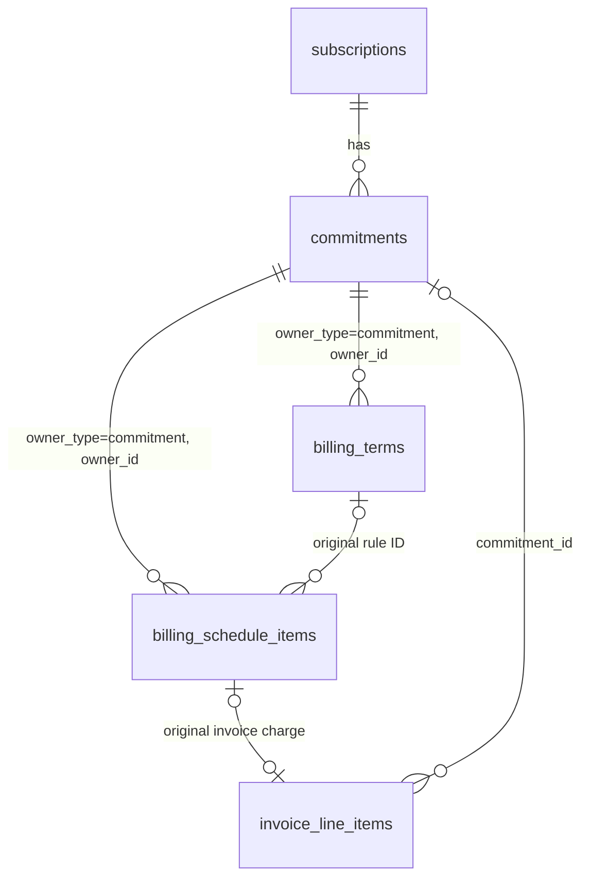

# FLE-1513 — Commitments & Billing Terms (ERD)

- **Ticket:** [FLE-1513](https://linear.app/flexprice/issue/FLE-1513/erd-commitments-revamp) · Linear doc: [Commitment Revamp](https://linear.app/flexprice/document/commitment-revamp-f4e4242a0c8b)
- **Scenarios:** [2026-10-07-FLE-1513-commitments-scenarios.md](./2026-10-07-FLE-1513-commitments-scenarios.md): every supported situation, how to set it up, and what gets invoiced.
- **Date:** 2026-10-09 · Status updated 2026-10-28
- **Implementation plan:** [2026-10-27-FLE-1513-billing-terms-implementation-plan.md](./2026-10-27-FLE-1513-billing-terms-implementation-plan.md)
- **Tenant API contract:** [Billing Terms API Contract](./2026-10-28-FLE-1513-billing-terms-api-contract.md), including create/inline create, editing, invoice correction and same-API cost explorer.
- **Author:** Ankit Malik
- **Status:** Phase 1 (commitments, `per_period`) shipped — PRs #3211, #3212, #3214, #3215. Billing terms (§7) designed, not implemented. §0.1 lists what shipped and where it differs from this document.

---

## 0. Summary

- **Commitments become their own entity on a subscription.** A commitment says how usage in a scope is priced: usage up to a capacity is billed at a committed rate, and usage beyond it at an overage rate.
  - Capacity is checked per billing period, or per minute (or any other bucket).
  - It can be limited to certain times of day.
  - Commitments on the same usage stack in priority order.
- **A binding commitment is owed in full whether or not it is used.** That money is collected by one of two methods:
  - `per_period` (default, same as today): each period's invoice bills usage within the commitment at the committed rate, plus a **true-up** line for the unused part.
  - `billing_terms`: the commitment value is billed only through **instalments**, built from billing terms such as "$300 upfront, the rest monthly in arrears". Period invoices show usage within the commitment at $0 ("covered by commitment") and never include a true-up.
- **Billing terms are persisted invoicing rules, independent of Prices.** Each rule is `once` or `recurring`, with a fixed amount or a remainder. The owner holds the contractual total, dates, currency and delivery setting.
- **`billing_schedule_items` are the executable charges generated by those rules.** They hold exact amounts, bill dates, resolved service periods and invoice claims. Instalments remain a product term; there is no separate `billing_instalments` table.
- **Rules can be amended through preview and save.** Archive the entire old rule/schedule set and create fresh upcoming items with new source IDs. Invoice references remain historical; only the current published schedule is executable. New billable items allocate the amount not retained on live invoices. Voiding an invoice cancels its charge rather than reviving it; any released, unallocated principal requires replanning before this commitment collects again.
- **Billing terms and schedule items are owner-agnostic.** They use `owner_type` / `owner_id`. Commitments are the only owner in v1; other entities can adopt the same tables later.

- **There is no ledger in v1.** Collection summaries are derived from items/invoices. Recognition and deferred revenue are supplied by performance obligations separately.

---

## 0.1 Implementation status (2026-10-26)

Phase 1 shipped behind the `commitments_v2` environment setting as PRs [#3211](https://github.com/flexprice/flexprice/pull/3211) (engine), [#3212](https://github.com/flexprice/flexprice/pull/3212) (service), [#3214](https://github.com/flexprice/flexprice/pull/3214) (billing) and [#3215](https://github.com/flexprice/flexprice/pull/3215) (API + inline creation).

**Shipped**

- The `commitments` table, the pure allocation engine (`commitment_engine.go`), the loader (`billing_commitments.go`), and period/window maths (`commitment_periods.go`); usage is read from `meter_usage` only (the raw-events read path was removed).
- CRUD + preview + search + terminate API, inline creation on `CreateSubscriptionRequest.commitments[]` (subscription scope and `subscription_id` filled server-side; price scopes follow price overrides; runs after all line items exist), per-subscription idempotency keys backed by a partial unique index over published rows.
- Amount and quantity commitments; `billing_period` and `window` measurement; `active_windows` with timezone; stacking by priority; binding floors with true-up; mid-period starts and terminations prorate and clip their floors.
- Webhooks `commitment.created` / `.updated` / `.terminated`, with `created` cascading to `subscription.updated`; activity-log entries.

**Differences from this document**

- `committed_rate` / `overage_rate` decimals became **price objects** (`committed_price`, `overage_price`: billing_model, amount, tiers, tier_mode, transform_quantity). A committed price must be FLAT_FEE or TIERED-SLAB; VOLUME is rejected because it breaks the binding floor. Every derived amount applies the whole price: period amount = cost(capacity), within = cost(total used) split across lines, overage = custom price over the on-demand total.
- On-demand remainders bill the **marginal** cost beyond covered units — cost(full) − cost(full − od), per window for bucketed prices. VOLUME-tiered and PACKAGE line prices price the remainder fresh instead, matching entitlement remainders.
- Terminate takes `{effective_at?, cancellation_fee?}` only — a flat fee billed on an immediate ONE_OFF invoice with the PRORATION billing reason. `bill_remaining`, percent fees and `on_early_termination` are **not** in v1; nothing writes a `cancellation_fee_amount` column.
- Entitled meters are **rejected** in commitment scope (stricter than legacy, which applied entitlements before commitment math); revisit at legacy migration. WEEK/MONTH-bucketed and group-by-bucketed prices are rejected for window measurement.
- Nothing sets `commitment_status = ended` in phase 1; terminated commitments stay binding through the end of the billing period containing the cutoff.

**Pending**

- **Billing terms (§5.2, §5.3, §7): designed, not implemented; schema simplified 2026-10-28.** No `billing_terms` / `billing_schedule_items` tables exist; `collection_method`, `total_amount` and the dormant `instalment_invoicing` field are stored. Keep that existing column and its Go mappings; the proposed `invoice_delivery` request field maps to it. Only `per_period` currently works; stored fields do not imply implemented scheduled collection. Phase-2 contract: `docs/design/2026-10-28-FLE-1513-billing-terms-api-contract.md`.
- Utilisation and instalment endpoints (§9.6, §11), revenue rollup and analytics (§9).
- Before un-gating for a raw-events tenant: tag raw-path charges with `subscription_line_item_id` (line items sharing a price double-count usage on that path); guard entitlements added after a commitment exists (plan change / addon features).
- Legacy commitment migration (§10, rollout phase 4).

---

## 1. Problem

Today a commitment is a set of fields on other entities:


| Where                  | Fields                                                                                                                                                                     | Limits                                                                                                               |
| ---------------------- | -------------------------------------------------------------------------------------------------------------------------------------------------------------------------- | -------------------------------------------------------------------------------------------------------------------- |
| Subscription           | `commitment_amount`, `commitment_duration`, `overage_factor`, `enable_true_up`                                                                                             | One per subscription. Silently off when `overage_factor = 1` (`Subscription.HasCommitment`). Excludes fixed charges. |
| Subscription line item | `commitment_amount`, `commitment_quantity`, `commitment_type`, `commitment_overage_factor`, `commitment_true_up_enabled`, `commitment_windowed`, `commitment_time_buckets` | One price only. `commitment_duration` is stored but never billed. Time-of-day buckets are UTC only.                  |


What this blocks:

1. **Committed money can only be billed per period, in arrears.** "$300 upfront and the rest monthly" and "30% at signing, 50% mid-term, the rest at the end" can't be billed.
2. **No pooling** across a chosen group of prices.
3. **No stacking and no separate reserved rate.**
  - 8 GPUs reserved 24×7 at $0.048/GPU-min;
  - 32 more GPUs 9am–9pm IST from 25 Aug at $0.0491667;
  - usage above both, on demand at $0.06.
   A single overage multiplier cannot express this.
4. **True-up lines use made-up prices.** They carry a generated `price_id` that matches no stored price, so revenue reporting can't attribute them.
5. **No per-commitment breakdown** of reserved used, reserved unused and on-demand.


## 2. Goals and non-goals

**Goals (v1)**

- A `Commitment` entity with its own API, lifecycle and audit trail.
- **Scope:** subscription, price group, meter or price.
- **Pricing:** amount or quantity commitments, with a committed price and an overage price.
- **Measurement:** per billing period or per bucket, time-of-day windows, and stacking.
- Binding and non-binding commitments.
- **Collection methods:** `per_period` (true-up on each invoice) and `billing_terms` (instalments).
- **Billing terms** covering upfront, partial upfront, recurring at any interval (advance or arrear), deposits, payment holidays, milestones (dated or triggered), ramps and fully custom plans.
- **Instalments:**
  - a preview before creation;
  - delivery on the subscription invoice or as separate invoices;
  - archive-and-replace rule amendments, re-plan and bring-forward through the same amendment flow, and milestone triggering.
- Initial phase-2 termination preserves the shipped request and default policy, including a flat cancellation fee. The additional policy variants below are a future contract extension.

**Non-goals (v1)**

- **Renewal.** A follow-on contract is a new commitment.
- **Term-cumulative commitments:** one check over the whole term, with an end-of-term true-up.
- **Prepaid drawdown commitments:** a balance that pays for any usage, with rollover. These need a ledger.
- **A payment ledger.**
- **Billing terms on owners other than commitments.** The design supports it (§7.9); building it is phase 5.
- **Mixing amount and quantity commitments on the same usage** (C14).
- **Commitment templates** on plans and addons, and **carrying commitments across a plan change**.
- **Migrating legacy commitments** (phase 4).
- **Attributing reserved capacity to sources** (e.g. per deployment). This is an analytics / revenue-recognition setting and is out of scope here. Invoice totals never depend on it.


## 3. Concepts


### 3.1 How a commitment is priced and collected

```
                                 Commitment
        ┌─────────────────────────────┴──────────────────────────────┐
  How usage is priced                                  How a binding commitment's value is collected
  scope · capacity · windows · priority                collection_method
  committed price · overage price                         │
        │                                    ┌────────────┴─────────────┐
        │                              per_period                  billing_terms
        ▼                              (default)                        │
  On each period's invoice:            within → committed rate      billing_terms rows
    beyond the commitment → on-demand  unused → true-up line            │ expand
    within → see the two methods  ───▶                              billing_schedule_items
                                                                    within → $0 "covered"
                                                                    no true-up
```

A non-binding commitment has no collection method. Usage within it is billed at the committed rate, and unused capacity costs nothing.

### 3.2 Key terms


| Term                                | Meaning                                                                                                                                                                                                                                                                                                                                          |
| ----------------------------------- | ------------------------------------------------------------------------------------------------------------------------------------------------------------------------------------------------------------------------------------------------------------------------------------------------------------------------------------------------ |
| **Billing period / boundary**       | The subscription's own invoice period, e.g. 1 Mar–1 Apr on a monthly subscription anchored on the 1st. A *boundary* is the moment one period ends and the next begins. At each boundary, Flexprice issues a subscription invoice carrying the **arrear** charges of the period that ended and the **advance** charges of the period that starts. |
| **Term**                            | `[start_date, end_date)` of a commitment. Both are required.                                                                                                                                                                                                                                                                                     |
| **Commitment period**               | A billing period clipped to the term. A term starting 25 Aug on a monthly subscription has a first period of 25 Aug–1 Sep.                                                                                                                                                                                                                       |
| **Measurement window**              | Where capacity is checked: the whole commitment period, or one bucket of the scoped bucketed price (e.g. one minute).                                                                                                                                                                                                                            |
| **Committed price / overage price** | The rate for usage within the commitment (the "reserved rate"), and the rate for usage beyond it (the "on-demand rate"). The overage price defaults to the line item's own price.                                                                                                                                                                |
| **Binding / non-binding**           | Binding: the full commitment is owed. Non-binding: a discounted rate with no obligation.                                                                                                                                                                                                                                                         |
| **Period amount**                   | What one commitment period's commitment is worth in money (§6.3).                                                                                                                                                                                                                                                                                |
| **Commitment value**                | The sum of all period amounts in the term. Always computable from the commitment's immutable fields. Returned by the API as `commitment_value`.                                                                                                                                                                                                  |
| `total_amount`                      | A snapshot of the commitment value, stored only when `collection_method` is `billing_terms`. The instalments were generated against it and must keep adding up to it (D19).                                                                                                                                                                      |
| **True-up**                         | `per_period` only: the unused part of a period's commitment, billed on that period's invoice.                                                                                                                                                                                                                                                    |
| **Billing term**                    | One immutable persisted invoicing rule: how part of an obligation becomes one or more scheduled charges (§7).                                                                                                                                                                                                                                                                              |
| **Remainder**                       | A billing term whose amount is not given. It is the computed unassigned budget minus its fixed rows. The allocation is the whole total at creation, and the unassigned amount (including any correction gap) at amendment.                                                                                                                                                                                              |
| **Instalment**                      | One concrete charge generated from billing terms and stored in `billing_schedule_items`; it may await a milestone rather than have a date.                                                                                                                                                                                                                                                                                                   |
| **Advance / arrear**                | On a recurring billing term: `advance` bills each step at its **start**, and `arrear` bills it at its **end**. Same meaning as `invoice_cadence` on line items today.                                                                                                                                                                            |
| **Step**                            | One instalment's span in a recurring row: `interval_count × interval`, e.g. 1 × QUARTERLY = 3 months.                                                                                                                                                                                                                                            |
| **Billed / earned / deferred**      | Billed = commitment money invoiced. Earned/recognized and deferred revenue come from performance obligations, separately from billing terms (§9).                                                                                                                                                                                                                         |
| **Usage value vs billed amount**    | Usage value is what usage was worth under the commitment (used, unused and on-demand, at committed and overage rates). Billed amount is what was actually invoiced in a period. They are equal under `per_period` and differ under `billing_terms` (§9).                                                                                         |
| **Assigned amount** | Sum of schedule-item principal amounts claimed by live invoices, including drafts and unpaid invoices. Used to protect charges during amendments; distinct from payments received and financial billed revenue. |
| **Payment terms**                   | Not used here. In finance this means an invoice's due date (Net 30), which existing invoice settings already handle.                                                                                                                                                                                                                             |


## 4. Decisions


### Commitments


| #   | Decision                                                                                                                                                                                                                                                                                                                                                                                                                                                                       | Why                                                                                                                                                                                                                 |
| --- | ------------------------------------------------------------------------------------------------------------------------------------------------------------------------------------------------------------------------------------------------------------------------------------------------------------------------------------------------------------------------------------------------------------------------------------------------------------------------------ | ------------------------------------------------------------------------------------------------------------------------------------------------------------------------------------------------------------------- |
| D1  | Scope is two columns: `scope_entity_type` (subscription, group, meter or price) and `scope_entity_id`. A group must be a price group. A subscription scope covers every usage price on it, including prices added later. Fixed charges are never in scope.                                                                                                                                                                                                                     | Price groups already model "several prices". Feature groups are deferred.                                                                                                                                           |
| D2  | A quantity commitment's scope must resolve to exactly one meter.                                                                                                                                                                                                                                                                                                                                                                                                               | A quantity needs a single unit.                                                                                                                                                                                     |
| D3  | `measurement` is `billing_period` or `window`. A window is one bucket of the scoped prices (`price.ResolveBucketSize`); all scoped prices must resolve to the same bucket size.                                                                                                                                                                                                                                                                                                | Reuses the existing bucketed-usage path.                                                                                                                                                                            |
| D4  | `active_windows` is a list of time ranges in `timezone` (defaulting to the subscription's), all sharing one capacity and rate.                                                                                                                                                                                                                                                                                                                                                 | One rate per commitment.                                                                                                                                                                                            |
| D5  | Commitments stack as a **waterfall**. In each window, usage fills the active commitments in `priority` order (lowest number first; ties go to the earlier `start_date`, then the lower `id`). Each commitment is filled to its capacity before the next one receives anything. Example: two 10-GPU commitments with usage of 15 leaves the first fully used (10 of 10), the second 50% used (5 of 10), and no on-demand. Pro-rata filling across commitments is not supported. | Deterministic and easy to explain. It lets the tenant decide which reservation is consumed first, e.g. the cheaper one.                                                                                             |
| D6  | Commitments that overlap in time and share a usage line item must have the same `type` and `measurement`.                                                                                                                                                                                                                                                                                                                                                                      | Stacking hands units from one commitment to the next. Money and units, or minutes and periods, can't be combined in a defined order.                                                                                |
| D7  | Rates: `committed_price_id`, and `overage_price_id` (NULL means the line item's own price). New commitments don't use `overage_factor`. A custom overage price needs a single-meter scope.                                                                                                                                                                                                                                                                                     | Explicit and auditable.                                                                                                                                                                                             |
| D8  | `end_date` is required and never after the subscription's `end_date`. Both `start_date` and `end_date` may be mid-period (revised 2026-10-27: the original billing-boundary alignment was dropped — termination had already built the partial-floor machinery, and contracts like "exactly one year from a mid-period start" need mid-period ends). The final partial period prorates its floor; the commitment occupies its last billing period for overlap checks.                                                                                                                                                                                                                                                                                                             | No contract is truly open-ended.                                                                                                                                                                                    |
| D9  | No renewal in v1.                                                                                                                                                                                                                                                                                                                                                                                                                                                              | Smaller v1. A follow-on contract is a new commitment.                                                                                                                                                               |
| D10 | A commitment's economics are immutable: scope, type, value, rates, measurement, windows, priority, contractual dates, currency, binding, collection method, delivery and `total_amount`. Labels and metadata remain editable. Billing terms have their own archive-and-replace editing flow (§7.8), which only redistributes unassigned money. | Changing collection timing does not reprice the commitment or rewrite an invoice. |


### Collection


| #   | Decision                                                                                                                                                                                                                                                                                                                                                                                                                              | Why                                                                                                                                                                                                                             |
| --- | ------------------------------------------------------------------------------------------------------------------------------------------------------------------------------------------------------------------------------------------------------------------------------------------------------------------------------------------------------------------------------------------------------------------------------------- | ------------------------------------------------------------------------------------------------------------------------------------------------------------------------------------------------------------------------------- |
| D11 | A binding commitment has `collection_method` `per_period` (default) or `billing_terms`, all-or-nothing. `per_period`**:** within-commitment usage at the committed rate plus a true-up on every period's invoice; no instalments. `billing_terms`**:** the money comes only through instalments; within-commitment usage at $0; **the true-up is never calculated** (the engine still finds the unused capacity, for analytics only). | A period's commitment is paid in exactly one place.                                                                                                                                                                             |
| D12 | A `per_period` true-up line is priced at the committed price for quantity commitments. For amount commitments it is a fixed line with no price, tagged with `commitment_id`.                                                                                                                                                                                                                                                          | Fixes the made-up price IDs on today's true-up lines.                                                                                                                                                                           |
| D13 | Within-commitment usage refers to its owner, not to a payment as proof of coverage. Invoice charge lines retain their exact schedule-item/rule source IDs. Schedule service periods are informational snapshots; they are not recognition instructions. | Performance obligations own recognition; source provenance remains auditable. |
| D14 | `invoice_delivery` is a commitment-level setting, used only with `billing_terms`. `subscription_invoice` (default) uses the next subscription boundary. `separate_invoice` creates a `ONE_OFF` per due current item. Explicit corrections with no future subscription boundary use separate delivery (§7.7).                                                                                                                                                                | Tenants choose between one invoice per period and collecting on an exact date.                                                                                                                                                  |
| D15 | The commitment value is never stored for `per_period`; it is computed when needed (API response, termination). For `billing_terms`, `total_amount` stores it as a snapshot at creation.                                                                                                                                                                                                                                               | The value can always be derived from immutable fields. The snapshot keeps schedule items consistent with the value they were generated from, even if the period-amount calculation is ever corrected (e.g. a DST or rounding fix). |


### Billing terms and instalments


| #   | Decision                                                                                                                                                                                                                                                                                                                                                                                                                                                | Why                                                                                                                                          |
| --- | ------------------------------------------------------------------------------------------------------------------------------------------------------------------------------------------------------------------------------------------------------------------------------------------------------------------------------------------------------------------------------------------------------------------------------------------------------- | -------------------------------------------------------------------------------------------------------------------------------------------- |
| D16 | Persist billing rules and concrete schedule items, using existing BaseMixin published/archived status. Current rules are the owner's published rows; old immutable definitions remain addressable by ID. No parent schedule or stored revision counters. | Archive plus stable IDs supplies the required audit history without a version model. |
| D17 | A row is `once` or `recurring`. A `once` row has `bill_on` (a date) or `on_trigger`. A `recurring` row has `start_date` / `end_date` (boundary dates), `interval` + `interval_count`, and `bill_at` (advance or arrear). A fully custom plan is a list of `once` rows.                                                                                                                                                                                    | One meaning per field. Each row reads on its own.                                                                                            |
| D18 | Fixed is an amount per occurrence; a remainder is the unassigned collection budget minus all fixed occurrences in the submitted rules. At most one remainder row. Percent input always uses original total and is normalized to fixed money. | The budget is computed in the service, not repeated on each rule. |
| D19 | For an active or naturally ended owner, assigned principal across published and archived history plus currently published scheduled principal plus unallocated principal equals `total_amount`. A valid replacement plan allocates the whole unassigned budget and leaves no gap. A later invoice void may create a gap; both delivery paths pause this commitment until it is replanned. Taxes, discounts, payments and credits do not silently enlarge the budget. | Invoice history remains valid while missing allocation is visible and cannot trigger obsolete charges. |
| D20 | A recurring row's `interval × interval_count` must be a whole multiple of the subscription's billing period. The default (the subscription's period × 1) is stored on the row.                                                                                                                                                                                                                                                                          | Steps line up with invoices.                                                                                                                 |
| D21 | Presets (`upfront`, `partial_upfront`, `spread`) are API shorthand only, expanded into rows before saving.                                                                                                                                                                                                                                                                                                                                              | One storage format.                                                                                                                          |
| D22 | Create and edit previews use the same normalization/expansion as saving. Edit preview returns the full old set to archive, retained invoices, proposed items and a computed state_token. No preview or version state is stored. | Reviewable changes and stale-edit detection do not require database version columns. |
| D23 | `on_trigger` instalments wait for an API trigger. If never triggered, they are billed at term end.                                                                                                                                                                                                                                                                                                                                                      | "50% at go-live".                                                                                                                            |
| D24 | An edit archives all published rules/items and inserts fresh rules/upcoming items atomically. Invoice-assigned historical principal and source IDs remain unchanged; old unclaimed items are canceled. | Published status defines the current executable set. |
| D25 | Invoice/owner/item locking, conditional claims and unique source bindings protect both delivery paths. Void cancels/archives its item permanently; unallocated principal requires explicit replanning. | No archived charge is revived or collected twice. |
| D26 | Rules and items use deterministic date/created_at/ID ordering. Input indexes are validation locations, not persisted business order. | These rules have no priority semantics requiring a position column. |
| D39 | Serialize mutations with owner locks and compare a computed state_token from preview against current authoritative state. No stored counter, request hash or revision marker is required. Identical current plans are no-ops; stale plans conflict. | Retains concurrency protection while trimming the schema. |
| D40 | No coverage overrides on rules. Once items snapshot the owner's start/end; recurring items snapshot their step. Proportional collection splitting uses elapsed step duration only. | Neither service-period display nor splitting imports performance-obligation logic. |

### Lifecycle and accounting


| #   | Decision                                                                                                                                                                                                                                                                                                                                                                                                                                           | Why                                                                                                                                                                                                                                                 |
| --- | -------------------------------------------------------------------------------------------------------------------------------------------------------------------------------------------------------------------------------------------------------------------------------------------------------------------------------------------------------------------------------------------------------------------------------------------------- | --------------------------------------------------------------------------------------------------------------------------------------------------------------------------------------------------------------------------------------------------- |
| D27 | Termination determines retained contractual principal and settlement through the owner. V1 preserves the current default/flat-fee request; credit-note/bill-remaining policy inputs remain future extensions. Accrued contractual principal is distinct from recognized revenue. | Collection settlement must not define a performance-obligation recognition policy. |
| D28 | Plan change and subscription cancellation terminate commitments under their own rule.                                                                                                                                                                                                                                                                                                                                                              | Carry-over is deferred.                                                                                                                                                                                                                             |
| D29 | Recognition follows performance obligations. Collection dates, amounts and schedule service periods do not define earned revenue or a recognition curve. An owner may supply its term to the recognition system independently. | An upfront invoice does not itself determine how revenue is spread. |
| D30 | No ledger in v1 (§9).                                                                                                                                                                                                                                                                                                                                                                                                                              | Commitments are not drawn down by usage.                                                                                                                                                                                                            |
| D31 | Commitment invoice lines carry `commitment_id` and `commitment_line_kind`. Instalment lines also carry `billing_schedule_item_id`, `entity_type=commitment`, `entity_id`, and no price.                                                                                                                                                                                                                                                               | Every line can be traced to its commitment.                                                                                                                                                                                                         |
| D32 | Create is idempotent via `idempotency_key`.                                                                                                                                                                                                                                                                                                                                                                                                        | Safe client retries.                                                                                                                                                                                                                                |
| D33 | Legacy commitment fields and new commitments never price the same usage (C15, C16).                                                                                                                                                                                                                                                                                                                                                                | Two engines never price one usage.                                                                                                                                                                                                                  |
| D34 | Commitment usage analytics come from the allocator; billed amounts come from invoices; recognized revenue comes from performance obligations. | Three different measures must not be inferred from the payment schedule. |
| D35 | Usage dashboards read usage value; current bills, spend alerts and wallet pending charges read billed/collectible amounts; recognition reports read performance obligations. | Collection and recognition remain independent. |
| D36 | **On-demand belongs to the stack, not to a commitment.** Usage becomes on-demand only after every active commitment in that window is full. Its rate is the overage price, which all commitments that overlap on the same usage must agree on (C20): either all NULL (the line item price) or the same price. On-demand quantities are attributed to the price and meter, and to the scope shared by the stack, never to an individual commitment. | A commitment that has been filled has no overage of its own: its excess flows to the next commitment. Requiring one overage price per stack removes any ambiguity about which commitment's overage applies.                                         |
| D37 | Each commitment has `name` (shown in the dashboard and API), `invoice_label` (the invoice line title) and an optional `invoice_description` (the line's second row). All three can be edited and apply to invoices generated afterwards.                                                                                                                                                                                                           | Tenants control exactly how commitments read on invoices, e.g. "1× H100 reserved GPU" with "8 GPUs reserved at $2.88/hr (744 hrs/GPU)".                                                                                                             |
| D38 | Commitment utilisation and cost-explorer style views are served from **revenue facts**, which hold the engine's allocation per commitment, price and time bucket. The events / meter-usage analytics API keeps serving raw quantities and does not split usage by commitment (§9.6–9.7).                                                                                                                                                           | Whether a unit of usage is within a commitment or on-demand depends on all other usage in the same window and on the stack order. It cannot be decided per event, so splitting it in the events API would mean reimplementing the allocator in SQL. |


## 5. Data model




All new tables use `BaseMixin` (`tenant_id`, `status`, `created_*`, `updated_*`) and `EnvironmentMixin` (`environment_id`). Every query filters on both `tenant_id` and `environment_id`.

### 5.1 `commitments` (prefix `cmt`)

> **Shipped:** keep the dormant `instalment_invoicing` column in Ent and `migrations/versioned/postgres/20261022120000_create_commitments.sql`, together with its existing Go mappings. `invoice_delivery` is the proposed request name and maps to that storage field; no column-rename migration is in scope. No billing-term version columns exist in the checkout. Other phase-1 deltas remain in §0.1.

| Column                 | Type          | Null | Meaning                                                                                                                                                                                                                             |
| ---------------------- | ------------- | ---- | ----------------------------------------------------------------------------------------------------------------------------------------------------------------------------------------------------------------------------------- |
| `id`                   | varchar(50)   | no   | `cmt_…`                                                                                                                                                                                                                             |
| `subscription_id`      | varchar(50)   | no   | The subscription it belongs to                                                                                                                                                                                                      |
| `customer_id`          | varchar(50)   | no   | Copied from the subscription, for list filters                                                                                                                                                                                      |
| `name`                 | varchar(255)  | no   | Shown in the dashboard and API, e.g. "H100 base reservation"                                                                                                                                                                        |
| `invoice_label`        | varchar(255)  | no   | Title of this commitment's invoice lines (D37). Defaults to `name`. e.g. "1× H100 reserved GPU"                                                                                                                                     |
| `invoice_description`  | varchar(500)  | yes  | Optional second row under the title, e.g. "8 GPUs reserved at $2.88/hr (744 hrs/GPU)". Plain text.                                                                                                                                  |
| `currency`             | varchar(10)   | no   | Same as the subscription's currency                                                                                                                                                                                                 |
| `scope_entity_type`    | varchar(20)   | no   | One of `subscription`, `group`, `meter`, `price` (§6.1)                                                                                                                                                                             |
| `scope_entity_id`      | varchar(50)   | no   | ID of that entity. For `subscription`, equals `subscription_id`.                                                                                                                                                                    |
| `type`                 | varchar(20)   | no   | `amount`: `value` is money. `quantity`: `value` is units of the scope's meter.                                                                                                                                                      |
| `value`                | numeric(20,8) | no   | Capacity per measurement window (one period, or one bucket)                                                                                                                                                                         |
| `committed_price_id`   | varchar(50)   | yes  | Subscription-scoped price for usage within the commitment, created from `committed_rate`. Required for quantity commitments. NULL for amount commitments, whose usage is valued at each line item's own price. Never changes (D10). |
| `overage_price_id`     | varchar(50)   | yes  | Subscription-scoped price for on-demand usage, created from `overage_rate`. NULL means each line item's own price.                                                                                                                  |
| `measurement`          | varchar(20)   | no   | `billing_period` or `window` (§6.2)                                                                                                                                                                                                 |
| `active_windows`       | jsonb         | yes  | e.g. `[{"start":"09:00","end":"21:00"}]`. Half-open minute-of-day ranges that may wrap past midnight. NULL means all day.                                                                                                           |
| `timezone`             | varchar(64)   | no   | IANA name used for `active_windows`. Defaults to the subscription's timezone.                                                                                                                                                       |
| `priority`             | int           | no   | Stacking order; lower is applied first (D5)                                                                                                                                                                                         |
| `binding`              | bool          | no   | True means the full commitment value is owed                                                                                                                                                                                        |
| `collection_method`    | varchar(20)   | yes  | Binding only: `per_period` (default) or `billing_terms` (D11). With `billing_terms`, rows exist in `billing_terms` and `billing_schedule_items`.                                                                                       |
| `total_amount`         | numeric(20,8) | yes  | Only when `collection_method` is `billing_terms`: snapshot of the commitment value at creation (D15). NULL otherwise.                                                                                                               |
| `instalment_invoicing` | varchar(30)   | yes  | Existing column, retained. Proposed request name: `invoice_delivery`. Only with `billing_terms`: `subscription_invoice` (default) or `separate_invoice` (D14). Resolved on each item's `delivery`; corrections without a future subscription boundary use separate delivery and show it in preview. |
| `start_date`           | timestamptz   | no   | Term start (inclusive)                                                                                                                                                                                                              |
| `end_date`             | timestamptz   | no   | Term end (exclusive), may be mid-period; never after the subscription end (D8)                                                                                                                                                                                                |
| `on_early_termination` | varchar(20)   | yes  | Binding only: `forfeit` (default), `credit_note` (billing_terms only) or `bill_remaining`                                                                                                                                           |
| `commitment_status`    | varchar(20)   | no   | `active`, `ended` or `terminated`                                                                                                                                                                                                   |
| `terminated_at`        | timestamptz   | yes  | When termination took effect                                                                                                                                                                                                        |
| `idempotency_key`      | varchar(128)  | yes  | D32                                                                                                                                                                                                                                 |
| `metadata`             | jsonb         | yes  | Free-form                                                                                                                                                                                                                           |


**Indexes**

- `(tenant_id, environment_id, subscription_id, commitment_status)`
- `(tenant_id, environment_id, scope_entity_type, scope_entity_id)`
- `(tenant_id, environment_id, customer_id)`
- unique `(tenant_id, environment_id, idempotency_key)`


### 5.2 `billing_terms` (prefix `bterm`)

Each row is a persisted rule. Its definition never changes in place: an edit archives the old rows and creates new IDs. BaseMixin/EnvironmentMixin supply tenant, environment, published/archived status, timestamps and actor fields. There are no revision, position, allocation snapshot, source-version or request-hash columns.

| Column | Type | Null | Meaning |
|---|---|---|---|
| `id` | varchar(50) | no | Stable source ID, including after archival |
| `owner_type`, `owner_id` | varchar | no | Typed owner reference; commitment in v1 |
| `kind` | varchar(20) | no | `once` or `recurring` |
| `value_type` | varchar(20) | no | `fixed` or `remainder` |
| `value` | numeric(20,8) | yes | Fixed amount per occurrence; absent for remainder |
| `bill_on` | timestamptz | yes | Once only: date; absent for an untriggered milestone |
| `on_trigger` | bool | no | Once only, default false; term-end fallback if not triggered |
| `start_date`, `end_date` | timestamptz | yes | Recurring generation range; defaults to owner term on create; explicit start on edit |
| `interval`, `interval_count` | varchar(20), int | yes | Recurring frequency; reuse billing-period enum |
| `bill_at` | varchar(20) | yes | Recurring: `advance` or `arrear` |
| `split` | varchar(20) | yes | Recurring remainder: `even` or `proportional` to elapsed time |
| `description` | varchar(255) | yes | Invoice label; optional occurrence templating |
| `metadata` | jsonb | yes | Optional input-percent/audit context; not hidden version state |

Index `(tenant_id, environment_id, owner_type, owner_id, status)`. Order by `created_at`, then ID for display. Current lookup filters published rows; history/source lookup explicitly includes archived rows under the same tenant/environment. No source deletion or archive cascade to invoices.

### 5.3 `billing_schedule_items` (prefix `bsi`)

Create **all** concrete items eagerly when terms are saved, in the same transaction. A finite term and fixed total make this bounded (at most 500 relevant items). A manual milestone has a row immediately, with NULL `bill_on`; only its date waits for a trigger. Future invoices themselves are not created early.

| Column | Type | Null | Meaning |
|---|---|---|---|
| `id` | varchar(50) | no | Stable charge/source ID |
| `owner_type`, `owner_id` | varchar | no | Owner reference |
| `billing_term_id` | varchar(50) | yes | Exact rule that produced it; owner-generated settlements alone may omit it |
| `customer_id` | varchar(50) | no | Resolved invoice recipient |
| `subscription_id` | varchar(50) | yes | Required for subscription delivery; optional for generic owners |
| `currency` | varchar(10) | no | Obligation currency |
| `kind` | varchar(20) | no | `charge` or owner-authorized `settlement` |
| `bill_trigger` | varchar(20) | no | `on_date` or `manual` |
| `bill_on` | timestamptz | yes | NULL only until a manual charge is triggered/falls back |
| `amount` | numeric(20,8) | no | Positive, currency-rounded principal |
| `description` | varchar(255) | no | Resolved invoice label |
| `service_period_start`, `service_period_end` | timestamptz | no | Resolved display snapshot: owner term for once, individual step for recurring. Not a recognition policy. |
| `delivery` | varchar(30) | no | Resolved `subscription_invoice` or `separate_invoice` |
| `schedule_status` | varchar(20) | no | `scheduled`, `invoiced` (includes draft assignment), or `canceled` |
| `invoice_id`, `invoice_line_item_id` | varchar(50) | yes | Retained source references, even after void/archive |
| `cancellation_reason` | varchar(30) | yes | `terms_amended`, `invoice_voided`, or `termination` |
| `metadata` | jsonb | yes | Optional audit information |

BaseMixin/EnvironmentMixin apply. No supersession/revision column is needed: archived status and the exact rule/invoice links preserve provenance. Index scoped due pickup, owner/status, source rule and invoice ID. A unique scoped invoice-line source binding prevents billing an item twice; reissue creates a new item.

The allocation invariant is `assigned + published_scheduled + unallocated = collection_target`. Assigned principal includes live invoices linked to archived items; scheduled principal includes only published scheduled items with published source rules. The normal target is owner total; owner-authorized settlement decisions remain outside the generic schema. A successful plan leaves zero gap. A later void can create a gap requiring replanning; never clamp a negative gap or revive an archived item.

Expose the computed allocation summary, not stored version counters. Invoice line → item → rule IDs remain resolvable indefinitely. Rule history need not reconstruct numbered versions; timestamps, immutable definitions and the existing edit activity show what changed.

### 5.4 Changes to existing tables


| Item                 | Change                                                                                                                                          |
| -------------------- | ----------------------------------------------------------------------------------------------------------------------------------------------- |
| `invoice_line_items` | Keep the existing `commitment_id`; add nullable indexed/unique `billing_schedule_item_id`. The schedule reference preserves the original rule provenance, including archived source rules.                                                                     |
| `types/invoice.go`   | `commitment` already exists in this checkout; preserve generic entity attribution for future owners.                                                                                                 |
| `types/metadata.go`  | `commitment_line_kind`: one of `within_commitment`, `on_demand`, `true_up`, `instalment`, `settlement`. Usage references its commitment owner; charge lines reference schedule item IDs (D13). |
| `prices`             | No change. Committed and overage prices are subscription-scoped, created the way time-of-day buckets create theirs today.                       |

**Why not use Prices as schedule items?** A Price defines an amount/rate and cadence; a schedule item is one concrete occurrence, with its own due/trigger date, resolved amount, execution state and invoice claim. A recurring $100 Price would still need twelve occurrence records to distinguish which charges were invoiced, canceled or replaced. Manual milestones, partial-period splits and a final rounding residual also need occurrence-specific state. Adding those fields to Prices would move the schedule model into the pricing table rather than remove it. Generating both a Price per item and an item duplicates fixed-money state and adds another archival lifecycle.

The stored invoice line already permits a nullable `price_id` (`ent/schema/invoice_line_item.go`), and its amount, quantity and period are snapshots. However, `CreateInvoiceLineItemRequest.Validate` currently requires a Price for subscription invoices. Phase 2 must explicitly support server-generated, validated schedule-source lines without a Price through that path and audit downstream price-dependent behavior. Keep ordinary public subscription-line validation intact; a caller-supplied or unvalidated source ID is not permission to bypass it. Use the schedule item's amount and identity, with quantity 1, and never fabricate a nonexistent Price ID. A legitimate product Price may remain attribution where appropriate, but neither a synthetic recurring Price nor a subscription line item is required to execute a collection schedule.


## 6. Commitments in detail


### 6.1 Scope resolution

Scope is resolved on every invoice, so prices added later are picked up automatically.


| Scope type     | Usage line items in scope                                              |
| -------------- | ---------------------------------------------------------------------- |
| `subscription` | All usage line items on the subscription that are active in the period |
| `group`        | Usage line items whose price has `group_id` = `scope_entity_id`        |
| `meter`        | Usage line items whose price has `meter_id` = `scope_entity_id`        |
| `price`        | Usage line items with `price_id` = `scope_entity_id`                   |


### 6.2 Measurement and time windows

- `billing_period`**:** capacity is `value` once per commitment period. Usage is the period's total quantity (quantity commitments) or total cost at line-item prices (amount commitments).
- `window`**:** capacity is `value` in every bucket. Usage per bucket comes from the existing bucketed path (`fillBucketedValuesForWindowedCommitment`, `generateBucketStarts`). Empty buckets count as zero, so unused capacity is counted.
- `active_windows`**:** a bucket counts only if its start, in `timezone`, falls inside a range. Outside the ranges, the commitment has no capacity.


### 6.3 Period amount and commitment value


| Type     | `billing_period`                                                         | `window`                                                |
| -------- | ------------------------------------------------------------------------ | ------------------------------------------------------- |
| amount   | `value`, prorated by the seconds of the period that fall inside the term | `value × active buckets in the period`                  |
| quantity | `value × committed rate`, prorated the same way                          | `value × committed rate × active buckets in the period` |


- Active buckets are counted on the calendar, honouring `active_windows`, the timezone and DST.
- The **commitment value** is the sum over all periods. It is computed by one function, `CommitmentValue(c)`, used by the API, termination and revenue.
- For `billing_terms`, the value at creation is stored as `total_amount` (D15).

Examples:

- **$100/month from 1 Jan to 1 Jan:** each period is $100; the value is $1,200.
- **$100/month from 15 Jan for 12 periods:** period 1 (15 Jan–1 Feb, 17 of 31 days) is $54.84. The other 11 periods are $100. The value is $1,154.84.
- **8 GPUs at $0.048/min, all day:** August (31 days) is 8 × 0.048 × 44,640 = $17,141.76. September is $16,588.80. February is $15,482.88.


### 6.4 Allocation: `CommitmentEngine.Apply(sub, periodStart, periodEnd, usageLines)`

1. Load active commitments that overlap the period, in D5 order. If there are none, return the usage lines unchanged.
2. Resolve each commitment's scope (§6.1) and read usage per window (§6.2).
3. For each window with usage *u*, go through the commitments active in that window, in order:
  - `used = min(u, capacity)`
  - `unused += capacity − used`
  - `u −= used`
   Whatever remains is on-demand. When a commitment covers several prices, capacity is filled in price `display_order`, then `price_id`.
4. Price the result (§6.5).

This runs for every commitment regardless of collection method. Under `billing_terms`, `unused` is reported for analytics only and never billed. `computeCommitmentMath` (`billing_commitment.go:222`) is extended, not forked. Step 3 is a pure function.

**Stacking example.** C1 and C2 both reserve 10 GPUs on the same price, C1 with priority 1 and C2 with priority 2.


| Usage in the window | C1 used  | C2 used  | On-demand                             |
| ------------------- | -------- | -------- | ------------------------------------- |
| 6                   | 6 of 10  | 0 of 10  | 0                                     |
| 15                  | 10 of 10 | 5 of 10  | 0                                     |
| 24                  | 10 of 10 | 10 of 10 | 4, at the stack's overage price (D36) |


A commitment that is full has no overage of its own: the excess flows to the next commitment. Only what is left after the last one is on-demand. If a commitment is not active in that window (outside its `active_windows`, or before its `start_date`), it is skipped.

### 6.5 Invoice lines from usage

The usage lines in scope are replaced by:


| Line                                                          | Non-binding    | Binding, per_period                                                                                | Binding, billing_terms               |
| ------------------------------------------------------------- | -------------- | -------------------------------------------------------------------------------------------------- | ------------------------------------ |
| Within commitment: one per (commitment, price), with quantity | committed rate | committed rate (quantity) or line-item price (amount)                                              | $0, attributed to the commitment owner |
| True-up: one per commitment                                   | none           | `unused × committed rate` (quantity) or `period amount − within value` (amount); omitted when zero | none (never calculated for billing)  |
| On-demand: one per price                                      | overage price  | overage price                                                                                      | overage price                        |


- Every line carries `commitment_id`, `commitment_line_kind` and `commitment_info`.
- **Line titles.** Within-commitment and true-up lines are titled with the commitment's `invoice_label` and carry its `invoice_description` (D37). They get a short suffix when needed to tell them apart: "(unused)" for true-ups, "(covered)" under billing terms. On-demand lines keep the price's own name, because on-demand belongs to the stack (D36). Instalment lines use the `invoice_label` plus the billing term's description, e.g. "Instalment 3 of 10".
- **Invariant:** per price, within quantity + on-demand quantity = the original usage quantity. A mismatch is a hard error.
- Under `per_period`, within + true-up always equals the period amount.


### 6.6 Commitment validation

All failures return `ErrValidation`, with a hint naming the field.


| #   | Rule                                                                                                                                                                        |
| --- | --------------------------------------------------------------------------------------------------------------------------------------------------------------------------- |
| C1  | The subscription exists in this tenant and environment and is `active` or `trialing`. `currency` matches the subscription.                                                  |
| C2  | `start_date` ≥ subscription start, and `start_date` < `end_date`.                                                                                                           |
| C3  | `end_date` is a billing boundary or the subscription's `end_date`. The error names the nearest boundaries either side.                                                      |
| C4  | `scope_entity_id` exists in this tenant and environment and matches `scope_entity_type`. A subscription scope equals `subscription_id`. A group has `entity_type = price`.  |
| C5  | The scope resolves to at least one usage line item at `start_date`.                                                                                                         |
| C6  | `value` > 0.                                                                                                                                                                |
| C7  | Quantity: the scope resolves to exactly one meter (D2), and `committed_rate` > 0 is given. Amount: `committed_rate` is absent.                                              |
| C8  | `overage_rate`, if given, is ≥ 0, and the scope resolves to a single meter.                                                                                                 |
| C9  | Window: every scoped price is bucketed, and all resolve to one bucket size.                                                                                                 |
| C10 | `active_windows` only with window. Each range is `HH:MM` with start ≠ end. Ranges in one commitment don't overlap.                                                          |
| C11 | `timezone` is a valid IANA name.                                                                                                                                            |
| C12 | `priority` ≥ 0, and distinct from every active commitment that overlaps in time and shares a line item.                                                                     |
| C13 | Binding: `collection_method` defaults to `per_period`. Non-binding: `collection_method`, `billing_terms`, `invoice_delivery` and `on_early_termination` must be absent. |
| C14 | Commitments that overlap in time and share a line item have the same `type` and `measurement` (D6).                                                                         |
| C15 | No line item in scope carries legacy commitment fields or time buckets.                                                                                                     |
| C16 | A subscription scope requires the subscription to have no `commitment_amount`.                                                                                              |
| C17 | `billing_terms` requires the `billing_terms` input (T1–T15). `per_period` rejects both `billing_terms` and `invoice_delivery`.                                          |
| C18 | `on_early_termination = credit_note` requires `billing_terms`.                                                                                                              |
| C19 | `idempotency_key`, if given, is ≤ 128 characters. A repeated key returns the existing commitment unchanged.                                                                 |
| C20 | Commitments that overlap in time and share a line item have the same `overage_price_id`: all NULL, or rates that resolve to the same price (D36).                           |
| C21 | `name` and `invoice_label` are 1–255 characters. `invoice_description` is at most 500 characters.                                                                           |


**On price attach:** attaching a price re-checks C7, C9 and C14 for every active commitment whose group or subscription scope would now include it.

## 7. Billing terms and schedule items

> **Design only.** Simplified 2026-10-28. No new rule/item tables or phase-2 behavior exist yet. The implementation plan and companion contract mirror this section. This replaces earlier proposals for per-rule revision and cutoff fields.

### 7.1 Definition and input

Billing terms describe how a known obligation becomes invoice charges. They do not price usage, determine performance obligations, or recognize revenue. Terms are included directly in commitment creation and inline subscription creation; there is no mandatory follow-up attach call. `per_period` rejects them.

Accept a create preset or explicit rules. Percent input is original-total shorthand, converted to fixed money and retained for display. Fixed recurring value means amount per charge, not total for the series. The remainder budget is computed from owner target minus retained invoice principal and the submitted fixed occurrences; it is not stored on every rule.

### 7.2 Dates and field usage

| Concern | Once | Recurring |
|---|---|---|
| Amount | Fixed or remainder | Fixed per charge or remainder |
| Invoice eligibility | `bill_on` or `on_trigger` | Step start/end from `bill_at` |
| Generation range | Owner term supplies the default once bill date and service-period snapshot | `start_date` / `end_date`, within the owner term |
| Coverage override | None | None; each item snapshots its step |
| Frequency | None | `interval` / `interval_count` |
| Split | None | `even` / `proportional` for remainder only |

On create, recurring range defaults to owner start/end, and dated once defaults to owner start. On edit, require the new recurring `start_date` and dated-once `bill_on` explicitly, so no default silently replays past charges. `end_date` can default to owner end. Explicit past bill dates are allowed inside the term and shown as due now; they do not rewrite existing invoices.

There is no extra global billing-date cutoff. The generation range and resulting `bill_on` dates are sufficient. An arrear series can start on 1 May, be edited on 10 May, and still bill the May step on 1 June. `start_date` is the step/service start; it is not always the bill date.

### 7.3 Presets

| Preset | Expanded rules |
|---|---|
| `upfront` | Once remainder, owner start |
| `partial_upfront` | Once fixed amount/percent, plus recurring remainder; split defaults to even |
| `spread` | Recurring remainder with cadence/timing; split defaults to even, proportional is explicit |

Presets are create-time convenience. Store ordinary rules, not a preset or Price. Edit uses the complete desired remaining rules rather than replaying the create preset.

### 7.4 Expansion and splitting

1. Obtain the owner snapshot, original total/collection target, retained assigned principal and currency precision. Freeze the original total at currency precision; normalize fixed/percent money before budget checks.
2. Build every recurring step inside its range using the supplied calendar. V1 commitments retain subscription-boundary alignment. Once creates one item; recurring creates one per step, including the last partial step.
3. Resolve fixed totals and the one optional remainder against the unassigned budget.
4. Expand exact amounts/dates, round at currency precision and let the last remainder item absorb its residual. Reject zero/negative items or an unbalanced total.
5. Persist every rule and every generated item atomically. Persist resolved service-period dates even though the request has no coverage override. Invoice creation occurs later, when eligible items are due.

`split` affects **collection amounts only**, and only a recurring remainder:

- `even`: divide by item count.
- `proportional`: divide by the elapsed duration of each generated step, after timezone-aware calendar boundaries have been built. `amount_i = remainder × duration_i / sum(duration)`.

Example: $900 across steps lasting 15 and 30 days gives $450/$450 with even, or $300/$600 with proportional. It is useful for partial first/last steps and unequal months. It does not use commitment rates, capacity, period monetary value or recognized revenue as weights. Fixed recurring charges are not implicitly prorated.

For the original $854.84 remainder over 15 Jan 2027–1 Jan 2028, monthly even gives eleven $71.24 charges and a final $71.20. Time-proportional uses 351 days: January $41.40, February $68.19, March $75.50, and final December $75.51 after residual rounding. Other full months vary by their elapsed duration.

A once $1,200 upfront rule produces one $1,200 item with the owner term as its informational service period. It does not create monthly recognition entries. If the performance obligation uses straight-line recognition over that term, recognition schedules that independently.

### 7.5 Validation

| ID | Rule |
|---|---|
| T1 | 1–20 rules per submitted plan; old archived rules do not count. |
| T2 | Once/recurring field combinations must match §7.2. |
| T3 | Fixed input is positive after currency rounding; exactly one amount/percent; percent is in (0,100]. |
| T4 | At most one remainder rule. |
| T5 | Fixed occurrence amounts total less than the computed budget with a remainder, or exactly to it without one. |
| T6 | Dated once charges lie in owner term; trigger and date are mutually exclusive. Explicit date on edit. |
| T7 | Recurring start/end are ordered and in the term; commitment adapter requires its start/boundaries/end alignment. Explicit start on edit. |
| T8 | Valid positive interval/count. Commitment adapter retains whole-multiple-of-subscription-period validation. |
| T9 | Recurring timing is advance or arrear. |
| T10 | Remainder split is even or proportional; reject it on fixed/once rules. |
| T11 | Rendered description fits its limit. |
| T12 | Every generated amount is positive and new items allocate the complete unassigned target. Only untriggered manual items have no bill date. |
| T13 | At most 500 relevant items: retained live-invoice items plus proposed upcoming items. Archived canceled history does not count. |
| T14 | Preset expands to ordinary valid rules. |
| T15 | Resolved once service period equals owner term; recurring periods equal steps. Request coverage overrides are not supported. |
| T16 | Owner adapter permits collection editing; budget is positive; the computed preview state still matches. Ended/settlement corrections use dated once rules. |
| T17 | Edit is a complete remaining plan, never a direct mutation of invoice-assigned principal or an automatic replay of original full-term terms. |

Validation uses the existing 400 envelope; stale edits return 409. Errors identify request rule index/field without persisting an ordering column.

### 7.6 Invoice display and revenue recognition

Once items snapshot owner start/end; recurring items snapshot the step. Those dates describe the invoice charge, not a recognition curve. Remove the special per-rule coverage overrides and per-payment "covered by" attribution. Zero-priced within-commitment usage can say "covered by commitment" and point to its owner. Each actual charge line still references its exact schedule item, which points to the original rule even when archived.

Recognition is owned by performance obligations. Owner service dates can inform that separate model, but changing a collection schedule must not change recognized revenue. An upfront amount is not spread into monthly billing rows to emulate recognition.

### 7.7 Delivery and void behavior

Both delivery modes use the same eligibility check: published item, scheduled execution state, published source rule, due date and complete allocation. Owner-authorized settlements use their own authorized source. Current means published, not a numeric revision.

Confirmed lifecycle policy: defer unclaimed commitment payments while the subscription is paused or trialing, in **both** delivery modes. Preserve original item dates, amounts and periods; no waiver, proration or regeneration follows from deferral. Paused subscription invoices remain $0/SKIPPED; trial preview invoices never assign positive principal at $0. Resume/trial-end billing collects overdue eligible items on its real subscription invoice, or the separate worker catches them up after activation. Draft/incomplete subscriptions cannot independently collect before activation. Existing assigned invoices keep their normal explicit invoice/payment lifecycle. A temporary pause/trial is not permission to switch subscription delivery to one-off fallback.

For subscription delivery, append due items to the next eligible new subscription invoice. For separate delivery, a tenant/environment-scoped worker creates one ONE_OFF invoice when each item becomes due. Do not pre-create future invoices. Queued jobs re-read status under the owner lock; an archived unassigned item is skipped, never regenerated. An activity retry with an already-created live invoice recovers that invoice ID and resumes its pipeline without a second charge. A voided invoice is never recovered for collection.

The existing subscription path creates an empty draft through `CreateDraftInvoicesActivity`, then runs `ProcessInvoiceWorkflow` / `ComputeInvoiceActivity`. Append candidates once after cadence/child aggregation and bind their lines atomically inside compute; do not rely on usage being non-empty or add an independent claiming activity. Opening/trial-end/resume uses its actual billing instant; cycle uses invoice period end. Real pickup also requires the item's date to be no later than actual collection time, so an early draft cannot claim future payments. An older catch-up invoice must not consume items beyond its own boundary. Historical replacement claims require explicitly reviewed IDs.

Separate delivery adds exactly one workflow type, `ProcessBillingScheduleItemsDueWorkflow`, with two cron-queue activities: `PrepareBillingScheduleBatchActivity` (bounded fallback/due/recovery preparation) and `CreateOrRecoverBillingScheduleInvoiceActivity` (atomic item invoice creation/recovery). The workflow then durably starts existing `ProcessInvoiceWorkflow` on the invoice queue. There is no new per-item workflow. Subscription workflow orchestration stays unchanged: its existing activities call the modified preparation/compute services. Recover assigned live invoices including archived sources after interruption. The scoped tick starts at 2 minutes with bounded paging/history/backlog continuation. The [implementation plan](./2026-10-27-FLE-1513-billing-terms-implementation-plan.md) §9 specifies registrations, provisioning and retry behavior.

Archive-all edits do not void existing invoices or cancel their payment retries. Those are explicit invoice operations. Both delivery paths defer this owner's schedule pickup when an invoice void creates unallocated principal; ordinary other charges continue.

Void permanently cancels/archives the matching item with reason `invoice_voided`, preserving amount, dates and invoice/rule references. It never reschedules the item. For example, $600 assigned + $600 upcoming becomes $525 assigned + $600 upcoming + $75 unallocated after a $75 void. Explicit replan schedules $675 and clears the gap. Reissue is a shortcut for this reviewed plan. Repeated void callbacks are no-ops.

Manual milestone rows exist from creation. Trigger sets the date on the existing published row; duplicate trigger without a requested date preserves the first resolved date, never resolves now again. Term-end fallback dates still-untriggered current items. Ended/settlement corrections can resolve to a one-off delivery when no subscription invoice remains; preview shows that choice.

### 7.8 Editing without stored versions

All writes serialize on the typed owner lock. Preview returns a **computed `state_token`**, derived from authoritative owner economics/lifecycle plus current rule/item IDs, definitions, execution states, dates and invoice bindings. It is an opaque API precondition, not a stored revision/counter/hash column. Do not include wall-clock now or unrelated activity timestamps in that token. Keep request-time defaults explicit in the normalized preview command.

Save accepts `{expected_state, billing_terms: {rows: [...]}, reason?}`:

1. Lock the owner and reload its current published plan and assigned history on the writer.
2. If the normalized desired rule multiset already equals the published rules, and its original generated amounts still represent that requested plan, return current state without recreating rows. A valid current plan need not be reinserted after invoicing. This no-op check must not mask an unallocated gap or an edited trigger/date.
3. Otherwise compare the computed state to `expected_state`; return 409 on mismatch. Never silently rebase after a claim, void, trigger or another edit.
4. Compute the unassigned budget, validate and expand the complete replacement plan.
5. Archive every published old rule/item. Retain historical assigned principal and source links; cancel old unclaimed items without deleting them. Insert fresh rule/item IDs and verify complete allocation in this transaction.
6. Commit before invoice finalization/provider/notification actions. New upcoming items become eligible; no invoice is issued or voided by this save itself.

No numeric revision, input-position, source-version, supersession or stored request-hash field is required. Rule order has no economic priority; compare normalized multisets, preserving duplicate count, and sort records deterministically for display. Source rule IDs and the archived item graph establish historical amounts; do not recalculate old remainder values against today's budget.

Exact PUT retry while the desired plan is still current is a no-op. An old retry after a different edit conflicts instead of restoring the old plan; do not promise recovery of numbered historical responses without storing an operation log. A retry when a void introduced a gap must return fresh review rather than quietly resume collection.

Re-plan and bring-forward generate new ordinary once/recurring rules and use this same operation. A single-rule UI edit submits the whole remaining plan. To preserve a triggered but unclaimed milestone in a replacement, submit a dated once rule with its resolved date. This write budget does not restrict the editor to displaying only the remainder: full-contract authoring and retrospective correction are described below.

### 7.9 Reusable owner boundary

Domain models and owner/repository/service interfaces live in `internal/domain/billingterms`; repositories in `internal/repository/ent`; generic services/planner in `internal/ee/service/billingterms`. The core imports neither parent `ServiceParams`, API DTOs nor commitment/subscription models. Register narrow dependencies and an immutable owner-adapter resolver through FX in main.

Owner adapters supply finite term, original/authorized target, currency, actual invoice recipient, optional subscription, calendar/default cadence, lifecycle permissions and charge attribution. They do not persist shared version counters. A standalone fee with no subscription can use explicit dates or an independent calendar and separate delivery. Proportional weights come from generic elapsed-time math, not owner pricing callbacks.

Commitments own usage pricing, normal-billing suppression, accrued contractual settlement amounts and lifecycle policy. Performance obligations own recognition; credit owners own credit granting. Shared code owns validation, expansion, archival, summaries, claims, void cancellation and source history. Future owners implement adapters/wrappers, not a new rule/item schema or owner-type business switches in the core.

### 7.10 UX

Show Upcoming charges, Existing invoices and History separately. History is an ordered collection of immutable source IDs and archive events, not numbered versions. Existing audit actions can group old/new IDs for display; financial provenance does not depend on a log entry.

The editor always shows the full collection target, retained invoice principal and proposed charges together. For example, a $1,200 contract with $300 on a live invoice displays that $300 as a fixed historical entry and $900 as editable. Users do not have to reconstruct the contract from an unexplained remaining balance. Payment status does not unlock an assigned amount.

Offer two paths:

| Path | Authoring and activation |
|---|---|
| Change upcoming billing | Keep live invoices fixed in the full-contract view; replace all unclaimed charges using the available balance. Do not recreate historical charges from owner start. |
| Correct billing setup | Draft the desired full-contract arrangement, including explicit historical dates when needed. Preview which invoices must be replaced, correct them explicitly, refresh authoritative state, then activate the reviewed replacement. If no live assigned principal remains, the replacement allocates the full target and may start at owner start. |

Users can prepare and review the full replacement **before** voiding anything. This is a non-executable proposal, not a newly published set alongside the existing claims. A correction preview can model the hypothetical release of explicitly selected invoices, but must label the amounts as conditional, show the blocking invoices and disallow activation while their principal is still assigned. No stored draft/version model is needed. Save always validates against actual live claims, never the hypothetical balance or a client assertion that an invoice will be voided.

The sequence is draft → review invoice effects → explicit invoice correction → fresh preview → save → explicitly reissue selected historical charges or let normal delivery collect the reviewed due items. If only some invoices are replaced, their released principal joins the editable balance; every retained invoice still counts. A failed/partial correction does not install the proposal, and a resulting allocation gap keeps this owner's new pickup deferred until a valid plan is saved. A credit note, refund or payment alone does not release principal under this model. Never automatically void an entire mixed subscription invoice; the invoice correction flow must preserve/reissue its unrelated charges and follow its normal payment/refund constraints.

Creating fresh executable items for the full $1,200 while a retained $300 invoice remains live would authorize $1,500. Archiving its original terms/items does not offset that $300. Supporting that order of activation would require a separate allocation of retained invoice principal against the new items, including partial/many-to-many matches. That additional model is deferred; full-contract authoring before correction remains supported without it.

Review shows the complete old set to archive, retained invoices, proposed amounts/bill dates/service periods, actual delivery and due-now effects. Save the normalized request and expected state. On conflict retain the draft and require review. A complete plan clears the derived allocation gap without a separate resume endpoint.

### 7.11 Invoice transactions and recalculation

Existing-invoice lock order is invoice rows → sorted shared collection-lifecycle guards → sorted typed owner locks → item rows. Commitment claims and subscription pause/resume/trial/activation/cancel share a scoped eligibility guard; an owner lock alone does not serialize with the subscription row lock. Existing lifecycle parent-row locks are an outer prefix only, never acquired from inside invoice/guard/owner locking. Audit nested lifecycle invoice calls to pre-lock existing invoices before guards; owner-only edits must not lock existing invoices in reverse order. New invoice/line persistence and source binding share a transaction; an idempotency race discovering an existing invoice must use the existing-invoice order. The implementation plan specifies the required real-database race tests.

Schedule item ID is a distinct reconciliation key. Preserve already-assigned charge lines, including archived sources, on draft recompute/in-place recalc; current-only eligibility applies to new claims. Never merge identical-looking schedule items or delete linked lines through the legacy no-subscription-line-item fallback. Legacy destructive recalculation/manual principal edits must enter explicit correction before voiding/removing linked charges.

Retrospective correction is supported deliberately: after void and a reviewed replan, replacement items may carry past bill dates/service periods. Reissuing an old invoice must explicitly select the fresh item IDs reviewed for that invoice; it must not blindly collect every overdue item or revive the old source. Recurrence/date changes can turn one old invoice into several new charges, so there is no inferred one-to-one mapping. The current `/invoices/{id}/recalculate` has no selection body and is subscription-only; it needs a source-aware extension before it can perform this correction. Separate-invoice correction uses the same new-item claims through one-off delivery. Preview shows unrelated lines and the replacement period; ordinary in-place recalc continues preserving existing principal. All delivery paths share the unique claim, and a worker that already claimed a selected item must be surfaced/reconciled, never billed again by reissue.

Assigned budget comes from immutable obligation-currency item amounts, not discounted, taxed, paid or FX-converted line amounts. Trial zeroing/minimum-amount filters cannot assign principal without persisting its full charge. External provider work follows the existing invoice pipeline after the short atomic write boundary.

### 7.12 Acceptance cases

Test a standalone fixed-fee adapter with no subscription/meter/Price through creation, eager expansion, edit/archive, pickup, void/gap/replan and retries. Test all table rows in §13 with real PostgreSQL for constraints/locks, not mocked Ent. Performance-obligation recognition must remain unchanged when only collection timing or split is edited.

## 8. Lifecycle

| Event | Behavior |
|---|---|
| Preview | Shared normalization/expansion; no owner, Price, rule, item or invoice writes |
| Create | Atomically create owner and all rules/items; nested subscription creation reuses its transaction |
| Edit | Lock owner; compare computed state; archive complete old set; insert all new upcoming rules/items; retain invoice history |
| Claim | Persist invoice principal line and source binding in the same transaction |
| Void | Cancel/archive matching item permanently; show any released-principal gap and require replan |
| Term end | Date existing untriggered manual rows; permit collection-only correction with explicit dates |
| Terminate | Owner cancels future collection and authorizes any settlement, without reopening old items |

The current public termination request remains `{effective_at?, cancellation_fee?}`. Phase 2 keeps that default policy: compute **accrued contractual principal**, which is distinct from recognized revenue, and freeze a nominal collection target of max(accrued contractual principal, retained assigned principal). Persist this business decision in protected existing owner metadata and preserve it during ordinary metadata updates. No new generic version/settlement columns are added by this module. Original `total_amount` remains unchanged; cancellation fee is separate.

Archive/cancel future items and add at most the authorized principal shortfall as an idempotent settlement. Retrying termination does not recreate it. Later correction uses the frozen target, not a target recomputed downward after invoice void. A terminal closure may archive without new rules/items when no amount remains.

The broader `credit_note` / `bill_remaining` options in scenarios A15/A16 are future contract extensions. They do not define recognition policy: performance obligations remain authoritative for recognized revenue, including any termination effects. Plan changes/cancellation invoke owner lifecycle handling under the same lock protocol.

## 9. Billed, earned, deferred and analytics


### 9.1 Collection and recognition

Billed principal is based on invoice/credit-note history; allocation/assigned principal remains a separate scheduling summary. Recognized/earned revenue and deferred balances must come from performance obligations and their recognition policies. Billing-term amount splits and item service periods are not those policies.

Do not return a made-up earned/deferred value from the billing-terms module by summing commitment periods or spreading an upfront invoice. Any owner financial summary must integrate the recognition system separately, or leave those fields absent until that integration exists. Accrued contractual principal used for termination is an owner settlement calculation, not necessarily recognized revenue.

### 9.2 Analytics are computed from the engine, not the invoice (D34)

Under `billing_terms`, the invoice cannot answer usage questions:

- within-commitment usage lines are $0;
- instalment lines carry no price or meter.

So analytics never read commitment money from invoice amounts. For every commitment, price and period, the engine (§6.4) produces the same split under both collection methods:


| Measure                | Value                                                                                                   | Attributed to                                                                                                                          |
| ---------------------- | ------------------------------------------------------------------------------------------------------- | -------------------------------------------------------------------------------------------------------------------------------------- |
| Used within commitment | within quantity × committed rate (quantity commitments), or at the line-item price (amount commitments) | each price and meter, by its within quantity                                                                                           |
| Unused commitment      | period amount − used value                                                                              | the commitment. Analytics may optionally spread it across the scoped meters; that is an analytics setting and does not affect billing. |
| On-demand              | on-demand quantity × overage price                                                                      | each price and meter                                                                                                                   |


Under binding `per_period`, unused commitment contributes to the period true-up. Under `billing_terms`, unused value is still reported but never produces a period true-up. Label the arrangement "covered by commitment; collected through billing terms", including arrear/unpaid arrangements. Do not call it prepaid or infer that every scheduled payment has been paid. A meter's economic usage value therefore looks the same whichever collection method the tenant chose.

The effective true-up policy is `binding && effective_collection_method == per_period`; NULL legacy collection uses its existing per-period default. Keep the commitment binding and its capacity/valuation intact. In the current code `UsageBreakdown` derives used amount from rendered invoice lines, and `meter_usage.go` sets `TrueUpEnabled` from binding. Phase 2 must instead preserve allocation/valuation independently and share the collection projection across both paths. For a line with mixed collection-method commitments, suppress only scheduled owners' contributions; line-level true-up is enabled only if an applicable per-period owner enables it. Missing/paused/disabled schedule delivery must never fall back to a second floor charge.

### 9.3 Two measures, and who reads which (D35)

**Usage value** is what usage was worth under the commitment: used, unused and on-demand. **Billed amount** is what was invoiced in the period. They are equal under `per_period`. Under `billing_terms` they differ by design, because the commitment money was collected on its own schedule.

Example: a $100/month commitment, January, with $80 of usage and a $300 once upfront charge followed by monthly collection from April:


|                        | Usage value | Billed amount (January invoice)             |
| ---------------------- | ----------- | ------------------------------------------- |
| Used within commitment | $80         | $0 (covered by commitment)                 |
| Unused commitment      | $20         | $0                                          |
| On-demand              | $0          | $0                                          |
| Deposit instalment     | —           | $300, at commitment level; service period snapshots the owner term |


| Consumer                                                        | Reads                                                                                         |
| --------------------------------------------------------------- | --------------------------------------------------------------------------------------------- |
| Customer usage dashboards, per-meter usage analytics, usage API | usage value (and billed amount alongside, labelled)                                           |
| Revenue recognition, earned view | performance obligations and their recognition policies                                             |
| Revenue analytics, billings view | invoice/credit history; recognized/deferred measures come from performance obligations                                                |
| Invoice preview, "current bill"                                 | billed amount                                                                                 |
| Spend alerts/current bill | Charge projection: covered usage $0, overage and eligible due collections once; do not duplicate invoice-bound charges |
| Wallet ongoing balance/pending charges | Same charge identity, additionally honoring existing wallet eligibility; usage-only wallets do not reserve fixed schedule principal |


### 9.4 API fields

Extend the existing `GetUsageBySubscriptionResponse.Commitments[]` / `CommitmentUsageBreakdown`, rather than replace it with a competing set of capacity fields:

- `committed`, `used`, `unused` retain quantity and economic amount. Their values must not become zero when the invoice charge does. Quantity commitments calculate utilization from units; amount commitments from money. Handle zero capacity without dividing by zero.
- Add `collection_method`, `true_up_enabled` and `true_up_amount`. The existing `billed_amount` is the calculated commitment contribution to usage billing for that window, not actual invoiced cash or schedule charges. It is zero for `billing_terms`; overage is reported outside that commitment amount.
- Add one `collection` summary per commitment, with its own `as_of` and currency: target, assigned principal (drafts included), finalized non-void invoiced principal, current scheduled principal, date-due principal, unallocated principal and next bill date. Date-due is a subset of scheduled and may be deferred by pause/trial/gap; explain that derived state rather than imply immediate collection. Spend/pending-charge estimates include only eligible due principal and must not count assigned drafts again. The owner-lifetime collection summary is distinct from the queried usage window. Historical invoice links resolve through item/rule IDs, including archives.
- Reuse these summaries once at the cost-bearing usage-analytics response level (`GetUsageAnalyticsResponse`) when requested for explanation. Never repeat a $300 payment on every price/meter/combo/point or add it to metered `TotalCost`. Existing `CommitmentInfo.computed_*_amount` fields remain charge-based; expose covered economic value separately. Supported group/point charges still sum to their whole-line charge. Preserve existing partial/source/property-filter restrictions and whole-pool allocation for supported meter filters.
- Draft means assigned/reserved, not "charged". UI can show "$300 invoiced through billing terms" for finalized non-void principal, with invoice links/payment status. Credit-note/refund information is separate; do not present gross scheduled principal as net paid cash, or infer owner-level paid cash from a mixed invoice. Batch scoped PostgreSQL summary reads, not one query per analytic point.

Illustrative additive owner breakdown for a January usage window (the complete response also includes its existing attribution/window fields):

```json
{
  "commitment_id": "comm_example",
  "collection_method": "billing_terms",
  "true_up_enabled": false,
  "true_up_amount": "0.00",
  "committed": {"quantity": "100", "amount": "100.00"},
  "used": {"quantity": "80", "amount": "80.00"},
  "unused": {"quantity": "20", "amount": "20.00"},
  "billed_amount": "0.00",
  "collection": {
    "as_of": "2027-01-15T00:00:00Z",
    "currency": "usd",
    "target_amount": "1200.00",
    "assigned_amount": "300.00",
    "invoiced_amount": "300.00",
    "scheduled_amount": "900.00",
    "due_amount": "0.00",
    "unallocated_amount": "0.00",
    "next_bill_on": "2027-02-01T00:00:00Z"
  }
}
```

The example shows 80% utilization, $80 of covered economic consumption, $0 incremental covered charge, $0 true-up and $300 already invoiced separately through the terms. Coverage follows the binding contract from its applicable dates, including when payment is later or unpaid; payment receipt is not a coverage switch. With $130 usage, show $100 covered/$30 overage. If a $75 schedule item is also due, its invoice totals $105 before tax/discounts. Positive due principal still invoices when metered usage is zero or informational zero-value lines are hidden.

Within-commitment invoice lines retain the covering owner and may carry used economic value in separate `commitment_info` fields when the line amount is $0. No payment-level coverage link or recognition policy is implied.

**Cost Explorer, confirmed 29 October 2026:** `POST /events/analytics` calls `GetCostExplorer` and adds a separately paginated top-level `commitments` array. Each entry carries `usage_window`, usage/utilization, `collection_scope=lifetime` and the collection summary. Preserve existing usage totals. Owner summaries include no-event/no-invoice commitments; details use the paginated schedule-item/history endpoints. Bound items expose their invoice status and stable source IDs. The [tenant contract](./2026-10-28-FLE-1513-billing-terms-api-contract.md) §10 defines the wire format and cursors.

Lifetime assigned/invoiced amounts are obligation-currency principal before discounts, credits and taxes; they are not cash received. Draft-assigned principal is assigned minus invoiced. Void releases principal into a visible gap; credits/refunds do not automatically reallocate it. Usage uses the selected date range and whole-pool attribution; unsupported source/property attribution is explicitly unavailable. Transactional owner/source drill-down stays bounded in PostgreSQL; usage stays in ClickHouse. Selected-window invoice/credit aggregates, financial projections and per-owner cash allocation are outside this release.

### 9.5 Analytics and recognition integration

Record usage-value facts from the allocator and billed/credit/void facts from invoice history, preserving source IDs even when rules/items are archived. Those analytics must not derive a recognition curve from collection dates or item service periods. Recognition reports integrate performance obligations independently.

Reconciliation checks are separate: usage quantities/value reconcile to allocation; assigned plus scheduled plus any explicit gap reconcile to the owner collection target; invoice billings reconcile to invoice history. Recognized/deferred balances reconcile to performance obligations, not to a sum of billing-term period values. Phase 2 includes invoice/credit collection facts and same-API cost-explorer drill-up. Phase 3 owns broader usage rollups and recognition integrations.

### 9.6 Commitment utilisation

For each commitment and each bucket (an hour, a day, or a whole period):


| Measure     | Quantity commitment                                                                            | Amount commitment                |
| ----------- | ---------------------------------------------------------------------------------------------- | -------------------------------- |
| Capacity    | `value × active windows` in the bucket                                                         | `value`, prorated to the bucket  |
| Used        | within-commitment quantity                                                                     | within-commitment value          |
| Unused      | capacity − used                                                                                | capacity − used                  |
| Utilisation | used ÷ capacity, as a percentage                                                               | used ÷ capacity, as a percentage |
| On-demand   | reported next to the stack it overflowed (D36), never inside a single commitment's utilisation | same                             |


Example. In the §6.4 stacking example with 15 GPUs used: C1 is at 100% utilisation, C2 at 50%, and on-demand is 0.

**Where the numbers come from**

- **Closed periods** are read from revenue facts. These are final and reconciled with invoices.
- **The open period** is calculated live by running the engine for the period so far, the same path as the invoice preview. The result is cached for a few minutes and flagged `provisional: true`.

**API:** `GET /v1/commitments/{id}/utilisation?from=…&to=…&granularity=hour|day|period`. For each bucket it returns:

- `capacity`, `used`, `unused` and `utilisation_pct`;
- `on_demand` for the stack;
- `usage_value` and `billed_amount` (D35);
- `provisional`.


### 9.7 Cost-explorer and recognition views

Cost-explorer style usage views read allocator-derived revenue/usage facts rather than splitting raw events independently in SQL. Collection/billings views use invoice facts. Performance-obligation data supplies recognized revenue/deferred balances separately; do not substitute usage value or scheduled collections for it. Preserve existing ClickHouse query memory limits and tenant/environment scope in any later analytics implementation.

## 10. Interaction with existing features


| Feature                                                  | Behaviour                                                                                                                                                                                        |
| -------------------------------------------------------- | ------------------------------------------------------------------------------------------------------------------------------------------------------------------------------------------------ |
| Tax                                                      | Instalments, within lines and true-up lines are taxed when invoiced. Each dollar of commitment money is billed once, so it is taxed once.                                                        |
| Coupons                                                  | Invoice-level coupons apply as usual. Line-level coupons target prices: they apply to priced within and true-up lines, and never to instalment lines, which have no price.                       |
| Wallet / prepaid credits | Preserve existing wallet configuration and price-type eligibility rather than assume every wallet is usage-only. Scheduled charge lines are fixed principal; usage-only wallets cover eligible overage, fixed/all wallets follow normal configured invoice-payment behavior. Never debit covered $0 usage or duplicate a source across due-item and invoice summaries. |
| Entitlement grants                                       | `GrantPricingGuard` treats prices in a commitment's scope like legacy committed prices (amount grants rejected). Grants and commitments stay separate: a grant is free usage with no obligation. |
| Legacy commitments                                       | C15, C16                                                                                                                                                                                         |
| Usage API                                                | `GetUsageBySubscription` returns usage value and billed amount side by side per commitment, price and period (§9.4).                                                                             |
| Analytics                                                | Computed from the engine, not invoice amounts (§9.2). Revenue facts gain `commitment_id` and `commitment_line_kind`.                                                                             |
| Invoice preview / current bill                           | Billed amount: covered usage $0 under `billing_terms`, plus due instalments.                                                                                                                     |
| Spend alerts, wallet ongoing balance and pending charges | Billed amount only (D35). Under `billing_terms`, covered usage adds nothing; only on-demand usage and due instalments count.                                                                     |
| Integrations                                             | Stripe, QuickBooks, Razorpay, HubSpot and Chargebee sync must accept $0 lines and fixed lines without a price. Verified in each sandbox.                                                         |


## 11. API

> Phase-1 commitment routes already exist. The billing-terms additions below are proposed, not implemented. The new `invoice_delivery` request field maps to existing `instalment_invoicing` storage; retain the column and its Go mappings.

| Method | Path | Scope |
|---|---|---|
| POST | `/v1/commitments` | write; accepts nested `billing_terms` and `invoice_delivery` |
| POST | `/v1/commitments/preview` | read override; same create expansion, no writes |
| GET | `/v1/commitments/{id}/billing-terms` | read; published rules/upcoming items, retained invoices, summary and computed `state_token` |
| POST | `/v1/commitments/{id}/billing-terms/preview` | read override; full replacement preview |
| PUT | `/v1/commitments/{id}/billing-terms` | write; complete replacement with `expected_state` |
| GET | `/v1/commitments/{id}/billing-terms/history` | read; paginated rule/item history including archives |
| GET | `/v1/commitments/{id}/billing-schedule-items` | read; published default, archived opt-in |
| GET | `/v1/commitments/{id}/billing-schedule-items/{item_id}` | read; exact current or archived source under owner scope |
| POST | `/v1/commitments/{id}/billing-schedule-items/{item_id}/trigger` | write; current manual item only |
| POST | `/v1/events/analytics` | read override; top-level commitment summaries with lifetime collection and separate paginated source drill-down |
| POST | `/v1/invoices/{id}/recalculate` | existing async operation extended with reviewed replacement schedule-item IDs |
| — | `CreateSubscriptionRequest.commitments[]` | same nested create shape, atomic with subscription/line items |

Existing get/search/descriptive update/terminate routes remain. Public routes select commitment owner type server-side; generic core interfaces are not an unrestricted cross-entity API.

**Create request** (the total is computed from commitment economics):

```json
{
  "subscription_id": "subs_example",
  "name": "Annual platform commitment",
  "scope": {"entity_type": "subscription", "entity_id": "subs_example"},
  "type": "amount", "value": "100", "measurement": "billing_period",
  "binding": true, "collection_method": "billing_terms",
  "invoice_delivery": "subscription_invoice",
  "start_date": "2027-01-01T00:00:00Z", "end_date": "2028-01-01T00:00:00Z",
  "billing_terms": {"rows": [
    {"kind": "once", "value_type": "fixed", "value": "300"},
    {"kind": "recurring", "value_type": "remainder", "interval": "MONTHLY", "interval_count": 1, "bill_at": "arrear", "split": "even"}
  ]}
}
```

This creates both rules and all 13 schedule items immediately, with $300 upfront and twelve $75 charges. Only due items become invoice lines. A manual milestone item would already exist with no bill date.

**Edit preview/save body**, after $600 is retained on live invoices:

```json
{
  "expected_state": "opaque_current_state",
  "reason": "Four remaining payments",
  "billing_terms": {"rows": [
    {"kind": "recurring", "value_type": "remainder", "start_date": "2027-05-01T00:00:00Z", "end_date": "2028-01-01T00:00:00Z", "interval": "MONTHLY", "interval_count": 2, "bill_at": "arrear", "split": "even"}
  ]}
}
```

The preview returns four $150 charges on July/September/November/January boundaries plus the IDs to archive and invoices to retain. No global cutoff, numeric version or persisted request hash is sent/stored. Dates and money are normalized before saving.

For full-contract correction, only the read-only preview additionally accepts `replace_invoice_ids?: string[]`. Validate each scoped live invoice has assigned principal for this owner; model only that owner's hypothetical released principal, not the invoice's tax/discount total or another owner's charges. Return `conditional_released_principal`, `blocking_invoice_ids` and `can_apply: false` while replacement depends on those live claims. This does not void or reserve anything and does not return a save-ready command. After explicit invoice correction, preview again without hypothetical exclusions and save the ordinary command with its fresh state token. PUT rejects the preview-only field and never trusts conditional release as available money. In particular, do not submit a conditional remainder rule as though its hypothetical resolved amount were guaranteed by an actual-state preview.

Use existing 400 validation, 404 scoped-not-found and 409 conflict envelopes. A conflict returns the current state token and amount summary. An exact current-plan retry is a no-op; a stale request after a different edit conflicts. Source and history reads explicitly include archives while always filtering tenant/environment.

## 12. Code layout and touch points

The [implementation plan](./2026-10-27-FLE-1513-billing-terms-implementation-plan.md) contains the dependency graph, method contracts, migration order, implementation milestones and release checks. The paths below are prospective except where already shipped.

```
ent/schema/{commitment,billing_term,billing_schedule_item}.go
internal/domain/commitment/{model,repository}.go
internal/domain/billingterms/{model,repository}.go              BillingTerm, ScheduleItem + builders + FromEnt
internal/repository/ent/{commitment,billing_terms}.go
internal/ee/service/commitment.go                                preview / create / get / search / update / terminate
internal/ee/service/commitment_value.go                          period amounts + CommitmentValue (§6.3)
internal/ee/service/commitment_engine.go                         pure allocation + usage lines (§6.4, §6.5)
internal/ee/service/commitment_terms_owner.go                    TermsOwner for commitments
internal/ee/service/billingterms/{presets,expand,validate,amend}.go    pure: presets and percent to rows, rules to schedule items, T1–T17
internal/ee/service/billingterms/service.go                      due pickup, delivery, claim, archive-and-replace amendments, trigger, void hook
internal/temporal/{models,activities,workflows}/billingterms/    scoped due/fallback/recovery + per-item delivery
internal/api/v1/commitment.go, internal/api/dto/{commitment,billing_terms}.go
```


| Area                            | File(s)                                                   | Change                                                                                                       | Must verify                                          |
| ------------------------------- | --------------------------------------------------------- | ------------------------------------------------------------------------------------------------------------ | ---------------------------------------------------- |
| Commitment usage calculation | `billing.go`, shared commitment renderer | Preserve allocation/value; suppress covered principal and true-up for scheduled collection | Existing per-period behavior unchanged; no schedule projection inside each cadence calculation |
| Schedule projection and claims | `billing.go` preparation; `invoice.go` compute | Append candidates once after cadence/child aggregation; persist line plus claim inside compute | Empty usage, opening/cycle/resume, cutoff, parent destination and claim races |
| Usage and true-up display | `commitment_engine.go`, `billing_commitments.go`, `meter_usage.go`, usage DTOs | Separate economic consumed value from collection projection; effective true-up policy and owner collection summary | Quantity/amount utilization preserved; covered charge/true-up zero only for scheduled owners |
| Temporal delivery | new `temporal/{models,activities,workflows}/billingterms`, registration/config/schedules | Scoped fallback/dispatch/recovery and per-item invoice delivery; reuse existing subscription compute/invoice processing | Actual provisioning, both delivery modes, pause/trial deferral, durable recovery and backlog |
| Commitment maths                | `billing_commitment.go`                                   | Committed vs overage price; true-up at the committed price                                                   | Legacy tests pass                                    |
| Invoice create and void         | invoice service                                           | Atomically bind claims; cancel/archive voided items and expose replanning gaps                                                                                | Exactly-once under retries                           |
| One-off invoices                | invoice service                                           | `separate_invoice`                                                                                           | Tax and payments as for any `ONE_OFF`                |
| Period advance                  | subscription billing-period update                        | Term end, untriggered instalments                                                                            | Idempotent re-runs                                   |
| Price attach                    | `subscription_line_item.go`                               | Re-check C7, C9, C14                                                                                         | Error messages                                       |
| Cancel and plan change          | `subscription.go:1871`, plan change flow                  | Terminate commitments                                                                                        | Every rule × both methods                            |
| Credit notes                    | `creditnote.go`                                           | Credit against instalment lines                                                                              | Amount ≤ creditable per line                         |
| Grants                          | `billing_meter_usage_grants.go`                           | `GrantPricingGuard`                                                                                          | Amount grants rejected                               |
| Revenue rollup                  | `revenue/rollup.go`                                       | Re-run the engine per period; used, unused and on-demand facts; instalment billings; reconciliation per §9.5 | Both reconciliation checks                           |
| Usage API                       | `subscription.go` `GetUsageBySubscription`                | Usage value and billed amount fields (§9.4)                                                                  | Matches invoice preview (billed) and revenue (value) |
| Wallet balance and spend alerts | `wallet.go` `pendingCharges`, alert evaluation            | Read billed amounts only                                                                                     | Covered usage not counted twice                      |
| PDF, webhooks, SDK              | typst template; system events; swagger and `make sdk-all` | New line kinds and coverage text; `commitment.*` and `billing_schedule_item.invoiced` events; new tags          | Snapshot; payloads; MCP allowed tags                 |


## 13. Test plan


### 13.1 Allocation engine and usage lines (`commitment_engine_test.go`, pure)


| #   | Scenario                                                          | Expected                                                                    |
| --- | ----------------------------------------------------------------- | --------------------------------------------------------------------------- |
| E1  | per_period, amount $100, usage $120                               | within $100, on-demand $20, no true-up                                      |
| E2  | per_period, amount $100, usage $60                                | within $60, true-up $40                                                     |
| E3  | per_period, quantity 8/min, usage 10, 5, 8                        | within 8+5+8 at committed rate; true-up 3 × rate; on-demand 2               |
| E4  | billing_terms, same as E2                                         | within $0 (covered), no true-up; unused reported for analytics only         |
| E5  | Non-binding, committed rate below list                            | within at committed rate, no true-up                                        |
| E6  | Group scope, $70 + $50 vs $100                                    | second price shows $20 on-demand                                            |
| E7  | Subscription scope, price added mid-period                        | included from its start                                                     |
| E8  | Meter scope across two prices                                     | one shared capacity                                                         |
| E9  | C1 + C2 stacked, per_period                                       | used, unused (true-up) and on-demand match the Linear doc to the cent       |
| E10 | `active_windows`: two ranges, a midnight wrap, a DST timezone     | correct bucket assignment                                                   |
| E11 | Term starts 25 Aug                                                | earlier buckets ignored; prorated true-up                                   |
| E12 | Custom overage price                                              | on-demand at that price                                                     |
| E13 | Forced break of quantity conservation                             | hard error                                                                  |
| E14 | per_period: within + true-up per period                           | equals the period amount                                                    |
| E15 | billing_terms usage attribution | owner commitment reference; no payment-coverage override graph |
| E16 | Same usage under `per_period` and `billing_terms`                 | identical used, unused and on-demand values; only the billed amounts differ |
| E17 | Two 10-GPU commitments (priority 1, 2) with usage of 6, 15 and 24 | 6/0/0, 10/5/0, 10/10/4 (C1/C2/on-demand)                                    |
| E18 | Stacked commitments where C2 is outside its active window         | C2 skipped; the overflow from C1 goes to on-demand                          |


### 13.2 Period amounts and commitment value


| #   | Scenario                                                                                                               | Expected                       |
| --- | ---------------------------------------------------------------------------------------------------------------------- | ------------------------------ |
| P1  | amount, billing_period, 12 aligned months                                                                              | 12 × value                     |
| P2  | Start on 15 Jan                                                                                                        | first period prorated ($54.84) |
| P3  | quantity, window, 28/30/31-day months                                                                                  | amounts as in §6.3             |
| P4  | window with `active_windows` in a DST timezone                                                                         | correct bucket counts          |
| P5  | `CommitmentValue` equals the sum of period amounts, and equals the stored `total_amount` at creation for billing_terms | holds for P1–P4                |


### 13.3 Expansion (`billingterms/expand_test.go`, pure)


| #   | Rows                                                                                                       | Expected                                                   |
| --- | ---------------------------------------------------------------------------------------------------------- | ---------------------------------------------------------- |
| X1  | `upfront`                                                                                                  | one instalment = total, on `start_date`                    |
| X2  | `partial_upfront`, 300 upfront + rest arrear even, $1,000 / 10 months                                      | 300 + 10 × 70                                              |
| X3  | Same, starting 15 Jan, proportional                                                                        | §7.4 split example                                         |
| X4  | `spread` advance, MONTHLY×1, proportional                                                                  | 12 instalments, at each period start                       |
| X5  | `recurring(fixed 300, advance, QUARTERLY×1)` on a monthly subscription                                     | 4 × 300, on 1 Jan, 1 Apr, 1 Jul, 1 Oct                     |
| X6  | `recurring(remainder, arrear, MONTHLY×5)` over 12 months                                                   | steps of 5, 5, 2; amounts per split                        |
| X7 | Once 300 plus recurring fixed 100 from 1 Apr | 300 + 9 × 100; once item snapshots full owner term |
| X8  | Once fixed 120 + recurring remainder, $1,200 / 12 months                                                   | 120 + 12 × 90 (§7.4 example)                               |
| X9  | Ramp: `recurring(fixed 50, arrear, end_date 1 Jul)` + `recurring(remainder, arrear, start_date 1 Jul, even)` | 6 × 50, then 6 equal                                       |
| X10 | `once(remainder, on_trigger)`                                                                              | manual, `bill_on` NULL                                     |
| X11 | Custom: dated once fixed rows plus a remainder                                                             | as given; sum = total                                      |
| X12 | Rounding: remainder 1,000 over 3, even                                                                     | 333.33, 333.33, 333.34                                     |
| X13 | Percent input 30 / 50 on $1,200                                                                            | stored as fixed 360 / 600 with `input_percent` in metadata |
| X14 | Instalment IDs                                                                                             | follow `bill_on` order                                     |


### 13.4 Validation

Pure amendment planning also has table-driven unit tests in `billingterms/amend_test.go`: preservation of assigned principal (including drafts), complete replacement of pending items, even/proportional remainder rounding, explicit recurring ranges and arrear bill dates, explicit due-now dates, milestone retention, rejection of full-total executable replacement while invoice claims remain, and acceptance of full-total replacement after those claims are voided. Conditional correction previews never alter the actual write budget. The service tests exercise state-token/locking orchestration; real-DB tests below exercise locks and rollback.

Every rule C1–C21 and T1–T17 gets at least one failing case and one passing case, in table-driven tests (`commitment_validation_test.go`, `billingterms/validate_test.go`). Key cases:


| #   | Case                                                                                | Rule                                      |
| --- | ----------------------------------------------------------------------------------- | ----------------------------------------- |
| V1  | `end_date` 23 Apr on a monthly subscription anchored on the 1st                     | C3, with the error naming 1 Apr and 1 May |
| V2  | Quantity commitment over a group spanning two meters                                | C7                                        |
| V3  | Amount and quantity commitments overlapping on one price                            | C14                                       |
| V4  | Same priority on overlapping commitments                                            | C12                                       |
| V5  | Scope touching a legacy line-item commitment                                        | C15                                       |
| V6  | Non-binding with `collection_method`                                                | C13                                       |
| V7  | per_period with `billing_terms`                                                     | C17                                       |
| V8  | `credit_note` with per_period                                                       | C18                                       |
| V9  | Two remainder rows                                                                  | T4                                        |
| V10 | Fixed rows exceeding the total; no remainder and sum ≠ total                        | T5                                        |
| V11 | Fixed rows exactly equal to the total, plus a remainder row (resolves to 0)         | T5 (D19)                                  |
| V12 | Once `bill_on` outside the term; `on_trigger` together with `bill_on`               | T6                                        |
| V13 | Recurring `start_date` 17 Mar on a monthly subscription                              | T7                                        |
| V14 | `interval` MONTHLY on a quarterly subscription                                      | T8                                        |
| V15 | `split` on a recurring fixed row                                                    | T10                                       |
| V16 | Percent input of 0 or above 100                                                     | T3                                        |
| V17 | Coverage override requested, or invalid generated service-period range | reject unsupported override input; resolved once owner term / recurring step (T15) |
| V18 | Overlapping commitments with different overage rates                                | C20                                       |
| V19 | Empty `invoice_label`; `invoice_description` over 500 characters                    | C21                                       |


### 13.5 Integration (real DB via `testutil`)


| #   | Scenario                                                                         | Expected                                                                                   |
| --- | -------------------------------------------------------------------------------- | ------------------------------------------------------------------------------------------ |
| I1  | Preview, then create with the same request                                       | identical instalments; preview saved nothing                                               |
| I2  | Create a billing_terms commitment with a preset, then replay the idempotency key | one transaction; same commitment returned                                                  |
| I3  | A create step fails                                                              | full rollback                                                                              |
| I4  | `subscription_invoice` delivery across 3 boundaries                              | each instalment on the right invoice, exactly once                                         |
| I5  | `separate_invoice` with `bill_on` in the past                                    | `ONE_OFF` issued immediately                                                               |
| I6  | Invoice retried or regenerated                                                   | no double billing                                                                          |
| I7  | Invoice voided                                                                   | item canceled/archived; gap visible and collection deferred until explicit replan; per_period lines recomputed                                       |
| I8  | Manual trigger, triggered vs never triggered                                     | billed on trigger vs at term end                                                           |
| I9 | Wrong replacement total, then valid total | first rejected; second archives old set and inserts fresh source IDs atomically |
| I10 | Bring forward 300 through the amendment flow | new once rule and adjusted remaining rules; rule links and total preserved                                |
| I11 | Shipped terminate request/default policy under per_period, upfront, partial upfront and back-loaded collection | default-policy numbers in A15/A16, frozen target and cancellation-fee idempotency; other policy inputs remain deferred                                                             |
| I12 | Subscription without commitments                                                 | invoice unchanged (golden fixtures)                                                        |
| I13 | Tax enabled                                                                      | commitment money taxed once                                                                |
| I14 | Two concurrent invoice generations                                               | each instalment claimed once                                                               |
| I15 | Amendment concurrent with invoicing | shared owner lock; stale save conflicts, or worker skips canceled IDs                                                               |
| I16 | Multi-tenant isolation                                                           | no cross-environment access                                                                |
| I17 | Usage API vs invoice preview vs final invoice                                    | same breakdown                                                                             |
| I18 | Recognition integration over upfront collection and termination | performance-obligation recognition unchanged by collection-only edits; not synthesized by core |
| I19 | Price attach that breaks C14                                                     | rejected                                                                                   |
| I20 | Usage API under billing_terms, $80 used in January | value_within 80, value_unused 20, billed_amount 0, covering commitment owner |
| I21 | Wallet pending charges and spend alerts under `billing_terms`                    | covered usage counted as $0; on-demand counted                                             |
| I22 | Invoice preview under `billing_terms`                                            | matches the final invoice's billed amounts                                                 |
| I23 | Analytics and recognition reconciliation over a full term | usage facts, invoice billings and performance-obligation recognition each reconcile to their own sources |
| I24 | Utilisation API for a closed period and for the open period                      | closed matches revenue facts; open is flagged provisional and matches the invoice preview  |
| I25 | Cost-explorer group-by (commitment × kind × month) for a closed period           | totals equal the invoices of that period                                                   |
| I26 | Editing `invoice_label` mid-term                                                 | already issued invoices unchanged; later invoices use the new label                        |
| I27 | Edit before any invoice exists | all scheduled items replaced; allocation remains the full total; old rules/items retained |
| I28 | Edit after upfront and four payments, including draft/unpaid invoices | assigned $600 unchanged; four new $150 items; no full-term replay while retaining claims (§7.8) |
| I29 | Claim, trigger, fallback or void between preview and save | computed state mismatch; 409 and no partial write |
| I30 | Two concurrent distinct edits from the same preview state | one applies; the other conflicts under the owner lock |
| I31 | Exact PUT retry while desired rules are still current, including after invoicing | no-op; no new rows, trigger reset or duplicate charge |
| I32 | Old request retried after a different edit | computed state mismatch; 409 without restoring old rules |
| I33 | Failure after archival but before replacement inserts | all rules/items/archive state roll back together |
| I34 | Cancel untriggered milestone; preserve a triggered-but-unclaimed milestone | no canceled milestone can be triggered; preserved trigger represented as dated once rule |
| I35 | Void an archived-source invoice after an edit | source stays archived/canceled; gap defers pickup until complete replacement |
| I36 | Repeated void after a correction has already been replanned | already-canceled old claim makes callback a no-op; replacement items/invoices untouched |
| I37 | Edit with overdue unclaimed charges or explicit past dates | all old pending items included in replacement; due-now delivery shown; historical invoices untouched |
| I38 | May series start with edit on 10 May and arrear bill on 1 June | explicit range accepted; no separate cutoff or recognition side effect |
| I39 | History/source references after multiple edits | immutable original rule/item IDs resolve; old invoice content remains as issued |
| I40 | Assignment budget with tax, discounts, credits and payments | uses raw assigned schedule principal; never treats unpaid invoices as editable |
| I41 | Tenant/environment isolation for edit/history/no-op checks | foreign owner/rule/item IDs and state tokens cannot authorize access |
| I42 | Void/correct after natural term end | explicit collection-only replan required; separate delivery fallback shown when no subscription boundary remains |
| I43 | Too many rules/items or no unassigned target | 400; no archival/insertion |
| I44 | Trigger retry with omitted date after first resolution | return first resolved date/current state; do not resolve now or store replay-version fields |
| I45 | One-rule UI edit within a larger plan | archive complete old set and create all replacement IDs; only published set is eligible |
| I46 | Follow invoice source after archive | exact original rule through item ID; no substitution by current rules |
| I47 | Archive rules while old invoices remain live | invoice states/references and assigned principal unchanged despite archival; no duplicate billable principal |
| I48 | Nested terms on standalone/inline creation | one transaction creates owner, rules and all items eagerly; rollback leaves none |
| I49 | Same current plan submitted in another rule order | multiset no-op preserves duplicate count; no stored position or row churn |
| I50 | Separate-invoice worker retries an old item after an edit | published/current eligibility fails under the owner lock; no obsolete invoice is created |
| I51 | Void old invoice while other current items are due | archived old item never revives; gap defers commitment pickup in both delivery paths until complete replan |
| I52 | Initial configuration is wrong before any invoice exists | archive complete original set and regenerate total; no invoice correction or gap required |
| I53 | Correct setup after an invoice was issued separately | explicit correction frees principal, gap is shown, preview reallocates it, and only new current items issue invoices |
| I54 | Source invoice also contains usage or another commitment | amendment does not auto-void it or remove unrelated charges; existing correction flow governs |
| I55 | Shared core with a standalone fixed-fee owner | no subscription/commitment dependencies; explicit calendar and separate delivery use unchanged core |
| I56 | Standalone recurring owner without required calendar, or unsupported delivery | validation error; no fallback to commitment defaults or pricing weights |
| I57 | Draft recompute after source rules/items were archived | exact assigned principal lines and source IDs retained, with no duplicate new claim |
| I58 | Two schedule charges with identical labels and coverage | distinct reconciliation identities by schedule item ID |
| I59 | Legacy void-and-recreate for an invoice containing linked schedule charges | preflight correction-required response before destructive work; normal in-place compute retains links |
| I60 | Concurrent compute, void, amendment, lifecycle transition and multi-owner invoice | documented parent-prefix/invoice/eligibility-guard/owner/item lock order; no deadlock, post-pause claim or partial bindings |
| I61 | Invoice billing-currency conversion | assignment budget remains in original owner currency; links survive FX conversion and void |
| I62 | Trial zeroing, threshold skip or minimum-amount handling | never assign a positive principal without its persisted charge line |
| I63 | Per-scope due/fallback worker with missing scope or foreign IDs | fail closed; every data query bounded by tenant and environment |
| I64 | Rules/items initialized inside owner creation transaction | one transaction; no separate commit and no owner counters needed |
| I65 | Invoice recipient differs from subscription customer | adapter snapshots the correct invoicing recipient for separate delivery |
| I66 | Finalization or provider work fails after an atomic claim | retry the existing invoice; never create a second charge or free assignment |
| I67 | Activity crashes after invoice/claim commit, then source is archived | retry recovers the same live invoice and resumes processing; no new pickup or stranded invoice |
| I68 | Feature adoption/delivery disabled with existing terms owners | historical reads/void bookkeeping remain valid; no fallback to per-period collection |
| I69 | Due-schedule provisioning fails for an environment | separate-delivery adoption fails clearly; no unscoped discovery or successful undeliverable setup |
| I70 | Void after commitment termination | frozen settlement target is preserved; dated-once correction allocates its unassigned principal without restarting usage or lowering the target |
| I71 | Full-contract correction proposal while a $300 invoice remains live | proposed $1,200 is conditional/non-executable; save cannot authorize $1,500 in principal |
| I72 | All affected principal voided, then full-contract replacement from owner start | full target is available; explicit past-dated fresh items are allowed, with original invoice/source history preserved |
| I73 | Reissue a historical invoice after the reviewed replan | select exact new item IDs; exclude unrelated overdue items, share claims with workers and never revive old sources |
| I74 | Subscription schedule-source line without Price | trusted validated source succeeds through invoice computation; spoofed/foreign/invalid sources fail, ordinary public line validation still requires Price and no synthetic ID is written |
| I75 | Scheduled amount/quantity commitment with under-cap or zero usage | capacity/used/unused economic values retained; covered charge and true-up zero; due principal still invoices with no usage |
| I76 | Mixed per-period and scheduled commitments in a stack | same waterfall; only per-period contribution can true-up; line flags and grouped analytics sum to actual charges |
| I77 | Actual subscription opening/cycle/trial-end/resume workflows | empty draft reaches existing compute/processing; one claim at correct boundary even after period advance, fan-out or grouped-child merge |
| I78 | Actual separate-item and milestone-fallback workflows | scoped schedule dispatches registered item activity and existing invoice processing; positive ONE_OFF without pre-creating future invoices |
| I79 | Early draft compute and delayed multi-period catch-up | no early future claim or charge assigned beyond the destination invoice boundary; explicit historical replacement selection only |
| I80 | Paused subscription with due items in both modes | no claim or waiver; dates/amounts remain; resume catches up once without rewriting skipped invoices |
| I81 | Trialing/draft/incomplete subscription with due items | no positive claim at $0 or separate-mode bypass; trial-end/activation catches up with original principal |
| I82 | Grouped meter/property/time-point analytics with collection summary | economic usage and charge amounts distinct; payment summary once per owner; no paid/prepaid claim from a draft or unpaid invoice |
| I83 | Owner rule/item limits and worker limits | 20/21 rules, 500/501 relevant items, 100/101 page and 500/501 dispatch cases; no history cap, silent truncation or backlog starvation |
| I84 | 0/2/3-decimal currencies, database bounds and calendar extremes | checked precision/range/interval arithmetic; positive rounded items sum exactly; invalid preview/save reject identically |
| I85 | Scoped worker provisioning, replay and interrupted assigned delivery | real schedule plus queues/activities exist; retries recover same live invoice including archived sources; no unscoped scan |
| I86 | Spend/wallet/current bill during scheduled coverage | covered usage $0; overage and due eligible payments counted once; assigned drafts/future items not counted twice |
| I87 | Cost Explorer in existing events analytics | top-level commitment summaries; usage_window and collection_scope=lifetime explicit; no synthetic Price or duplicate per-meter payment |
| I88 | No usage events or no invoice yet, with feature/source/property filters | applicable owners visible; whole-owner feature matching and unavailable usage attribution explicit |
| I89 | Draft, finalized, voided and archived invoice sources | lifetime principal agrees with authoritative bindings; drafts distinguished from invoiced, credit/refund not treated as released principal or cash |
| I90 | Commitment and schedule-history pagination | independent bounded cursors bind scope and filters; totals do not depend on a detail page; no silent truncation |
| I91 | Query-window usage versus later lifetime invoicing | changing usage dates does not relabel lifetime totals; no financial projection readiness dependency |


### 13.6 Regression

`billing_test.go`, `billing_commitment_test.go`, the multi-cadence suites, `commitment_true_up_probe`, and `make test-suite`.

## 14. Rollout


| Phase | Ships                                                                                                                                                             | Gate                                                                                           |
| ----- | ----------------------------------------------------------------------------------------------------------------------------------------------------------------- | ---------------------------------------------------------------------------------------------- |
| 1     | **Shipped (2026-10-26)** — commitments (§6) with `per_period`, PRs #3211/#3212/#3214/#3215                                                                        | Env flag `commitments_v2`. August dry-run matches. Invoices without commitments are unchanged. |
| 2     | `billing_terms`: rows, presets, percent input, preview, expansion, both deliveries, claim and void, archive-and-replace rule amendments, full-contract correction/reissue, shared re-plan/bring-forward flow, trigger; default-policy termination for both methods | I1–I22 and I26–I91 green; I23–I25 remain phase 3; scoped Temporal integration and usage/collection parity verified |
| 3     | Windowed invoice/credit analytics, broader usage/revenue rollups and performance-obligation recognition integration | Reconciliation invariants |
| 4     | Migrate legacy commitments                                                                                                                                        | Per-tenant dry-run shows no invoice difference                                                 |
| 5     | More owners (§7.9)                                                                                                                                                | A separate ERD per owner                                                                       |


Phase-2 transactional migrations are additive: two new PostgreSQL tables (`billing_terms`, `billing_schedule_items`) and the nullable invoice-line schedule source column, via `make generate-ent` and `make generate-migration`. Keep existing commitment delivery storage. The current release adds no collection-analytics projection or ClickHouse migration; Cost Explorer reads bounded lifetime owner state and source detail.

## 15. Deferred

- Renewal of commitments.
- A payment ledger.
- Term-cumulative commitments and prepaid drawdown commitments.
- Mixed-type stacking (C14). If added: apply quantity/window commitments first, then amount/period commitments on the priced remainder.
- Feature-group scope.
- Carrying commitments over on plan change, and commitment templates.
- Per-instalment payment terms (due dates).
- Public `on_early_termination` policy inputs beyond the shipped default/flat cancellation-fee request; `credit_note` and `bill_remaining` variants remain designed examples until their separate contract extension lands.
- Invoice line grouping options (per commitment, or a single combined commitment line).

