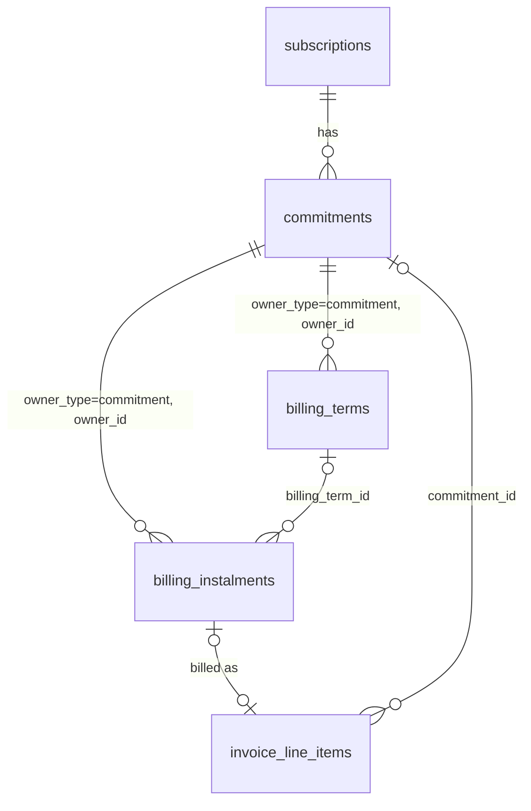

# FLE-1513 — Commitments & Billing Terms (ERD)

- **Ticket:** [FLE-1513](https://linear.app/flexprice/issue/FLE-1513/erd-commitments-revamp) · Linear doc: [Commitment Revamp](https://linear.app/flexprice/document/commitment-revamp-f4e4242a0c8b)
- **Scenarios:** [2026-10-07-FLE-1513-commitments-scenarios.md](./2026-10-07-FLE-1513-commitments-scenarios.md): every supported situation, how to set it up, and what gets invoiced.
- **Date:** 2026-10-09 · Status updated 2026-10-26
- **Author:** Ankit Malik
- **Status:** Phase 1 (commitments, `per_period`) shipped — PRs #3211, #3212, #3214, #3215. Billing terms (§7) designed, not implemented. §0.1 lists what shipped and where it differs from this document.

---

## 0. Summary

- **Commitments become their own entity on a subscription.** A commitment says how usage in a scope is priced: usage up to a capacity is billed at a committed rate, and usage beyond it at an overage rate.
  - Capacity is checked per billing period, or per minute (or any other bucket).
  - It can be limited to certain times of day.
  - Commitments on the same usage stack in priority order.
- **A binding commitment is owed in full whether or not it is used.** That money is collected by one of two methods:
  - `per_period` (default, same as today): each period's invoice bills usage within the commitment at the committed rate, plus a **true-up** line for the unused part.
  - `billing_terms`: the commitment value is billed only through **instalments**, built from billing terms such as "$300 upfront, the rest monthly in arrears". Period invoices show usage within the commitment at $0 ("covered by commitment") and never include a true-up.
- **Billing terms are simple rows owned by the commitment.**
  - Each row is a `once` instalment on a date, or a `recurring` series.
  - Each row has either a `fixed` amount or the `remainder` (the commitment value minus all other rows).
  - The instalments always add up to the commitment value.
  - A preview endpoint shows the exact instalments before anything is created.
- **Billing terms and instalments are owner-agnostic.** They point to their owner through `owner_type` / `owner_id`. Commitments are the only owner in v1; other entities can adopt the same tables later without schema changes.
- **There is no ledger in v1.** Billed, earned and deferred amounts are derived from the instalments and the commitment's periods.

---

## 0.1 Implementation status (2026-10-26)

Phase 1 shipped behind the `commitments_v2` environment setting as PRs [#3211](https://github.com/flexprice/flexprice/pull/3211) (engine), [#3212](https://github.com/flexprice/flexprice/pull/3212) (service), [#3214](https://github.com/flexprice/flexprice/pull/3214) (billing) and [#3215](https://github.com/flexprice/flexprice/pull/3215) (API + inline creation).

**Shipped**

- The `commitments` table, the pure allocation engine (`commitment_engine.go`), the loader (`billing_commitments.go`), and period/window maths (`commitment_periods.go`); usage is read from `meter_usage` only (the raw-events read path was removed).
- CRUD + preview + search + terminate API, inline creation on `CreateSubscriptionRequest.commitments[]` (subscription scope and `subscription_id` filled server-side; price scopes follow price overrides; runs after all line items exist), per-subscription idempotency keys backed by a partial unique index over published rows.
- Amount and quantity commitments; `billing_period` and `window` measurement; `active_windows` with timezone; stacking by priority; binding floors with true-up; mid-period starts and terminations prorate and clip their floors.
- Webhooks `commitment.created` / `.updated` / `.terminated`, with `created` cascading to `subscription.updated`; activity-log entries.

**Differences from this document**

- `committed_rate` / `overage_rate` decimals became **price objects** (`committed_price`, `overage_price`: billing_model, amount, tiers, tier_mode, transform_quantity). A committed price must be FLAT_FEE or TIERED-SLAB; VOLUME is rejected because it breaks the binding floor. Every derived amount applies the whole price: period amount = cost(capacity), within = cost(total used) split across lines, overage = custom price over the on-demand total.
- On-demand remainders bill the **marginal** cost beyond covered units — cost(full) − cost(full − od), per window for bucketed prices. VOLUME-tiered and PACKAGE line prices price the remainder fresh instead, matching entitlement remainders.
- Terminate takes `{effective_at?, cancellation_fee?}` only — a flat fee billed on an immediate ONE_OFF invoice with the PRORATION billing reason. `bill_remaining`, percent fees and `on_early_termination` are **not** in v1; nothing writes a `cancellation_fee_amount` column.
- Entitled meters are **rejected** in commitment scope (stricter than legacy, which applied entitlements before commitment math); revisit at legacy migration. WEEK/MONTH-bucketed and group-by-bucketed prices are rejected for window measurement.
- Nothing sets `commitment_status = ended` in phase 1; terminated commitments stay binding through the end of the billing period containing the cutoff.

**Pending**

- **Billing terms (§5.2, §5.3, §7): designed, not implemented.** No `billing_terms` / `billing_instalments` tables exist; `collection_method`, `total_amount` and `instalment_invoicing` are stored but only `per_period` is honoured. Phase-2 contract: `docs/design/2026-10-24-FLE-1513-billing-terms-api-contract.md`.
- Utilisation and instalment endpoints (§9.6, §11), revenue rollup and analytics (§9).
- Before un-gating for a raw-events tenant: tag raw-path charges with `subscription_line_item_id` (line items sharing a price double-count usage on that path); guard entitlements added after a commitment exists (plan change / addon features).
- Legacy commitment migration (§10, rollout phase 4).

---

## 1. Problem

Today a commitment is a set of fields on other entities:


| Where                  | Fields                                                                                                                                                                     | Limits                                                                                                               |
| ---------------------- | -------------------------------------------------------------------------------------------------------------------------------------------------------------------------- | -------------------------------------------------------------------------------------------------------------------- |
| Subscription           | `commitment_amount`, `commitment_duration`, `overage_factor`, `enable_true_up`                                                                                             | One per subscription. Silently off when `overage_factor = 1` (`Subscription.HasCommitment`). Excludes fixed charges. |
| Subscription line item | `commitment_amount`, `commitment_quantity`, `commitment_type`, `commitment_overage_factor`, `commitment_true_up_enabled`, `commitment_windowed`, `commitment_time_buckets` | One price only. `commitment_duration` is stored but never billed. Time-of-day buckets are UTC only.                  |


What this blocks:

1. **Committed money can only be billed per period, in arrears.** "$300 upfront and the rest monthly" and "30% at signing, 50% mid-term, the rest at the end" can't be billed.
2. **No pooling** across a chosen group of prices.
3. **No stacking and no separate reserved rate.**
  - 8 GPUs reserved 24×7 at $0.048/GPU-min;
  - 32 more GPUs 9am–9pm IST from 25 Aug at $0.0491667;
  - usage above both, on demand at $0.06.
   A single overage multiplier cannot express this.
4. **True-up lines use made-up prices.** They carry a generated `price_id` that matches no stored price, so revenue reporting can't attribute them.
5. **No per-commitment breakdown** of reserved used, reserved unused and on-demand.


## 2. Goals and non-goals

**Goals (v1)**

- A `Commitment` entity with its own API, lifecycle and audit trail.
- **Scope:** subscription, price group, meter or price.
- **Pricing:** amount or quantity commitments, with a committed price and an overage price.
- **Measurement:** per billing period or per bucket, time-of-day windows, and stacking.
- Binding and non-binding commitments.
- **Collection methods:** `per_period` (true-up on each invoice) and `billing_terms` (instalments).
- **Billing terms** covering upfront, partial upfront, recurring at any interval (advance or arrear), deposits, payment holidays, milestones (dated or triggered), ramps and fully custom plans.
- **Instalments:**
  - a preview before creation;
  - delivery on the subscription invoice or as separate invoices;
  - re-plan, bring forward and trigger.
- Early termination with three rules.

**Non-goals (v1)**

- **Renewal.** A follow-on contract is a new commitment.
- **Term-cumulative commitments:** one check over the whole term, with an end-of-term true-up.
- **Prepaid drawdown commitments:** a balance that pays for any usage, with rollover. These need a ledger.
- **A payment ledger.**
- **Billing terms on owners other than commitments.** The design supports it (§7.9); building it is phase 5.
- **Mixing amount and quantity commitments on the same usage** (C14).
- **Commitment templates** on plans and addons, and **carrying commitments across a plan change**.
- **Migrating legacy commitments** (phase 4).
- **Attributing reserved capacity to sources** (e.g. per deployment). This is an analytics / revenue-recognition setting and is out of scope here. Invoice totals never depend on it.


## 3. Concepts


### 3.1 How a commitment is priced and collected

```
                                 Commitment
        ┌─────────────────────────────┴──────────────────────────────┐
  How usage is priced                                  How a binding commitment's value is collected
  scope · capacity · windows · priority                collection_method
  committed price · overage price                         │
        │                                    ┌────────────┴─────────────┐
        │                              per_period                  billing_terms
        ▼                              (default)                        │
  On each period's invoice:            within → committed rate      billing_terms rows
    beyond the commitment → on-demand  unused → true-up line            │ expand
    within → see the two methods  ───▶                              billing_instalments
                                                                    within → $0 "covered"
                                                                    no true-up
```

A non-binding commitment has no collection method. Usage within it is billed at the committed rate, and unused capacity costs nothing.

### 3.2 Key terms


| Term                                | Meaning                                                                                                                                                                                                                                                                                                                                          |
| ----------------------------------- | ------------------------------------------------------------------------------------------------------------------------------------------------------------------------------------------------------------------------------------------------------------------------------------------------------------------------------------------------ |
| **Billing period / boundary**       | The subscription's own invoice period, e.g. 1 Mar–1 Apr on a monthly subscription anchored on the 1st. A *boundary* is the moment one period ends and the next begins. At each boundary, Flexprice issues a subscription invoice carrying the **arrear** charges of the period that ended and the **advance** charges of the period that starts. |
| **Term**                            | `[start_date, end_date)` of a commitment. `start_date` is required; without `end_date` the term is open-ended and runs until terminated (D8).                                                                                                                                                                                                                                                                                     |
| **Commitment period**               | A billing period clipped to the term. A term starting 25 Aug on a monthly subscription has a first period of 25 Aug–1 Sep.                                                                                                                                                                                                                       |
| **Measurement window**              | Where capacity is checked: the whole commitment period, or one bucket of the scoped bucketed price (e.g. one minute).                                                                                                                                                                                                                            |
| **Committed price / overage price** | The rate for usage within the commitment (the "reserved rate"), and the rate for usage beyond it (the "on-demand rate"). The overage price defaults to the line item's own price.                                                                                                                                                                |
| **Binding / non-binding**           | Binding: the full commitment is owed. Non-binding: a discounted rate with no obligation.                                                                                                                                                                                                                                                         |
| **Period amount**                   | What one commitment period's commitment is worth in money (§6.3).                                                                                                                                                                                                                                                                                |
| **Commitment value**                | The sum of all period amounts in the term. Always computable from the commitment's immutable fields. Returned by the API as `commitment_value`.                                                                                                                                                                                                  |
| `total_amount`                      | A snapshot of the commitment value, stored only when `collection_method` is `billing_terms`. The instalments were generated against it and must keep adding up to it (D19).                                                                                                                                                                      |
| **True-up**                         | `per_period` only: the unused part of a period's commitment, billed on that period's invoice.                                                                                                                                                                                                                                                    |
| **Billing term**                    | One row describing how part of the commitment value is billed (§7).                                                                                                                                                                                                                                                                              |
| **Remainder**                       | A billing term whose amount is not given. It is `total_amount` minus the amounts of every other row, so the tenant never has to do the subtraction.                                                                                                                                                                                              |
| **Instalment**                      | One dated charge generated from billing terms.                                                                                                                                                                                                                                                                                                   |
| **Advance / arrear**                | On a recurring billing term: `advance` bills each step at its **start**, and `arrear` bills it at its **end**. Same meaning as `invoice_cadence` on line items today.                                                                                                                                                                            |
| **Step**                            | One instalment's span in a recurring row: `interval_count × interval`, e.g. 1 × QUARTERLY = 3 months.                                                                                                                                                                                                                                            |
| **Billed / earned / deferred**      | Billed = commitment money invoiced. Earned = period amounts of periods that have ended. Deferred = billed − earned (§9).                                                                                                                                                                                                                         |
| **Usage value vs billed amount**    | Usage value is what usage was worth under the commitment (used, unused and on-demand, at committed and overage rates). Billed amount is what was actually invoiced in a period. They are equal under `per_period` and differ under `billing_terms` (§9).                                                                                         |
| **Payment terms**                   | Not used here. In finance this means an invoice's due date (Net 30), which existing invoice settings already handle.                                                                                                                                                                                                                             |


## 4. Decisions


### Commitments


| #   | Decision                                                                                                                                                                                                                                                                                                                                                                                                                                                                       | Why                                                                                                                                                                                                                 |
| --- | ------------------------------------------------------------------------------------------------------------------------------------------------------------------------------------------------------------------------------------------------------------------------------------------------------------------------------------------------------------------------------------------------------------------------------------------------------------------------------ | ------------------------------------------------------------------------------------------------------------------------------------------------------------------------------------------------------------------- |
| D1  | Scope is two columns: `scope_entity_type` (subscription, group, meter or price) and `scope_entity_id`. A group must be a price group. A subscription scope covers every usage price on it, including prices added later. Fixed charges are never in scope.                                                                                                                                                                                                                     | Price groups already model "several prices". Feature groups are deferred.                                                                                                                                           |
| D2  | A quantity commitment's scope must resolve to exactly one meter.                                                                                                                                                                                                                                                                                                                                                                                                               | A quantity needs a single unit.                                                                                                                                                                                     |
| D3  | `measurement` is `billing_period` or `window`. A window is one bucket of the scoped prices (`price.ResolveBucketSize`); all scoped prices must resolve to the same bucket size.                                                                                                                                                                                                                                                                                                | Reuses the existing bucketed-usage path.                                                                                                                                                                            |
| D4  | `active_windows` is a list of time ranges in `timezone` (defaulting to the subscription's), all sharing one capacity and rate.                                                                                                                                                                                                                                                                                                                                                 | One rate per commitment.                                                                                                                                                                                            |
| D5  | Commitments stack as a **waterfall**. In each window, usage fills the active commitments in `priority` order (lowest number first; ties go to the earlier `start_date`, then the lower `id`). Each commitment is filled to its capacity before the next one receives anything. Example: two 10-GPU commitments with usage of 15 leaves the first fully used (10 of 10), the second 50% used (5 of 10), and no on-demand. Pro-rata filling across commitments is not supported. | Deterministic and easy to explain. It lets the tenant decide which reservation is consumed first, e.g. the cheaper one.                                                                                             |
| D6  | Commitments that overlap in time and share a usage line item must have the same `type` and `measurement`.                                                                                                                                                                                                                                                                                                                                                                      | Stacking hands units from one commitment to the next. Money and units, or minutes and periods, can't be combined in a defined order.                                                                                |
| D7  | Rates: `committed_price_id`, and `overage_price_id` (NULL means the line item's own price). New commitments don't use `overage_factor`. A custom overage price needs a single-meter scope.                                                                                                                                                                                                                                                                                     | Explicit and auditable.                                                                                                                                                                                             |
| D8  | `end_date` is optional (revised 2026-10-29: a commitment without one is open-ended — it runs until terminated or its subscription ends, billing its floor and true-up every billing period; it has no finite `commitment_value`, and for overlap checks it holds its scope until its subscription ends, indefinitely when that has no end; a cancellation fee on it covers the rest of the billing period holding `effective_at`). When set, it is never after the subscription's `end_date`, and `start_date` is always before a set subscription `end_date`. Both `start_date` and `end_date` may be mid-period (revised 2026-10-27: the original billing-boundary alignment was dropped — termination had already built the partial-floor machinery, and contracts like "exactly one year from a mid-period start" need mid-period ends). The final partial period prorates its floor; the commitment occupies its last billing period for overlap checks.                                                                                                                                                                                                                                                                                                             | Originally "no contract is truly open-ended"; revised 2026-10-29 for reserved capacity held until cancelled (e.g. 10 GPUs a day with no end date).                                                                                                                                                                                    |
| D9  | No renewal in v1.                                                                                                                                                                                                                                                                                                                                                                                                                                                              | Smaller v1. A follow-on contract is a new commitment.                                                                                                                                                               |
| D10 | A commitment's economics are immutable: scope, type, value, rates (including the committed price), measurement, windows, priority, dates, binding, collection method and billing terms. Only `name`, `invoice_label`, `invoice_description` and `metadata` can be edited; anything else means terminate and recreate.                                                                                                                                                          | Past invoices and instalments always match the commitment that produced them. A price change on the line item can only affect on-demand usage when no `overage_rate` is set. It never affects the commitment value. |


### Collection


| #   | Decision                                                                                                                                                                                                                                                                                                                                                                                                                              | Why                                                                                                                                                                                                                             |
| --- | ------------------------------------------------------------------------------------------------------------------------------------------------------------------------------------------------------------------------------------------------------------------------------------------------------------------------------------------------------------------------------------------------------------------------------------- | ------------------------------------------------------------------------------------------------------------------------------------------------------------------------------------------------------------------------------- |
| D11 | A binding commitment has `collection_method` `per_period` (default) or `billing_terms`, all-or-nothing. `per_period`**:** within-commitment usage at the committed rate plus a true-up on every period's invoice; no instalments. `billing_terms`**:** the money comes only through instalments; within-commitment usage at $0; **the true-up is never calculated** (the engine still finds the unused capacity, for analytics only). | A period's commitment is paid in exactly one place.                                                                                                                                                                             |
| D12 | A `per_period` true-up line is priced at the committed price for quantity commitments. For amount commitments it is a fixed line with no price, tagged with `commitment_id`.                                                                                                                                                                                                                                                          | Fixes the made-up price IDs on today's true-up lines.                                                                                                                                                                           |
| D13 | Under `billing_terms`, each within-commitment line lists the instalments whose service period covers that invoice period (`covered_by_instalment_ids`). This is for display only; nothing is deducted.                                                                                                                                                                                                                                | Readers see which payment covered the month.                                                                                                                                                                                    |
| D14 | `instalment_invoicing` is a commitment-level setting, used only with `billing_terms`. `subscription_invoice` (default) puts instalments on the subscription's boundary invoices. `separate_invoice` issues a `ONE_OFF` invoice per instalment on its `bill_on` (§7.7).                                                                                                                                                                | Tenants choose between one invoice per period and collecting on an exact date.                                                                                                                                                  |
| D15 | The commitment value is never stored for `per_period`; it is computed when needed (API response, termination). For `billing_terms`, `total_amount` stores it as a snapshot at creation.                                                                                                                                                                                                                                               | The value can always be derived from immutable fields. The snapshot keeps instalments consistent with the value they were generated from, even if the period-amount calculation is ever corrected (e.g. a DST or rounding fix). |


### Billing terms and instalments


| #   | Decision                                                                                                                                                                                                                                                                                                                                                                                                                                                | Why                                                                                                                                          |
| --- | ------------------------------------------------------------------------------------------------------------------------------------------------------------------------------------------------------------------------------------------------------------------------------------------------------------------------------------------------------------------------------------------------------------------------------------------------------- | -------------------------------------------------------------------------------------------------------------------------------------------- |
| D16 | Billing terms are rows in `billing_terms`, owned directly by the owner (`owner_type`, `owner_id`). There is no parent schedule row.                                                                                                                                                                                                                                                                                                                     | The owner already holds the value, dates and currency.                                                                                       |
| D17 | A row is `once` or `recurring`. A `once` row has `bill_on` (a date) or `on_trigger`. A `recurring` row has `starts_on` / `ends_on` (boundary dates), `interval` + `interval_count`, and `bill_at` (advance or arrear). A fully custom plan is a list of `once` rows.                                                                                                                                                                                    | One meaning per field. Each row reads on its own.                                                                                            |
| D18 | `value_type` is `fixed` or `remainder`. On a `once` row, `fixed` is the instalment's amount. On a `recurring` row, `fixed` is the amount **per instalment**. `remainder` is `total_amount` minus all other rows, and at most one row may use it. On a recurring row, the remainder is divided across the instalments by `split` (even or proportional). Percentages are accepted only as API input and converted to fixed amounts before saving (§7.1). | Stored rows are plain amounts. Nobody has to check that percentages add up to 100%, or count how many instalments a percentage repeats over. |
| D19 | While the owner is active, its non-canceled instalments add up to `total_amount` exactly. A remainder row's last instalment absorbs rounding. Without a remainder row, the fixed rows must add up exactly. A remainder that resolves to 0 is rejected.                                                                                                                                                                                                  | Everything adds up to the contract value. A zero remainder is almost always a setup mistake.                                                 |
| D20 | A recurring row's `interval × interval_count` must be a whole multiple of the subscription's billing period. The default (the subscription's period × 1) is stored on the row.                                                                                                                                                                                                                                                                          | Steps line up with invoices.                                                                                                                 |
| D21 | Presets (`upfront`, `partial_upfront`, `spread`) are API shorthand only, expanded into rows before saving.                                                                                                                                                                                                                                                                                                                                              | One storage format.                                                                                                                          |
| D22 | `POST /v1/commitments/preview` runs the full create validation and expansion without saving anything. It returns the commitment value, each row's resolved amount and every instalment.                                                                                                                                                                                                                                                                 | Tenants see exactly what will be billed.                                                                                                     |
| D23 | `on_trigger` instalments wait for an API trigger. If never triggered, they are billed at term end.                                                                                                                                                                                                                                                                                                                                                      | "50% at go-live".                                                                                                                            |
| D24 | Invoiced instalments are locked. Scheduled instalments can be re-planned (keeping the total), brought forward or triggered. Billing terms rows never change.                                                                                                                                                                                                                                                                                            | Contracts get renegotiated, but history stays intact.                                                                                        |
| D25 | Each instalment is invoiced at most once, enforced by a conditional update in the invoice transaction. Voiding the invoice releases it.                                                                                                                                                                                                                                                                                                                 | Retries and regenerations are safe.                                                                                                          |
| D26 | Instalments are ordered by `bill_on` (NULLs last), then `id`.                                                                                                                                                                                                                                                                                                                                                                                           | IDs are time-sortable and generated in billing order.                                                                                        |


### Lifecycle and accounting


| #   | Decision                                                                                                                                                                                                                                                                                                                                                                                                                                           | Why                                                                                                                                                                                                                                                 |
| --- | -------------------------------------------------------------------------------------------------------------------------------------------------------------------------------------------------------------------------------------------------------------------------------------------------------------------------------------------------------------------------------------------------------------------------------------------------- | --------------------------------------------------------------------------------------------------------------------------------------------------------------------------------------------------------------------------------------------------- |
| D27 | Early termination follows `on_early_termination`: `forfeit` (default) keeps money billed but not yet earned; `credit_note` (billing_terms only) credits it back; `bill_remaining` bills the rest of the commitment value. Earned-but-unbilled money is always billed (§8).                                                                                                                                                                         | Covers the contracts we have seen.                                                                                                                                                                                                                  |
| D28 | Plan change and subscription cancellation terminate commitments under their own rule.                                                                                                                                                                                                                                                                                                                                                              | Carry-over is deferred.                                                                                                                                                                                                                             |
| D29 | Revenue: commitment money billed ahead of its period is deferred, and recognised when that period ends. Under `per_period`, a period is billed and earned on the same invoice. Forfeits are recognised at termination; credit notes reverse.                                                                                                                                                                                                       | Billing and recognition stay separate.                                                                                                                                                                                                              |
| D30 | No ledger in v1 (§9).                                                                                                                                                                                                                                                                                                                                                                                                                              | Commitments are not drawn down by usage.                                                                                                                                                                                                            |
| D31 | Commitment invoice lines carry `commitment_id` and `commitment_line_kind`. Instalment lines also carry `billing_instalment_id`, `entity_type=commitment`, `entity_id`, and no price.                                                                                                                                                                                                                                                               | Every line can be traced to its commitment.                                                                                                                                                                                                         |
| D32 | Create is idempotent via `idempotency_key`.                                                                                                                                                                                                                                                                                                                                                                                                        | Safe client retries.                                                                                                                                                                                                                                |
| D33 | Legacy commitment fields and new commitments never price the same usage (C15, C16).                                                                                                                                                                                                                                                                                                                                                                | Two engines never price one usage.                                                                                                                                                                                                                  |
| D34 | Analytics and revenue are computed from the commitment engine's allocation (used, unused, on-demand per commitment, price and period), never from invoice amounts. Under `billing_terms`, unused capacity is reported as "unused commitment (prepaid)" even though it is not billed.                                                                                                                                                               | A meter's usage and revenue look the same whichever collection method the tenant chose.                                                                                                                                                             |
| D35 | Every consumer reads exactly one of two measures: usage value (dashboards, usage analytics, earned revenue) or billed amount (invoice preview, spend alerts, wallet pending charges, billings view). APIs return both, side by side and labelled.                                                                                                                                                                                                  | Prevents counting a commitment twice (once as usage, once as instalments) in anything that predicts or controls spend.                                                                                                                              |
| D36 | **On-demand belongs to the stack, not to a commitment.** Usage becomes on-demand only after every active commitment in that window is full. Its rate is the overage price, which all commitments that overlap on the same usage must agree on (C20): either all NULL (the line item price) or the same price. On-demand quantities are attributed to the price and meter, and to the scope shared by the stack, never to an individual commitment. | A commitment that has been filled has no overage of its own: its excess flows to the next commitment. Requiring one overage price per stack removes any ambiguity about which commitment's overage applies.                                         |
| D37 | Each commitment has `name` (shown in the dashboard and API), `invoice_label` (the invoice line title) and an optional `invoice_description` (the line's second row). All three can be edited and apply to invoices generated afterwards.                                                                                                                                                                                                           | Tenants control exactly how commitments read on invoices, e.g. "1× H100 reserved GPU" with "8 GPUs reserved at $2.88/hr (744 hrs/GPU)".                                                                                                             |
| D38 | Commitment utilisation and cost-explorer style views are served from **revenue facts**, which hold the engine's allocation per commitment, price and time bucket. The events / meter-usage analytics API keeps serving raw quantities and does not split usage by commitment (§9.6–9.7).                                                                                                                                                           | Whether a unit of usage is within a commitment or on-demand depends on all other usage in the same window and on the stack order. It cannot be decided per event, so splitting it in the events API would mean reimplementing the allocator in SQL. |


## 5. Data model




All new tables use `BaseMixin` (`tenant_id`, `status`, `created_*`, `updated_*`) and `EnvironmentMixin` (`environment_id`). Every query filters on both `tenant_id` and `environment_id`.

### 5.1 `commitments` (prefix `cmt`)

> **Shipped**, with these deltas: `committed_price_id` / `overage_price_id` are created from `committed_price` / `overage_price` **price objects**, not rate decimals; `on_early_termination` is unexposed; `collection_method`, `total_amount` and `instalment_invoicing` are dormant until billing terms ship; the idempotency unique index is **partial over published rows**, so archived commitments release their keys.

| Column                 | Type          | Null | Meaning                                                                                                                                                                                                                             |
| ---------------------- | ------------- | ---- | ----------------------------------------------------------------------------------------------------------------------------------------------------------------------------------------------------------------------------------- |
| `id`                   | varchar(50)   | no   | `cmt_…`                                                                                                                                                                                                                             |
| `subscription_id`      | varchar(50)   | no   | The subscription it belongs to                                                                                                                                                                                                      |
| `customer_id`          | varchar(50)   | no   | Copied from the subscription, for list filters                                                                                                                                                                                      |
| `name`                 | varchar(255)  | no   | Shown in the dashboard and API, e.g. "H100 base reservation"                                                                                                                                                                        |
| `invoice_label`        | varchar(255)  | no   | Title of this commitment's invoice lines (D37). Defaults to `name`. e.g. "1× H100 reserved GPU"                                                                                                                                     |
| `invoice_description`  | varchar(500)  | yes  | Optional second row under the title, e.g. "8 GPUs reserved at $2.88/hr (744 hrs/GPU)". Plain text.                                                                                                                                  |
| `currency`             | varchar(10)   | no   | Same as the subscription's currency                                                                                                                                                                                                 |
| `scope_entity_type`    | varchar(20)   | no   | One of `subscription`, `group`, `meter`, `price` (§6.1)                                                                                                                                                                             |
| `scope_entity_id`      | varchar(50)   | no   | ID of that entity. For `subscription`, equals `subscription_id`.                                                                                                                                                                    |
| `type`                 | varchar(20)   | no   | `amount`: `value` is money. `quantity`: `value` is units of the scope's meter.                                                                                                                                                      |
| `value`                | numeric(20,8) | no   | Capacity per measurement window (one period, or one bucket)                                                                                                                                                                         |
| `committed_price_id`   | varchar(50)   | yes  | Subscription-scoped price for usage within the commitment, created from `committed_rate`. Required for quantity commitments. NULL for amount commitments, whose usage is valued at each line item's own price. Never changes (D10). |
| `overage_price_id`     | varchar(50)   | yes  | Subscription-scoped price for on-demand usage, created from `overage_rate`. NULL means each line item's own price.                                                                                                                  |
| `measurement`          | varchar(20)   | no   | `billing_period` or `window` (§6.2)                                                                                                                                                                                                 |
| `active_windows`       | jsonb         | yes  | e.g. `[{"start":"09:00","end":"21:00"}]`. Half-open minute-of-day ranges that may wrap past midnight. NULL means all day.                                                                                                           |
| `timezone`             | varchar(64)   | no   | IANA name used for `active_windows`. Defaults to the subscription's timezone.                                                                                                                                                       |
| `priority`             | int           | no   | Stacking order; lower is applied first (D5)                                                                                                                                                                                         |
| `binding`              | bool          | no   | True means the full commitment value is owed                                                                                                                                                                                        |
| `collection_method`    | varchar(20)   | yes  | Binding only: `per_period` (default) or `billing_terms` (D11). With `billing_terms`, rows exist in `billing_terms` and `billing_instalments`.                                                                                       |
| `total_amount`         | numeric(20,8) | yes  | Only when `collection_method` is `billing_terms`: snapshot of the commitment value at creation (D15). NULL otherwise.                                                                                                               |
| `instalment_invoicing` | varchar(30)   | yes  | Only when `collection_method` is `billing_terms`: `subscription_invoice` (default) or `separate_invoice` (D14). Copied to each instalment's `delivery`.                                                                             |
| `start_date`           | timestamptz   | no   | Term start (inclusive)                                                                                                                                                                                                              |
| `end_date`             | timestamptz   | yes  | Term end (exclusive), may be mid-period; never after the subscription end. NULL: open-ended (D8)                                                                                                                                                                                                |
| `on_early_termination` | varchar(20)   | yes  | Binding only: `forfeit` (default), `credit_note` (billing_terms only) or `bill_remaining`                                                                                                                                           |
| `commitment_status`    | varchar(20)   | no   | `active`, `ended` or `terminated`                                                                                                                                                                                                   |
| `terminated_at`        | timestamptz   | yes  | When termination took effect                                                                                                                                                                                                        |
| `idempotency_key`      | varchar(128)  | yes  | D32                                                                                                                                                                                                                                 |
| `metadata`             | jsonb         | yes  | Free-form                                                                                                                                                                                                                           |


**Indexes**

- `(tenant_id, environment_id, subscription_id, commitment_status)`
- `(tenant_id, environment_id, scope_entity_type, scope_entity_id)`
- `(tenant_id, environment_id, customer_id)`
- unique `(tenant_id, environment_id, idempotency_key)`


### 5.2 `billing_terms` (prefix `bterm`)

Each row says how one part of the owner's value is billed. Rows are created with the owner and never change.


| Column           | Type          | Null | Used by                  | Meaning                                                                                                                                            |
| ---------------- | ------------- | ---- | ------------------------ | -------------------------------------------------------------------------------------------------------------------------------------------------- |
| `id`             | varchar(50)   | no   | all                      | `bterm_…`                                                                                                                                          |
| `owner_type`     | varchar(30)   | no   | all                      | v1: `commitment`                                                                                                                                   |
| `owner_id`       | varchar(50)   | no   | all                      | e.g. `cmt_…`                                                                                                                                       |
| `kind`           | varchar(20)   | no   | all                      | `once`: one instalment. `recurring`: one instalment per step between `starts_on` and `ends_on`.                                                    |
| `value_type`     | varchar(20)   | no   | all                      | `fixed`: `value` is money. `remainder`: the owner's `total_amount` minus every other row (D18).                                                    |
| `value`          | numeric(20,8) | yes  | all                      | When `fixed`: on `once`, the instalment's amount; on `recurring`, the amount per instalment. NULL for `remainder`.                                 |
| `bill_on`        | timestamptz   | yes  | once                     | Billing date, within `[start_date, end_date]`. Default `start_date`. NULL when `on_trigger`.                                                       |
| `on_trigger`     | bool          | no   | once                     | True: a milestone with an unknown date, billed when triggered through the API, or at `end_date` if never triggered. Default false.                 |
| `covers_from`    | timestamptz   | yes  | once                     | Start of the service this instalment pays for. Default `start_date`. Used for the instalment's service period and the "covered by" display (§7.6). |
| `covers_to`      | timestamptz   | yes  | once                     | End of that service. Default `end_date`.                                                                                                           |
| `starts_on`      | timestamptz   | yes  | recurring                | First step's start: the commitment's `start_date` or a billing boundary in the term. Default `start_date`.                                         |
| `ends_on`        | timestamptz   | yes  | recurring                | Last step's end: a billing boundary in the term, or `end_date`. Default `end_date`.                                                                |
| `interval`       | varchar(20)   | yes  | recurring                | Step unit, from the price billing period enum: `MONTHLY`, `QUARTERLY`, `ANNUAL`, …                                                                 |
| `interval_count` | int           | yes  | recurring                | Units per step: 1 × QUARTERLY means every quarter; 2 × MONTHLY means every two months.                                                             |
| `bill_at`        | varchar(20)   | yes  | recurring                | `advance`: each step is billed at its start. `arrear`: each step is billed at its end.                                                             |
| `split`          | varchar(20)   | yes  | recurring with remainder | `even`: equal instalments. `proportional`: each instalment matches its step's period amounts (§7.4).                                               |
| `description`    | varchar(255)  | yes  | all                      | Invoice line label. May use `{n}` and `{of}`. Defaults: "Commitment payment" (once), "Instalment {n} of {of}" (recurring).                         |
| `metadata`       | jsonb         | yes  | all                      | Free-form. When a percentage was given in the request, it is recorded here as `input_percent` for audit.                                           |


**Index:** `(tenant_id, environment_id, owner_type, owner_id)`. Rows are ordered by `id`.

### 5.3 `billing_instalments` (prefix `binst`)

One row per dated charge. Only owners whose `collection_method` is `billing_terms` have them.


| Column                                       | Type          | Null | Meaning                                                                                                                                                                                                                                   |
| -------------------------------------------- | ------------- | ---- | ----------------------------------------------------------------------------------------------------------------------------------------------------------------------------------------------------------------------------------------- |
| `id`                                         | varchar(50)   | no   | `binst_…`. Time-sortable; used for ordering (D26).                                                                                                                                                                                        |
| `owner_type`, `owner_id`                     | varchar       | no   | The owner (the commitment)                                                                                                                                                                                                                |
| `billing_term_id`                            | varchar(50)   | yes  | The row that produced it. NULL for instalments created by re-plan or bring-forward, and for settlements.                                                                                                                                  |
| `customer_id`                                | varchar(50)   | no   | Copied from the owner: who is invoiced                                                                                                                                                                                                    |
| `subscription_id`                            | varchar(50)   | yes  | Copied from the owner. Required for `subscription_invoice` delivery.                                                                                                                                                                      |
| `currency`                                   | varchar(10)   | no   | Copied from the owner                                                                                                                                                                                                                     |
| `kind`                                       | varchar(20)   | no   | `instalment` (planned) or `settlement` (added at termination, §8)                                                                                                                                                                         |
| `bill_trigger`                               | varchar(20)   | no   | `on_date`: billed when `bill_on` is reached. `manual`: waits for a trigger (D23).                                                                                                                                                         |
| `bill_on`                                    | timestamptz   | yes  | When it becomes billable. NULL only for an untriggered manual instalment.                                                                                                                                                                 |
| `amount`                                     | numeric(20,8) | no   | Greater than 0, in `currency`                                                                                                                                                                                                             |
| `description`                                | varchar(255)  | no   | Rendered label, e.g. "Instalment 3 of 10"                                                                                                                                                                                                 |
| `service_period_start`, `service_period_end` | timestamptz   | no   | What the instalment pays for. Once: the row's `covers_from` to `covers_to` (default the term). Recurring: its step. Settlement: the term up to termination. Used for display and revenue recognition timing; billing never depends on it. |
| `delivery`                                   | varchar(30)   | no   | `subscription_invoice` or `separate_invoice`, copied from the owner's `instalment_invoicing`                                                                                                                                              |
| `instalment_status`                          | varchar(20)   | no   | `scheduled`, `invoiced` or `canceled`                                                                                                                                                                                                     |
| `invoice_id`, `invoice_line_item_id`         | varchar(50)   | yes  | Set when invoiced. The instalment is locked from then on.                                                                                                                                                                                 |
| `metadata`                                   | jsonb         | yes  | Free-form                                                                                                                                                                                                                                 |


**Indexes**

- `(tenant_id, environment_id, instalment_status, delivery, bill_on)` for due pickup
- `(tenant_id, environment_id, owner_type, owner_id)`
- `(tenant_id, environment_id, invoice_id)` for void handling

**Invariant:** while the owner is active, the sum of `amount` over its non-canceled instalments equals the owner's `total_amount`.

### 5.4 Changes to existing tables


| Item                 | Change                                                                                                                                          |
| -------------------- | ----------------------------------------------------------------------------------------------------------------------------------------------- |
| `invoice_line_items` | Add `commitment_id` and `billing_instalment_id`, both nullable and indexed.                                                                     |
| `types/invoice.go`   | `InvoiceLineItemEntityType` gains `commitment`.                                                                                                 |
| `types/metadata.go`  | `commitment_line_kind`: one of `within_commitment`, `on_demand`, `true_up`, `instalment`, `settlement`. Plus `covered_by_instalment_ids` (D13). |
| `prices`             | No change. Committed and overage prices are subscription-scoped, created the way time-of-day buckets create theirs today.                       |


## 6. Commitments in detail


### 6.1 Scope resolution

Scope is resolved on every invoice, so prices added later are picked up automatically.


| Scope type     | Usage line items in scope                                              |
| -------------- | ---------------------------------------------------------------------- |
| `subscription` | All usage line items on the subscription that are active in the period |
| `group`        | Usage line items whose price has `group_id` = `scope_entity_id`        |
| `meter`        | Usage line items whose price has `meter_id` = `scope_entity_id`        |
| `price`        | Usage line items with `price_id` = `scope_entity_id`                   |


### 6.2 Measurement and time windows

- `billing_period`**:** capacity is `value` once per commitment period. Usage is the period's total quantity (quantity commitments) or total cost at line-item prices (amount commitments).
- `window`**:** capacity is `value` in every bucket. Usage per bucket comes from the existing bucketed path (`fillBucketedValuesForWindowedCommitment`, `generateBucketStarts`). Empty buckets count as zero, so unused capacity is counted.
- `active_windows`**:** a bucket counts only if its start, in `timezone`, falls inside a range. Outside the ranges, the commitment has no capacity.


### 6.3 Period amount and commitment value


| Type     | `billing_period`                                                         | `window`                                                |
| -------- | ------------------------------------------------------------------------ | ------------------------------------------------------- |
| amount   | `value`, prorated by the seconds of the period that fall inside the term | `value × active buckets in the period`                  |
| quantity | `value × committed rate`, prorated the same way                          | `value × committed rate × active buckets in the period` |


- Active buckets are counted on the calendar, honouring `active_windows`, the timezone and DST.
- The **commitment value** is the sum over all periods. It is computed by one function, `CommitmentValue(c)`, used by the API, termination and revenue.
- For `billing_terms`, the value at creation is stored as `total_amount` (D15).

Examples:

- **$100/month from 1 Jan to 1 Jan:** each period is $100; the value is $1,200.
- **$100/month from 15 Jan for 12 periods:** period 1 (15 Jan–1 Feb, 17 of 31 days) is $54.84. The other 11 periods are $100. The value is $1,154.84.
- **8 GPUs at $0.048/min, all day:** August (31 days) is 8 × 0.048 × 44,640 = $17,141.76. September is $16,588.80. February is $15,482.88.


### 6.4 Allocation: `CommitmentEngine.Apply(sub, periodStart, periodEnd, usageLines)`

1. Load active commitments that overlap the period, in D5 order. If there are none, return the usage lines unchanged.
2. Resolve each commitment's scope (§6.1) and read usage per window (§6.2).
3. For each window with usage *u*, go through the commitments active in that window, in order:
  - `used = min(u, capacity)`
  - `unused += capacity − used`
  - `u −= used`
   Whatever remains is on-demand. When a commitment covers several prices, capacity is filled in price `display_order`, then `price_id`.
4. Price the result (§6.5).

This runs for every commitment regardless of collection method. Under `billing_terms`, `unused` is reported for analytics only and never billed. `computeCommitmentMath` (`billing_commitment.go:222`) is extended, not forked. Step 3 is a pure function.

**Stacking example.** C1 and C2 both reserve 10 GPUs on the same price, C1 with priority 1 and C2 with priority 2.


| Usage in the window | C1 used  | C2 used  | On-demand                             |
| ------------------- | -------- | -------- | ------------------------------------- |
| 6                   | 6 of 10  | 0 of 10  | 0                                     |
| 15                  | 10 of 10 | 5 of 10  | 0                                     |
| 24                  | 10 of 10 | 10 of 10 | 4, at the stack's overage price (D36) |


A commitment that is full has no overage of its own: the excess flows to the next commitment. Only what is left after the last one is on-demand. If a commitment is not active in that window (outside its `active_windows`, or before its `start_date`), it is skipped.

### 6.5 Invoice lines from usage

The usage lines in scope are replaced by:


| Line                                                          | Non-binding    | Binding, per_period                                                                                | Binding, billing_terms               |
| ------------------------------------------------------------- | -------------- | -------------------------------------------------------------------------------------------------- | ------------------------------------ |
| Within commitment: one per (commitment, price), with quantity | committed rate | committed rate (quantity) or line-item price (amount)                                              | $0, with `covered_by_instalment_ids` |
| True-up: one per commitment                                   | none           | `unused × committed rate` (quantity) or `period amount − within value` (amount); omitted when zero | none (never calculated for billing)  |
| On-demand: one per price                                      | overage price  | overage price                                                                                      | overage price                        |


- Every line carries `commitment_id`, `commitment_line_kind` and `commitment_info`.
- **Line titles.** Within-commitment and true-up lines are titled with the commitment's `invoice_label` and carry its `invoice_description` (D37). They get a short suffix when needed to tell them apart: "(unused)" for true-ups, "(covered)" under billing terms. On-demand lines keep the price's own name, because on-demand belongs to the stack (D36). Instalment lines use the `invoice_label` plus the billing term's description, e.g. "Instalment 3 of 10".
- **Invariant:** per price, within quantity + on-demand quantity = the original usage quantity. A mismatch is a hard error.
- Under `per_period`, within + true-up always equals the period amount.


### 6.6 Commitment validation

All failures return `ErrValidation`, with a hint naming the field.


| #   | Rule                                                                                                                                                                        |
| --- | --------------------------------------------------------------------------------------------------------------------------------------------------------------------------- |
| C1  | The subscription exists in this tenant and environment and is `active` or `trialing`. `currency` matches the subscription.                                                  |
| C2  | `start_date` ≥ subscription start, and `start_date` < `end_date` when `end_date` is set.                                                                                                           |
| C3  | `end_date` is a billing boundary or the subscription's `end_date`. The error names the nearest boundaries either side.                                                      |
| C4  | `scope_entity_id` exists in this tenant and environment and matches `scope_entity_type`. A subscription scope equals `subscription_id`. A group has `entity_type = price`.  |
| C5  | The scope resolves to at least one usage line item at `start_date`.                                                                                                         |
| C6  | `value` > 0.                                                                                                                                                                |
| C7  | Quantity: the scope resolves to exactly one meter (D2), and `committed_rate` > 0 is given. Amount: `committed_rate` is absent.                                              |
| C8  | `overage_rate`, if given, is ≥ 0, and the scope resolves to a single meter.                                                                                                 |
| C9  | Window: every scoped price is bucketed, and all resolve to one bucket size.                                                                                                 |
| C10 | `active_windows` only with window. Each range is `HH:MM` with start ≠ end. Ranges in one commitment don't overlap.                                                          |
| C11 | `timezone` is a valid IANA name.                                                                                                                                            |
| C12 | `priority` ≥ 0, and distinct from every active commitment that overlaps in time and shares a line item.                                                                     |
| C13 | Binding: `collection_method` defaults to `per_period`. Non-binding: `collection_method`, `billing_terms`, `instalment_invoicing` and `on_early_termination` must be absent. |
| C14 | Commitments that overlap in time and share a line item have the same `type` and `measurement` (D6).                                                                         |
| C15 | No line item in scope carries legacy commitment fields or time buckets.                                                                                                     |
| C16 | A subscription scope requires the subscription to have no `commitment_amount`.                                                                                              |
| C17 | `billing_terms` requires the `billing_terms` input (T1–T15). `per_period` rejects both `billing_terms` and `instalment_invoicing`.                                          |
| C18 | `on_early_termination = credit_note` requires `billing_terms`.                                                                                                              |
| C19 | `idempotency_key`, if given, is ≤ 128 characters. A repeated key returns the existing commitment unchanged.                                                                 |
| C20 | Commitments that overlap in time and share a line item have the same `overage_price_id`: all NULL, or rates that resolve to the same price (D36).                           |
| C21 | `name` and `invoice_label` are 1–255 characters. `invoice_description` is at most 500 characters.                                                                           |


**On price attach:** attaching a price re-checks C7, C9 and C14 for every active commitment whose group or subscription scope would now include it.

## 7. Billing terms and instalments in detail

> **Not implemented.** This whole section is design only — no tables, expansion, delivery or termination handling exist yet. The phase-2 API contract supersedes the request shapes here: `docs/design/2026-10-24-FLE-1513-billing-terms-api-contract.md`. One ruling to carry into implementation: under `billing_terms`, within-commitment usage must appear at **$0** ("covered by commitment") — skipping only the true-up would double-collect.

### 7.1 Input and storage

With `collection_method = billing_terms`, the create request carries `billing_terms` as either a preset or explicit rows:


| Form   | Example                                                                                                                                         |
| ------ | ----------------------------------------------------------------------------------------------------------------------------------------------- |
| Preset | `{"preset":"partial_upfront","upfront":{"amount":"300"},"rest":{"bill_at":"arrear","split":"even"}}`                                            |
| Rows   | `{"rows":[{"kind":"once","value_type":"fixed","value":"300"},{"kind":"recurring","value_type":"remainder","bill_at":"arrear","split":"even"}]}` |


**Percent input.** Anywhere a fixed amount is accepted (`upfront`, or a row with `value_type: fixed`), the request may send `{"percent": "30"}` instead of a value.

- The API converts it: `round(total_amount × percent / 100)` at currency precision.
- It is saved as a `fixed` row, with `input_percent` kept in `metadata`.
- On a recurring row, the percent means **per instalment**.
- The preview (D22) shows the converted amounts.

**Expansion.** On create, the rows are saved and expanded into instalments (§7.4). From then on, billing reads only instalments; the rows remain for display and audit.

### 7.2 Which fields each kind uses


| Field                        | once                                                     | recurring                                                           |
| ---------------------------- | -------------------------------------------------------- | ------------------------------------------------------------------- |
| `value_type`, `value`        | required (`value` absent for remainder)                  | required (`value` absent for remainder)                             |
| `bill_on`                    | optional, default `start_date`; absent when `on_trigger` | not allowed                                                         |
| `on_trigger`                 | optional, default false                                  | not allowed                                                         |
| `covers_from`, `covers_to`   | optional, default the term                               | not allowed (each instalment covers its step)                       |
| `starts_on`, `ends_on`       | not allowed                                              | optional, default the term                                          |
| `interval`, `interval_count` | not allowed                                              | optional, default the subscription's period × 1 (stored explicitly) |
| `bill_at`                    | not allowed                                              | required: advance or arrear                                         |
| `split`                      | not allowed                                              | required only with remainder                                        |
| `description`                | optional                                                 | optional                                                            |


### 7.3 Presets


| Preset                                                                                                            | Rows created                                                                                                        |
| ----------------------------------------------------------------------------------------------------------------- | ------------------------------------------------------------------------------------------------------------------- |
| `{"preset":"upfront"}`                                                                                            | once, remainder, `bill_on = start_date`                                                                             |
| `{"preset":"partial_upfront","upfront":{amount or percent},"rest":{bill_at, interval?, interval_count?, split?}}` | once, fixed upfront, `bill_on = start_date`; plus recurring, remainder, with the rest settings (split default even) |
| `{"preset":"spread","bill_at":…,"interval":…,"interval_count":…,"split":…}`                                       | recurring, remainder (split default proportional)                                                                   |


"In arrears every period" is `collection_method = per_period`, so there is no preset for it.

### 7.4 Expansion: rows to instalments

**Inputs:** the rows, `total_amount` (the commitment value at creation), the commitment periods with their period amounts (§6.3), and the currency precision.

**Step 1: build the steps of each recurring row.**

- Cut `[starts_on, ends_on)` into consecutive steps of `interval_count × interval`. The last step may be shorter.
- Each step covers whole commitment periods (D20 and T7).
- The number of instalments for the row is the number of steps.

**Step 2: resolve each row's amount.**

- `once` + `fixed`: `value`.
- `recurring` + `fixed`: `value × number of steps`.
- `remainder`: `total_amount` minus the sum of every other row. It must be greater than 0 (D19).

**Step 3: generate instalments.**


| Row                                 | `bill_on`                                                                 | Service period                                  | Amount                                                                            |
| ----------------------------------- | ------------------------------------------------------------------------- | ----------------------------------------------- | --------------------------------------------------------------------------------- |
| once                                | the row's `bill_on`; or NULL with `bill_trigger = manual` if `on_trigger` | `covers_from` to `covers_to` (default the term) | the row amount                                                                    |
| recurring + fixed                   | step start (advance) or step end (arrear)                                 | the step                                        | `value`                                                                           |
| recurring + remainder, even         | same                                                                      | the step                                        | row amount ÷ number of steps                                                      |
| recurring + remainder, proportional | same                                                                      | the step                                        | row amount × (step's period amounts ÷ sum of period amounts over the row's steps) |


**Step 4: round.** Every instalment is rounded to currency precision. In a remainder row, the last instalment absorbs that row's rounding difference.

**Step 5: insert.** Instalments are inserted in `bill_on` order, so IDs follow billing order (D26).

**Worked example: remainder with a fixed row.** $1,200 over 12 months. Rows: `once(fixed 120)` + `recurring(remainder, arrear, MONTHLY×1, even)`.

- The remainder is 1,200 − 120 = 1,080. Over 12 steps that is $90 each.
- Instalments: $120 on 1 Jan, then $90 at each month end.

**Worked example: even vs proportional.** $100/month from 15 Jan for 12 periods (value $1,154.84). Rows: `once(fixed 300, bill_on 15 Jan)` + `recurring(remainder, arrear, MONTHLY×1, split)`. The remainder is 854.84 over 12 steps.


| Split        | Step 1 (15 Jan–1 Feb)              | Steps 2–12                                      |
| ------------ | ---------------------------------- | ----------------------------------------------- |
| even         | $71.24                             | $71.24 each; the last absorbs rounding ($71.20) |
| proportional | 854.84 × 54.84 / 1,154.84 = $40.59 | $74.02 each; the last absorbs rounding ($74.05) |


**Worked example: deposit.** $100/month, 1 Jan to 1 Jan (value $1,200). Rows: `once(fixed 300, covers 1 Jan–1 Apr)` + `recurring(fixed 100, arrear, MONTHLY×1, starts_on 1 Apr)`.

- Instalments: $300 on 1 Jan, then $100 at the end of each month from April to December.
- Total: 300 + 9 × 100 = 1,200.
- January to March have no instalment of their own. Their invoices show usage within the commitment as covered by the deposit, because its `covers_from` / `covers_to` is 1 Jan–1 Apr. From April, each month is covered by its own instalment.

**Worked example: quarterly.** $1,200 a year. Rows: `recurring(fixed 300, advance, QUARTERLY×1)`.

- Instalments: $300 on 1 Jan, 1 Apr, 1 Jul and 1 Oct.
- Each instalment's service period is its quarter.


### 7.5 Billing terms validation

All failures return `ErrValidation`, naming the row (its index in the request) and the field.


| #   | Rule                                                                                                                                                                                                                                          |
| --- | --------------------------------------------------------------------------------------------------------------------------------------------------------------------------------------------------------------------------------------------- |
| T1  | 1 to 20 rows.                                                                                                                                                                                                                                 |
| T2  | `kind` is once or recurring. Fields not used by the kind (§7.2) must be absent.                                                                                                                                                               |
| T3  | `value_type` is fixed or remainder. Fixed requires `value` > 0. Remainder requires `value` to be absent. Percent input must satisfy 0 < percent ≤ 100 before conversion.                                                                      |
| T4  | At most one remainder row.                                                                                                                                                                                                                    |
| T5  | The sum of resolved fixed amounts (§7.4 step 2) is less than `total_amount` when there is a remainder row, and exactly equal to it when there isn't.                                                                                          |
| T6  | Once: `bill_on` is within `[start_date, end_date]`. `on_trigger = true` requires `bill_on` to be absent.                                                                                                                                      |
| T7  | Recurring: `starts_on` is the commitment's `start_date` or a billing boundary inside the term. `ends_on` is a billing boundary inside the term, or `end_date`. `starts_on` < `ends_on`.                                                       |
| T8  | Recurring: `interval` is a valid billing period, `interval_count` ≥ 1, and `interval × interval_count` is a whole multiple of the subscription's billing period (D20).                                                                        |
| T9  | Recurring: `bill_at` is advance or arrear.                                                                                                                                                                                                    |
| T10 | `split` (even or proportional) is present only on a recurring remainder row, and required there.                                                                                                                                              |
| T11 | `description` is ≤ 255 characters after rendering.                                                                                                                                                                                            |
| T12 | After expansion: every instalment amount > 0, every `bill_on` within `[start_date, end_date]`, and the sum equals `total_amount`.                                                                                                             |
| T13 | At most 500 instalments per owner.                                                                                                                                                                                                            |
| T14 | Presets: required preset fields are present, and the rows they expand to pass T1–T13.                                                                                                                                                         |
| T15 | Once: `covers_from` and `covers_to`, if given, lie within `[start_date, end_date]` with `covers_from` < `covers_to`. Recurring rows must not set them. Coverage ranges of different rows may overlap or leave gaps; they affect display only. |


### 7.6 Showing coverage

Under `billing_terms`, each within-commitment line on a period invoice carries `covered_by_instalment_ids`: the instalments whose service period overlaps the invoice period. A `once` instalment's service period comes from its row's `covers_from` / `covers_to` (default: the whole term), so a deposit covering January to March is referenced only on those months' invoices. The PDF and API render this as, for example, "covered by commitment, instalment of 1 Jun (Jun–Aug)". It is informational only: nothing is deducted, and there is no balance.

### 7.7 Delivery: how instalments reach invoices

`subscription_invoice` (default)

- When the billing service generates the subscription's invoice at boundary *b*, it loads that subscription's instalments with delivery `subscription_invoice`, status `scheduled` and `bill_on` ≤ *b*.
- It adds each one as a fixed line, and claims it, in the same transaction.
- Where instalments land:
  - an advance step lands on the invoice that opens it;
  - an arrear step lands on the invoice that closes it;
  - a once instalment dated mid-period lands on the next boundary's invoice.

`separate_invoice`

- `BillingInstalmentsDueWorkflow` is a Temporal schedule that runs every 15 minutes. It finds scheduled instalments with this delivery and `bill_on` ≤ now, and issues one `ONE_OFF` invoice per instalment.
- Use this when money must be collected on an exact date.

**Exactly once (D25)**

- Each instalment is claimed with `UPDATE billing_instalments SET instalment_status='invoiced', invoice_id=$1, invoice_line_item_id=$2 WHERE id=$3 AND instalment_status='scheduled'`.
- If no row is updated, the instalment is already on another invoice, so it is skipped.
- Previews and dry-runs list due instalments without claiming them.

**Void:** voiding an invoice sets its instalments back to `scheduled` and clears the invoice references. They are billed again on the next run.

**Term end:** untriggered manual instalments get `bill_on = end_date`.

### 7.8 Changing instalments

Each operation locks the owner row (`SELECT … FOR UPDATE`).


| Operation     | API                                                                        | Behaviour                                                                                                                                                                       | Validation                                                                                                                      |
| ------------- | -------------------------------------------------------------------------- | ------------------------------------------------------------------------------------------------------------------------------------------------------------------------------- | ------------------------------------------------------------------------------------------------------------------------------- |
| Re-plan       | `PUT /v1/commitments/{id}/instalments`                                     | Replaces every scheduled instalment with the given list. New ones have `billing_term_id` NULL.                                                                                  | Owner active. Each new instalment has amount > 0 and `bill_on` within the term (or is manual). Invoiced + new = `total_amount`. |
| Bring forward | `POST /v1/commitments/{id}/instalments/bring-forward {amount, bill_on?}`   | Adds one instalment of `amount` (default `bill_on` now), and reduces the earliest scheduled instalments by the same total, in D26 order. Instalments that reach 0 are canceled. | 0 < amount ≤ sum of scheduled. `bill_on` within the term.                                                                       |
| Trigger       | `POST /v1/commitments/{id}/instalments/{instalment_id}/trigger {bill_on?}` | Sets `bill_on` (default now).                                                                                                                                                   | The instalment is manual and scheduled. `bill_on` is within the term.                                                           |


### 7.9 Staying generic: the owner adapter

The billing terms module (`internal/ee/service/billingterms`) knows nothing about commitments. Owner-specific behaviour goes through one interface, registered per `owner_type`:

```go
// TermsOwner supplies what billing terms need from the entity that owns them.
type TermsOwner interface {
	OwnerType() types.BillingTermsOwnerType
	Load(ctx context.Context, ownerID string, forUpdate bool) (*types.TermsOwnerInfo, error) // customer, subscription, currency, term, total_amount, delivery, status
	Periods(ctx context.Context, ownerID string) ([]types.OwnerPeriod, error)                 // periods with period amounts
	BuildLine(ctx context.Context, instalment *billingterms.Instalment) (*dto.CreateInvoiceLineItemRequest, error)
}
```


| Concern                                                                        | Module                        | Owner                                             |
| ------------------------------------------------------------------------------ | ----------------------------- | ------------------------------------------------- |
| Validation (T1–T15), presets, percent conversion, expansion, rounding, preview | yes                           | supplies periods and total                        |
| Due pickup, delivery, claiming, void release                                   | yes                           |                                                   |
| Re-plan, bring forward, trigger                                                | yes                           | locks itself via `Load(forUpdate)`                |
| Instalment invoice line                                                        |                               | yes                                               |
| Suppressing its normal billing                                                 |                               | yes (commitments: within usage at $0, no true-up) |
| Termination                                                                    | cancel and settlement helpers | applies its own rule (§8)                         |


Future owners (phase 5, each with its own ERD): fixed subscription line items, a "scheduled charge" entity for one-off and subscription-level fees, and credit purchases.

## 8. Lifecycle


| Event          | What happens                                                                                                                                                                                                                                       |
| -------------- | -------------------------------------------------------------------------------------------------------------------------------------------------------------------------------------------------------------------------------------------------- |
| Preview        | `POST /v1/commitments/preview`: the same validation and expansion as create, but nothing is saved (D22).                                                                                                                                           |
| Create         | One transaction: validate (C1–C21, T1–T15); create the committed and overage prices; insert the commitment. For `billing_terms`, also compute and store `total_amount`, convert percent inputs, insert the rows, and expand them into instalments. |
| Period invoice | §6.5 for usage lines, §7.7 for instalments.                                                                                                                                                                                                        |
| Invoice voided | Its instalments return to scheduled. Under `per_period`, the regenerated invoice recomputes the within and true-up lines.                                                                                                                          |
| Term ends      | Runs in the step that advances subscription periods. Untriggered instalments get `bill_on = end_date`. The commitment becomes `ended`.                                                                                                             |
| Terminate      | Via `POST /v1/commitments/{id}/terminate {effective_at}`, subscription cancellation (`subscription.go:1871`), or plan change. See below.                                                                                                           |
| Edit           | Only `name`, `invoice_label`, `invoice_description` and `metadata` (D10, D37). Label changes apply to invoices generated afterwards.                                                                                                               |


> **Shipped terminate** differs from the design below: `POST /v1/commitments/{id}/terminate {effective_at?, cancellation_fee?}`. The period invoice clips the floor to the days the commitment ran; an optional flat fee is billed at once on a ONE_OFF invoice with the PRORATION billing reason (idempotency key `commitment_termination_<id>`), atomically with the status change. `bill_remaining` and the `billing_terms` branches below are not in v1.

**Termination of a binding commitment.** A non-binding commitment simply stops.

1. Lock the commitment and work out two amounts.
  - **Earned** = the period amounts up to `effective_at`, with the final period prorated.
  - **Value** = `total_amount` under `billing_terms`, or the computed commitment value under `per_period`.
2. Under `per_period`:
  - The final invoice computes the last, prorated period as usual: within lines plus a true-up up to the prorated period amount.
  - `forfeit`: nothing more.
  - `bill_remaining`: add a settlement line for Value − Earned (the commitment for periods that will no longer run).
3. Under `billing_terms`:
  - Every scheduled instalment is canceled.
  - **Billed** = the sum of invoiced instalments.
  - If Earned > Billed, add a settlement instalment for the difference, billed on the final invoice. This applies with `forfeit` and `credit_note`.
  - If Billed > Earned:
    - `forfeit`: nothing more. The difference is recognised at termination.
    - `credit_note`: issue a credit note for the difference, against the latest invoiced instalment lines first.
  - `bill_remaining`: instead of the above, add one settlement instalment for Value − Billed.
4. Set `commitment_status = terminated` and `terminated_at = effective_at`.

Scenarios A15 and A16 work through the numbers.

## 9. Billed, earned, deferred and analytics


### 9.1 Billed, earned, deferred

For a binding commitment at time *t*:

- **Billed(t)** is the commitment money invoiced by *t*, minus credit notes against it. Under `billing_terms` it is the invoiced instalments. Under `per_period` it is the within-commitment and true-up lines.
- **Earned(t)** is the sum of period amounts for periods that have ended by *t*. During a termination, the current period counts too, prorated.
- **Deferred(t)** is Billed − Earned. It is always 0 under `per_period`. A negative value means earned but not yet billed, which happens on back-loaded plans.

`GET /v1/commitments/{id}` returns `commitment_value` (always computed), billed, earned, deferred and the next scheduled instalment.

### 9.2 Analytics are computed from the engine, not the invoice (D34)

Under `billing_terms`, the invoice cannot answer usage questions:

- within-commitment usage lines are $0;
- instalment lines carry no price or meter.

So analytics never read commitment money from invoice amounts. For every commitment, price and period, the engine (§6.4) produces the same split under both collection methods:


| Measure                | Value                                                                                                   | Attributed to                                                                                                                          |
| ---------------------- | ------------------------------------------------------------------------------------------------------- | -------------------------------------------------------------------------------------------------------------------------------------- |
| Used within commitment | within quantity × committed rate (quantity commitments), or at the line-item price (amount commitments) | each price and meter, by its within quantity                                                                                           |
| Unused commitment      | period amount − used value                                                                              | the commitment. Analytics may optionally spread it across the scoped meters; that is an analytics setting and does not affect billing. |
| On-demand              | on-demand quantity × overage price                                                                      | each price and meter                                                                                                                   |


Under `per_period`, "unused commitment" equals the true-up that was billed. Under `billing_terms` it is not billed, but it is still reported, labelled "unused commitment (prepaid)". A meter's usage and revenue therefore look the same whichever collection method the tenant chose.

### 9.3 Two measures, and who reads which (D35)

**Usage value** is what usage was worth under the commitment: used, unused and on-demand. **Billed amount** is what was invoiced in the period. They are equal under `per_period`. Under `billing_terms` they differ by design, because the commitment money was collected on its own schedule.

Example. A $100/month commitment, January, with $80 of usage and the deposit from §7.4:


|                        | Usage value | Billed amount (January invoice)             |
| ---------------------- | ----------- | ------------------------------------------- |
| Used within commitment | $80         | $0 (covered by the deposit)                 |
| Unused commitment      | $20         | $0                                          |
| On-demand              | $0          | $0                                          |
| Deposit instalment     | —           | $300, at commitment level, covering Jan–Mar |


| Consumer                                                        | Reads                                                                                         |
| --------------------------------------------------------------- | --------------------------------------------------------------------------------------------- |
| Customer usage dashboards, per-meter usage analytics, usage API | usage value (and billed amount alongside, labelled)                                           |
| Revenue analytics, earned view                                  | usage value: used + unused + on-demand per period                                             |
| Revenue analytics, billings view                                | billed amount, with deferred = billed − earned                                                |
| Invoice preview, "current bill"                                 | billed amount                                                                                 |
| Spend alerts, wallet ongoing balance and pending charges        | billed amount: covered usage counts as $0, and only on-demand usage and due instalments count |


### 9.4 API fields

The usage API (`GetUsageBySubscription`) returns, per commitment, price and period:

- `quantity_within`, `quantity_on_demand`;
- `value_within` (at the committed rate), `value_on_demand`;
- `billed_amount` (0 for covered usage under `billing_terms`);
- `covered_by_instalment_ids`.

Per commitment and period, it also returns `value_unused` and `period_amount`. Consumers never infer one measure from the other.

Within-commitment invoice lines also carry the used value in `commitment_info`, even when the line amount is $0, so anyone reading an invoice can see what the covered usage was worth.

### 9.5 Revenue rollup and reconciliation

The revenue rollup re-runs the commitment engine per period in non-billing mode. This follows the analytics platform ERD's rule: re-run the engine, never reimplement pricing. It records used, unused and on-demand as revenue facts per commitment, price, meter and time bucket. The bucket is one day, or one hour for window-measured commitments, so hourly reservation charts can be drawn. Each fact carries quantity, capacity, usage value and billed amount (§9.7).

Instalments are recorded as billings when invoiced. Each period's facts are recognised when the period ends. Forfeits are recognised at termination, and credit notes reverse.

Reconciliation checks:


| Collection      | Check                                                                                                                                    |
| --------------- | ---------------------------------------------------------------------------------------------------------------------------------------- |
| `per_period`    | unchanged: revenue facts for a period sum to that period's invoiced commitment and on-demand lines                                       |
| `billing_terms` | per period, used + unused = period amount; at any date, billed − earned = deferred; over the term, invoiced instalments = `total_amount` |


### 9.6 Commitment utilisation

For each commitment and each bucket (an hour, a day, or a whole period):


| Measure     | Quantity commitment                                                                            | Amount commitment                |
| ----------- | ---------------------------------------------------------------------------------------------- | -------------------------------- |
| Capacity    | `value × active windows` in the bucket                                                         | `value`, prorated to the bucket  |
| Used        | within-commitment quantity                                                                     | within-commitment value          |
| Unused      | capacity − used                                                                                | capacity − used                  |
| Utilisation | used ÷ capacity, as a percentage                                                               | used ÷ capacity, as a percentage |
| On-demand   | reported next to the stack it overflowed (D36), never inside a single commitment's utilisation | same                             |


Example. In the §6.4 stacking example with 15 GPUs used: C1 is at 100% utilisation, C2 at 50%, and on-demand is 0.

**Where the numbers come from**

- **Closed periods** are read from revenue facts. These are final and reconciled with invoices.
- **The open period** is calculated live by running the engine for the period so far, the same path as the invoice preview. The result is cached for a few minutes and flagged `provisional: true`.

**API:** `GET /v1/commitments/{id}/utilisation?from=…&to=…&granularity=hour|day|period`. For each bucket it returns:

- `capacity`, `used`, `unused` and `utilisation_pct`;
- `on_demand` for the stack;
- `usage_value` and `billed_amount` (D35);
- `provisional`.


### 9.7 Cost-explorer view: why revenue facts and not the events API


|                                                       | Events / meter-usage analytics API                                                                                                                                            | Revenue facts                                                                           |
| ----------------------------------------------------- | ----------------------------------------------------------------------------------------------------------------------------------------------------------------------------- | --------------------------------------------------------------------------------------- |
| What it holds                                         | raw quantities per event, with event properties                                                                                                                               | the engine's allocation per commitment, price, meter and bucket                         |
| Can it split usage into within, unused and on-demand? | No. A unit's status depends on all other usage in the same window and on the stack order (D5), so it cannot be decided per event without reimplementing the allocator in SQL. | Yes, because it is produced by the same engine that bills                               |
| Matches invoices                                      | No                                                                                                                                                                            | Yes, by the reconciliation checks in §9.5                                               |
| Handles billing terms                                 | No (instalments are not usage)                                                                                                                                                | Yes: instalments are billed facts with service periods; earned and deferred are derived |
| Use it for                                            | exploring raw usage: volumes, trends, event dimensions                                                                                                                        | utilisation, commitment reporting, revenue, the cost explorer                           |


**The cost explorer** is a query layer over revenue facts. It lets tenants filter and group by any of these dimensions:

- customer, subscription, commitment, price, meter;
- line kind (within, unused, on-demand, instalment, settlement);
- time, at hour, day, month or period.

It shows these measures:

- quantity and capacity;
- usage value, billed amount, earned and deferred.

Because every fact comes from the billing engine, the totals for a closed period match the invoices, whichever collection method each commitment uses.

**Splitting by event properties** (e.g. per deployment) is computed in the rollup, not in the events API:

1. The rollup reads each window's usage already split by the chosen property.
2. It applies the stack allocation to those shares, using an analytics setting: priority order by a property such as creation time, or a proportional split.
3. It writes facts with that property as an extra dimension.

Invoice totals are unaffected. This attribution setting belongs to the analytics design and ships in phase 3 (§14).

## 10. Interaction with existing features


| Feature                                                  | Behaviour                                                                                                                                                                                        |
| -------------------------------------------------------- | ------------------------------------------------------------------------------------------------------------------------------------------------------------------------------------------------ |
| Tax                                                      | Instalments, within lines and true-up lines are taxed when invoiced. Each dollar of commitment money is billed once, so it is taxed once.                                                        |
| Coupons                                                  | Invoice-level coupons apply as usual. Line-level coupons target prices: they apply to priced within and true-up lines, and never to instalment lines, which have no price.                       |
| Wallet / prepaid credits                                 | Unchanged rule (usage lines only): credits apply to within and on-demand lines, never to instalments or true-up lines.                                                                           |
| Entitlement grants                                       | `GrantPricingGuard` treats prices in a commitment's scope like legacy committed prices (amount grants rejected). Grants and commitments stay separate: a grant is free usage with no obligation. |
| Legacy commitments                                       | C15, C16                                                                                                                                                                                         |
| Usage API                                                | `GetUsageBySubscription` returns usage value and billed amount side by side per commitment, price and period (§9.4).                                                                             |
| Analytics                                                | Computed from the engine, not invoice amounts (§9.2). Revenue facts gain `commitment_id` and `commitment_line_kind`.                                                                             |
| Invoice preview / current bill                           | Billed amount: covered usage $0 under `billing_terms`, plus due instalments.                                                                                                                     |
| Spend alerts, wallet ongoing balance and pending charges | Billed amount only (D35). Under `billing_terms`, covered usage adds nothing; only on-demand usage and due instalments count.                                                                     |
| Integrations                                             | Stripe, QuickBooks, Razorpay, HubSpot and Chargebee sync must accept $0 lines and fixed lines without a price. Verified in each sandbox.                                                         |


## 11. API

> **Shipped:** the first six routes plus inline creation, all permission-gated (read routes included). The instalment and utilisation endpoints wait on billing terms and analytics. Request deltas: `committed_price` / `overage_price` price objects replace `committed_rate` / `overage_rate`; terminate takes `{effective_at?, cancellation_fee?}`; `billing_terms`, `collection_method = billing_terms`, `instalment_invoicing` and `on_early_termination` are not accepted yet. Inline requests may omit `subscription_id` and, on a subscription scope, `scope.entity_id` — both are filled server-side.

| Method | Path                                                       | Scope                                                                     |
| ------ | ---------------------------------------------------------- | ------------------------------------------------------------------------- |
| POST   | `/v1/commitments/preview`                                  | read (override): validation and expansion, nothing saved                  |
| POST   | `/v1/commitments`                                          | write                                                                     |
| GET    | `/v1/commitments/{id}`                                     | read: includes billing terms, instalments and the billing summary         |
| POST   | `/v1/commitments/search`                                   | read (override)                                                           |
| PUT    | `/v1/commitments/{id}`                                     | write: `name`, `invoice_label`, `invoice_description`, `metadata`         |
| POST   | `/v1/commitments/{id}/terminate`                           | delete (override)                                                         |
| GET    | `/v1/commitments/{id}/instalments`                         | read                                                                      |
| GET    | `/v1/commitments/{id}/utilisation`                         | read: capacity, used, unused, utilisation and on-demand per bucket (§9.6) |
| PUT    | `/v1/commitments/{id}/instalments`                         | write: re-plan                                                            |
| POST   | `/v1/commitments/{id}/instalments/bring-forward`           | write                                                                     |
| POST   | `/v1/commitments/{id}/instalments/{instalment_id}/trigger` | write                                                                     |
| —      | `CreateSubscriptionRequest.commitments[]`                  | inline, in the same transaction                                           |


**Per-period commitment (today's behaviour)**

```json
{
  "subscription_id": "subs_…",
  "name": "H100 base reservation", "invoice_label": "1× H100 reserved GPU",
  "invoice_description": "8 GPUs reserved at $2.88/hr",
  "scope": {"entity_type": "price", "entity_id": "price_h100"},
  "type": "quantity", "value": "8",
  "committed_price": {"billing_model": "FLAT_FEE", "amount": "0.048"},
  "overage_price": {"billing_model": "FLAT_FEE", "amount": "0.06"},
  "measurement": "window", "timezone": "Asia/Kolkata", "priority": 1,
  "binding": true, "collection_method": "per_period",
  "start_date": "2026-08-01T00:00:00+05:30", "end_date": "2027-08-01T00:00:00+05:30"
}
```

**Billing terms, using a preset**

```json
{
  "subscription_id": "subs_…", "idempotency_key": "contract-8812-c1",
  "name": "Platform commitment", "invoice_label": "Platform commitment",
  "scope": {"entity_type": "group", "entity_id": "grp_api_storage"},
  "type": "amount", "value": "100", "measurement": "billing_period",
  "binding": true, "collection_method": "billing_terms",
  "instalment_invoicing": "subscription_invoice", "on_early_termination": "forfeit",
  "start_date": "2027-01-01T00:00:00Z", "end_date": "2027-11-01T00:00:00Z",
  "billing_terms": {"preset": "partial_upfront",
                    "upfront": {"amount": "300"},
                    "rest": {"bill_at": "arrear", "split": "even"}}
}
```

**Billing terms, as rows with percent input** (30% / 50% / rest, stored as fixed amounts)

```json
"billing_terms": {"rows": [
  {"kind": "once", "value_type": "fixed", "percent": "30", "description": "Signing payment"},
  {"kind": "once", "value_type": "fixed", "percent": "50", "bill_on": "2027-07-01T00:00:00Z"},
  {"kind": "once", "value_type": "remainder", "bill_on": "2028-01-01T00:00:00Z", "description": "Final payment"}
]}
```

**Billing terms, fully custom** (dated once rows plus a milestone)

```json
"billing_terms": {"rows": [
  {"kind": "once", "value_type": "fixed", "value": "400", "bill_on": "2027-01-15T00:00:00Z"},
  {"kind": "once", "value_type": "fixed", "value": "350", "bill_on": "2027-06-20T00:00:00Z"},
  {"kind": "once", "value_type": "remainder", "on_trigger": true, "description": "Go-live payment"}
]}
```

**Preview / create response (abridged)**

```json
{
  "id": "cmt_…", "binding": true, "collection_method": "billing_terms",
  "commitment_value": "1000.00", "total_amount": "1000.00",
  "billing_terms": [
    {"id": "bterm_…", "kind": "once", "value_type": "fixed", "value": "300", "bill_on": "2027-01-01T00:00:00Z", "resolved_amount": "300.00"},
    {"id": "bterm_…", "kind": "recurring", "value_type": "remainder", "interval": "MONTHLY", "interval_count": 1, "bill_at": "arrear", "split": "even", "resolved_amount": "700.00", "instalment_count": 10}
  ],
  "instalments": [{"bill_on": "2027-01-01T00:00:00Z", "amount": "300.00"}, {"bill_on": "2027-02-01T00:00:00Z", "amount": "70.00"}, "…"],
  "billing_summary": {"billed": "0.00", "earned": "0.00", "deferred": "0.00"}
}
```


## 12. Code layout and touch points

```
ent/schema/{commitment,billing_term,billing_instalment}.go
internal/domain/commitment/{model,repository}.go
internal/domain/billingterms/{model,repository}.go              BillingTerm, Instalment + builders + FromEnt
internal/repository/ent/{commitment,billing_terms}.go
internal/ee/service/commitment.go                                preview / create / get / search / update / terminate
internal/ee/service/commitment_value.go                          period amounts + CommitmentValue (§6.3)
internal/ee/service/commitment_engine.go                         pure allocation + usage lines (§6.4, §6.5)
internal/ee/service/commitment_terms_owner.go                    TermsOwner for commitments
internal/ee/service/billingterms/{presets,expand,validate}.go    pure: presets and percent to rows, rows to instalments, T1–T15
internal/ee/service/billingterms/service.go                      due pickup, delivery, claim, re-plan, bring forward, trigger, void hook
internal/temporal/workflows/billing_instalments_due_workflow.go
internal/api/v1/commitment.go, internal/api/dto/{commitment,billing_terms}.go
```


| Area                            | File(s)                                                   | Change                                                                                                       | Must verify                                          |
| ------------------------------- | --------------------------------------------------------- | ------------------------------------------------------------------------------------------------------------ | ---------------------------------------------------- |
| Invoice calculation             | `billing.go` `CalculateAllCharges` (:1487)                | Due-instalments step and `CommitmentEngine.Apply`                                                            | Invoices without commitments are byte-identical      |
| Commitment maths                | `billing_commitment.go`                                   | Committed vs overage price; true-up at the committed price                                                   | Legacy tests pass                                    |
| Invoice create and void         | invoice service                                           | Claim and release instalments                                                                                | Exactly-once under retries                           |
| One-off invoices                | invoice service                                           | `separate_invoice`                                                                                           | Tax and payments as for any `ONE_OFF`                |
| Period advance                  | subscription billing-period update                        | Term end, untriggered instalments                                                                            | Idempotent re-runs                                   |
| Price attach                    | `subscription_line_item.go`                               | Re-check C7, C9, C14                                                                                         | Error messages                                       |
| Cancel and plan change          | `subscription.go:1871`, plan change flow                  | Terminate commitments                                                                                        | Every rule × both methods                            |
| Credit notes                    | `creditnote.go`                                           | Credit against instalment lines                                                                              | Amount ≤ creditable per line                         |
| Grants                          | `billing_meter_usage_grants.go`                           | `GrantPricingGuard`                                                                                          | Amount grants rejected                               |
| Revenue rollup                  | `revenue/rollup.go`                                       | Re-run the engine per period; used, unused and on-demand facts; instalment billings; reconciliation per §9.5 | Both reconciliation checks                           |
| Usage API                       | `subscription.go` `GetUsageBySubscription`                | Usage value and billed amount fields (§9.4)                                                                  | Matches invoice preview (billed) and revenue (value) |
| Wallet balance and spend alerts | `wallet.go` `pendingCharges`, alert evaluation            | Read billed amounts only                                                                                     | Covered usage not counted twice                      |
| PDF, webhooks, SDK              | typst template; system events; swagger and `make sdk-all` | New line kinds and coverage text; `commitment.*` and `billing_instalment.invoiced` events; new tags          | Snapshot; payloads; MCP allowed tags                 |


## 13. Test plan


### 13.1 Allocation engine and usage lines (`commitment_engine_test.go`, pure)


| #   | Scenario                                                          | Expected                                                                    |
| --- | ----------------------------------------------------------------- | --------------------------------------------------------------------------- |
| E1  | per_period, amount $100, usage $120                               | within $100, on-demand $20, no true-up                                      |
| E2  | per_period, amount $100, usage $60                                | within $60, true-up $40                                                     |
| E3  | per_period, quantity 8/min, usage 10, 5, 8                        | within 8+5+8 at committed rate; true-up 3 × rate; on-demand 2               |
| E4  | billing_terms, same as E2                                         | within $0 (covered), no true-up; unused reported for analytics only         |
| E5  | Non-binding, committed rate below list                            | within at committed rate, no true-up                                        |
| E6  | Group scope, $70 + $50 vs $100                                    | second price shows $20 on-demand                                            |
| E7  | Subscription scope, price added mid-period                        | included from its start                                                     |
| E8  | Meter scope across two prices                                     | one shared capacity                                                         |
| E9  | C1 + C2 stacked, per_period                                       | used, unused (true-up) and on-demand match the Linear doc to the cent       |
| E10 | `active_windows`: two ranges, a midnight wrap, a DST timezone     | correct bucket assignment                                                   |
| E11 | Term starts 25 Aug                                                | earlier buckets ignored; prorated true-up                                   |
| E12 | Custom overage price                                              | on-demand at that price                                                     |
| E13 | Forced break of quantity conservation                             | hard error                                                                  |
| E14 | per_period: within + true-up per period                           | equals the period amount                                                    |
| E15 | billing_terms: `covered_by_instalment_ids`                        | exactly the instalments overlapping the invoice period                      |
| E16 | Same usage under `per_period` and `billing_terms`                 | identical used, unused and on-demand values; only the billed amounts differ |
| E17 | Two 10-GPU commitments (priority 1, 2) with usage of 6, 15 and 24 | 6/0/0, 10/5/0, 10/10/4 (C1/C2/on-demand)                                    |
| E18 | Stacked commitments where C2 is outside its active window         | C2 skipped; the overflow from C1 goes to on-demand                          |


### 13.2 Period amounts and commitment value


| #   | Scenario                                                                                                               | Expected                       |
| --- | ---------------------------------------------------------------------------------------------------------------------- | ------------------------------ |
| P1  | amount, billing_period, 12 aligned months                                                                              | 12 × value                     |
| P2  | Start on 15 Jan                                                                                                        | first period prorated ($54.84) |
| P3  | quantity, window, 28/30/31-day months                                                                                  | amounts as in §6.3             |
| P4  | window with `active_windows` in a DST timezone                                                                         | correct bucket counts          |
| P5  | `CommitmentValue` equals the sum of period amounts, and equals the stored `total_amount` at creation for billing_terms | holds for P1–P4                |


### 13.3 Expansion (`billingterms/expand_test.go`, pure)


| #   | Rows                                                                                                       | Expected                                                   |
| --- | ---------------------------------------------------------------------------------------------------------- | ---------------------------------------------------------- |
| X1  | `upfront`                                                                                                  | one instalment = total, on `start_date`                    |
| X2  | `partial_upfront`, 300 upfront + rest arrear even, $1,000 / 10 months                                      | 300 + 10 × 70                                              |
| X3  | Same, starting 15 Jan, proportional                                                                        | §7.4 split example                                         |
| X4  | `spread` advance, MONTHLY×1, proportional                                                                  | 12 instalments, at each period start                       |
| X5  | `recurring(fixed 300, advance, QUARTERLY×1)` on a monthly subscription                                     | 4 × 300, on 1 Jan, 1 Apr, 1 Jul, 1 Oct                     |
| X6  | `recurring(remainder, arrear, MONTHLY×5)` over 12 months                                                   | steps of 5, 5, 2; amounts per split                        |
| X7  | Deposit: once 300 covering 1 Jan–1 Apr + `recurring(fixed 100, arrear, starts_on 1 Apr)`                   | 300 + 9 × 100; the deposit's service period is Jan–Mar     |
| X8  | Once fixed 120 + recurring remainder, $1,200 / 12 months                                                   | 120 + 12 × 90 (§7.4 example)                               |
| X9  | Ramp: `recurring(fixed 50, arrear, ends_on 1 Jul)` + `recurring(remainder, arrear, starts_on 1 Jul, even)` | 6 × 50, then 6 equal                                       |
| X10 | `once(remainder, on_trigger)`                                                                              | manual, `bill_on` NULL                                     |
| X11 | Custom: dated once fixed rows plus a remainder                                                             | as given; sum = total                                      |
| X12 | Rounding: remainder 1,000 over 3, even                                                                     | 333.33, 333.33, 333.34                                     |
| X13 | Percent input 30 / 50 on $1,200                                                                            | stored as fixed 360 / 600 with `input_percent` in metadata |
| X14 | Instalment IDs                                                                                             | follow `bill_on` order                                     |


### 13.4 Validation

Every rule C1–C21 and T1–T15 gets at least one failing case and one passing case, in table-driven tests (`commitment_validation_test.go`, `billingterms/validate_test.go`). Key cases:


| #   | Case                                                                                | Rule                                      |
| --- | ----------------------------------------------------------------------------------- | ----------------------------------------- |
| V1  | `end_date` 23 Apr on a monthly subscription anchored on the 1st                     | C3, with the error naming 1 Apr and 1 May |
| V2  | Quantity commitment over a group spanning two meters                                | C7                                        |
| V3  | Amount and quantity commitments overlapping on one price                            | C14                                       |
| V4  | Same priority on overlapping commitments                                            | C12                                       |
| V5  | Scope touching a legacy line-item commitment                                        | C15                                       |
| V6  | Non-binding with `collection_method`                                                | C13                                       |
| V7  | per_period with `billing_terms`                                                     | C17                                       |
| V8  | `credit_note` with per_period                                                       | C18                                       |
| V9  | Two remainder rows                                                                  | T4                                        |
| V10 | Fixed rows exceeding the total; no remainder and sum ≠ total                        | T5                                        |
| V11 | Fixed rows exactly equal to the total, plus a remainder row (resolves to 0)         | T5 (D19)                                  |
| V12 | Once `bill_on` outside the term; `on_trigger` together with `bill_on`               | T6                                        |
| V13 | Recurring `starts_on` 17 Mar on a monthly subscription                              | T7                                        |
| V14 | `interval` MONTHLY on a quarterly subscription                                      | T8                                        |
| V15 | `split` on a recurring fixed row                                                    | T10                                       |
| V16 | Percent input of 0 or above 100                                                     | T3                                        |
| V17 | `covers_from` after `covers_to`; covers on a recurring row; covers outside the term | T15                                       |
| V18 | Overlapping commitments with different overage rates                                | C20                                       |
| V19 | Empty `invoice_label`; `invoice_description` over 500 characters                    | C21                                       |


### 13.5 Integration (real DB via `testutil`)


| #   | Scenario                                                                         | Expected                                                                                   |
| --- | -------------------------------------------------------------------------------- | ------------------------------------------------------------------------------------------ |
| I1  | Preview, then create with the same request                                       | identical instalments; preview saved nothing                                               |
| I2  | Create a billing_terms commitment with a preset, then replay the idempotency key | one transaction; same commitment returned                                                  |
| I3  | A create step fails                                                              | full rollback                                                                              |
| I4  | `subscription_invoice` delivery across 3 boundaries                              | each instalment on the right invoice, exactly once                                         |
| I5  | `separate_invoice` with `bill_on` in the past                                    | `ONE_OFF` issued immediately                                                               |
| I6  | Invoice retried or regenerated                                                   | no double billing                                                                          |
| I7  | Invoice voided                                                                   | instalment billed again; per_period lines recomputed                                       |
| I8  | Manual trigger, triggered vs never triggered                                     | billed on trigger vs at term end                                                           |
| I9  | Re-plan with a wrong total, then a valid one                                     | first rejected; second replaces scheduled instalments                                      |
| I10 | Bring forward 300                                                                | new instalment; earliest scheduled reduced; total unchanged                                |
| I11 | Terminate under every rule × (per_period, upfront, partial upfront, back-loaded) | numbers in scenarios A15 / A16                                                             |
| I12 | Subscription without commitments                                                 | invoice unchanged (golden fixtures)                                                        |
| I13 | Tax enabled                                                                      | commitment money taxed once                                                                |
| I14 | Two concurrent invoice generations                                               | each instalment claimed once                                                               |
| I15 | Re-plan concurrent with invoicing                                                | serialised by the owner lock                                                               |
| I16 | Multi-tenant isolation                                                           | no cross-environment access                                                                |
| I17 | Usage API vs invoice preview vs final invoice                                    | same breakdown                                                                             |
| I18 | Revenue rollup over X2 and a termination                                         | billed, earned and deferred reconcile                                                      |
| I19 | Price attach that breaks C14                                                     | rejected                                                                                   |
| I20 | Usage API under `billing_terms` (deposit, January, $80 used)                     | value_within 80, value_unused 20, billed_amount 0, covered_by the deposit                  |
| I21 | Wallet pending charges and spend alerts under `billing_terms`                    | covered usage counted as $0; on-demand counted                                             |
| I22 | Invoice preview under `billing_terms`                                            | matches the final invoice's billed amounts                                                 |
| I23 | Revenue rollup reconciliation for a `billing_terms` commitment over a full term  | used + unused = period amount each period; billed − earned = deferred; instalments = total |
| I24 | Utilisation API for a closed period and for the open period                      | closed matches revenue facts; open is flagged provisional and matches the invoice preview  |
| I25 | Cost-explorer group-by (commitment × kind × month) for a closed period           | totals equal the invoices of that period                                                   |
| I26 | Editing `invoice_label` mid-term                                                 | already issued invoices unchanged; later invoices use the new label                        |


### 13.6 Regression

`billing_test.go`, `billing_commitment_test.go`, the multi-cadence suites, `commitment_true_up_probe`, and `make test-suite`.

## 14. Rollout


| Phase | Ships                                                                                                                                                             | Gate                                                                                           |
| ----- | ----------------------------------------------------------------------------------------------------------------------------------------------------------------- | ---------------------------------------------------------------------------------------------- |
| 1     | **Shipped (2026-10-26)** — commitments (§6) with `per_period`, PRs #3211/#3212/#3214/#3215                                                                        | Env flag `commitments_v2`. August dry-run matches. Invoices without commitments are unchanged. |
| 2     | `billing_terms`: rows, presets, percent input, preview, expansion, both deliveries, claim and void, re-plan, bring forward, trigger; termination for both methods | I1–I15 green; integration sync verified                                                        |
| 3     | Revenue rollup and analytics                                                                                                                                      | Reconciliation invariant                                                                       |
| 4     | Migrate legacy commitments                                                                                                                                        | Per-tenant dry-run shows no invoice difference                                                 |
| 5     | More owners (§7.9)                                                                                                                                                | A separate ERD per owner                                                                       |


Migrations are additive: three new tables and two nullable columns, via `make generate-ent` and `make generate-migration`.

## 15. Deferred

- Renewal of commitments.
- A payment ledger.
- Term-cumulative commitments and prepaid drawdown commitments.
- Mixed-type stacking (C14). If added: apply quantity/window commitments first, then amount/period commitments on the priced remainder.
- Feature-group scope.
- Carrying commitments over on plan change, and commitment templates.
- Per-instalment payment terms (due dates).
- Invoice line grouping options (per commitment, or a single combined commitment line).

