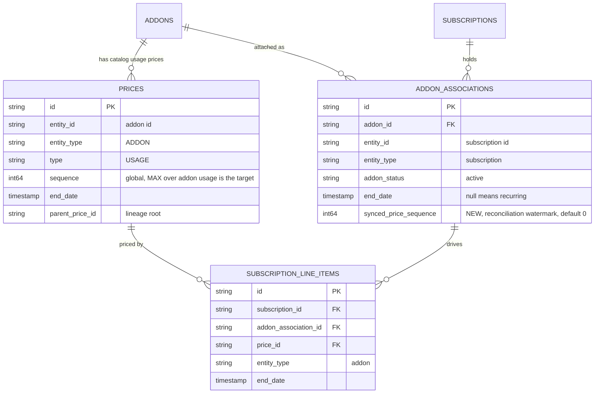
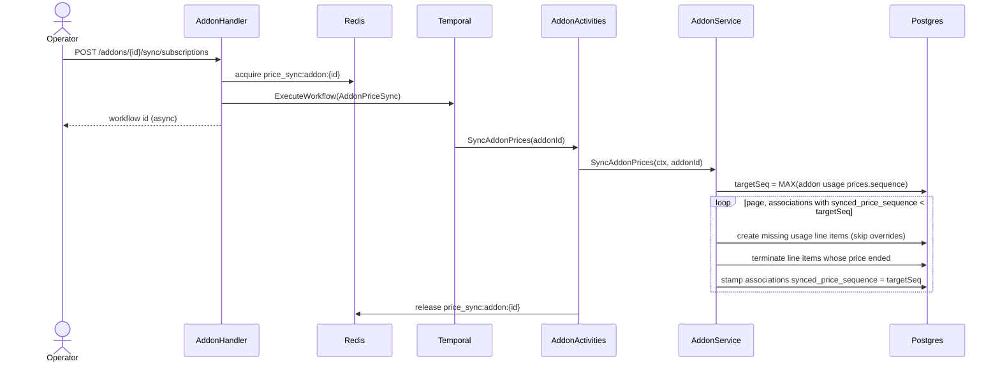

# Add-on Usage-Charge Sync to Existing Subscriptions — Design ERD

Status: **Proposed**
Date: 2026-10-12
Author: tsage
Ticket: FLE-1415

---

## 1. Problem statement

An add-on's prices are a catalog definition. When a tenant overrides an existing usage charge on an
add-on, or adds a new usage charge to it, that change is picked up only by subscriptions created after the
edit. Subscriptions that already hold the add-on keep billing the old charges, because a subscription bills
from its own line items, not from the live catalog price.

Plans already solve the same problem with an explicit "sync prices to subscriptions" action. Add-ons have
no equivalent, so there is no way to push an overridden or newly-added add-on usage charge onto the
customers who already hold that add-on.

We want an explicit, opt-in "sync add-on usage charges" action that reconciles every existing subscription
holding the add-on to the add-on's current usage prices. Without it nothing changes for existing
subscriptions, and the override still applies only to new subscriptions.

## 2. How it works today

### 2.1 Add-on charges on a subscription

When an add-on is attached, each of its catalog prices becomes a subscription line item that references the
catalog price id directly (`subscription_line_items.entity_type = 'addon'`, `entity_id = <addon_id>`,
`price_id = <addon catalog price id>`, `addon_association_id = <association id>`). The association
(`addon_associations`, `entity_type = 'subscription'`) is the per-subscription instance of the add-on.

### 2.2 Overriding a catalog charge

Editing a price with critical fields (`PriceService.UpdatePrice`) end-dates the old price
(`end_date = effective_from`, bumps its global `prices.sequence`) and creates a successor price starting at
the same instant, with `parent_price_id` pointing at the lineage root. This is entity-type agnostic, so it
already behaves identically for add-on prices. Adding a new charge is a plain `CreatePrice` that pulls a
fresh, higher `prices.sequence`.

Nothing touches existing subscription line items, so existing subscriptions keep the old charge and only new
attachments see the new price. There is no sync path for add-ons.

### 2.3 The plan price sync (close reference)

The plan price sync is the closest existing feature and a useful reference for the overall shape, though
the add-on flow is not the same (see 3.1 for the differences).

`POST /plans/{id}/sync/subscriptions` runs a per-plan Redis lock, then the Temporal `PriceSyncV2Workflow`,
then `SyncPlanPricesV2`. It is usage-only (`prices.type = 'USAGE'`), raises no invoice, and runs two passes
per subscription. The terminate pass end-dates line items whose catalog price was ended. The create pass
adds line items for catalog usage prices the subscription is missing, skipping per-subscription overrides.
Scope is narrowed by a sequence watermark, `subscriptions.synced_price_sequence < MAX(plan usage
prices.sequence)`, and reconciled subscriptions are stamped forward so they fall out of the next run. It
matches a catalog price to a subscription by strict cadence equality (same billing period and count).

Fixed charges are intentionally never synced. An advance fixed charge is already finalized on an issued
invoice, and rewriting what it was sealed on would corrupt the billed period.

## 3. Proposed solution

An explicit, opt-in sync that reconciles the subscriptions holding an add-on with its current usage prices.
It borrows the overall shape of the plan price sync in 2.3 (dedicated endpoint, per-entity lock, Temporal
workflow, usage-only, two passes, no invoice), but it is keyed on the add-on association and differs in the
ways listed in 3.1.

- Endpoint `POST /addons/{id}/sync/subscriptions`, explicit and opt-in. It takes a per-add-on Redis lock,
  starts a Temporal workflow, and returns the workflow id immediately (async).
- Temporal `AddonPriceSyncWorkflow`, then activity `SyncAddonPrices`, then `AddonService.SyncAddonPrices`.
- The target sequence is derived, not stored. It is `MAX(prices.sequence)` over the add-on's published
  usage prices, computed per add-on at sync time. No column on `addons`.
- A per-association watermark, the new `addon_associations.synced_price_sequence`, records how far each
  association has been reconciled. An association is behind when its watermark is below its add-on's target.
- Two passes per behind association, usage-only, raising no invoice.
  - Create. For each active catalog usage price the association is missing, create a line item with the same
    `addon_association_id`, skipping any charge the subscription overrode (subscription-scoped price
    lineage). Eligibility uses the add-on attach rule (currency match plus divisor-compatible cadence), so a
    multi-cadence add-on charge reaches the subscription exactly as attach would.
  - Terminate. End-date the add-on usage line item whose catalog price was ended
    (`end_date = GREATEST(line_item.start, price.end_date)`).
  - Stamp the association's watermark to the target.
- Scope. Active, recurring associations (`addon_status = 'active'`, association `end_date IS NULL`) on
  active or trialing subscriptions. One-time add-ons are excluded because they are already billed.

The watermark lives on the association, not the subscription, because a subscription holds many add-ons and
can even hold two associations to the same add-on transiently (one cancelled-at-period-end, one new
recurring). A per-association watermark tracks each independently. A per-subscription scalar could not.

### 3.1 Key differences from the plan price sync

These are why this is not the plan price sync with a different id, and why a few parts are built
differently.

- Many add-ons per subscription. A subscription holds at most one plan but any number of add-ons. The sync
  is therefore keyed on the add-on association, and the reconciliation watermark lives on
  `addon_associations`, not on the subscription. One add-on can be associated to a subscription only once at
  a time, so the association is the correct per-instance unit.
- Target sequence is per add-on. The target is `MAX(prices.sequence)` over a single add-on's usage prices,
  and each association is stamped against its own add-on's target. Editing add-on A moves only A's target.
  Associations of add-on B stay behind only if B changed. The plan sync computes one target over the plan's
  prices and stamps the subscription.
- Multi-cadence eligibility. An add-on can be attached to a subscription on a different but compatible
  cadence (for example a monthly add-on charge on a quarterly subscription). The create pass therefore
  matches catalog prices to a subscription with the add-on attach rule (currency match plus
  divisor-compatible cadence), so a new or overridden charge reaches the subscription exactly as attach
  would. The plan price sync matches cadence strictly and does not support this.

Everything else (usage-only, the create-then-terminate-then-stamp passes, the override skip by
`parent_price_id` lineage, raising no invoice) follows the same principles as the plan price sync.

## 4. Use cases

1. Override a usage charge, then sync. Every active recurring association's old line item is end-dated and a
   new one for the successor price is created, same association.
2. Add a new usage charge, then sync. A line item for the new charge is created on every active recurring
   association eligible by cadence and currency.
3. Multi-charge add-on, one charge changed. Only the changed charge's line item is replaced. The add-on's
   other charges are untouched, matched by price lineage.
4. Per-subscription override exists. A subscription that overrode the charge keeps its override, skipped via
   `parent_price_id` lineage.
5. No sync clicked. Existing subscriptions keep the old charges, and only subscriptions created after the
   edit get the new price. Unchanged from today.

## 5. Schema change (ERD) and sequence

### 5.1 ERD, schema change only

One new column. `addons`, `subscriptions`, `prices`, and `subscription_line_items` are shown only for the
relationships that drive the sync. No existing columns change.

The migration adds `synced_price_sequence int64 NOT NULL DEFAULT 0` to `addon_associations`, plus a partial
index `(tenant_id, environment_id, addon_id, synced_price_sequence, id)` over active, recurring, published
rows to drive the "which associations are behind" scan. Existing associations default to 0, so the first
sync per add-on reconciles each once (a no-op for already-correct ones) and stamps it.

### 5.2 Sequence

## 6. Walkthrough

1. Tenant overrides an add-on usage charge P1. P1 is end-dated and successor P2 is created
   (`P2.parent_price_id = root`, higher `prices.sequence`). `MAX(addon usage sequence)` rises to the target.
   Existing subscriptions are unaffected so far.
2. Tenant calls `POST /addons/{id}/sync/subscriptions`. The handler takes `price_sync:addon:{id}` (rejecting
   a concurrent sync of the same add-on), starts `AddonPriceSyncWorkflow`, and returns the workflow id.
3. The activity sets tenant, environment, and user on the context, defers releasing the lock, and calls
   `AddonService.SyncAddonPrices(addonId)`.
4. The service reads `targetSeq = MAX(prices.sequence)` over the add-on's published usage prices. If it is 0
   there is nothing to do.
5. It pages associations with `synced_price_sequence < targetSeq` (active, recurring, on active or trialing
   subscriptions). Per page it loads the page's subscriptions and the add-on's published usage prices, then:
   - Create. For each association it filters the add-on's active usage prices to those eligible for the
     subscription (currency plus divisor-compatible cadence), and for each one with no existing line item
     under that association and no per-subscription override, it builds a line item (`entity_type = 'addon'`,
     `addon_association_id`, quantity 0) and bulk-inserts. For P1 to P2, P2 gets a new line item.
   - Terminate. It end-dates the association's live add-on usage line items whose catalog price was ended.
     P1's line item is end-dated at P1.end_date.
   - Stamp. It sets each processed association's `synced_price_sequence = targetSeq`, so it drops out of the
     next page or run.
6. No invoice is raised. Usage before the effective date bills on P1's line item, after it on P2's. The
   add-on's other, unchanged charges are never matched, so their line items are left alone. A subscription
   that overrode the charge keeps its subscription-scoped price, skipped by lineage.
