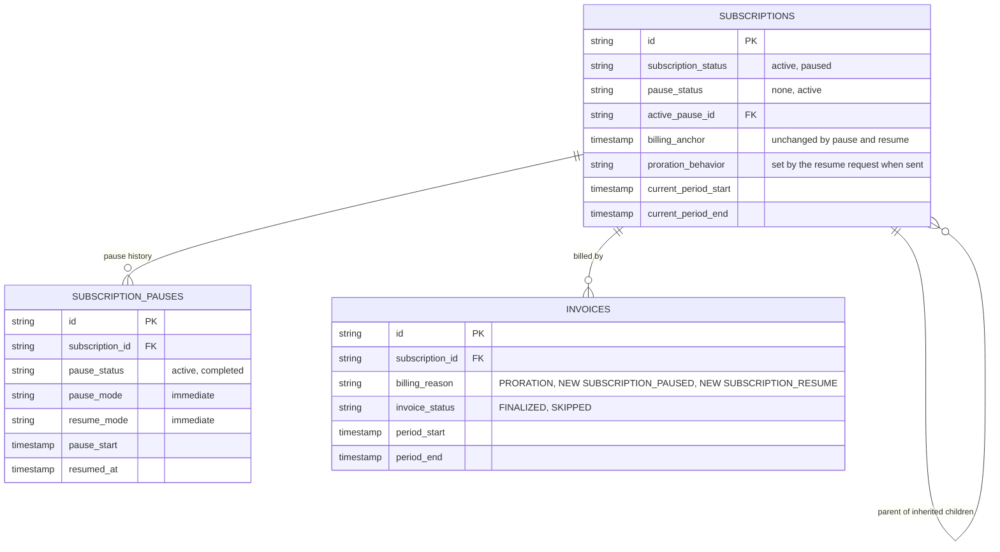
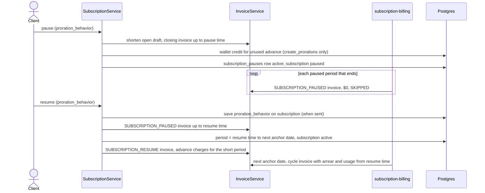

# Pause Subscription Billing, Design ERD

Status: **Proposed**
Date: 2026-10-14
Author: tsage
Ticket: FLE-1555

---

## 1. Problem statement

Customers cannot pause a subscription. Support for pausing was removed from the API some time back, so the
only option for a customer who wants to stop being billed for a while is to cancel and create a new
subscription later.

We want to bring back pause and resume. A paused subscription is billed for everything used up to the
pause, is not billed while paused, and starts billing again from the moment it is resumed.

## 2. How it works today

Pause is not supported. There is no pause or resume endpoint. Some pause code is still in the codebase (the
`subscription_pauses` table, the `paused` status, and old pause and resume service methods), but none of it
is reachable and its behavior is wrong. The new flow replaces the old service methods and reuses the
table, the status values and the webhooks. The table exists in the database and get-subscription returns
its rows as `pauses` while a subscription is paused, but nothing writes to it today.

Two existing flows are the closest references:

- **Immediate cancel with an invoice** already closes a period early. It cuts the current period at the
cancel time and bills usage and arrear fixed charges up to that point on a finalized invoice. Its request
takes a `proration_behavior`, and under `create_prorations` the unused part of advance fixed charges is
credited to the customer's wallet.
- **Subscription create with a short first period** already bills a period that starts between two anchor
dates. The first period runs from the start date to the next anchor date, and its fixed charges are priced
by the subscription's `proration_behavior`: the full price under `none`, the used fraction under
`create_prorations`.


## 3. Proposed solution (MVP)

Two endpoints, `POST /subscriptions/{id}/pause` and `POST /subscriptions/{id}/resume`. Both act immediately.
Scheduled pause, scheduled resume and automatic resume are phase 2. The MVP is about closing the period
with the right proration, skipping the paused periods, and restarting billing on the same billing anchor.

**API contracts**

`POST /v1/subscriptions/{id}/pause`

```json
{
  "proration_behavior": "create_prorations",
  "reason": "Customer requested a hold",
  "metadata": { "requested_by": "support" }
}
```

| Field | Type | Required | Notes |
|---|---|---|---|
| `proration_behavior` | enum | no | `none` (default) or `create_prorations`. Applies to the closing invoice only |
| `reason` | string | no | Max 255 characters |
| `metadata` | map | no | Stored on the pause |

`POST /v1/subscriptions/{id}/resume`

```json
{
  "proration_behavior": "create_prorations",
  "metadata": { "requested_by": "support" }
}
```

| Field | Type | Required | Notes |
|---|---|---|---|
| `proration_behavior` | enum | no | `none` or `create_prorations`. When sent, it is saved onto the subscription's `proration_behavior`. When omitted, the subscription's current value is used |
| `metadata` | map | no | Stored on the pause |

Both endpoints return the subscription and its pause (id, `pause_status`, `pause_start`, `resumed_at`). A
failed validation returns `400`, an unknown subscription `404`.

**Pause**

The pause time is the moment of the request.

1. The current period's open draft invoice is shortened to end at the pause time, so the usage it holds is
not billed again at the original period end.
2. A closing invoice is raised for the current period start up to the pause time, the same way an immediate
cancel with an invoice raises it. It holds usage and arrear fixed charges for that window and no advance
charges, because those were billed when the period started. It is finalized and payable.
3. Proration on the closing invoice follows the request's `proration_behavior`:
   - `none`: arrear fixed charges are billed for the full period, and no credit is given for advance fixed
   charges.
   - `create_prorations`: arrear fixed charges are billed only for the used part of the period, and the
   unused part of advance fixed charges is credited to the customer's wallet.

   The request value drives both. This differs from cancel, where the arrear part still reads the
   subscription's own `proration_behavior`.
4. A row is written to `subscription_pauses` with `pause_status = active` and `pause_start` set to the
pause time.
5. The subscription becomes `paused`. Its current period becomes the pause time up to the original period
end.

**While paused**

- The billing period keeps rolling on its anchor. The existing `subscription-billing` workflow does this.
Today it only picks `active` subscriptions, so it is extended to also pick `paused` ones, and for those it
only creates the paused invoice and advances the period.
- Every paused period gets an invoice with a new billing reason, `SUBSCRIPTION_PAUSED`. It has no line
items, is $0 and is always `SKIPPED`. It is never recomputed.
- Usage events keep arriving and are stored, but nothing bills them.

**Resume**

The resume time is the moment of the request.

1. If the request has `proration_behavior`, it is saved onto the subscription.
2. The paused period in progress is closed at the resume time with a `SUBSCRIPTION_PAUSED` invoice, $0 and
`SKIPPED`.
3. The billing anchor is not changed. The current period becomes the resume time up to the next anchor
date, the same way a subscription created between two anchor dates gets a short first period.
4. An invoice with a new billing reason, `SUBSCRIPTION_RESUME`, bills the advance fixed charges for that
short period. It is finalized and payable.
5. Arrear fixed charges and usage for the short period are billed by the normal cycle invoice at the next
anchor date, together with the next period's advance charges. Usage counts from the resume time, so
nothing from the paused stretch is billed.
6. The `subscription_pauses` row becomes `completed` with `resumed_at` set to the resume time.
7. The subscription becomes `active`.

Proration of the short period follows the subscription's `proration_behavior`:

- `none`: advance and arrear fixed charges are billed at the full period price.
- `create_prorations`: advance fixed charges are prorated on the resume invoice, and arrear fixed charges
are prorated on the next cycle invoice.

If the resume lands exactly on an anchor date there is no short period, and the resume invoice bills a
full period of advance charges.

**Business rules**

- BR1. Pausing a parent pauses its inherited children, and resuming the parent resumes them. Today a
paused inherited child is never picked up again on resume, so the cascade is fixed to include paused
children.
- BR2. Immediate cancel is allowed while paused. It bills nothing and completes the pause.
- BR3. Auto-cancellation for overdue invoices skips paused subscriptions.
- BR4. `subscription.paused` and `subscription.resumed` webhooks fire on each transition.
- BR5. A subscription that reaches its `end_date` while paused is cancelled by the billing run as usual,
and its pause is completed.

**Validations**

Pause is refused when:

- V1. The subscription is not `active` (draft, trialing, incomplete, paused or cancelled).
- V2. A cancellation is scheduled (`cancel_at` is set).
- V3. The subscription is Stripe-managed, or is an individual inherited or grouped child.
- V4. The pause time is outside the current period: the period has not started yet, or it has ended and
the billing run has not rolled it yet.

Resume is refused when:

- V5. The subscription is not paused.
- V6. The subscription has reached its `end_date`.

While paused:

- V7. A scheduled cancellation or a plan change is refused.
- V8. Adding or removing an addon, deleting a line item, or changing the status through the subscription
update API is refused. The subscription has to be resumed first.

**Old code**

The old pause and resume service methods are replaced by the new ones, and the unrouted API handler is
rewritten for the two new endpoints. Everything else from the old flow stays for now and its removal is
phase 2.


## 4. Use cases

1. **Pause.** A monthly subscription with an advance $310 fee and an arrear $62 fee, billed on the 1st, is
   paused on Jan 11. The closing invoice for Jan 1 to Jan 11 bills usage and the arrear fee. With
   `create_prorations` the arrear fee is $20 (10/31) and $210 (21/31 of $310) is credited to the wallet.
   With `none` the arrear fee is $62 and nothing is credited.
2. **Paused periods.** Jan 11 to Feb 1 and Feb 1 to Mar 1 each get a $0 `SKIPPED` invoice with reason
   `SUBSCRIPTION_PAUSED`.
3. **Resume.** The customer resumes on Mar 18. Mar 1 to Mar 18 gets a $0 `SKIPPED` invoice. The anchor stays
   on the 1st, so the current period is Mar 18 to Apr 1 and the next one is Apr 1 to May 1. With
   `create_prorations` the resume invoice bills $140 (14/31 of $310), and the Apr 1 invoice bills $28
   (14/31 of $62) plus usage from Mar 18 plus April's $310. With `none` the resume invoice bills $310 and
   the Apr 1 invoice bills $62 plus usage plus April's $310.
4. **Anchor on the 22nd.** Paused on Feb 5, resumed on Mar 18. Jan 22 to Feb 5 is the closing invoice.
   Feb 5 to Feb 22 and Feb 22 to Mar 18 are $0 `SKIPPED`. The current period is Mar 18 to Mar 22 (4 of 28
   days). With `create_prorations` the resume invoice bills $44.29 and the Mar 22 invoice bills $8.86 plus
   usage plus $310 for Mar 22 to Apr 22. With `none` the customer pays $310 on Mar 18 for 4 days and $310
   again on Mar 22, which is how `none` already behaves for a short first period at create.
5. **Cancel while paused.** The customer cancels on Feb 10 instead of resuming. Nothing is billed and the
   subscription is cancelled.


## 5. ERD and sequence


### 5.1 ERD

No database migration. `subscriptions.proration_behavior` stops being immutable in the ent schema so resume
can update it, which changes generated code only. The new billing reasons go into the existing `invoices.billing_reason` string column, and
each pause is one row in the existing `subscription_pauses` table. The tables below are shown only for the
fields the pause flow uses.




### 5.2 Sequence




## 6. Phase 2

Each item adds to the MVP without changing how it behaves. The request fields below are new and optional,
so MVP callers are unaffected.

- **Scheduled pause.** `pause_mode` (`immediate` or `scheduled`) and `pause_start` on the pause request.
- **Automatic resume.** `pause_end` on the pause request.
- **Scheduled resume.** `resume_mode` (`immediate` or `scheduled`) and `resume_at` on the resume request.
- **Running scheduled pauses and resumes.** Extend the existing `subscription-billing` workflow with "pause
due" and "resume due" conditions, next to its existing `cancel_at` condition. Pause and resume use the
stored times as their effective times, so a late run produces the same invoices. A dedicated schedule is
the alternative, at the cost of extra Temporal runs on every tick. An automatic or scheduled resume
prorates with the subscription's `proration_behavior`, so it needs no new column.
- **Billing anchor on resume.** An explicit `billing_anchor` on the resume request, for customers who want
to move their billing day when they come back.
- **Pausing an individual child** while the parent and the other children keep billing.
- **Pausing with a pending cancellation or plan change.**
- **Stripe-managed subscriptions,** through Stripe's `pause_collection`, with our Stripe sync no longer
overwriting the paused status.
- **Auto-cancellation of paused subscriptions** with an unpaid closing invoice.
- **Credit grants and coupons.** Re-anchor recurring credit grants on resume and extend repeating coupon end
dates by the pause length.
- **Commitments.** Prorate the commitment true-up on the closing invoice.
- **Pause at period end.** A `period_end` pause mode that skips the next period's advance charges on the
last cycle invoice.
- **Dry run.** Preview the closing and resume invoices before pausing or resuming.
- **Old code removal.** Remove the old pause and auto-resume blocks inside the legacy billing period
function, and any other pause code that nothing calls, once it is confirmed no other billing flow uses it.


## 7. Open questions

### 1. Auto-cancellation of paused subscriptions

A customer who pauses and never pays the closing invoice stays paused forever.

- **Proposed:** auto-cancellation skips paused subscriptions in the MVP.
- **Alternative:** include paused subscriptions with an overdue invoice in auto-cancellation. Cancelling a
paused subscription bills nothing, so this is safe.

### 2. Grouped children of a paused parent

Their charges are on the parent's invoice, so they are not billed while the parent is paused.

- **Proposed:** leave their status unchanged.
- **Alternative:** cascade the pause and resume to grouped children too, so their status shows `paused`.

### 3. Commitment true-up on the closing invoice

A commitment charges the gap between usage and an agreed minimum spend. The closing invoice is computed the
way cancel computes it, so it bills the full gap even for a cut-short period. Annual commitments billed
monthly also keep counting paused months.

- **Proposed:** keep the cancel behavior in the MVP. A pause does not waive the commitment.
- **Alternative 1:** skip the true-up on the closing invoice.
- **Alternative 2:** prorate the true-up to the used part of the period.

### 4. Stripe-managed subscriptions

Stripe owns their status and overwrites ours on its next webhook.

- **Proposed:** refuse the pause in the MVP.
- **Alternative:** pause in Stripe too through `pause_collection`, and stop our Stripe sync from overwriting
the paused status.

### 5. Entitlements while paused

The customer entitlements API only returns active and trialing subscriptions, so a paused customer has no
entitlements, boolean features included.

- **Proposed:** keep it. A paused subscription grants no access.
- **Alternative:** return the paused subscription's entitlements, so access continues while billing is
paused.

### 6. Credit grants and coupons while paused

Recurring credits that fall due during a pause are skipped and not caught up, and after resume they keep
their old delivery date. Repeating coupons have a calendar end date, so a pause uses up their time.

- **Proposed:** accept both in the MVP and fix them in phase 2.
- **Alternative:** on resume, re-anchor recurring grants to the new period and push coupon end dates out by
the pause length.
