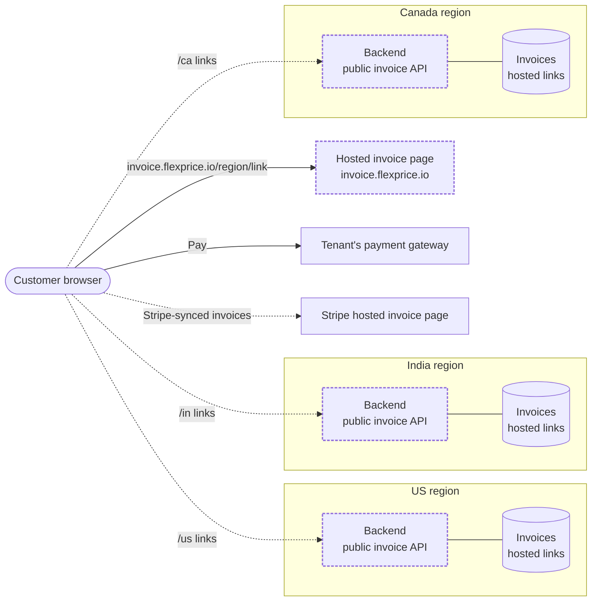
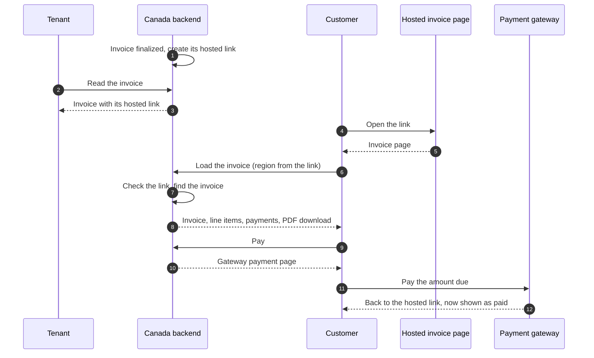
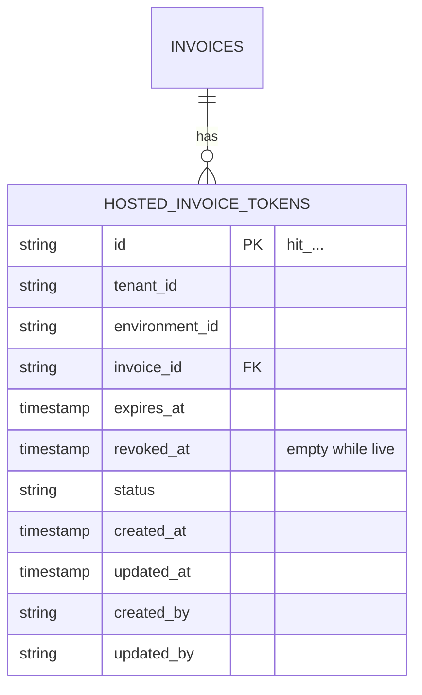
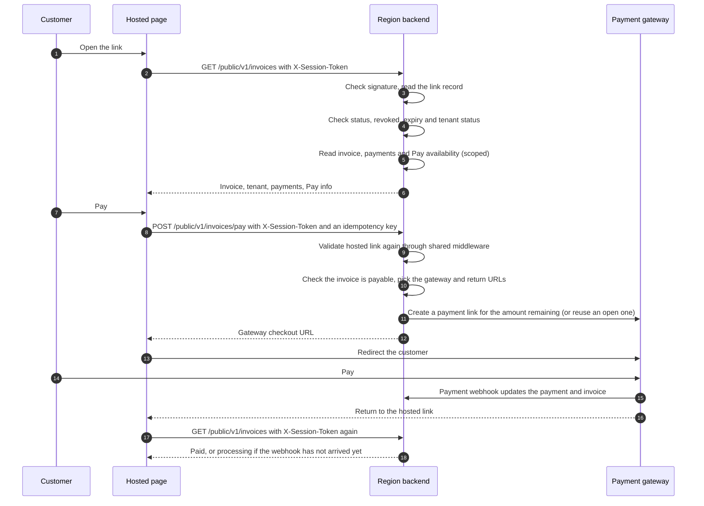
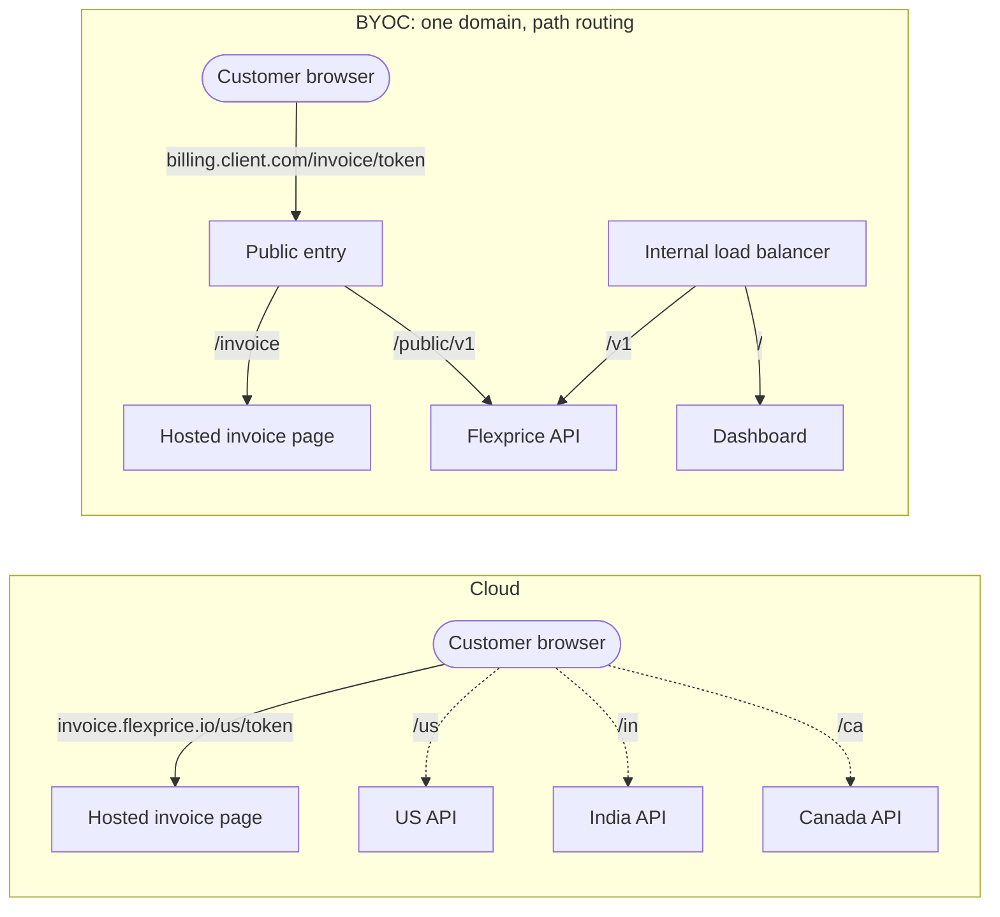

# Hosted Invoice — Design ERD

Status: In review · Owner: aghijap · Last updated: 2026-10-20
Links: <ticket> · <related ERDs / PRs>

## 1. Requirement
<!-- erd:locked -->

**Today.** A tenant's end customer can reach an invoice without a Flexprice login in three ways:

- **Customer portal.** View, pay and download the PDF. The tenant has to mint a session with its API key; the token opens the customer's whole account and expires after an hour.
- **`invoice_pdf_url` in webhooks.** A presigned link to the PDF in Flexprice's storage (S3/GCS). It expires after an hour and only gives the PDF, with no way to pay.
- **Stripe's hosted invoice page.** Only for invoices synced to Stripe. Tenants on other providers, or with no integration, have nothing like it.

**The gap.** There is no common hosted invoice link available on the invoice object that lets a customer view, download and pay that invoice without logging in. Tenants whose provider already hosts invoices have no single place in Flexprice to read that provider's link.

**After.** Every finalized invoice carries exactly one hosted invoice link on the invoice object. The end customer opens it without logging in to view that invoice, download its PDF and pay it.

- If the invoice is synced to an integration that hosts invoices (for example Stripe), the invoice holds that integration's hosted link, so the provider stays the system the customer pays through.
- Otherwise the invoice holds a Flexprice-hosted link, and payment goes through the tenant's payment gateway.

Tenants read the link from the invoice the same way whichever page it points to.

## 2. Use cases
<!-- erd:locked -->

**UC1 — Tenant retrieves the hosted invoice link.**
1. An invoice is finalized.
2. The tenant reads the invoice's hosted link from the invoice API response or an invoice webhook.

Variation: the invoice is synced to an integration that hosts invoices; the link the tenant reads is the provider's.

**UC2 — Customer views an open invoice.**
1. The customer opens the link; no login.
2. They see the tenant's name, the amount due, the invoice number and the due date.
3. They open the invoice details: summary (to, from, invoice number, memo), line items, totals, amount paid, amount remaining and payment history.
4. They download the invoice PDF.

**UC3 — Customer pays an open invoice.**
1. The customer opens the link and chooses Pay.
2. They complete payment on the tenant's payment gateway.
3. They return to the hosted page, which now shows the invoice as paid (UC4).

Variations:
- Payment fails: the page still shows the amount due and Pay, enabled only while the invoice remains payable and a usable gateway is available.
- Payment is processing: the page shows it as processing and offers no second Pay.
- Part of the invoice is already paid: the page shows the amount remaining, and Pay collects that amount.
- The invoice is not payable yet (for example the first invoice of a subscription awaiting activation): the page shows the invoice with Pay disabled.

**UC4 — Customer opens a paid invoice.**
1. The customer opens the link.
2. They see "Invoice paid", the amount, the invoice number, the payment date and the payment method.
3. They open the invoice and payment details (as in UC2 step 3).
4. They download the invoice PDF. There is no Pay.

**UC5 — Customer opens a voided invoice.**
1. The customer opens the link.
2. They see the invoice marked as voided, with its amount and invoice number.
3. They can open the details and download the PDF. There is no Pay.

**UC6 — Customer opens an integration-owned invoice.**
1. The customer opens the invoice's link, which is the provider's hosted page (for example Stripe).
2. They view and pay the invoice there; Flexprice records the payment through the existing sync.

Variation: until Stripe supplies a hosted URL, the invoice retains its Flexprice link. When the Stripe URL arrives, it replaces the active URL and the old Flexprice link is revoked.

**UC7 — Tenant revokes or refreshes a link.** Deferred (not in v1): tenant revoke and refresh are not built; revoke is internal only, on the switch to Stripe (UC6).

## 3. Scope
<!-- erd:locked -->

A **hosted invoice page** here means a page that shows the invoice amount with a Pay button, lets the customer view the line items and download the invoice. A checkout or payment link is not a hosted invoice page.

**In**
- A hosted invoice link on newly finalized invoices, readable from the invoice API and webhooks.
- Stripe's hosted page as the link for invoices synced to Stripe.
- A Flexprice-hosted page for all other invoices: view, details, PDF download and Pay.

**Out**
- Tenant revoke and refresh of Flexprice links (revoke exists internally only, on the switch to Stripe; admin APIs can add it later).
- Hosted links from other providers (Razorpay, Zoho Books, QuickBooks, HubSpot); they can be added later.
- Checkout or payment links (Paddle, Whop, Nomod, Moyasar) as the hosted link.
- Payment receipts.
- Sending the hosted invoice link by email; to be scoped separately later.
- Changes to the customer portal.

## 4. Functional requirements
<!-- erd:locked -->

"Stripe invoice sync on" means the tenant's Stripe connection has outbound invoice sync enabled.

| ID | Requirement | UC | Acceptance criteria |
|---|---|---|---|
| FR-1 | When an invoice is finalized and the tenant does not sync invoices to Stripe, the invoice gets a Flexprice hosted link. | UC1 | Finalize an invoice with no Stripe sync → the invoice API response and the `invoice.update.finalized` webhook carry a Flexprice link. |
| FR-2 | When Stripe supplies a hosted invoice URL, it becomes the invoice's active hosted URL and any existing Flexprice link is revoked when the sync completes. Enabling sync alone does not switch the link. | UC1, UC6 | Sync an invoice with an existing Flexprice link → the invoice API and `invoice.sync.success` carry Stripe's URL; opening the old Flexprice link shows the revoked page. |
| FR-3 | If Stripe sync fails or supplies no hosted URL, the active hosted link is unchanged. | UC6 | Force a failed sync → `invoice.sync.failed`, existing Flexprice link remains; retry with a Stripe URL → switch to Stripe and revoke the Flexprice link. |
| FR-4 | The Stripe URL is kept in invoice metadata (`metadata.stripe_hosted_invoice_url`); no hosted URL or token is stored on the invoice or in the link table. The API's `hosted_invoice_url` is computed at read time: Stripe's URL if present, else the signed Flexprice link if the invoice has a live link, else empty. Flexprice does not refresh provider URLs. | UC6 | Read the invoice twice, days apart → same Stripe URL, with no Stripe API call on read. |
| FR-5 | The invoice's link is readable from the invoice API (get and list) and from invoice webhooks. | UC1 | `GET /invoices/:id`, the invoice list and the invoice webhooks all return the same link. |
| FR-6 | Opening a Flexprice link needs no login and shows only that invoice. | UC2 | Open the link in a fresh browser → the invoice loads; no other invoice or customer data is reachable from it. |
| FR-7 | The open view shows the tenant's name, the amount due, the invoice number, the due date and Pay. | UC2, UC3 | Open the link for a finalized, unpaid invoice → all five are shown. |
| FR-8 | The page shows invoice and payment details: summary (to, from, invoice number, memo), line items, totals, amount paid, amount remaining and payment history. | UC2, UC4, UC5 | Open the details for an invoice with a partial payment → every field shows the invoice's values. |
| FR-9 | The customer can download the invoice PDF from the page. | UC2, UC4, UC5 | Click Download → the PDF of this invoice downloads, however long after finalization the link is opened. |
| FR-10 | Pay is offered only when the invoice is payable by the customer portal's rules (finalized, payment status pending or failed, amount remaining above zero, not the first invoice of a subscription still awaiting activation) and the tenant has at least one gateway that can accept the payment; on an open invoice that fails these checks, Pay is shown disabled. Processing replaces Pay with "Payment processing"; paid and voided invoices have no Pay. | UC3 | Open invoice awaiting activation or with no usable gateway → disabled Pay; eligible open invoice → enabled Pay; processing → "Payment processing" instead of Pay; paid or voided → no Pay. |
| FR-11 | Pay collects the amount remaining through the tenant's payment gateway and returns the customer to the hosted page. | UC3 | Pay a partly paid invoice → the gateway charges the amount remaining; after paying, the customer lands on the hosted page. |
| FR-12 | After a failed payment, Pay follows FR-10; a payment that is processing shows as processing with no Pay. | UC3 | Failed payment → Pay is shown again, enabled only under FR-10; processing payment → "Payment processing" and no Pay. |
| FR-13 | A paid invoice shows "Invoice paid", the amount, the invoice number, the payment date and the payment method, with no Pay. | UC4 | Open the link of a paid invoice → all five are shown and Pay is absent. |
| FR-14 | A voided invoice shows as voided with its amount and invoice number, with no Pay. | UC5 | Void an invoice and open its link → voided state, no Pay. |
| FR-15 | Deferred (not in v1): tenant revoke of a Flexprice link. | UC7 | — |
| FR-16 | Deferred (not in v1): tenant refresh of a Flexprice link. One link is live per invoice. | UC7 | — |
| FR-17 | Deferred (not in v1): `invoice.update` webhook on revoke or refresh. | UC7 | — |
| FR-18 | Opening a revoked link (revoked on the switch to Stripe) shows "This link is no longer valid, contact <tenant name>" and no invoice data. | UC6 | Open a revoked link → that message, with no amount, number or line items. |
| FR-19 | Deferred (not in v1): tenant revoke and refresh endpoints, and their rejection for Stripe-owned links. | UC7 | — |
| FR-20 | In Flexprice cloud, Flexprice links are served from the dedicated invoice domain `invoice.flexprice.io`, separate from the dashboard and customer portal domains. A BYOC deployment serves them under `/invoice` on its own domain. | UC1 | In cloud, every Flexprice link starts with `https://invoice.flexprice.io/<region>/`; in BYOC, every link starts with `https://<deployment domain>/invoice/`. |

## 5. Non-functional requirements
<!-- erd:locked -->

These apply to Flexprice links; Stripe links follow Stripe's own rules.

| ID | Category | Requirement (measurable) | How we verify |
|---|---|---|---|
| NFR-1 | Security | The link carries the link record's id and an HMAC-SHA256 signature made with the deployment's auth secret, the key that already signs customer-portal and checkout tokens. Without the secret no valid link can be produced, and the signing secret is not stored in the database. No URL or token is stored in the database. | Review: changing any character of a link makes it invalid; neither the link table nor the invoice holds a token. |
| NFR-2 | Security | A link expires 30 days after the invoice's due date (or finalization if there is no due date), but never sooner than 30 days and never later than 120 days after the link record's creation. The floor and cap are per link, not measured from invoice creation, so a backdated invoice still gets a working link. An expired link shows "This link is no longer valid, contact <tenant name>" and no invoice data. | e2e: finalize an invoice whose due date is more than 30 days in the past → link valid for 30 days from issue; set the link's expiry in the past → expired page; set a far-future due date → expiry stays at link creation + 120 days, and access is rejected at that boundary. |
| NFR-3 | Security | Deferred (not in v1): expiry of a refreshed link. | — |
| NFR-4 | Security | While a tenant is suspended, its links show the "no longer valid" page; they work again when the tenant is reactivated. | e2e: suspend the tenant → page blocked; reactivate → page loads. |

## 6. Constraints
<!-- erd:locked -->

| Constraint | Source | Impact |
|---|---|---|
| Stripe's hosted URL expires 30 days after the due date, never more than 120 days. | Stripe | After that, the Stripe link (FR-4) opens Stripe's expired page. |
| Invoice PDFs are kept in Flexprice's object storage and served through download links that expire after an hour. | Flexprice storage | The page creates a fresh download link on each download. |
| With more than one payment gateway connected, Flexprice cannot choose one for a payment unless told which. | Flexprice payments | Pay needs a single gateway, or the page names the one to use. |
| All data is scoped to a tenant and an environment. | Flexprice multi-tenancy | The page has no API key, so the link must identify the tenant, environment and invoice before anything is read. |

## 7. Current state – what we reuse
<!-- erd:locked -->

| Piece | What it gives us | Reuse |
|---|---|---|
| Customer portal invoice view, PDF and pay | Reads one invoice for a customer, serves its PDF and starts a payment, without an API key | Extend: add the link token as a second way in, alongside the portal session |
| Portal session token | Signed token scoped to a whole customer, valid for an hour | Replace for hosted links: a per-invoice token that can be revoked (NFR-1) |
| Portal payability rules | When an invoice may be paid | As-is (FR-10) |
| Payment links | Gateway payment page for the amount remaining, reuse of an unexpired link so a customer can't open two payments, return to a given page after paying | As-is (FR-11) |
| Invoice PDF rendering and storage | Renders the PDF once, keeps it in object storage, issues short-lived download links | As-is (FR-9) |
| Tenant status check | Blocks portal access for suspended tenants | As-is (NFR-4) |
| Stripe invoice sync | Pushes the invoice to Stripe on finalization and keeps Stripe's hosted URL in invoice metadata | Extend: the invoice's hosted link reads the metadata URL (FR-2) |
| Invoice webhooks | `invoice.update.finalized`, `invoice.update`, `invoice.sync.success` / `invoice.sync.failed` | Extend: carry the hosted link (FR-5) |
| Customer portal frontend | Public, token-based pages (portal, checkout) built from the shared UI components, including invoice status display | Reuse the shared UI components in a new standalone app for the hosted invoice page, served on the invoice domain (FR-20) |

## 8. Solution overview
<!-- erd:locked -->

The hosted invoice page is a standalone frontend app, owned by the frontend team and built from the same UI components as the dashboard. One deployment on `invoice.flexprice.io` serves every region; the regional frontends and the dashboard are not involved. The link's path names its region (`/us/…`, `/in/…`, `/ca/…`), and the page uses it to call that region's backend directly from the browser, through a small public invoice API. A BYOC deployment serves the same app under `/invoice` on its own domain (9.6).



New pieces are dashed: the hosted invoice page, and the public invoice API with its store of hosted links in every backend. The solid arrow loads the page; dotted arrows are the page's own calls to the region named in the link.

The main flow, for a Canada tenant whose invoice is not synced to Stripe:



- For an invoice synced to Stripe, the first step is replaced by the Stripe sync recording Stripe's hosted URL in metadata, and the customer views and pays on Stripe's page.

## 9. Detailed design
<!-- erd:locked -->

### 9.1 Hosted link token

**Why the token is protected**
- The link needs no login: whoever holds it can open the invoice.
- The page shows the customer's details, the tenant's line items and prices, payment history, and can start a payment.
- So the token must be impossible to guess, must not leak, and must stop working once expired or revoked.

**Token.** The token is `<link id>.<signature>`, where the signature is the base64url HMAC-SHA256 of the bare link id. It is signed with the deployment's auth secret, the key that already signs customer-portal and checkout tokens. The token is signed when the API returns the link. No URL or token is stored in the database, so database readers cannot use it.

**Storage.** Hosted links live in their own table, one row per link ever issued. A replaced or revoked link keeps its row, so opening an old link still identifies the tenant and can show "This link is no longer valid, contact <tenant name>".



| Column | Type | Null | Why |
|---|---|---|---|
| `id` | string | no | Row id with its own prefix |
| `tenant_id`, `environment_id` | string | no | Standard scoping, copied from the invoice |
| `invoice_id` | string | no | The invoice the link opens |
| `expires_at` | timestamp | no | due date + 30 days (finalization when no due date exists), at least created_at + 30 days and at most created_at + 120 days |
| `revoked_at` | timestamp | yes | Set when the link is revoked, e.g. on the switch to Stripe |
| `status`, `created_at`, `updated_at`, `created_by`, `updated_by` | standard | | Standard fields of every table |

Indexes:
- `invoice_id` unique where `revoked_at` is empty: at most one live link per invoice, enforced by the database.

**Lifecycle**
- **Issue:** when an invoice is finalized, a link row is inserted in the same transaction as finalization, unless the tenant syncs invoices to Stripe (invoice outbound sync on the Stripe connection); nothing is written to the invoice.
- **Due date change:** when a finalized invoice's due date changes, the live row's expiry is recalculated in the same update, within the link's `created_at` + 30 days floor and + 120 days cap; this is how a tenant extends an expired link while refresh is deferred.
- **Switch to Stripe:** when a Stripe hosted URL is received, retain it in `metadata.stripe_hosted_invoice_url`; when the sync completes, revoke any unrevoked Flexprice link. Repeated delivery is idempotent. No URL is written.
- **Open:** the signature is checked first; a link with a bad signature is rejected without touching the database. The link record is then read by its id without a tenant filter, the only lookup that may do so. The row gives the tenant, environment and invoice; everything after it is scoped as usual. A row that is not published, revoked or past `expires_at`, or whose invoice carries a Stripe hosted URL, shows the "no longer valid" page.

**Example.** Acme Ltd, a Canada tenant, finalizes invoice INV-0042 due on 14 Nov 2026. Flexprice creates this link record:

| Column | Value |
|---|---|
| `id` | `hit_01JAB3K7Q9X2M4N8P6R5T1V0WZ` |
| `tenant_id` | `tenant_01J9ZK2W8Q4R6T` |
| `environment_id` | `env_01J9ZK3A1B2C3D` |
| `invoice_id` | `inv_01JAB3K5M2N4P6Q8` |
| `expires_at` | 2026-12-14 00:00 UTC (due date + 30 days) |
| `revoked_at` | empty |
| `status` | published |
| `created_at` | 2026-10-14 10:05 UTC |

The link is built from the record when the API returns it; nothing is stored:

1. Input: the bare link id, `hit_01JAB3K7Q9X2M4N8P6R5T1V0WZ`.
2. Signature: HMAC-SHA256 of the input with the deployment's auth secret, base64url without padding (43 characters): `<signature>`.
3. Token: record id, a dot, the signature.
4. Link: the deployment's base URL, a slash, the token.

| Deployment | Base URL | Link |
|---|---|---|
| Cloud, Canada | `https://invoice.flexprice.io/ca` | `https://invoice.flexprice.io/ca/hit_01JAB3K7Q9X2M4N8P6R5T1V0WZ.<signature>` |
| Cloud, US | `https://invoice.flexprice.io/us` | `https://invoice.flexprice.io/us/<token>` |
| Cloud, India | `https://invoice.flexprice.io/in` | `https://invoice.flexprice.io/in/<token>` |
| BYOC | the deployment's domain plus `/invoice`, e.g. `https://billing.client.com/invoice` | `https://billing.client.com/invoice/<token>` |

Opening the link reverses the steps: split the token at the dot, sign the record id again, and compare with the signature in the link (in constant time). Only a match reads the record; any edited character fails the comparison.

**Storage and reading.** No URL or token is stored on the invoice or in the link table. Invoice get/list responses and webhooks compute `hosted_invoice_url` at read time: Stripe's URL from `metadata.stripe_hosted_invoice_url` if present; else, if `hosted_invoice.base_url` is set and the invoice has a live (unrevoked, unexpired) Flexprice link, `hosted_invoice.base_url` + "/" + the token signed at read time; else empty. Invoice list looks up live links for the page's invoices in one batch query. Link records remain the authority for expiry and revocation when a public endpoint is called. These checks are not cached. Issuing and revoking links are not recorded in the activity log.

Revoke acts on the link record, never on the signature: the signature only proves Flexprice issued the link, and the record says whether it still works. Revoke is internal only (the switch to Stripe).

| Case | Link records | Link |
|---|---|---|
| Revoke (switch to Stripe) | The live record is marked revoked | "No longer valid, contact <tenant>" |
| Expiry | Nothing changes; the record's expiry has passed | "No longer valid, contact <tenant>" |
| Edited or forged link | Nothing is read | Rejected: the signature does not match |

### 9.2 API contracts

**Invoice field.** Invoice API responses (get and list) and invoice webhook payloads gain one field:

| Field | Type | Value |
|---|---|---|
| `hosted_invoice_url` | string, omitted when empty | Computed at read time: Stripe's hosted URL for Stripe-synced invoices, else the signed Flexprice link while a live link exists (FR-1 to FR-5) |

**Public endpoints.** The hosted page calls these on its own region's API. Each request sends the existing `<link_id>.<signature>` token in `X-Session-Token`; no API key or customer-portal session is needed. The customer-facing URL still contains the token, but API paths do not.

All three live under `/public/v1`, a prefix used only for endpoints reached without an API key, so the edge and ingress can apply their own rate limits to it with one path rule.

```http
GET /public/v1/invoices
X-Session-Token: <link_id>.<signature>
```

The view, download and pay endpoints share dedicated hosted-invoice middleware. It verifies the hosted-link signature, reads the link record, checks the link's status, revocation, expiry and tenant status, and establishes the invoice, tenant and environment scope before the handler runs. The invoice is derived from the link record, never from a caller-supplied invoice ID. This reuses the portal's header convention, not its JWT middleware: customer-portal JWTs are not accepted here, and hosted-link tokens do not grant portal access. A missing header follows the malformed-token error below. The regional API's CORS policy must allow `X-Session-Token` for hosted-page requests.

Errors shared by all three:

| Case | HTTP | `code` | `message` (shown on the page as is) |
|---|---|---|---|
| Missing token header, malformed token or signature mismatch | 404 | `not_found` | "This link is not valid." |
| Link revoked or expired, or tenant suspended | 404 | `not_found` | "This link is no longer valid, contact Acme Ltd." |

**`GET /public/v1/invoices`.** Everything the page shows.

```json
{
  "tenant": {
    "name": "Acme Ltd",
    "billing_details": { "email": "billing@acme.com", "help_email": "help@acme.com", "phone": "+1 416 555 0100", "address": { "...": "..." } }
  },
  "invoice": {
    "id": "inv_01JAB3K5M2N4P6Q8",
    "invoice_number": "INV-0042",
    "invoice_status": "FINALIZED",
    "payment_status": "PENDING",
    "currency": "cad",
    "total": "1200.00",
    "amount_paid": "200.00",
    "amount_remaining": "1000.00",
    "due_date": "2026-11-14T00:00:00Z",
    "customer": { "...": "..." },
    "line_items": [ { "...": "..." } ],
    "taxes": [ { "...": "..." } ],
    "...": "same as the customer portal's invoice response"
  },
  "payments": [
    { "id": "pay_01JAB…", "amount": "200.00", "currency": "cad", "payment_status": "SUCCEEDED", "payment_gateway": "stripe", "payment_method_type": "CARD", "created_at": "2026-10-16T08:00:00Z", "succeeded_at": "2026-10-16T08:01:00Z", "failed_at": null }
  ],
  "pay": { "enabled": true }
}
```

- `invoice` has the customer portal's invoice response shape, so the page reuses the dashboard's invoice components. It holds what the portal already shows the customer, including the invoice's metadata.
- `payments` lists the invoice's payments with only the fields above; gateway payloads and internal ids are left out.
- `pay.enabled` follows FR-10.

**`GET /public/v1/invoices/pdf`.** Same as the customer portal's PDF endpoint.

```json
{ "presigned_url": "https://<storage>/…/INV-0042.pdf?X-Amz-Expires=3600&…" }
```

The download URL is created on each call and lasts an hour; the page opens it.

**`POST /public/v1/invoices/pay`.** Same response as customer portal pay.

```json
{ "idempotency_key": "<uuid made by the page per click>" }
```

```json
{
  "payment_id": "pay_01JAC…",
  "invoice_id": "inv_01JAB3K5M2N4P6Q8",
  "status": "PENDING",
  "amount": "1000.00",
  "currency": "cad",
  "payment_action": { "type": "payment_link", "url": "https://<gateway checkout>" }
}
```

- `idempotency_key` is required. The backend picks the gateway (the first, alphabetically, of the tenant's gateways that can create payment links) and sets the return URLs to the hosted link.
- The amount is always the amount remaining (FR-11). An unexpired payment link already open for the invoice is returned again instead of a new one.

| Error | HTTP | `code` | `message` |
|---|---|---|---|
| Invoice not payable (FR-10) | 400 | `invalid_operation` | "This invoice can't be paid right now." |
| `idempotency_key` missing | 400 | `validation_error` | "Something went wrong, please try again." |

**Tenant endpoints.** Deferred (not in v1): `POST /v1/invoices/{id}/hosted-link/refresh` and `POST /v1/invoices/{id}/hosted-link/revoke` (FR-15 to FR-17, FR-19) are not built.

### 9.3 Flows

Open and pay a Flexprice link (UC2, UC3). Issuing and revoking are in 9.1.



### 9.4 Jobs and events

No new jobs or consumers.

| Webhook | When | `hosted_invoice_url` |
|---|---|---|
| `invoice.update.finalized` | Invoice finalized | Computed at read time; Flexprice link unless the tenant syncs invoices to Stripe |
| `invoice.sync.success` | Stripe sync completes | Stripe's hosted URL (from metadata) |

| Config | Value |
|---|---|
| `hosted_invoice.base_url` | Cloud: `https://invoice.flexprice.io/<region>`. BYOC: `https://<deployment domain>/invoice` (9.6). The API layer reads it when returning links; links are this value, a slash and the token. Empty (the default) returns no Flexprice link. |

### 9.5 Frontend

**App.** A standalone app with one deployment on `invoice.flexprice.io`, separate from the dashboard; no dashboard shell and no login. Its route is `/<region>/<token>`. The region picks the API origin from a region-to-API map set at build time (`us`, `in`, `ca`, and `staging` for testing); any other path shows "Page not found". The page sends the signed token in `X-Session-Token` on every view, download and pay request, calling the region's API directly. The page sets `referrer: no-referrer` and `robots: noindex`.

**States.**

| State | When | Shows |
|---|---|---|
| Open | Finalized, payment pending or failed | Tenant name, amount due, invoice number, due date, Pay (disabled when `pay.enabled` is false), Download, "View invoice and payment details" |
| Processing | Payment processing | Same card with "Payment processing" in place of Pay |
| Paid | Payment succeeded | "Invoice paid", amount, invoice number, payment date, payment method, Download, details; no Pay |
| Voided | Invoice voided | "Voided", amount, invoice number, Download, details; no Pay |
| Not valid | API returns 404 | The API's message only |

**Details drawer** (FR-8): summary (to: the customer; from: the tenant; invoice number; memo), line items, totals, amount paid, amount remaining, payment history, and "Questions? Contact <tenant>" with the tenant's help email.

**Actions.**
- Pay: calls pay with a new idempotency key, then redirects to `payment_action.url`. Returning from the gateway reloads the invoice.
- Download: calls the download endpoint and opens `presigned_url`.

### 9.6 Deployment: cloud and BYOC

The backend is the same in both. The page is the same app, built twice: they differ in where it is served, the prefix its files load from, and its region-to-API map.

| | Cloud | BYOC |
|---|---|---|
| Page | One deployment on `invoice.flexprice.io` for every region | Served by the deployment under `/invoice` on its existing domain, next to the dashboard and API |
| File prefix (build time) | `/` | `/invoice/`, so the page's files load from `/invoice/assets/…` and not from the dashboard's paths |
| Region-to-API map (build time) | `us`, `in`, `ca`, `staging` → each region's API | `invoice` → the deployment's own domain |
| `hosted_invoice.base_url` | `https://invoice.flexprice.io/<region>`, set per region | `https://<deployment domain>/invoice` |
| Link | `https://invoice.flexprice.io/<region>/<token>` | `https://billing.client.com/invoice/<token>` |
| Page calls | Browser → the region's API named in the link | Browser → `/public/v1` on the same domain |



BYOC needs, beyond cloud:
- The page built with the `/invoice/` prefix, and accepting `invoice` as its link segment (the cloud build accepts only region names).
- Load balancer rules: `/invoice` to the page (unknown paths under it return the page's entry file) and `/public/v1` to the API.
- `/invoice` and `/public/v1` reachable by end customers from the internet through a public entry that forwards only those two paths. `/v1`, `/health`, `/api/v1` and the dashboard stay on the internal load balancer.
- A deployment that leaves `hosted_invoice.base_url` empty issues no Flexprice links and offers no Pay.

## 10. Cross-cutting concerns
<!-- erd:locked -->

| Concern | How the design handles it | NFR |
|---|---|---|
| Forged or guessed links | Signature checked in constant time before any database read; a mismatch reads nothing (9.1) | NFR-1 |
| Expired or revoked links | Link record checked on every call; no cache, so a revoke works at once | NFR-2 |
| Suspended tenant | Hosted routes check the tenant's status themselves and answer with the "no longer valid" message | NFR-4 |
| Link leaking from the page | `no-referrer` and `noindex` on the page | NFR-1 |
| Multi-tenancy | The link-by-id read is the only lookup without a tenant filter; every read after it is scoped to the link's tenant and environment | — |
| Data on a forwarded link | Whoever holds the link sees what the portal shows the customer, including invoice metadata; expiry and revoke bound it | NFR-2 |
| Paying twice | Switching to a Stripe URL revokes the Flexprice hosted link; pay reuses an open payment link and takes an idempotency key | — |
| Link creation fails at finalize | The link is created in the finalize transaction, so finalize fails and retries as it does today | — |
| Stripe sync fails | The active hosted link is unchanged until a provider URL is received (FR-3) | — |
| Performance | Invoice get signs the link at read time; list adds one batch query for live links per page; public endpoints validate the link record on each call; no performance target set | — |
| Backward compatibility | `hosted_invoice_url` is a new, optional, computed field; invoices finalized before launch have no link; the customer portal is unchanged | — |

## 11. Risks & open questions
<!-- erd:locked -->

| Risk | Likelihood / Impact | Mitigation |
|---|---|---|
| No rate limiting on the public endpoints, so Pay could be used for card testing | Low / Medium | Gateways' own card-testing defences; rate limiting is future scope |
| Razorpay and Nomod payment links ignore the return URLs (existing bug), so the customer may not come back to the page after paying | Medium / Low | Existing bug, fixed separately |
| A failed Razorpay autopay is treated as already synced (existing bug), so Pay may get no payment link for that invoice | Low / Medium | Existing bug, fixed separately |
| Stripe's hosted URL expires (maximum 120-day expiry window) and is never refreshed | Medium / Low | Accepted (FR-4) |

| Open question | Owner | Blocks |
|---|---|---|
| Tenant-level default payment gateway, for both the customer portal and the hosted page | Product | Nothing in v1; handled separately |
| Whether Zoho Books, QuickBooks, HubSpot and Tabs hosted pages take payment, before adding them as providers | Backend (aghijap) | Future providers |
