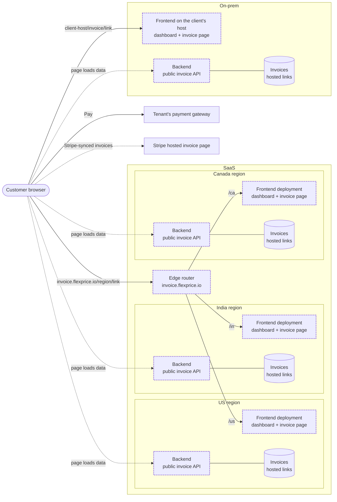
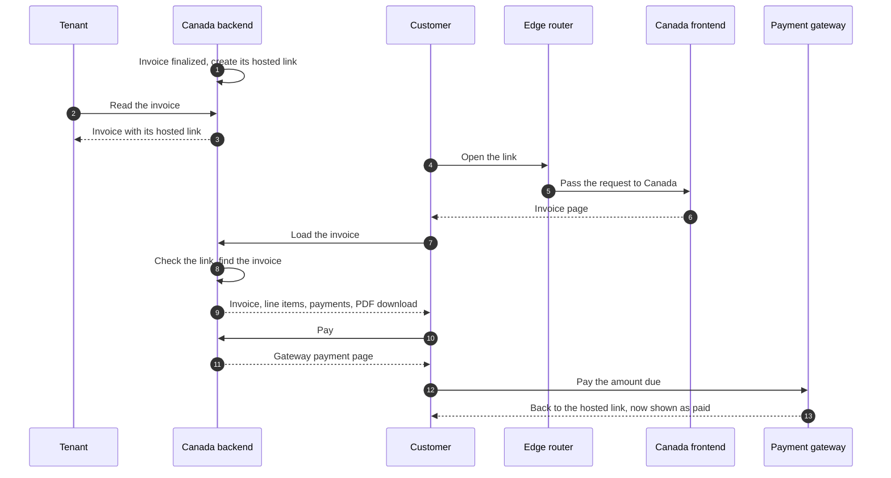
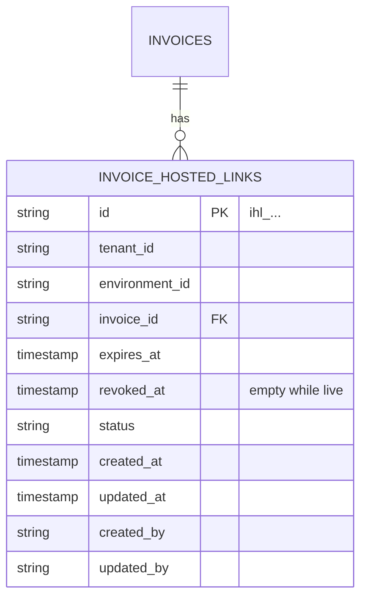
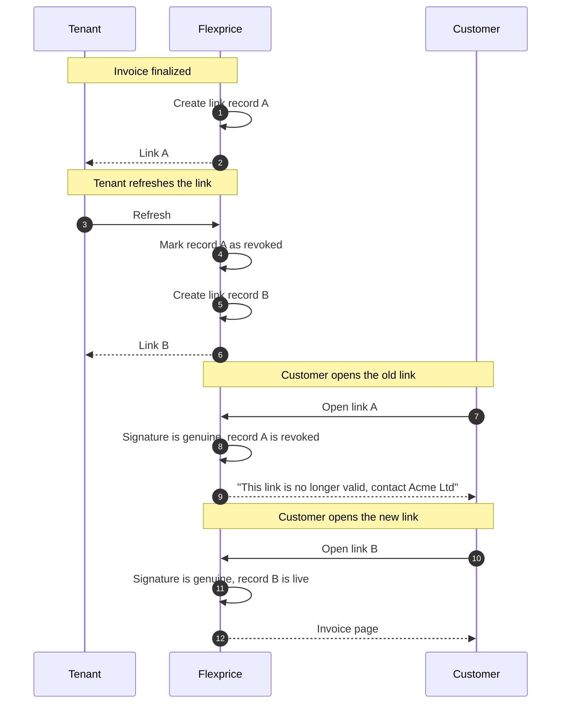
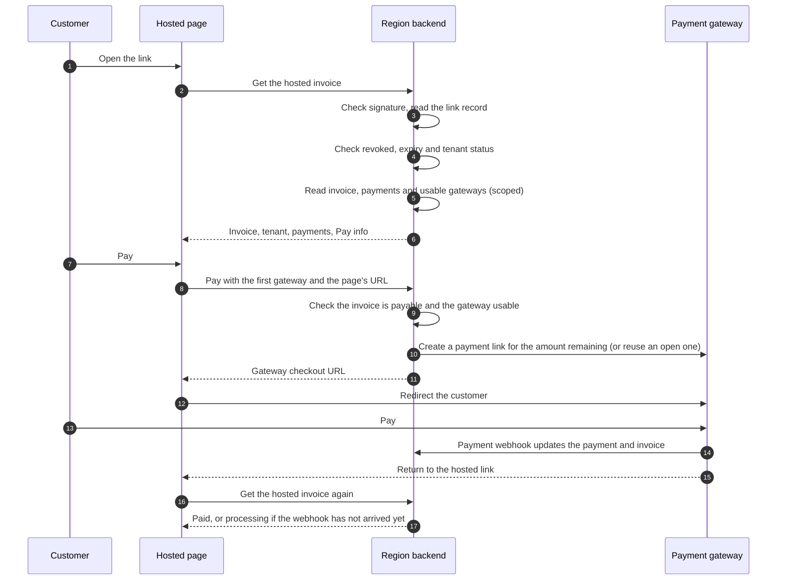

# Hosted Invoice — Design ERD

Status: In review · Owner: aghijap · Last updated: 2026-10-16
Links: <ticket> · <related ERDs / PRs>

## 1. Requirement
<!-- erd:locked -->

**Today.** A tenant's end customer can reach an invoice without a Flexprice login in three ways:

- **Customer portal.** View, pay and download the PDF. The tenant has to mint a session with its API key; the token opens the customer's whole account and expires after an hour.
- **`invoice_pdf_url` in webhooks.** A presigned link to the PDF in Flexprice's storage (S3/GCS). It expires after an hour and only gives the PDF, with no way to pay.
- **Stripe's hosted invoice page.** Only for invoices synced to Stripe. Tenants on other providers, or with no integration, have nothing like it.

**The gap.** There is no common hosted invoice link available on the invoice object that lets a customer view, download and pay that invoice without logging in. Tenants whose provider already hosts invoices have no single place in Flexprice to read that provider's link.

**After.** Every finalized invoice carries exactly one hosted invoice link on the invoice object. The end customer opens it without logging in to view that invoice, download its PDF and pay it.

- If the invoice is synced to an integration that hosts invoices (for example Stripe), the invoice holds that integration's hosted link, so the provider stays the system the customer pays through.
- Otherwise the invoice holds a Flexprice-hosted link, and payment goes through the tenant's payment gateway.

Tenants read the link from the invoice the same way whichever page it points to.

## 2. Use cases
<!-- erd:locked -->

**UC1 — Tenant retrieves the hosted invoice link.**
1. An invoice is finalized.
2. The tenant reads the invoice's hosted link from the invoice API response or an invoice webhook.

Variations:
- The invoice is synced to an integration that hosts invoices; the link the tenant reads is the provider's.
- The invoice was finalized before launch; its hosted link becomes available through the backfill.

**UC2 — Customer views an open invoice.**
1. The customer opens the link; no login.
2. They see the tenant's name, the amount due, the invoice number and the due date.
3. They open the invoice details: summary (to, from, invoice number, memo), line items, totals, amount paid, amount remaining and payment history.
4. They download the invoice PDF.

**UC3 — Customer pays an open invoice.**
1. The customer opens the link and chooses Pay.
2. They complete payment on the tenant's payment gateway.
3. They return to the hosted page, which now shows the invoice as paid (UC4).

Variations:
- Payment fails: the page still shows the amount due and Pay, enabled only while the invoice remains payable and a usable gateway is available.
- Payment is processing: the page shows it as processing and offers no second Pay.
- Part of the invoice is already paid: the page shows the amount remaining, and Pay collects that amount.
- The invoice is not payable yet (for example the first invoice of a subscription awaiting activation): the page shows the invoice with Pay disabled.

**UC4 — Customer opens a paid invoice.**
1. The customer opens the link.
2. They see "Invoice paid", the amount, the invoice number, the payment date and the payment method.
3. They open the invoice and payment details (as in UC2 step 3).
4. They download the invoice PDF. There is no Pay.

**UC5 — Customer opens a voided invoice.**
1. The customer opens the link.
2. They see the invoice marked as voided, with its amount and invoice number.
3. They can open the details and download the PDF. There is no Pay.

**UC6 — Customer opens an integration-owned invoice.**
1. The customer opens the invoice's link, which is the provider's hosted page (for example Stripe).
2. They view and pay the invoice there; Flexprice records the payment through the existing sync.

Variation: until Stripe supplies a hosted URL, the invoice retains its Flexprice link. When the Stripe URL arrives, it replaces the active URL and the old Flexprice link is revoked.

**UC7 — Tenant revokes or refreshes a link.**
1. The tenant revokes an invoice's Flexprice link, or refreshes it to get a new one.
2. The old link stops working.
3. After a refresh, the invoice holds the new link, which the tenant can retrieve.

Variation: the invoice is synced to Stripe; its link is Stripe's and cannot be revoked from Flexprice.

## 3. Scope
<!-- erd:locked -->

A **hosted invoice page** here means a page that shows the invoice amount with a Pay button, lets the customer view the line items and download the invoice. A checkout or payment link is not a hosted invoice page.

**In**
- A hosted invoice link on newly finalized invoices and a backfill for existing finalized invoices, readable from the invoice API and webhooks.
- Stripe's hosted page as the link for invoices synced to Stripe.
- A Flexprice-hosted page for all other invoices: view, details, PDF download and Pay.
- Revoking and refreshing Flexprice links.

**Out**
- Hosted links from other providers (Razorpay, Zoho Books, QuickBooks, HubSpot); they can be added later.
- Checkout or payment links (Paddle, Whop, Nomod, Moyasar) as the hosted link.
- Payment receipts.
- Sending the hosted invoice link by email; to be scoped separately later.
- Changes to the customer portal.

## 4. Functional requirements
<!-- erd:locked -->

"Stripe invoice sync on" means the tenant's Stripe connection has outbound invoice sync enabled.

| ID | Requirement | UC | Acceptance criteria |
|---|---|---|---|
| FR-1 | When an invoice is finalized without an integration hosted URL, the invoice gets a Flexprice hosted link. | UC1 | Finalize an invoice with no Stripe sync → the invoice API response and the `invoice.update.finalized` webhook carry a Flexprice link. |
| FR-2 | When Stripe supplies a hosted invoice URL, it becomes the invoice's active hosted URL and any existing Flexprice link is revoked in the same transaction. Enabling sync alone does not switch the link. | UC1, UC6 | Sync an invoice with an existing Flexprice link → the invoice API and `invoice.sync.success` carry Stripe's URL; opening the old Flexprice link shows the revoked page. |
| FR-3 | If Stripe sync fails or supplies no hosted URL, the active hosted link is unchanged. | UC6 | Force a failed sync → `invoice.sync.failed`, existing Flexprice link remains; retry with a Stripe URL → switch to Stripe and revoke the Flexprice link. |
| FR-4 | The Stripe URL remains in invoice metadata and is also stored in the invoice's top-level `hosted_invoice_url` when selected as active. Flexprice does not refresh provider URLs. | UC6 | Read the invoice twice, days apart → same Stripe URL, with no Stripe API call on read. |
| FR-5 | The invoice's link is readable from the invoice API (get and list) and from invoice webhooks. | UC1 | `GET /invoices/:id`, the invoice list and the invoice webhooks all return the same link. |
| FR-6 | Opening a Flexprice link needs no login and shows only that invoice. | UC2 | Open the link in a fresh browser → the invoice loads; no other invoice or customer data is reachable from it. |
| FR-7 | The open view shows the tenant's name, the amount due, the invoice number, the due date and Pay. | UC2, UC3 | Open the link for a finalized, unpaid invoice → all five are shown. |
| FR-8 | The page shows invoice and payment details: summary (to, from, invoice number, memo), line items, totals, amount paid, amount remaining and payment history. | UC2, UC4, UC5 | Open the details for an invoice with a partial payment → every field shows the invoice's values. |
| FR-9 | The customer can download the invoice PDF from the page. | UC2, UC4, UC5 | Click Download → the PDF of this invoice downloads, however long after finalization the link is opened. |
| FR-10 | Pay is offered only when the invoice is payable by the customer portal's rules (finalized, payment status pending or failed, amount remaining above zero, not the first invoice of a subscription still awaiting activation) and the tenant has at least one gateway that can accept the payment; on an open invoice that fails these checks, Pay is shown disabled. Processing replaces Pay with "Payment processing"; paid and voided invoices have no Pay. | UC3 | Open invoice awaiting activation or with no usable gateway → disabled Pay; eligible open invoice → enabled Pay; processing → "Payment processing" instead of Pay; paid or voided → no Pay. |
| FR-11 | Pay collects the amount remaining through the tenant's payment gateway and returns the customer to the hosted page. | UC3 | Pay a partly paid invoice → the gateway charges the amount remaining; after paying, the customer lands on the hosted page. |
| FR-12 | After a failed payment, Pay follows FR-10; a payment that is processing shows as processing with no Pay. | UC3 | Failed payment → Pay is shown again, enabled only under FR-10; processing payment → "Payment processing" and no Pay. |
| FR-13 | A paid invoice shows "Invoice paid", the amount, the invoice number, the payment date and the payment method, with no Pay. | UC4 | Open the link of a paid invoice → all five are shown and Pay is absent. |
| FR-14 | A voided invoice shows as voided with its amount and invoice number, with no Pay. | UC5 | Void an invoice and open its link → voided state, no Pay. |
| FR-15 | The tenant can revoke an invoice's Flexprice link; the invoice then has no link until it is refreshed. | UC7 | Revoke → the old link stops working and the invoice API returns no link. |
| FR-16 | The tenant can refresh an invoice's Flexprice link; the invoice gets a new link and the old one stops working. One link is active per invoice. | UC7 | Refresh → the API returns a new link; the old link stops working; only the new one opens the invoice. |
| FR-17 | Revoking or refreshing sends the `invoice.update` webhook with the invoice's current link. | UC7 | Refresh → `invoice.update` is delivered carrying the new link. |
| FR-18 | Opening a revoked link shows "This link is no longer valid, contact <tenant name>" and no invoice data. | UC7 | Open a revoked link → that message, with no amount, number or line items. |
| FR-19 | Revoke and refresh apply only to Flexprice links. | UC7 | Revoke or refresh on an invoice holding a Stripe link → rejected with an error saying the link is managed by Stripe. |
| FR-20 | In Flexprice cloud, Flexprice links are served from the dedicated invoice domain `invoice.flexprice.io`, separate from the dashboard and customer portal domains. On-prem, links use the deployment's configured base URL. | UC1 | In cloud, every Flexprice link starts with `https://invoice.flexprice.io/<region>/`; on-prem, every link starts with the configured base URL. |
| FR-21 | Existing finalized invoices are backfilled with hosted links, following the provider ownership rules in FR-1 to FR-4. | UC1, UC6 | After backfill, an existing stored Stripe URL populates the top-level active URL; otherwise a Flexprice link is issued under the normal expiry rules. Switching to Stripe revokes any existing Flexprice link. |

## 5. Non-functional requirements
<!-- erd:locked -->

These apply to Flexprice links; Stripe links follow Stripe's own rules.

| ID | Category | Requirement (measurable) | How we verify |
|---|---|---|---|
| NFR-1 | Security | The link carries the link record's id and an HMAC-SHA256 signature made with the deployment's auth secret, the key that already signs customer-portal and checkout tokens. Without the secret no valid link can be produced, and the signing secret is not stored in the database. The invoice stores the complete bearer URL. | Review: changing any character of a link makes it invalid; the link table holds no token. |
| NFR-2 | Security | A link expires at the earlier of 30 days after the invoice's due date (or finalization if there is no due date) and 120 days after the link record's creation. The cap is per link, not measured from invoice creation. An expired link shows "This link is no longer valid, contact <tenant name>" and no invoice data. | e2e: move the due date 31 days into the past → expired page; set a far-future due date → expiry stays at link creation + 120 days, and access is rejected at that boundary. |
| NFR-3 | Security | A refreshed link expires at the later of refresh + 30 days and the invoice's due date + 30 days (or finalization + 30 days when there is no due date), capped at the new link record's creation + 120 days. Refresh creates a new link with its own creation timestamp and cap. | e2e: refresh a link on an invoice 40 days past due → it works for 30 days from the refresh. |
| NFR-4 | Security | While a tenant is suspended, its links show the "no longer valid" page; they work again when the tenant is reactivated. | e2e: suspend the tenant → page blocked; reactivate → page loads. |

## 6. Constraints
<!-- erd:locked -->

| Constraint | Source | Impact |
|---|---|---|
| Stripe's hosted URL expires 30 days after the due date, never more than 120 days. | Stripe | After that, the stored Stripe link (FR-4) opens Stripe's expired page. |
| Invoice PDFs are kept in Flexprice's object storage and served through download links that expire after an hour. | Flexprice storage | The page creates a fresh download link on each download. |
| With more than one payment gateway connected, Flexprice cannot choose one for a payment unless told which. | Flexprice payments | Pay needs a single gateway, or the page names the one to use. |
| All data is scoped to a tenant and an environment. | Flexprice multi-tenancy | The page has no API key, so the link must identify the tenant, environment and invoice before anything is read. |

## 7. Current state – what we reuse
<!-- erd:locked -->

| Piece | What it gives us | Reuse |
|---|---|---|
| Customer portal invoice view, PDF and pay | Reads one invoice for a customer, serves its PDF and starts a payment, without an API key | Extend: add the link token as a second way in, alongside the portal session |
| Portal session token | Signed token scoped to a whole customer, valid for an hour | Replace for hosted links: a per-invoice token that can be revoked and refreshed (FR-15, FR-16, NFR-1) |
| Portal payability rules | When an invoice may be paid | As-is (FR-10) |
| Payment links | Gateway payment page for the amount remaining, reuse of an unexpired link so a customer can't open two payments, return to a given page after paying | As-is (FR-11) |
| Invoice PDF rendering and storage | Renders the PDF once, keeps it in object storage, issues short-lived download links | As-is (FR-9) |
| Tenant status check | Blocks portal access for suspended tenants | As-is (NFR-4) |
| Stripe invoice sync | Pushes the invoice to Stripe on finalization and stores Stripe's hosted URL on the invoice | Extend: the invoice's hosted link reads the stored URL (FR-2) |
| Invoice webhooks | `invoice.update.finalized`, `invoice.update`, `invoice.sync.success` / `invoice.sync.failed` | Extend: carry the hosted link (FR-5, FR-17) |
| Customer portal frontend | Public, token-based pages inside the dashboard app (portal, checkout), including invoice status display | Extend: base for the hosted invoice page, served on the invoice domain (FR-20) |

## 8. Solution overview
<!-- erd:locked -->

The hosted invoice page is a frontend page: an invoice-only entry point of the frontend app, owned by the frontend team and built from the same UI components as the dashboard. It ships with each region's existing frontend deployment and reads its data from a small public invoice API on that region's backend. In SaaS, an edge router on `invoice.flexprice.io` forwards `/{region}/…` to that region's frontend deployment, so the customer only ever sees `invoice.flexprice.io`. On-prem, the link points at the deployment's own frontend host and no router is involved.



New pieces are dashed: the edge router, the invoice page in every frontend deployment, and the public invoice API with its store of hosted links in every backend. Solid arrows load the page; dotted arrows are the page's own calls to its region's backend.

The main flow, for a Canada tenant whose invoice is not synced to Stripe:



- On-prem follows the same flow without the edge router: the customer opens the link on the deployment's own frontend host.
- For an invoice synced to Stripe, the first step is replaced by the Stripe sync storing Stripe's hosted link, and the customer views and pays on Stripe's page.

## 9. Detailed design
<!-- erd:locked -->

### 9.1 Hosted link token

**Why the token is protected**
- The link needs no login: whoever holds it can open the invoice.
- The page shows the customer's details, the tenant's line items and prices, payment history, and can start a payment.
- So the token must be impossible to guess, must not leak, and must stop working once expired or revoked.

**Token.** The token is the link record's id plus a signature: `<link id>.<HMAC-SHA256 of the link id>`, base64url-encoded. It is signed with the deployment's auth secret, which already signs customer-portal and checkout tokens; the signed input carries a fixed hosted-link label, so a portal or checkout token can never pass as a hosted link or the other way round. The URL is signed when issued and stored on the invoice. The signing key is not stored in the database, but the stored URL is a bearer credential and database readers can use it. Rotating the auth secret invalidates every live link; tenants refresh links after a rotation.

**Storage.** Hosted links live in their own table, one row per link ever issued. A replaced or revoked link keeps its row, so opening an old link still identifies the tenant and can show "This link is no longer valid, contact <tenant name>".



| Column | Type | Null | Why |
|---|---|---|---|
| `id` | string | no | Row id with its own prefix |
| `tenant_id`, `environment_id` | string | no | Standard scoping, copied from the invoice |
| `invoice_id` | string | no | The invoice the link opens |
| `expires_at` | timestamp | no | Normal: min(due date + 30 days, created_at + 120 days), using finalization when no due date exists. Refreshed: min(max(due date + 30 days, refresh + 30 days), created_at + 120 days), again using finalization when no due date exists |
| `revoked_at` | timestamp | yes | Set when the tenant revokes or refreshes the link |
| `status`, `created_at`, `updated_at`, `created_by`, `updated_by` | standard | | Standard fields of every table |

Indexes:
- `invoice_id` unique where `revoked_at` is empty: at most one live link per invoice, enforced by the database.

**Lifecycle**
- **Issue:** when an invoice is finalized without an integration hosted URL, a link row is inserted and its signed URL is stored in `invoice.hosted_invoice_url` in the same transaction as finalization.
- **Backfill:** existing finalized invoices receive hosted links under FR-21. Flexprice links retain the normal expiry in NFR-2, calculated from the original due date or finalization; backfilling does not extend it, so an older invoice may receive an already-expired link. Stripe links follow the provider’s existing rules.
- **Due date change:** when a finalized invoice's due date changes, the live row's expiry is recalculated in the same update; a refreshed link keeps its 30 days from the refresh as a floor. Neither a due-date change nor recalculation can extend expiry beyond that link record's original `created_at` + 120 days.
- **Refresh:** the live row gets `revoked_at`, a new row is inserted, and the invoice's `hosted_invoice_url` is replaced with the new signed URL in the same transaction.
- **Revoke:** the live row gets `revoked_at` and the invoice's `hosted_invoice_url` is cleared in the same transaction; the invoice has no link until refreshed.
- **Switch to Stripe:** when a Stripe hosted URL is received, retain it in `metadata.stripe_hosted_invoice_url`, set the invoice's `hosted_invoice_url` to it, and revoke any unrevoked Flexprice link in the same transaction. Repeated delivery must be idempotent. Refresh and revoke must serialize with this switch so they cannot replace a Stripe-owned URL.
- **Open:** the signature is checked first; a link with a bad signature is rejected without touching the database. The link record is then read by its id without a tenant filter, the only lookup that may do so. The row gives the tenant, environment and invoice; everything after it is scoped as usual. A row that is revoked or past `expires_at` shows the "no longer valid" page.

**Example.** Acme Ltd, a Canada tenant, finalizes invoice INV-0042 due on 14 Nov 2026. Flexprice creates this link record:

| Column | Value |
|---|---|
| `id` | `ihl_01JAB3K7Q9X2M4N8P6R5T1V0WZ` |
| `tenant_id` | `tenant_01J9ZK2W8Q4R6T` |
| `environment_id` | `env_01J9ZK3A1B2C3D` |
| `invoice_id` | `inv_01JAB3K5M2N4P6Q8` |
| `expires_at` | 2026-12-14 00:00 UTC (due date + 30 days) |
| `revoked_at` | empty |
| `status` | published |
| `created_at` | 2026-10-14 10:05 UTC |

The link is built from the record on issue and stored in the invoice's `hosted_invoice_url`:

1. Input: `hosted_invoice_link:ihl_01JAB3K7Q9X2M4N8P6R5T1V0WZ` (the fixed label keeps portal and checkout tokens from passing as hosted links).
2. Signature: HMAC-SHA256 of the input with the deployment's auth secret, base64url without padding (43 characters): `8UIN_CEPAL_hxgZJYCgiHUxmmClFZhxtEXseH187EwA`. This value comes from an example secret, for illustration only.
3. Token: record id, a dot, the signature.
4. Link: the deployment's base URL, a slash, the token.

| Deployment | Base URL | Link |
|---|---|---|
| Cloud, Canada | `https://invoice.flexprice.io/ca` | `https://invoice.flexprice.io/ca/ihl_01JAB3K7Q9X2M4N8P6R5T1V0WZ.8UIN_CEPAL_hxgZJYCgiHUxmmClFZhxtEXseH187EwA` |
| Cloud, US | `https://invoice.flexprice.io/us` | `https://invoice.flexprice.io/us/<token>` |
| Cloud, India | `https://invoice.flexprice.io/in` | `https://invoice.flexprice.io/in/<token>` |
| On-prem | the client's frontend host, e.g. `https://billing.example.com/invoice` | `https://billing.example.com/invoice/<token>` |

Opening the link reverses the steps: split the token at the dot, sign the record id again, and compare with the signature in the link (in constant time). Only a match reads the record; any edited character fails the comparison.

After the tenant refreshes the link on 20 Oct 2026, the table holds two rows for the invoice; the old link still finds its row and shows "no longer valid, contact Acme Ltd":

| `id` | `expires_at` | `revoked_at` | Link |
|---|---|---|---|
| `ihl_01JAB3K7Q9X2M4N8P6R5T1V0WZ` | 2026-12-14 | 2026-10-20 09:12 UTC | `…/ca/ihl_01JAB3K7Q9X2M4N8P6R5T1V0WZ.8UIN_CEPAL_hxgZJYCgiHUxmmClFZhxtEXseH187EwA` (no longer valid) |
| `ihl_01JAC9F2D4H6K8M1N3P5Q7R9ST` | 2026-12-14 | empty | `…/ca/ihl_01JAC9F2D4H6K8M1N3P5Q7R9ST.czhs2MgdU7VxtbsTgV4DakPuUq1mmbK80JqeQt3X1oc` (live) |

**Storage and reading.** The invoice has a nullable `hosted_invoice_url` column containing its active URL, whether Flexprice or Stripe. Invoice get/list responses and webhooks read this column directly; no extra link-table lookup or signing is needed to return it. Stripe URLs also remain in `metadata.stripe_hosted_invoice_url`; backfill copies existing values into the new column. Flexprice link records remain the authority for expiry and revocation when a public endpoint is called. These checks are not cached. Issuing, refreshing and revoking links are not recorded in the activity log.

Revoke and refresh act on the link record, never on the signature: the signature only proves Flexprice issued the link, and the record says whether it still works.



| Action | Link records | Old link | New link |
|---|---|---|---|
| Revoke | The live record is marked revoked | "No longer valid, contact <tenant>" | None until the tenant refreshes |
| Refresh | The live record is marked revoked; a new record is created | "No longer valid, contact <tenant>" | Works |
| Expiry | Nothing changes; the record's expiry has passed | "No longer valid, contact <tenant>" | Tenant refreshes to get one |
| Edited or forged link | Nothing is read | Rejected: the signature does not match | — |

### 9.2 API contracts

**Invoice field.** Invoice API responses (get and list) and invoice webhook payloads gain one field:

| Field | Type | Value |
|---|---|---|
| `hosted_invoice_url` | string, omitted when empty | The Flexprice link, or Stripe's hosted URL for Stripe-synced invoices (FR-1 to FR-5) |

**Public endpoints.** The hosted page calls these on its own region's API. They take no API key or session: the token in the path is the only credential. They sit in their own route group and check the tenant's status themselves (NFR-4). The request path carries the full token, but observability records only `link_id`; the signature is redacted as specified in §10.

Errors shared by all three:

| Case | HTTP | `code` | `message` (shown on the page as is) |
|---|---|---|---|
| Malformed token or signature mismatch | 404 | `not_found` | "This link is not valid." |
| Link revoked or expired, or tenant suspended | 404 | `not_found` | "This link is no longer valid, contact Acme Ltd." |

**`GET /v1/hosted-invoice/{token}`.** Everything the page shows.

```json
{
  "tenant": {
    "name": "Acme Ltd",
    "billing_details": { "email": "billing@acme.com", "help_email": "help@acme.com", "phone": "+1 416 555 0100", "address": { "...": "..." } }
  },
  "invoice": {
    "id": "inv_01JAB3K5M2N4P6Q8",
    "invoice_number": "INV-0042",
    "invoice_status": "FINALIZED",
    "payment_status": "PENDING",
    "currency": "cad",
    "total": "1200.00",
    "amount_paid": "200.00",
    "amount_remaining": "1000.00",
    "due_date": "2026-11-14T00:00:00Z",
    "customer": { "...": "..." },
    "line_items": [ { "...": "..." } ],
    "taxes": [ { "...": "..." } ],
    "...": "same as the customer portal's invoice response"
  },
  "payments": [
    { "id": "pay_01JAB…", "amount": "200.00", "currency": "cad", "payment_status": "SUCCEEDED", "payment_gateway": "stripe", "payment_method_type": "CARD", "created_at": "2026-10-16T08:00:00Z", "succeeded_at": "2026-10-16T08:01:00Z", "failed_at": null }
  ],
  "pay": { "enabled": true, "gateways": ["razorpay", "stripe"] }
}
```

- `invoice` has the customer portal's invoice response shape, so the page reuses the dashboard's invoice components. It holds what the portal already shows the customer, including the invoice's metadata.
- `payments` lists the invoice's payments with only the fields above; gateway payloads and internal ids are left out.
- `pay.enabled` follows FR-10. `pay.gateways` lists the tenant's usable gateways (connected and able to create payment links) in alphabetical order. The Pay button sends the first one, matching the customer portal.

**`GET /v1/hosted-invoice/{token}/pdf`.** Same as the customer portal's PDF endpoint.

```json
{ "presigned_url": "https://<storage>/…/INV-0042.pdf?X-Amz-Expires=3600&…" }
```

The download URL is created on each call and lasts an hour; the page opens it.

**`POST /v1/hosted-invoice/{token}/pay`.** Same request and response as customer portal pay.

```json
{
  "payment_provider": "razorpay",
  "success_url": "https://invoice.flexprice.io/ca/<token>",
  "failure_url": "https://invoice.flexprice.io/ca/<token>",
  "cancel_url": "https://invoice.flexprice.io/ca/<token>",
  "idempotency_key": "<uuid made by the page per click>"
}
```

```json
{
  "payment_id": "pay_01JAC…",
  "invoice_id": "inv_01JAB3K5M2N4P6Q8",
  "status": "PENDING",
  "amount": "1000.00",
  "currency": "cad",
  "payment_action": { "type": "redirect", "url": "https://<gateway checkout>" }
}
```

- `payment_provider` is required; the page sends the URL it is on as all three return URLs.
- The amount is always the amount remaining (FR-11). An unexpired payment link already open for the invoice is returned again instead of a new one.

| Error | HTTP | `code` | `message` |
|---|---|---|---|
| Invoice not payable (FR-10) | 400 | `invalid_operation` | "This invoice can't be paid right now." |
| `payment_provider` missing or not a usable gateway | 400 | `validation_error` | "Razorpay is not available for this invoice." |

**Tenant endpoints.** API key, with invoice write permission, like void and finalize. No request body. Both return the invoice response with its current `hosted_invoice_url`.

| Endpoint | Behaviour |
|---|---|
| `POST /v1/invoices/{id}/hosted-link/refresh` | Revokes the live link if there is one and issues a new link (FR-16, NFR-3). Also issues one for a finalized invoice that never had a link, including invoices finalized before launch, and for one whose link was revoked or expired. |
| `POST /v1/invoices/{id}/hosted-link/revoke` | Revokes the live link (FR-15). With no live link it changes nothing, returns 200 and sends no webhook. |

| Error | HTTP | `code` | `message` |
|---|---|---|---|
| Invoice not found | 404 | `not_found` | "Invoice not found." |
| Draft invoice | 400 | `invalid_operation` | "Hosted links are created when an invoice is finalized." |
| Invoice has switched to a Stripe hosted URL (FR-19) | 400 | `invalid_operation` | "This invoice's hosted link is managed by Stripe." |

### 9.3 Flows

Open and pay a Flexprice link (UC2, UC3). Issuing, refreshing and revoking are in 9.1.



### 9.4 Jobs and events

Backfill existing finalized invoices under FR-21. Execution details and webhook behavior for the backfill remain to be defined. No new recurring jobs or consumers are specified.

| Webhook | When | `hosted_invoice_url` |
|---|---|---|
| `invoice.update.finalized` | Invoice finalized | Current stored URL; Flexprice until an integration hosted URL is received |
| `invoice.sync.success` | Stripe sync completes | Stripe's hosted URL |
| `invoice.update` | Link refreshed or revoked; not sent for a revoke that changed nothing | New link, or empty after a revoke |

| Config | Value |
|---|---|
| `hosted_invoice.base_url` | Cloud: `https://invoice.flexprice.io/<region>`. On-prem: the client's frontend host plus `/invoice`. Links are this value, a slash and the token. |

### 9.5 Frontend

**Entry point.** A separate invoice-only entry point of the frontend app at `/invoice/:token`. It loads no dashboard shell and no login. It uses relative asset paths so it works behind the edge router's `/<region>/` prefix, and calls the region's API that the deployment is built with. The page sets `referrer: no-referrer` and `robots: noindex`.

**States.**

| State | When | Shows |
|---|---|---|
| Open | Finalized, payment pending or failed | Tenant name, amount due, invoice number, due date, Pay (disabled when `pay.enabled` is false), Download, "View invoice and payment details" |
| Processing | Payment processing | Same card with "Payment processing" in place of Pay |
| Paid | Payment succeeded | "Invoice paid", amount, invoice number, payment date, payment method, Download, details; no Pay |
| Voided | Invoice voided | "Voided", amount, invoice number, Download, details; no Pay |
| Not valid | API returns 404 | The API's message only |

**Details drawer** (FR-8): summary (to: the customer; from: the tenant; invoice number; memo), line items, totals, amount paid, amount remaining, payment history, and "Questions? Contact <tenant>" with the tenant's help email.

**Actions.**
- Pay: calls pay with `pay.gateways[0]` and the current URL, then redirects to `payment_action.url`. Returning from the gateway reloads the invoice.
- Download: calls the PDF endpoint and opens `presigned_url`.

## 10. Cross-cutting concerns
<!-- erd:locked -->

| Concern | How the design handles it | NFR |
|---|---|---|
| Forged or guessed links | Signature checked in constant time before any database read; a mismatch reads nothing (9.1) | NFR-1 |
| Expired, revoked or replaced links | Link record checked on every call; no cache, so a revoke works at once | NFR-2, NFR-3 |
| Suspended tenant | Hosted routes check the tenant's status themselves and answer with the "no longer valid" message | NFR-4 |
| Link leaking from the page | `no-referrer` and `noindex` on the page | NFR-1 |
| Token in logs | Log only `link_id` for correlation. Redact the signature wherever the hosted URL or token appears in application logs, request/access logs (including the edge router), and traces; never record the full bearer token. | NFR-1 |
| Multi-tenancy | The link-by-id read is the only lookup without a tenant filter; every read after it is scoped to the link's tenant and environment | — |
| Data on a forwarded link | Whoever holds the link sees what the portal shows the customer, including invoice metadata; expiry and revoke bound it | NFR-2 |
| Paying twice | Switching to a Stripe URL revokes the Flexprice hosted link; pay reuses an open payment link and takes an idempotency key | — |
| Concurrent refreshes | The one-live-link index lets one refresh win; the other fails and can be retried | — |
| Link creation fails at finalize | The link is created in the finalize transaction, so finalize fails and retries as it does today | — |
| Stripe sync fails | The active hosted link is unchanged until a provider URL is received (FR-3) | — |
| Performance | Invoice reads return the stored URL without an extra link-table query; public endpoints still validate the link record on each call; no performance target set | — |
| Backward compatibility | `hosted_invoice_url` is a new, optional field; existing finalized invoices receive links through the backfill (FR-21); the customer portal is unchanged | — |

## 11. Risks & open questions
<!-- erd:locked -->

| Risk | Likelihood / Impact | Mitigation |
|---|---|---|
| No rate limiting on the public endpoints, so Pay could be used for card testing | Low / Medium | Gateways' own card-testing defences; rate limiting is future scope |
| Rotating the auth secret invalidates every live link | Low / High | Tenants refresh links after a rotation; no rotation planned |
| Razorpay and Nomod payment links ignore the return URLs (existing bug), so the customer may not come back to the page after paying | Medium / Low | Existing bug, fixed separately |
| A failed Razorpay autopay is treated as already synced (existing bug), so Pay may get no payment link for that invoice | Low / Medium | Existing bug, fixed separately |
| Stripe's hosted URL expires (maximum 120-day expiry window) and is never refreshed | Medium / Low | Accepted (FR-4) |

| Open question | Owner | Blocks |
|---|---|---|
| Tenant-level default payment gateway, for both the customer portal and the hosted page | Product | Nothing in v1; handled separately |
| Whether Zoho Books, QuickBooks, HubSpot and Tabs hosted pages take payment, before adding them as providers | Backend (aghijap) | Future providers |
