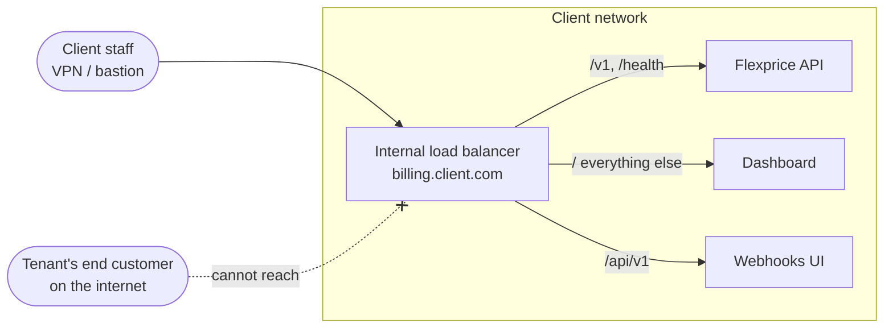
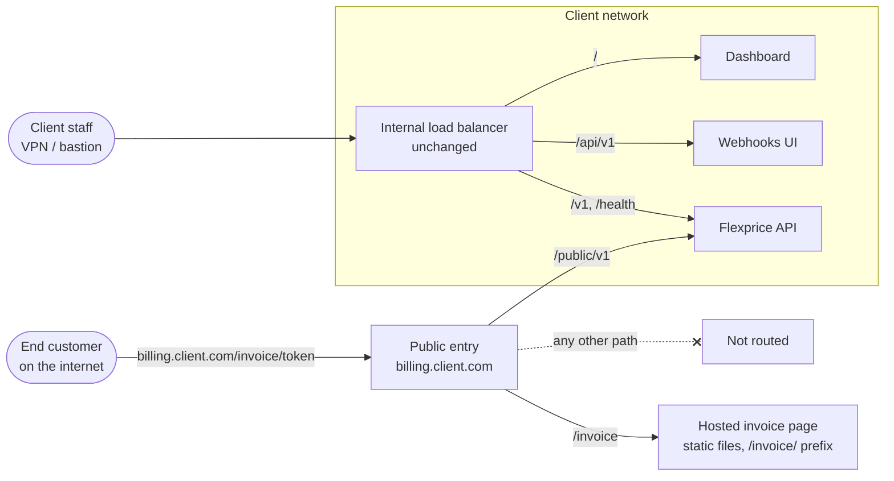
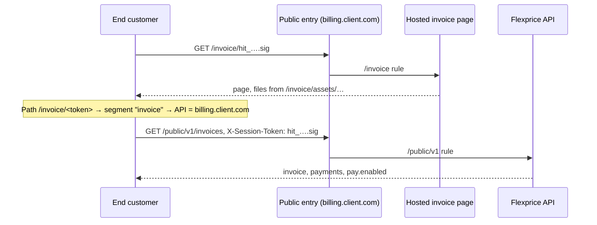

# Hosted invoice — BYOC setup

> **TL;DR.** In BYOC the hosted invoice page is served under `/invoice` on the deployment's existing domain, next to the dashboard and the API. Links look like `https://billing.client.com/invoice/<token>`. The backend needs only `hosted_invoice.base_url`. The page needs a BYOC build: its files load from `/invoice/` and it accepts `invoice` as the link segment. The deployment needs a public entry that forwards only `/invoice` and `/public/v1`; everything else on the domain stays private.

## Today's BYOC layout

A BYOC deployment has one domain and one load balancer that routes by path. The load balancer is internal: it is reached from inside the client's network (VPN or bastion).

Three gaps for hosted invoices:
1. End customers are on the internet, so they cannot reach anything on this load balancer.
2. `/public/v1/…` does not match `/v1`, so it falls through to the dashboard.
3. `/invoice/…` also falls through to the dashboard, which does not have the hosted invoice page.

## Target layout

Only `/invoice` and `/public/v1` are on the public entry. The API (`/v1`, `/health`), the webhooks UI (`/api/v1`) and the dashboard (`/`) stay on the internal load balancer; making that load balancer internet-facing would expose them.

## Why the page needs its own build prefix

The page is one entry file plus JS, CSS and image files. The build writes their URLs into the entry file.

| Build | Entry file asks for | On `billing.client.com` that goes to | Result |
|---|---|---|---|
| Cloud build (prefix `/`) | `/assets/index-….js` | Dashboard (the `/` rule) | Blank page: the dashboard has no such file |
| BYOC build (prefix `/invoice/`) | `/invoice/assets/index-….js` | Hosted invoice page (the `/invoice` rule) | Loads |

Only the hosted invoice app's BYOC build uses `/invoice/`. The dashboard build and the cloud build of the page keep `/`.

## What to change

| # | Where | Change |
|---|---|---|
| 1 | Hosted invoice page | Build prefix set at build time, default `/`; the BYOC build sets `/invoice/` |
| 2 | Hosted invoice page | Accept any link segment listed in its build-time region-to-API map, not only `us`, `in`, `ca`, `staging`; the BYOC build maps `invoice` to the deployment's own domain |
| 3 | BYOC load balancer | `/invoice` → the page's static files, with unknown paths under it returning the page's entry file |
| 4 | BYOC load balancer | `/public/v1` → the Flexprice API |
| 5 | BYOC network | A public entry that forwards only `/invoice` and `/public/v1`; the internal load balancer stays internal |
| 6 | BYOC backend values | `FLEXPRICE_HOSTED_INVOICE_BASE_URL=https://<deployment domain>/invoice` |

The page's no-referrer and noindex rules are in its entry file, so they hold on BYOC without the cloud host's headers. Until item 6 is set, the deployment issues no Flexprice links and offers no Pay, so the backend can ship before the rest.
