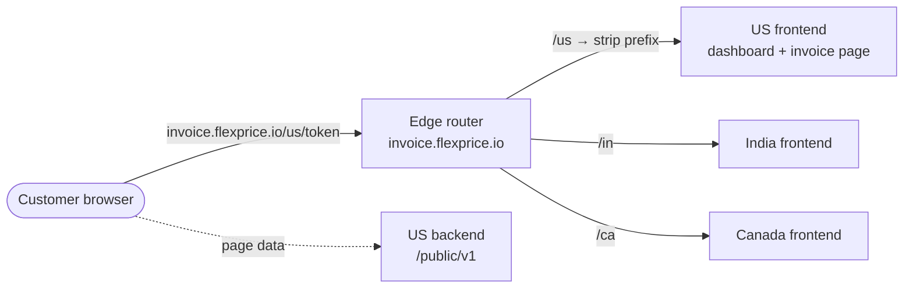
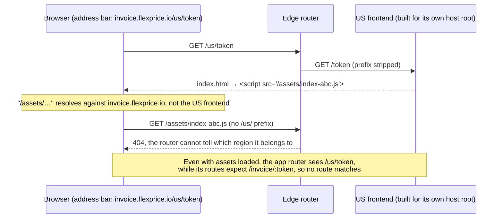
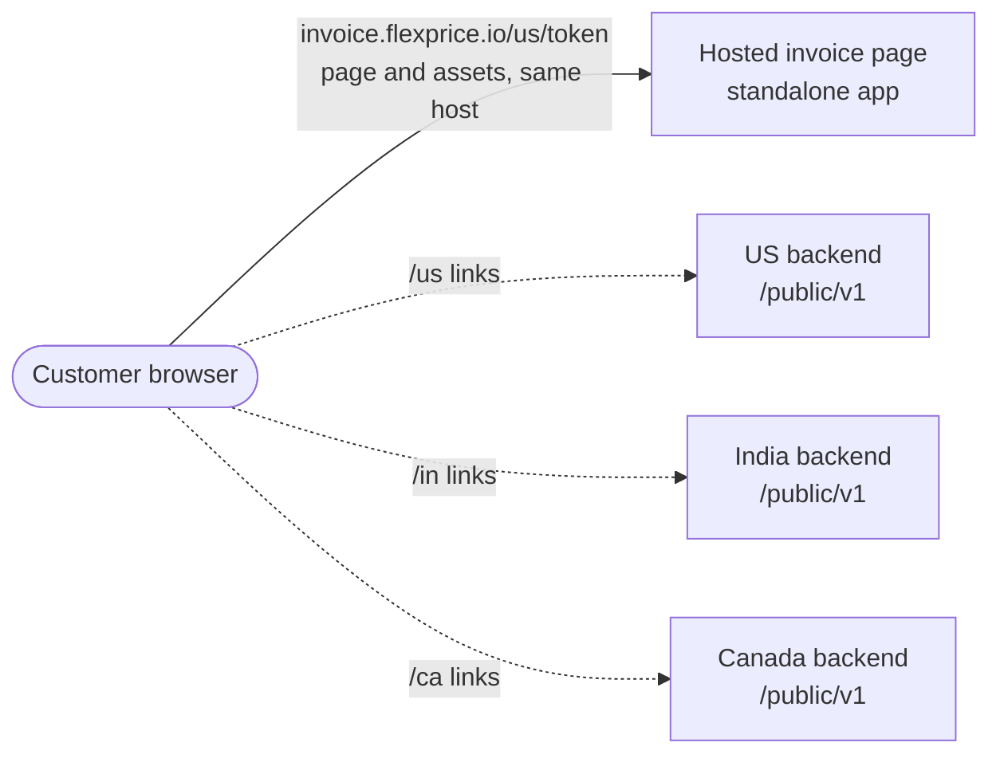
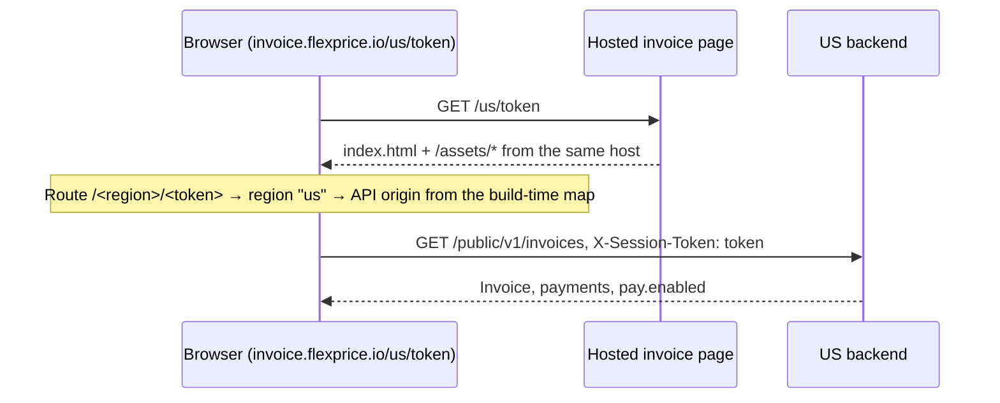

# Hosted invoice page — why it is a standalone app

> **TL;DR.** The ERD first served the hosted invoice page from each region's existing frontend, behind an edge router on `invoice.flexprice.io` that forwarded `/<region>/…` to that region. The regional frontends are built to live at the root of their own host, so behind the router their assets and routes did not resolve. We now ship the page as one standalone app on `invoice.flexprice.io`. The region in the link only picks which API the browser calls.

## Rejected: edge router to the regional frontends

### Where it breaks

Every workaround patched the same mismatch between the address bar host and the host the frontend was built for:

| Workaround | Why we dropped it |
|---|---|
| Asset base set to the full regional URL | The page loads its code from another host, and each build is tied to one region's host |
| Asset base `/us/` plus a router rewrite | A separate frontend build per region for one page, and that build no longer works on its own host |
| Relative asset base (`./`) | Breaks the dashboard's deep links: `/customers/123` asks for `/customers/assets/…` |
| Extra `/<region>/:token` routes in the frontend | Region names leak into the dashboard's routes, and the asset problem stays |

## Chosen: one standalone app on the invoice domain

| | Edge router (rejected) | Standalone app (chosen) |
|---|---|---|
| Frontend deployments touched | One per region | One new app |
| Region handling | Path prefix the frontends had to tolerate | Data in the path: picks the API origin |
| Edge routing | A router on `invoice.flexprice.io` | None, the domain points at the app |
| Dashboard impact | Build and route changes | None; shares the UI components only |
| Assets and routes | Rooted at the regional host, broken behind the router | Rooted at `invoice.flexprice.io`, resolve as built |
