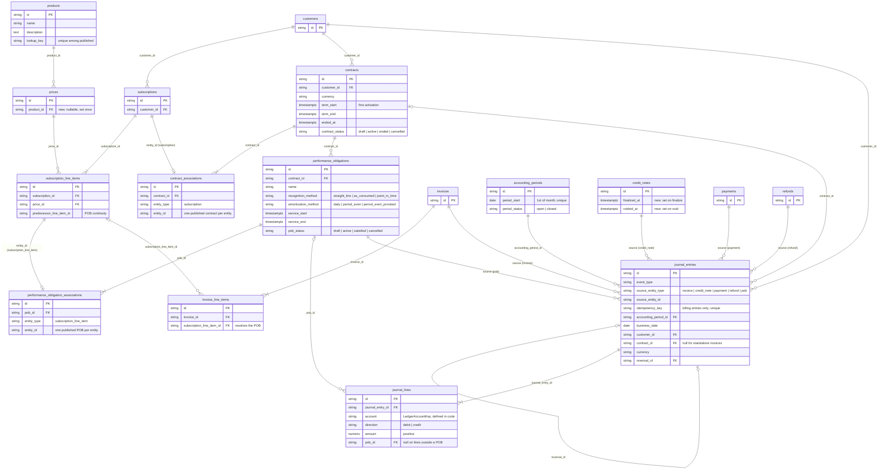

# Revenue Recognition — Phase 1 (ERD)

**Author:** Harshit Gupta

**Dated**: 20th Oct, 2026

## The Problem

Flexprice bills, but does not account for what it bills. An invoice says what a customer owes; it does not say when that money is earned. Finance needs:

- **Recognized revenue** — earned by delivering the service, independent of invoice and payment dates.
- **Deferred revenue** — billed but not yet earned (e.g. an annual prepaid invoice).
- **Unbilled revenue** — earned but not yet invoiced (e.g. usage billed in arrears).
- An auditable, balanced ledger behind those numbers, with rollforwards and a recognition waterfall — without requiring an ERP connection.


## Solution

Subscription-native recognition on top of the billing engine: each subscription becomes a contract, its line items become performance obligations with recognition schedules, and billing and earning events post balanced, immutable journal entries to an internal subledger. Reports are queries over that journal.

Out of Phase 1: contract extraction, SSP allocation, ERP posting, period close, multi-entity books, FX, free-credit contra revenue, breakage, projected deferred waterfall, ARR reporting.

Steps:

1. Product & Price
2. Contract
3. PerformanceObligation & earned to date
4. AccountingCalendar & AccountingPeriod
5. LedgerAccount
6. AccountingEvent & Journal
7. Rollforward & Waterfall

### Entity relationships

New tables show all their columns; existing tables show only the columns revrec links through. Every table also carries `tenant_id`, `environment_id`, `status` and audit columns, left out here.



- `contract_associations` and `performance_obligation_associations` are polymorphic. `entity_type` names the linked table, so the subscription and line item links are logical, not foreign keys.
- `journal_entries.source_entity_*` is polymorphic too. Billing entries come from invoices, credit notes, payments and refunds; recognition and offset entries come from POBs.
- Ledger accounts (Step 5) are fixed in code, so they have no table: `journal_lines.account` holds the key.
- Earned to date (Step 3) and the reports (Step 7) are computed on read and add no tables.

---


### Step 1 — Product & Price

A reusable commercial identity for what is sold. Phase 1 uses it only as catalog; Phase 2 hangs ERP item mappings on it.

#### DB schema

```sql
-- new
CREATE TABLE products (
    id             varchar(50)  PRIMARY KEY,   -- prefix "product"
    tenant_id      varchar(50)  NOT NULL,
    environment_id varchar(50)  NOT NULL,
    name           varchar(255) NOT NULL,
    description    text,
    lookup_key     varchar(255) NOT NULL,
    status         varchar(50)  NOT NULL DEFAULT 'published',
    created_at     timestamptz  NOT NULL,
    created_by     varchar(50),
    updated_at     timestamptz  NOT NULL,
    updated_by     varchar(50)
);

-- create-by-key, get-by-key
CREATE UNIQUE INDEX ON products (tenant_id, environment_id, lookup_key)
    WHERE status = 'published';
-- list / search
CREATE INDEX ON products (tenant_id, environment_id);

-- changed
ALTER TABLE prices ADD COLUMN product_id varchar(50);  -- nullable; set once, then immutable

-- list prices by product; delete-guard lookup
CREATE INDEX ON prices (tenant_id, environment_id, product_id);
```


#### APIs


| Endpoint                   | Role                              |
| -------------------------- | --------------------------------- |
| `POST /v1/products`        | Create                            |
| `GET /v1/products/{id}`    | Get                               |
| `GET /v1/products`         | List                              |
| `POST /v1/products/search` | Filtered search (`@x-scope read`) |
| `PUT /v1/products/{id}`    | Update name, description          |
| `DELETE /v1/products/{id}` | Archive                           |


New RBAC entity `EntityProduct`; `Products` tag added to `.speakeasy/mcp/allowed-tags.yaml`.

#### Invariants

- `lookup_key` is required on create and immutable, like addons and features; unique among published products.
- Prices without a product stay valid.
- A product with any published price referencing it cannot be deleted.
- Subscription overrides and price versions copy `product_id` from their source price at creation.
- A price's `product_id` can be set once (on create, or on update while empty); after that it never changes.


#### Services

`ProductService` (new) — owns product validation and the delete guard.

```go
type ProductService interface {
    CreateProduct(ctx context.Context, req dto.CreateProductRequest) (*dto.ProductResponse, error)
    GetProduct(ctx context.Context, id string) (*dto.ProductResponse, error)
    GetProductByLookupKey(ctx context.Context, lookupKey string) (*dto.ProductResponse, error)
    GetProducts(ctx context.Context, filter *types.ProductFilter) (*dto.ListProductsResponse, error)
    UpdateProduct(ctx context.Context, id string, req dto.UpdateProductRequest) (*dto.ProductResponse, error)
    DeleteProduct(ctx context.Context, id string) error
}
```


### Step 2 — Contract

The accounting agreement a subscription establishes.

#### DB schema

```sql
CREATE TABLE contracts (
    id                 varchar(50) PRIMARY KEY,   -- prefix "contract"
    tenant_id          varchar(50) NOT NULL,
    environment_id     varchar(50) NOT NULL,
    customer_id        varchar(50) NOT NULL,      
    currency           varchar(3)  NOT NULL,      
    term_start         timestamptz,               -- set on first activation
    term_end           timestamptz,               -- as per the contract
    ended_at           timestamptz,               -- contract actually ended
    contract_status    varchar(20) NOT NULL,      -- draft | active | ended | cancelled
    status             varchar(50) NOT NULL DEFAULT 'published',
    created_at         timestamptz NOT NULL,
    created_by         varchar(50),
    updated_at         timestamptz NOT NULL,
    updated_by         varchar(50)
);

-- contracts for a customer
CREATE INDEX ON contracts (tenant_id, environment_id, customer_id);

CREATE TABLE contract_associations (
    id             varchar(50) PRIMARY KEY,   -- prefix "contract_assoc"
    tenant_id      varchar(50) NOT NULL,
    environment_id varchar(50) NOT NULL,
    contract_id    varchar(50) NOT NULL,
    entity_type    varchar(50) NOT NULL,      -- subscription
    entity_id      varchar(50) NOT NULL,
    status         varchar(50) NOT NULL DEFAULT 'published',
    created_at     timestamptz NOT NULL,
    created_by     varchar(50)
);

-- contract of a subscription; an entity belongs to one contract
CREATE UNIQUE INDEX ON contract_associations (tenant_id, environment_id, entity_type, entity_id)
    WHERE status = 'published';
-- entities of a contract
CREATE INDEX ON contract_associations (tenant_id, environment_id, contract_id);
```


#### APIs


| Endpoint                    | Role                                              |
| --------------------------- | ------------------------------------------------- |
| `GET /v1/contracts/{id}`    | Get, with associations                            |
| `POST /v1/contracts/search` | Filter by customer, subscription, contract status |


Read-only: contracts are derived from subscriptions.

#### Invariants

- A contract links to its entities through associations. Phase 1 has exactly one per contract, `entity_type = subscription`; later sources (more subscriptions, standalone invoices, order forms) add entity types, not columns.
- An entity belongs to at most one published contract and never moves to another.
- Created with the subscription, in any status: `draft`, or `active` if the subscription is created active.
- `draft → active` on the subscription's first activation (draft activation, incomplete → active, trial → active); `term_start` is set then.
- A later `active → incomplete` or pause keeps the contract `active`.
- `active → ended` (`ended_at` set) only when the subscription actually stops: immediate cancel, or the period cron applying a deferred cancel / reaching `end_date`. A scheduled-but-pending cancel does not end it.
- `draft → cancelled` when the subscription is cancelled before ever activating.
- Archiving a draft subscription (checkout abandonment) archives its draft contract.
- A `draft` contract can carry billing journals (invoice, credit note, payment, refund; Step 6); recognition journals post only on `active` or `ended` contracts. Earnings for service delivered before activation catch up on the first recognition run after it.
- Plan change (v2) is in place and keeps the contract.
- Contract status changes cascade to its POBs (Step 3).
- Ending a contract keeps its POBs, schedules and journals.
- Nothing is written unless the environment has revenue recognition enabled.


#### Services

`ContractService` (new) — `SyncForSubscription` creates the contract if missing and derives its status from the subscription's current state; idempotent. Runs async after the subscription create, activation and termination transactions commit; errors are logged, never fail the subscription write. Later steps call it before using a contract, so a missed write heals.

```go
type ContractService interface {
    SyncForSubscription(ctx context.Context, sub *subscription.Subscription) (*contract.Contract, error)
    GetContract(ctx context.Context, id string) (*dto.ContractResponse, error)
    GetContracts(ctx context.Context, filter *types.ContractFilter) (*dto.ListContractsResponse, error)
}
```


#### Related changes

- New setting `revenue_recognition_config` gates every revrec write per environment.


### Step 3 — PerformanceObligation & earned to date

A POB is a continuing promise inside a contract, made of one or more subscription line items. Phase 1 earns on a **billing basis**, derived on read: billed amounts are the finalized invoice lines, each spread over its own service period; nothing about earning is persisted. A contract basis (booked amounts, SSP allocation, a persisted revenue schedule) is a later, per-POB alternative behind the same `EarnedToDate`.

Three reporting categories, one engine (a fourth, extrapolated, is deferred):

- **Actual** — posted recognition journals (Step 6).
- **Pending** — earned but not yet posted: the open month to date, and ended months the daily run has not posted.
- **Scheduled** — invoiced but not yet earned (the deferred part of finalized invoice lines).
- **Extrapolated** (deferred) — recurring fixed POBs with no end date only, after the last invoiced period, valued on read by the billing engine. Never persisted.


#### DB schema

```sql
CREATE TABLE performance_obligations (
    id                  varchar(50)  PRIMARY KEY,  -- prefix "pob"
    tenant_id           varchar(50)  NOT NULL,
    environment_id      varchar(50)  NOT NULL,
    contract_id         varchar(50)  NOT NULL,
    name                varchar(255) NOT NULL,     
    recognition_method  varchar(20)  NOT NULL,     -- straight_line | as_consumed | point_in_time
    amortization_method varchar(30)  NOT NULL,     -- daily | period_even | period_even_prorated
    service_start       timestamptz  NOT NULL,
    service_end         timestamptz,               -- set once every associated line item has ended
    pob_status          varchar(20)  NOT NULL,     -- draft | active | satisfied | cancelled
    status              varchar(50)  NOT NULL DEFAULT 'published',
    created_at          timestamptz  NOT NULL,
    created_by          varchar(50),
    updated_at          timestamptz  NOT NULL,
    updated_by          varchar(50)
);

-- POBs of a contract (sync, status cascade, search)
CREATE INDEX ON performance_obligations (tenant_id, environment_id, contract_id);

CREATE TABLE performance_obligation_associations (
    id             varchar(50) PRIMARY KEY,        -- prefix "pob_assoc"
    tenant_id      varchar(50) NOT NULL,
    environment_id varchar(50) NOT NULL,
    pob_id         varchar(50) NOT NULL,
    entity_type    varchar(50) NOT NULL,           -- subscription_line_item
    entity_id      varchar(50) NOT NULL,
    status         varchar(50) NOT NULL DEFAULT 'published',
    created_at     timestamptz NOT NULL,
    created_by     varchar(50)
);

-- resolve the POB of a line item; one POB per entity
CREATE UNIQUE INDEX ON performance_obligation_associations (tenant_id, environment_id, entity_type, entity_id)
    WHERE status = 'published';
-- entities of a POB (forecast, service term)
CREATE INDEX ON performance_obligation_associations (tenant_id, environment_id, pob_id);
```


#### Domain model

```go
// internal/types
type RecognitionMethod string // existing; values renamed
const (
    RecognitionMethodStraightLine RecognitionMethod = "straight_line"
    RecognitionMethodAsConsumed   RecognitionMethod = "as_consumed"
    RecognitionMethodPointInTime  RecognitionMethod = "point_in_time"
)

type AmortizationMethod string
const (
    AmortizationDaily              AmortizationMethod = "daily"
    AmortizationPeriodEven         AmortizationMethod = "period_even"
    AmortizationPeriodEvenProrated AmortizationMethod = "period_even_prorated" // default, set in code
)

type POBStatus string // draft | active | satisfied | cancelled

// RevRecEntityType types contract and POB associations (and later earning sources).
type RevRecEntityType string // subscription | subscription_line_item
```


#### Earning rules

Recognition method is derived once from the first line item's price:


| Price                           | Method          |
| ------------------------------- | --------------- |
| FIXED, recurring                | `straight_line` |
| FIXED, `BILLING_PERIOD_ONETIME` | `point_in_time` |
| USAGE                           | `as_consumed`   |


**Earned to date.** `earned(pob, asOf)` is a sum:

- **Invoiced:** every line of a finalized (not voided) invoice whose `subscription_line_item_id` belongs to the POB earns its line net (Step 6) over its own service period with the POB's amortization method (Step 4). Proration lines (`ONE_OFF` invoices) are lines like any other, so a mid-period change adds a credit line and a charge line; nothing is superseded. A line with no period earns at finalization.
- **Unbilled accrual, only with revenue analytics enabled:** PROVISIONAL `revenue_facts` of the POB's line items earn on their day (period_only rows evenly over their period). A row stops counting once a finalized `SUBSCRIPTION` invoice line covers its day; proration lines never switch it off. With revenue analytics off, revenue is recognized only once invoiced.
- Cancelling or modifying without proration changes nothing for the paid period: it keeps earning, and the new state reaches the next invoice.
- Daily amounts are `earned(day_end) − earned(day_start)`, never rounded per day.

Usage (`as_consumed`) POBs earn each finalized invoice line daily over its service period, and a PROVISIONAL revenue fact on its day until an invoice line covers that day.

#### APIs


| Endpoint                                  | Role                                                     |
| ----------------------------------------- | -------------------------------------------------------- |
| `GET /v1/performance_obligations/{id}`    | Get, with associations                                   |
| `POST /v1/performance_obligations/search` | Filter by contract, customer, status, recognition method |


Read-only: POBs are derived from subscriptions.

#### Invariants

- Created with the contract as `draft`; status cascades from the contract: `draft → active` on activation, `draft → cancelled` if the contract is cancelled. `active → satisfied` once every associated line item has ended and `service_end` has passed.
- Recognition runs on `active` and `satisfied` POBs (a satisfied POB still posts its last month and later corrections); never on `draft` or `cancelled`.
- An entity belongs to at most one POB; associations stay within the POB's contract.
- A new line item joins its predecessor's POB only when every continuity rule holds; otherwise it gets a new POB. Plan change v2 carried lines keep their row, so keep their POB. Continuity rules:
  - it has a `predecessor_line_item_id`;
  - its derived recognition method equals the POB's.
- Recognition and amortization methods never change after creation.
- POBs sync async after the subscription write that caused it commits (create, activation, termination, line item add / update / delete, plan change, period renewal). A failed sync is logged and never fails the source write; `Reconcile(contract)` repairs.
- Nothing is written unless the environment has revenue recognition enabled.


#### Services

`PerformanceObligationService` (new) — owns POB identity and associations, and evaluates earned-to-date for the recognition run (Step 6) and reports (Step 7).

```go
type PerformanceObligationService interface {
    SyncForSubscription(ctx context.Context, sub *subscription.Subscription, c *contract.Contract) ([]*pob.PerformanceObligation, error)
    EarnedToDate(ctx context.Context, contractID string, asOfs []time.Time) ([]map[string]decimal.Decimal, error) // per asOf, per POB; one load for all dates
    Reconcile(ctx context.Context, contractID string) error // repair job
    GetPerformanceObligation(ctx context.Context, id string) (*dto.PerformanceObligationResponse, error)
    GetPerformanceObligations(ctx context.Context, filter *pob.Filter) (*dto.ListPerformanceObligationsResponse, error)
}
```

Deferred: contract basis with persisted schedules (ramps, free periods, SSP allocation, edits), usage evidence, commitments and true-ups, net-negative proration (wallet credit).

### Step 4 — AccountingCalendar & AccountingPeriod

One monthly calendar per environment. The calendar is configuration, held in the `revenue_recognition_config` setting. Periods are materialized rows that journal entries reference.

#### DB schema

```sql
CREATE TABLE accounting_periods (
    id             varchar(50) PRIMARY KEY,   -- prefix "acct_period"
    tenant_id      varchar(50) NOT NULL,
    environment_id varchar(50) NOT NULL,
    period_start   date        NOT NULL,      -- 1st of the month; the period runs to the next month start
    period_status  varchar(20) NOT NULL,      -- open | closed (closed reserved for close, deferred)
    status         varchar(50) NOT NULL DEFAULT 'published',
    created_at     timestamptz NOT NULL,
    created_by     varchar(50),
    updated_at     timestamptz NOT NULL,
    updated_by     varchar(50)
);

-- period of a business date (posting); idempotent materialization
CREATE UNIQUE INDEX ON accounting_periods (tenant_id, environment_id, period_start)
    WHERE status = 'published';
```


#### Domain model

```go
// internal/types
type AccountingPeriodStatus string
const (
    AccountingPeriodStatusOpen   AccountingPeriodStatus = "open"
    AccountingPeriodStatusClosed AccountingPeriodStatus = "closed" // reserved; close is deferred
)

// value of setting key revenue_recognition_config
type RevenueRecognitionConfig struct {
    Enabled    bool       `json:"enabled"`
}
```


#### Amortization arithmetic

A billed amount `A` covers local dates `[ds, de)` (its service period). Each covered day `d` has a weight:


| Method                 | `w(d)`                                                            | Effect                                                                                                                                             |
| ---------------------- | ----------------------------------------------------------------- | -------------------------------------------------------------------------------------------------------------------------------------------------- |
| `daily`                | 1                                                                 | Equal per day                                                                                                                                      |
| `period_even`          | 1 / days in `d`'s month, over N whole months from the start month | A term of N months is N whole calendar months from its start month: a mid-month start puts a full month in the start month and nothing in the last |
| `period_even_prorated` | 1 / days in `d`'s month                                           | Equal per full month; partial months by the share they cover                                                                                       |


- `earned(asOf) = A × Σ_{d < asOf} w(d) / Σ_{d ∈ [ds, de)} w(d)`. Billed amounts are additive: a POB earns their sum (Step 3).
- `point_in_time`: all of `A` on `ds`.

Example: $300 over `[Jan 15, Apr 15)`, `period_even_prorated`.


| Month     | Days covered | `w(d)` | Month weight | Earned      |
| --------- | ------------ | ------ | ------------ | ----------- |
| Jan       | 17           | 1/31   | 0.548        | $54.56      |
| Feb       | 28           | 1/28   | 1            | $99.51      |
| Mar       | 31           | 1/31   | 1            | $99.50      |
| Apr       | 14           | 1/30   | 0.467        | $46.43      |
| **Total** |              |        | **3.015**    | **$300.00** |


On Mar 10: `300 × (0.548 + 1 + 9/31) / 3.015 = $182.95`. The same amount under `daily` is $3.33 a day for 90 days; under `period_even` (three months from January 15) it is $100 for January, February and March, and nothing for April.

- Never rounded per day. A period's recognition amount is `round(earned(period_end)) − round(earned(period_start))` at currency precision, so periods sum exactly to `A`.


#### APIs


| Endpoint                             | Role                         |
| ------------------------------------ | ---------------------------- |
| `POST /v1/accounting_periods/search` | Filter by status, date range |


Revenue recognition is enabled through the existing settings API; the calendar has no other configuration.

#### Invariants

- One calendar per environment; monthly periods only. Periods are contiguous, non-overlapping `[start, end)` months.
- Periods are rows because journal entries reference them and they will carry the close lifecycle (`open → closed`) once close ships; Phase 1 never closes one. Their end is always the next month start.
- Periods are materialized on demand inside the posting transaction (insert on conflict do nothing); a missing period never fails a post.
- Enabling rebuilds every contract from its own start into its real periods; there are no opening entries. A report may start at any period: its opening balance is the sum of everything posted before it.
- An entry posts to the period containing its business date. If that period is closed, it posts to the first open period after it.
- Nothing is written unless the environment has revenue recognition enabled.


#### Services

`AccountingPeriodService` (new) — resolves and materializes posting periods.

```go
type AccountingPeriodService interface {
    PeriodFor(ctx context.Context, businessDate time.Time) (*accountingperiod.AccountingPeriod, error)
    GetAccountingPeriods(ctx context.Context, filter *types.AccountingPeriodFilter) (*dto.ListAccountingPeriodsResponse, error)
}
```


### Step 5 — LedgerAccount

A fixed set of account roles defined in code. Journal lines reference an account by key. Tenants cannot add or change accounts; ERP GL codes map onto these roles in Phase 2.

#### Domain model

Normal side and statement follow the class: asset and contra_revenue are debit-normal, the rest credit-normal; revenue and contra_revenue are income statement, the rest balance sheet.

```go
// internal/types
type LedgerAccountKey string
const (
    LedgerAccountCash                 LedgerAccountKey = "cash"
    LedgerAccountReceivable           LedgerAccountKey = "accounts_receivable"
    LedgerAccountUnbilledReceivable   LedgerAccountKey = "unbilled_receivable"
    LedgerAccountDeferredRevenue      LedgerAccountKey = "deferred_revenue"
    LedgerAccountCustomerCredit       LedgerAccountKey = "customer_credit"
    LedgerAccountTaxPayable           LedgerAccountKey = "tax_payable"
    LedgerAccountRevenue              LedgerAccountKey = "revenue"
    LedgerAccountContraRevenue        LedgerAccountKey = "contra_revenue"
)

type AccountClass string  // asset | liability | revenue | contra_revenue
type Direction string     // debit | credit
type StatementType string // balance_sheet | income_statement
```


| Key                   | Class          | Posted by                                                                                                    |
| --------------------- | -------------- | ------------------------------------------------------------------------------------------------------------ |
| `cash`                | asset          | Payment succeeded (debit), refund succeeded (credit)                                                         |
| `accounts_receivable` | asset          | Invoice finalized / voided, credit note, credits applied, payment, refund                                    |
| `unbilled_receivable` | asset          | Recognition (debit); offset (credit). Holds earned but not yet invoiced                                      |
| `deferred_revenue`    | liability      | POB invoice lines (credit); offset (debit). Holds invoiced but not yet earned                                |
| `customer_credit`     | liability      | Wallet top-up `ONE_OFF` invoice finalized (credit); credits applied to an invoice, `CREDITS` payment (debit) |
| `tax_payable`         | liability      | Invoice tax; tax reversed by a credit note                                                                   |
| `revenue`             | revenue        | Recognition; standalone one-off invoices at finalize                                                         |
| `contra_revenue`      | contra_revenue | Credit notes                                                                                                 |


#### Invariants

- Account roles are fixed in code; no table, no tenant configuration.
- Coupons and discounts are netted into revenue; there is no discount account.
- Every credit note posts Dr `contra_revenue`, Dr `tax_payable` (when its tax is reversed) / Cr AR in the month it is issued. Credit notes never change schedules, so recognized revenue is never reversed.
- Known Phase 1 deviation: a credit note does not reduce `deferred_revenue` or `unbilled_receivable`. A $1,200 prepaid invoice with a $100 credit note keeps deferred at $1,200 and recognizes $1,200, with −$100 in `contra_revenue` at once; lifetime net revenue is right ($1,100), deferred is overstated during the term. "Billed" in the POB position excludes credit notes.
- Credits applied to an invoice settle AR from `customer_credit`, free and purchased alike. Splitting free credits (`FREE_CREDIT_GRANT`, `PURCHASED_CREDIT_BONUS`) into `contra_revenue` via `consumption_breakdown` is deferred; until then `customer_credit` runs a debit balance equal to the free credits used.
- A succeeded payment settles AR into `cash`, except method `CREDITS` (post-paid wallet), which settles from `customer_credit`. A refund credit note credits AR; the refund posts on success: `GATEWAY` / `OUT_OF_BAND` from `cash`, `WALLET` into `customer_credit`.


### Step 6 — AccountingEvent & Journal

Billing and earning events post balanced, immutable journal entries. Billing entries post when the source commits; recognition entries post from a daily job, once per POB per ended month plus corrections. Balances and reports are sums over journal lines.

#### DB schema

```sql
CREATE TABLE journal_entries (                     -- immutable
    id                 varchar(50)  PRIMARY KEY,   -- prefix "je"
    tenant_id          varchar(50)  NOT NULL,
    environment_id     varchar(50)  NOT NULL,
    event_type         varchar(50)  NOT NULL,      -- invoice_finalized | invoice_voided | credit_note_finalized | credit_note_voided | payment_succeeded | payment_reversed | refund_succeeded | revenue_earned | revenue_offset
    source_entity_type varchar(50)  NOT NULL,      -- invoice | credit_note | payment | refund | pob
    source_entity_id   varchar(50)  NOT NULL,
    idempotency_key    varchar(255),               -- billing entries only; recognition relies on the POB lock
    accounting_period_id varchar(50) NOT NULL,
    business_date      date         NOT NULL,      -- local date of the activity
    customer_id        varchar(50)  NOT NULL,
    contract_id        varchar(50),                -- null for standalone one-off invoices (no subscription) and their payments
    currency           varchar(10)  NOT NULL,      -- as invoices
    reversal_of        varchar(50),
    status             varchar(50)  NOT NULL DEFAULT 'published',
    created_at         timestamptz  NOT NULL,
    updated_at         timestamptz  NOT NULL,
    created_by         varchar(50),
    updated_by         varchar(50)
);

-- exactly-once posting per billing event
CREATE UNIQUE INDEX ON journal_entries (tenant_id, environment_id, idempotency_key)
    WHERE idempotency_key IS NOT NULL;
-- entries of a source (drill-down, reconcile)
CREATE INDEX ON journal_entries (tenant_id, environment_id, source_entity_type, source_entity_id);
-- rollforward by period
CREATE INDEX ON journal_entries (tenant_id, environment_id, accounting_period_id);
-- reports filtered by customer
CREATE INDEX ON journal_entries (tenant_id, environment_id, customer_id);

CREATE TABLE journal_lines (                       -- immutable
    id               varchar(50)   PRIMARY KEY,    -- prefix "jl"
    tenant_id        varchar(50)   NOT NULL,
    environment_id   varchar(50)   NOT NULL,
    journal_entry_id varchar(50)   NOT NULL,
    account          varchar(50)   NOT NULL,       -- LedgerAccountKey
    direction        varchar(10)   NOT NULL,       -- debit | credit
    amount           numeric(20,8) NOT NULL,       -- > 0
    pob_id           varchar(50),
    status           varchar(50)   NOT NULL DEFAULT 'published',
    created_at       timestamptz   NOT NULL,
    updated_at       timestamptz   NOT NULL,
    created_by       varchar(50),
    updated_by       varchar(50)
);

-- lines of an entry
CREATE INDEX ON journal_lines (tenant_id, environment_id, journal_entry_id);
-- POB position (deferred / unbilled) and posted revenue
CREATE INDEX ON journal_lines (tenant_id, environment_id, pob_id, account);
```

No `entry_date`: Phase 1 never closes a period, so it equals `business_date`; once close ships it is `max(business_date, period_start)`.

#### Posting rules

**POB position.** Billing and recognition post gross and never read a balance: a POB invoice line always credits `deferred_revenue`, and recognition always debits `unbilled_receivable`. For each ended month `P` the run then posts the **offset**, which removes from both accounts the part that is both billed and earned:

- `billed(P)` = the POB's invoice credits to `deferred_revenue` (net of voids) in entries dated up to `P_end`; `earned(P)` = its recognized revenue up to `P`.
- `offset(P) = min(billed(P), earned(P))`. The run posts `offset(P) − offsets already posted up to P`: Dr `deferred_revenue` / Cr `unbilled_receivable`; a negative amount mirrors it.
- At every month end deferred = `max(billed − earned, 0)` and unbilled = `max(earned − billed, 0)`, whatever order the entries posted in. A POB never carries both.

Billed means invoiced by `P_end` (the invoice's date), not the service period it covers: an arrears invoice dated Feb 1 for January usage is February billing, so January closes with unbilled. Invoice lines resolve their POB through `subscription_line_item_id`. A line's **line net** is `amount − line_item_discount − invoice_level_discount − inclusive tax` (inclusive tax allocated to lines pro rata by net when stored per invoice); billing entries and earned to date (Step 3) use the same line net, so tax never becomes revenue. `ONE_OFF` lines with no POB are recognized at finalize; their entry keeps the subscription's contract when the invoice has one, and `contract_id` is null for standalone invoices.


| Event (business date)                | Entry                                                                                                                                                                                                                                                                                                                               |
| ------------------------------------ | ----------------------------------------------------------------------------------------------------------------------------------------------------------------------------------------------------------------------------------------------------------------------------------------------------------------------------------- |
| Invoice finalized (`finalized_at`)   | Dr AR (invoice `total`, already net of credits), Dr `customer_credit` (credits applied) / Cr `tax_payable` (total tax), and per line by its line net: POB line Cr `deferred_revenue` (with its `pob_id`); no-POB `ONE_OFF` line Cr `revenue`; wallet top-up invoice (metadata carries `wallet_transaction_id`) Cr `customer_credit` |
| Invoice voided (`voided_at`)         | Per line, the inverse of its finalize credit (POB line: Dr `deferred_revenue`; no-POB line: Dr `revenue`; top-up: Dr `customer_credit`), Dr `tax_payable` / Cr AR by the gross including credits applied; the void's wallet refund returns the credits                                                                              |
| Credit note finalized                | Dr `contra_revenue`, Dr `tax_payable` (when reversed) / Cr AR                                                                                                                                                                                                                                                                       |
| Credit note voided                   | Inverse of its finalize entry, `reversal_of` set                                                                                                                                                                                                                                                                                    |
| Payment succeeded (`succeeded_at`)   | Dr `cash` / Cr AR; method `CREDITS`: Dr `customer_credit` / Cr AR                                                                                                                                                                                                                                                                   |
| Payment reversed                     | Inverse of the payment entry, `reversal_of` set                                                                                                                                                                                                                                                                                     |
| Refund succeeded (`succeeded_at`)    | Dr AR / Cr `cash` (`GATEWAY`, `OUT_OF_BAND`) or Cr `customer_credit` (`WALLET`)                                                                                                                                                                                                                                                     |
| Recognition (last day of the period) | Per POB and ended month `P`: `δ = round(earned(P_end)) − posted(≤ P)`. Positive `δ`: Dr `unbilled_receivable` / Cr `revenue`; negative mirrors it                                                                                                                                                                                   |
| Offset (last day of the period)      | Per POB and ended month `P`, in the same transaction as its recognition: Dr `deferred_revenue` / Cr `unbilled_receivable` by `offset(P) −` offsets posted up to `P`; negative mirrors it                                                                                                                                            |


Credits and voids: an invoice of 100 with 20 credits applied, paid 80, then voided. Finalize Dr AR 80, Dr `customer_credit` 20; payment Cr AR 80; void Cr AR 100 (gross including credits); the void's wallet refund (`refund_succeeded`, `WALLET`) Dr AR 100 / Cr `customer_credit` 100. AR nets to 0, and `customer_credit` holds 80: the paid cash moved to the wallet, with the 20 credits restored.

`posted(≤ P)` is Σ(credit − debit) on the POB's `revenue` lines in entries dated up to `P_end`: what the journal already holds, so a run posts only the gap. Walking months in order this equals the per-month `round(earned(P_end)) − round(earned(P_start)) − posted(P)`, and it also posts revenue earned before the first month (e.g. an advance one-time line). Recognition entries are per POB and every line carries `pob_id`; `pob_id` is null only on billing lines that belong to no POB (AR, tax, cash, customer credit, standalone one-off revenue).

Example 1, prepaid: $1,200 annual from Jan 1, `period_even`, invoiced Jan 1 (Dr AR 1,200 / Cr `deferred_revenue` 1,200).


| Run      | Period | `δ`  | `billed` | `earned` | Offset to date | Entries                                                                                                   |
| -------- | ------ | ---- | -------- | -------- | -------------- | --------------------------------------------------------------------------------------------------------- |
| Jan 2–31 | —      | —    | —        | —        | —              | None; January has not ended                                                                               |
| Feb 1    | Jan    | +100 | 1,200    | 100      | 100            | Dr `unbilled_receivable` 100 / Cr `revenue` 100; Dr `deferred_revenue` 100 / Cr `unbilled_receivable` 100 |
| Feb 2    | Jan    | 0    | 1,200    | 100      | 100            | None                                                                                                      |
| Mar 1    | Feb    | +100 | 1,200    | 200      | 200            | Same pair, 100 each                                                                                       |


January closes at deferred 1,100, unbilled 0; February at 1,000 and 0. A backdated modification that cuts January's earned to 90 makes the next run post `δ = −10` (Dr `revenue` 10 / Cr `unbilled_receivable` 10) and an offset of −10 (Dr `unbilled_receivable` 10 / Cr `deferred_revenue` 10): deferred after March 1 becomes 1,010.

Example 2, arrears usage posted out of order: January usage $300, invoiced Feb 1 at 00:05; the recognition run for January runs Feb 1 at 02:00. February usage $250, invoiced Mar 1.


| When         | Entry                                                                                                                      | Period |
| ------------ | -------------------------------------------------------------------------------------------------------------------------- | ------ |
| Feb 1, 00:05 | Invoice: Dr AR 300 / Cr `deferred_revenue` 300                                                                             | Feb    |
| Feb 1, 02:00 | January recognition: Dr `unbilled_receivable` 300 / Cr `revenue` 300                                                       | Jan    |
| Feb 1, 02:00 | January offset: billed by Jan 31 = 0, earned 300, `min` = 0; none                                                          | Jan    |
| Mar 1, 00:05 | Invoice: Dr AR 250 / Cr `deferred_revenue` 250                                                                             | Mar    |
| Mar 1, 02:00 | February recognition: Dr `unbilled_receivable` 250 / Cr `revenue` 250                                                      | Feb    |
| Mar 1, 02:00 | February offset: billed by Feb 28 = 300, earned 550, `min` = 300; Dr `deferred_revenue` 300 / Cr `unbilled_receivable` 300 | Feb    |


January closes at unbilled 300, deferred 0; February at unbilled 250 (300 + 250 − 300), deferred 0. Posting the 00:05 invoices after the 02:00 runs gives the same balances.

#### APIs


| Endpoint                          | Role                                                                   |
| --------------------------------- | ---------------------------------------------------------------------- |
| `GET /v1/journal_entries/{id}`    | Get, with lines                                                        |
| `POST /v1/journal_entries/search` | Filter by period, event type, account, customer, contract, POB, source |


Read-only: the journal is derived from billing and schedules.

#### Invariants

- Entries are immutable. Each has at least one debit and one credit line, positive amounts, Σ debits = Σ credits, one currency (the invoice's), one period. Corrections are deltas or inverses linked by `reversal_of`.
- Billing entries carry the idempotency key `{event_type}:{source_entity_id}`: one entry per event per source. A corrected invoice is a void (`invoice_voided`, same source) plus a new invoice (new source), never a re-post under the same key. Recognition entries carry none: a run computes `δ` under the POB lock, so a rerun computes `δ = 0` and posts nothing.
- Billing entries post async after the source commits (post-commit hook, like `revenue_facts`), each in its own transaction. A failure is logged and never fails the source write; `Reconcile` re-posts anything missing.
- Recognition and offset post only from the daily job (and the operator-triggered backfill), under a per-POB advisory lock, for ended periods only; a POB's recognition and offset for a month post in one transaction. Billing never reads a balance. Each run recomputes every ended month from the POB's start with running totals, so a billing entry dated in an ended month is picked up by the next run; an unchanged month computes `δ = 0` and posts nothing. No last-run cursor is stored. The current month's earned-to-date is computed on read (a dry run, Step 7), never posted.
- Business dates are local dates in the subscription's timezone (the customer's without a subscription); the entry posts to that date's period (Step 4).
- Billing entries post for `draft` contracts too; recognition only for `active` and `satisfied` POBs, catching up on the first run.
- A backfill (admin API, operator-triggered, safe to rerun) replays an environment from its start: contracts and POBs for every subscription, then all billing, then recognition of every contract. It only adds what is missing or wrong. No opening-balance entries. Enabling the setting does not start it by itself.
- Nothing is written unless the environment has revenue recognition enabled.


#### Services

`JournalService` (new) — builds, balances and posts entries; owns the recognition run and the backfill. A daily Temporal schedule `revenue-recognition` (04:00 UTC) fans out over enabled environments like `RevenueRollupWorkflow`; per environment it repairs POBs (`PerformanceObligationService.Reconcile`), calls `Reconcile` with a 7-day billing window (so a failed post is retried by later runs), then `Recognize` per selected contract. Selected: active contracts, contracts ended within two months, and contracts with an invoice changed in the window.

```go
type JournalService interface {
    PostInvoice(ctx context.Context, inv *invoice.Invoice) error         // finalized and voided
    PostCreditNote(ctx context.Context, cn *creditnote.CreditNote) error // finalized and voided
    PostPayment(ctx context.Context, p *payment.Payment) error           // succeeded and reversed
    PostRefund(ctx context.Context, r *refund.Refund) error
    Recognize(ctx context.Context, req RecognizeRequest) ([]*journal.Entry, error) // returns the entries posted; DryRun posts nothing and also counts the open month up to AsOf
    RunRecognition(ctx context.Context, req RecognitionRunRequest) error              // the daily run, resumable per environment and contract
    Backfill(ctx context.Context, req BackfillRequest) error                          // operator-triggered replay of the ctx environment
    Reconcile(ctx context.Context, since time.Time) error                             // re-posts billing entries missing since `since`
    GetJournalEntry(ctx context.Context, id string) (*dto.JournalEntryResponse, error)
    GetJournalEntries(ctx context.Context, filter *journal.Filter) (*dto.ListJournalEntriesResponse, error)
}
```

`Reconcile` is environment-wide, not per contract, so it also covers standalone `ONE_OFF` invoices, wallet top-ups and their payments. It finds every invoice, credit note, payment or refund finalized, voided, succeeded or reversed since `since` that has no entry under its key, and posts it. Recognition needs no repair: every run recomputes `δ`.

#### Related changes

- Credit notes set `finalized_at` on finalize and `voided_at` on void (`creditnote.go:794`, `:679`; both are null today). These are the business dates of their entries.
- Payment hooks fire after the payment row is saved (`payment_processor.go:171-179`), so a payment entry never posts for an unsaved row.
- Quantity-change proration invoices set `subscription_line_item_id` on their line (`subscription_modification_quantity.go:1068`; only `price_id` is set today). Without it the line resolves no POB, posts as revenue at finalize, and is recognized again through the POB.


### Step 7 — Rollforward & Waterfall

Reports are queries over the journal and POB earned-to-date; nothing is persisted. The rollforward explains how an account's balance moved in ended months; the waterfall shows revenue per customer per month, past, current and future.


| View                                                                | Endpoint                                   | Request                                                                          |
| ------------------------------------------------------------------- | ------------------------------------------ | -------------------------------------------------------------------------------- |
| Deferred / unbilled rollforward (summary, per contract, drill-down) | rollforward, then `journal_entries/search` | `accounts=[deferred_revenue]`, one period, `group_by=[customer_id, contract_id]` |
| Revenue summary, trial balance                                      | rollforward                                | `accounts=[revenue, contra_revenue]` or all accounts                             |
| Revenue recognition (customers × months, with details)              | waterfall                                  | `group_by=customer_id`, `details=true`                                           |
| Customer, contract revenue schedule                                 | waterfall                                  | `customer_ids` / `contract_ids`, `group_by=pob_id`                               |


#### APIs


| Endpoint                               | Role                                                                      |
| -------------------------------------- | ------------------------------------------------------------------------- |
| `POST /v1/revenue_reports/rollforward` | Opening, movements by category and closing per ended period and account   |
| `POST /v1/revenue_reports/waterfall`   | Revenue per group and month: actual, pending, scheduled                   |
| `POST /v1/journal_entries/search`      | Drill-down to lines (Step 6), by period, account, customer, contract, POB |


Both are `@x-scope read`. Periods are `YYYY-MM`; amounts are in `currency`, never combined across currencies.

**Rollforward**

```go
type RollforwardRequest struct {
    PeriodStart string                   `json:"period_start" validate:"required"` // YYYY-MM
    PeriodEnd   string                   `json:"period_end"`                       // YYYY-MM; default period_start; an ended month
    Currency    string                   `json:"currency" validate:"required"`
    Accounts    []types.LedgerAccountKey `json:"accounts"`                         // default [deferred_revenue]
    GroupBy     []types.RevenueReportGroupBy `json:"group_by"`                     // customer_id | contract_id | pob_id
    CustomerIDs []string                 `json:"customer_ids"`
    ContractIDs []string                 `json:"contract_ids"`
    POBIDs      []string                 `json:"pob_ids"`
    PostedBy    *time.Time               `json:"posted_by"`                        // only entries posted at or before it
    Limit       int                      `json:"limit"`                            // rows per page; totals are never paged
    Offset      int                      `json:"offset"`
}

type RollforwardResponse struct {
    Totals     []*RollforwardRow         `json:"totals"` // per period and account, all groups
    Items      []*RollforwardRow         `json:"items"`  // per period, account and group; empty without group_by
    Pagination *types.PaginationResponse `json:"pagination"`
}

type RollforwardRow struct {
    Period     string                                     `json:"period"`
    Account    types.LedgerAccountKey                     `json:"account"`
    CustomerID *string                                    `json:"customer_id,omitempty"`
    ContractID *string                                    `json:"contract_id,omitempty"`
    POBID      *string                                    `json:"pob_id,omitempty"`
    Opening    decimal.Decimal                            `json:"opening"`
    Movements  map[types.MovementCategory]decimal.Decimal `json:"movements"` // missing category = 0
    Closing    decimal.Decimal                            `json:"closing"`
}
```

Example, deferred revenue for Feb, `group_by=[customer_id, contract_id]`:

```json
{
  "totals": [{"period": "2026-02", "account": "deferred_revenue",
              "opening": "1100", "movements": {"invoiced": "100", "earned": "-200"}, "closing": "1000"}],
  "items":  [{"period": "2026-02", "account": "deferred_revenue", "customer_id": "cust_acme", "contract_id": "contract_1",
              "opening": "1100", "movements": {"earned": "-100"}, "closing": "1000"},
             {"period": "2026-02", "account": "deferred_revenue", "customer_id": "cust_beta", "contract_id": "contract_2",
              "opening": "0", "movements": {"invoiced": "100", "earned": "-100"}, "closing": "0"}]
}
```

**Waterfall**

```go
type WaterfallRequest struct {
    PeriodStart string                 `json:"period_start" validate:"required"` // YYYY-MM
    PeriodEnd   string                 `json:"period_end" validate:"required"`   // at most 36 months after period_start
    Currency    string                 `json:"currency" validate:"required"`
    GroupBy     types.RevenueReportGroupBy `json:"group_by"`                     // customer_id (default) | contract_id | pob_id
    CustomerIDs []string               `json:"customer_ids"`
    ContractIDs []string               `json:"contract_ids"`
    POBIDs      []string               `json:"pob_ids"`
    Details     bool                   `json:"details"`                          // month-end deferred and unbilled balances
    AsOf        *time.Time             `json:"as_of"`                            // report date: pending and scheduled split here; default now
    Limit       int                    `json:"limit"`
    Offset      int                    `json:"offset"`
}

type WaterfallResponse struct {
    Totals     []*WaterfallCell          `json:"totals"` // per period, all rows, never paged
    Items      []*WaterfallRow           `json:"items"`
    Pagination *types.PaginationResponse `json:"pagination"`
}

type WaterfallRow struct {
    CustomerID *string          `json:"customer_id,omitempty"`
    ContractID *string          `json:"contract_id,omitempty"`
    POBID      *string          `json:"pob_id,omitempty"`
    Cells      []*WaterfallCell `json:"cells"` // one per period, in order
}

type WaterfallCell struct {
    Period   string           `json:"period"`
    Revenue  RevenueBreakdown `json:"revenue"`
    Deferred *decimal.Decimal `json:"deferred,omitempty"` // details; closing deferred_revenue, ended months only
    Unbilled *decimal.Decimal `json:"unbilled,omitempty"` // details; closing unbilled_receivable, ended months only
}

type RevenueBreakdown struct {
    Total     decimal.Decimal `json:"total"` // actual + pending + scheduled
    Actual    decimal.Decimal `json:"actual"`
    Pending   decimal.Decimal `json:"pending"`
    Scheduled decimal.Decimal `json:"scheduled"`
}
```

Example, `group_by=customer_id`, Jan–Apr, on Mar 15 (abridged):

```json
{
  "totals": [{"period": "2026-01", "revenue": {"total": "200", "actual": "200"}},
             {"period": "2026-03", "revenue": {"total": "200", "pending": "90.32", "scheduled": "109.68"}}],
  "items":  [{"customer_id": "cust_acme", "cells": [
               {"period": "2026-01", "revenue": {"total": "100", "actual": "100"}, "deferred": "1100", "unbilled": "0"},
               {"period": "2026-03", "revenue": {"total": "100", "pending": "45.16", "scheduled": "54.84"}},
               {"period": "2026-04", "revenue": {"total": "100", "scheduled": "100"}}]}]
}
```


#### Report rules

**Signs.** Amounts are in the account's normal direction: a movement is positive when it increases the balance.

**Movement categories**, fixed in code from the entry's `event_type` and the line's account. The offset is one entry: it shows as `earned` in the deferred rollforward and as `invoiced` in the unbilled rollforward.


| Category      | Event types                                                                      |
| ------------- | -------------------------------------------------------------------------------- |
| `invoiced`    | `invoice_finalized`, `invoice_voided`; `revenue_offset` on `unbilled_receivable` |
| `earned`      | `revenue_earned`; `revenue_offset` on `deferred_revenue`                         |
| `adjustments` | `credit_note_finalized`, `credit_note_voided`                                    |
| `payments`    | `payment_succeeded`, `payment_reversed`                                          |
| `refunds`     | `refund_succeeded`                                                               |


**Rollforward** is journal only. `opening(P)` = signed lines of entries in periods before `P`; movements are the lines of entries in `P`; `closing = opening + Σ movements`. Only ended months can be requested: the open month is not reported until it ends. With `posted_by`, only entries posted at or before it count, which reproduces a report as it was then. Without close, a recognition correction posts to its original month (Step 6), so ended months can change; `posted_by` shows what changed. (The waterfall's `as_of` is different: the report date.)

**Waterfall cells**, per POB and month `P`, summed to the requested group:

- `actual` — posted `revenue` lines of `P` (credit − debit). `ONE_OFF` lines with no POB count here at finalize; they group under their contract when subscription-linked, and under a row with null keys otherwise (and always under a null `pob_id`), so rows always add up to `totals`. Credit notes are in `contra_revenue`, not in the waterfall.
- `pending` — earned but not yet posted: a `Recognize` dry run at `as_of` (default now), with the open month counted up to `as_of`. It covers the open month to date and any ended month the daily run has not posted.
- `scheduled` — invoiced but not yet earned: `round(earned(P_end)) − round(earned(max(P_start, as_of)))` over finalized invoice lines, for the open and future months. Computed as a second dry run at the first day after `period_end` minus the pending dry run, so it uses the same running totals that later post. Recurring POBs with no end date schedule only to the end of their last invoiced period.
- Usage (`as_consumed`) is never scheduled; it appears as actual and pending only.
- `deferred` / `unbilled` — the group's closing balances of those accounts for months ended by `as_of`, computed by the rollforward; 0 when the group has none, empty for later months.

Example: $1,200 annual prepaid and $100/month recurring (in advance, no end date), both `period_even` from Jan 1; reported on Mar 15.


| Report               | Jan                                     | Feb                                       | Mar (open)                                                        |
| -------------------- | --------------------------------------- | ----------------------------------------- | ----------------------------------------------------------------- |
| Deferred rollforward | 0 + 1,300 invoiced − 200 earned = 1,100 | 1,100 + 100 invoiced − 200 earned = 1,000 | Not available until March ends                                    |
| Waterfall, annual    | 100 actual                              | 100 actual                                | 45.16 pending + 54.84 scheduled; Apr–Dec 100 scheduled            |
| Waterfall, recurring | 100 actual                              | 100 actual                                | 45.16 pending + 54.84 scheduled; Apr–Dec nothing (no invoice yet) |


Pending on Mar 15 is 14 of 31 days for each: 100 × 14/31 = 45.16.

#### Invariants

- Reports are read-only and computed on read in Postgres; nothing is persisted.
- Rollforward: `opening(P) = closing(P − 1)`; the first requested period's opening is the sum of everything posted before it (Step 4). A period's rows sum exactly to its journal lines.
- Waterfall: Σ `actual` over all periods equals the `revenue` balance.
- `totals` cover every row matching the filters, not only the page.
- Currencies are never combined.
- `group_by` / filter by POB applies only to accounts whose lines carry `pob_id` (`deferred_revenue`, `unbilled_receivable`, `revenue`, and `contra_revenue`, where a credit note line carries the credited invoice line's POB); AR is grouped by customer or contract only.
- Pending and scheduled are never posted, and never mix.


#### Services

`RevenueReportService` (new) — builds the rollforward and the waterfall from one journal aggregate (`SumLines`: net per period × account × event type × group, earlier periods folded into one opening row) and `Recognize` dry runs.

```go
type RevenueReportService interface {
    GetRollforward(ctx context.Context, req *dto.RollforwardRequest) (*dto.RollforwardResponse, error)
    GetWaterfall(ctx context.Context, req *dto.WaterfallRequest) (*dto.WaterfallResponse, error)
}
```


#### Related changes

- Step 6: `journal_entries/search` gains an `account` filter; `Recognize` gains a dry run (`RecognizeRequest.DryRun`); the journal repository gains `SumLines`; `journal_entries` gains a customer index.

Deferred: extrapolated revenue and waterfall sort (customer name or a period); closing-balance snapshots and precomputed pending / scheduled for large environments (a full-environment rollforward reads every journal line, and the waterfall dry-runs every contract in scope); projected deferred waterfall (needs billing projections), ARR waterfall (needs ARR rules and overrides), revenue split by product (needs a product on the POB), booking-month waterfall rows, CSV export. Credit notes stay in `contra_revenue` (Step 5), so the deferred rollforward's `adjustments` is zero in Phase 1.