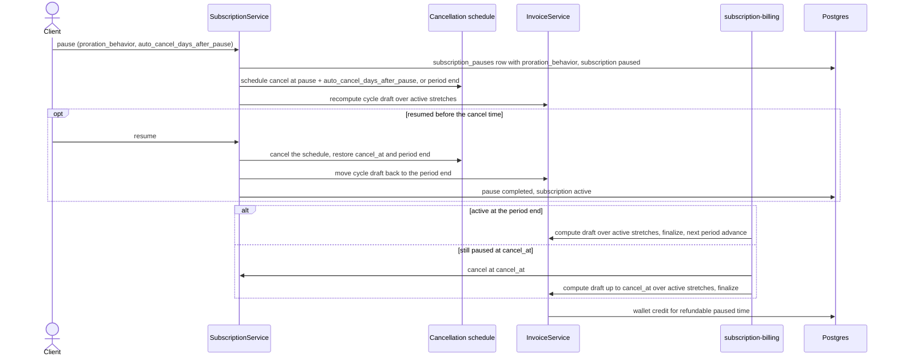
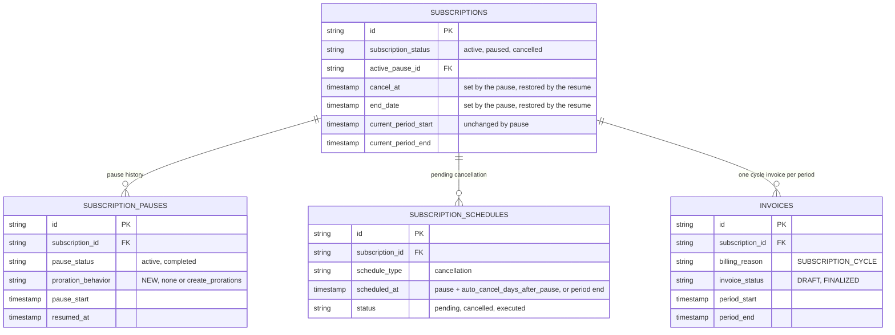

# Pause Subscription, One Invoice per Billing Period, Design ERD

Status: **Proposed**
Date: 2026-10-21
Author: tsage
Ticket: FLE-1698

---

## TL;DR

**Problem.** A subscription that is paused and resumed inside one billing period gets several invoices for
that period. The customer's order system expects exactly one invoice per customer per billing cycle. The
customer also wants a paused subscription to be cancelled on its own if it is not resumed within a set
number of days.

**Proposed solution.** Pause and resume stop raising invoices. Each billing period keeps its one cycle
draft, which is computed over the parts of the period when the subscription was active and finalized at
the period end. Each pause keeps its own `proration_behavior`, which decides whether its paused days are
taken off the fixed charges. A paused subscription is never rolled into the next period: it is cancelled after
`auto_cancel_days_after_pause`, or at the period end when it is not set, and the draft is finalized at that
point.

## How it works today

Phase 1 (FLE-1555) supports immediate pause and resume. Every pause and resume raises invoices:

- Pause raises a `PRORATION` closing invoice up to the pause, and credits the unused part of advance fixed
charges to the wallet under `create_prorations`.
- Each paused period gets a $0 `SUBSCRIPTION_PAUSED` invoice, and the subscription keeps rolling while
paused.
- Resume raises a `SUBSCRIPTION_RESUME` invoice for the advance fixed charges of the rest of the period, and
the cycle invoice at the period end bills the rest.

One pause and resume inside a period therefore produces three or four invoices for that period. There is
no way to cancel a paused subscription automatically.

The pieces this design reuses already exist:

- **The cycle draft.** Each billing period has one `SUBSCRIPTION_CYCLE` draft, which the billing run
computes and finalizes at the period end.
- **Scheduled cancellation.** A `scheduled_date` cancellation sets `cancel_at` and moves the cycle draft
to the cancel date. The billing run picks a subscription up once `cancel_at` passes, cancels it and
finalizes the draft. The cancellation is stored as a pending cancellation schedule, and cancelling that
schedule restores the subscription's `cancel_at`, `end_date` and period end.
- **Proration credit.** The wallet top-up used for proration credits today.

## Solution

### Pause

The pause time is the moment of the request.

1. The pause is refused when `pause time + auto_cancel_days_after_pause` is after the current period end (400). The
existing phase 1 validations stay.
2. A `subscription_pauses` row is written with `pause_start` set to the pause time and the request's
`proration_behavior`.
3. A `scheduled_date` cancellation is scheduled for `pause time + auto_cancel_days_after_pause`, or for the current
period end when `auto_cancel_days_after_pause` is not sent. This uses the existing cancellation schedule, so the
billing run cancels the subscription at that time without any new trigger.
4. The subscription becomes `paused`. `current_period_start` and the billing anchor do not change.
5. The cycle draft for the period is recomputed over the active stretches so far. It is created if it does
not exist yet.

No invoice is finalized and no wallet credit is given at the pause.

### Resume

1. The pending cancellation schedule is cancelled, which restores `cancel_at`, `end_date` and the period
end. The cycle draft is moved back to the original period end.
2. The `subscription_pauses` row gets `resumed_at` and becomes `completed`.
3. The subscription becomes `active`.

No invoice is raised at the resume, and the resume takes no `proration_behavior`. A pause cannot cross
the period end, so a resume always falls in the period whose advance fixed charges were already billed at
its start. The cycle draft carries on.

### Period end and cancellation

Both run through the existing billing run and finalize the period's one cycle draft:

- **Active at the period end.** The draft is computed over the active stretches and finalized, together with
the next period's advance fixed charges, as today.
- **Still paused when the cancellation is due.** The subscription is cancelled at `cancel_at` and the draft
is finalized up to that time. No next-period advance charges are billed.

### Computing the draft at finalization

The period is split into stretches from the `subscription_pauses` rows that overlap it. A pause that is
still open runs to the end of the invoice period, and the time after a cancel belongs to the pause the
subscription was cancelled from.

- **Active:** the subscription was not paused.
- **Paused, refundable:** paused by a pause sent with `create_prorations`.
- **Paused, not refundable:** paused by a pause sent with `none`.

Usage and fixed charges are then computed from these stretches:

- **Usage** is billed for the active stretches only, whatever the pause's `proration_behavior`. The usage
queries take every paused stretch as a range to exclude, so each meter is aggregated once over the active
time. Tiers, volume pricing, MAX, COUNT_UNIQUE and LATEST then apply to the combined active usage, not per
stretch. This aggregation does not exist today and is the main piece of work. The invoice preview uses the
same query.
- **Arrear fixed charges** are billed for the period minus the refundable time: amount × (period −
refundable time) ÷ period.
- **Advance fixed charges** were billed when the period started. The refundable part, amount × refundable
time ÷ period, is credited to the customer's wallet when the draft is finalized. The credit is keyed on the
invoice, so a retried finalization does not credit twice.

A pause sent with `none` therefore counts as billed time for fixed charges, which is what `none` means
today. The refundable stretches are recorded on the invoice so the fixed charge amounts can be reconciled.

**Example.** A monthly subscription with a 30-day period, a $300 advance fee and a $60 arrear fee, is
paused twice:

| Pause | Days | `proration_behavior` | Refundable days |
|---|---|---|---|
| Day 5 to day 10 | 5 | `create_prorations` | 5 |
| Day 20 to day 25 | 5 | `none` | 0 |

The period's one invoice bills usage for the 20 active days and the arrear fee for 25 of 30 days, $50.
$50 of the advance fee, 5 of 30 days of $300, is credited to the wallet.

### API

`POST /v1/subscriptions/{id}/pause`

```json
{
  "proration_behavior": "create_prorations",
  "auto_cancel_days_after_pause": 15,
  "reason": "Customer requested a hold",
  "metadata": { "requested_by": "support" }
}
```

| Field | Type | Required | Notes |
|---|---|---|---|
| `proration_behavior` | enum | no | `none` (default) or `create_prorations`. Decides whether this pause's days are taken off the fixed charges |
| `auto_cancel_days_after_pause` | integer | no | Minimum 1. The subscription is cancelled if it is not resumed within these days. Must not go past the current period end. When omitted, the subscription is cancelled at the period end |
| `reason` | string | no | Max 255 characters |
| `metadata` | map | no | Stored on the pause |

`POST /v1/subscriptions/{id}/resume`

```json
{
  "metadata": { "resumed_by": "support" }
}
```

| Field | Type | Required | Notes |
|---|---|---|---|
| `metadata` | map | no | Merged into the pause |

### Sequence diagram



### ERD

Only the fields this flow touches are shown.



### Schema changes

- **New column** `subscription_pauses.proration_behavior`, a string defaulting to `none`, with a migration.
Existing rows read as `none`.

`auto_cancel_days_after_pause` is not stored. It is only used to compute the cancellation time, which is stored on the
existing cancellation schedule and `cancel_at`. The `SUBSCRIPTION_PAUSED` and `SUBSCRIPTION_RESUME` billing
reasons from phase 1 are no longer raised.

### Workflow

The `subscription-billing` workflow already selects subscriptions whose period has ended or whose
`cancel_at` has passed, and already includes paused subscriptions. It changes in two ways:

- A paused subscription is never rolled into a new period. Its pending cancellation is always due at or
before the period end, so the run cancels it and finalizes the draft instead.
- Computing the cycle draft reads the subscription's pauses for the period and settles each paused stretch
by its pause's `proration_behavior`, as described above.

## Phase 2.2

Features to support after 2.1. Each is listed by what it should do. The approach for each is designed
separately.

- **Default `auto_cancel_days_after_pause`.** A hierarchical default, set at the tenant level and below, and applied when a pause request does not send its own value.
- **`auto_cancel_days_after_pause` with scheduled pause and resume.** The pause and resume requests accept it when the pause or the resume is scheduled.
- **Scheduled pause.** Pause a subscription at a future time instead of immediately.
- **Automatic resume.** Set, when pausing, the time at which the subscription resumes on its own.
- **Scheduled resume.** Resume a paused subscription at a future time instead of immediately. A pause with a resume time may then span more than one billing period.
- **Running scheduled pauses and resumes.** A workflow that carries out scheduled pauses and resumes at
their stored times, so a late run produces the same invoices.
- **Billing anchor on resume.** Let a customer move their billing day when they resume.
- **Pausing an individual child** while the parent and the other children keep billing.
- **Pausing with a pending cancellation or plan change.**
- **Stripe-managed subscriptions.** Pause and resume subscriptions that are synced with Stripe, without the Stripe sync overwriting the paused status.
- **Auto-cancellation of paused subscriptions with unpaid invoices.** Decide how overdue-invoice auto-cancellation treats a paused subscription.
- **Credit grants and coupons.** Keep recurring credit grants and repeating coupons aligned with the time
the subscription was active.
- **Commitments.** Account for paused time in the commitment true-up.
