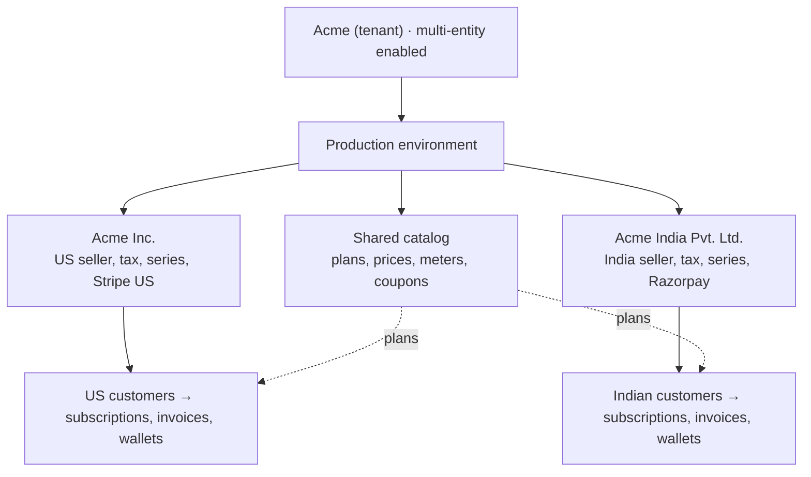
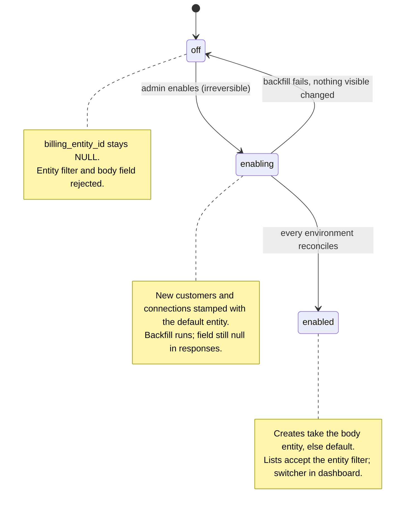
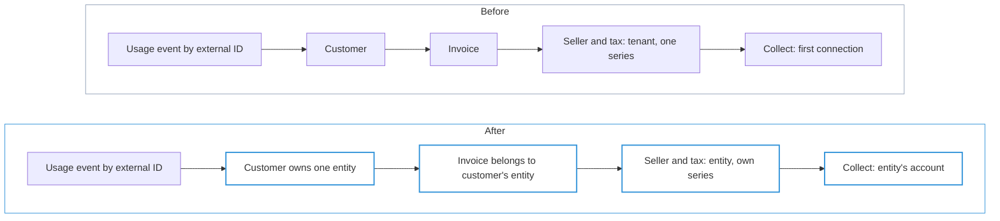
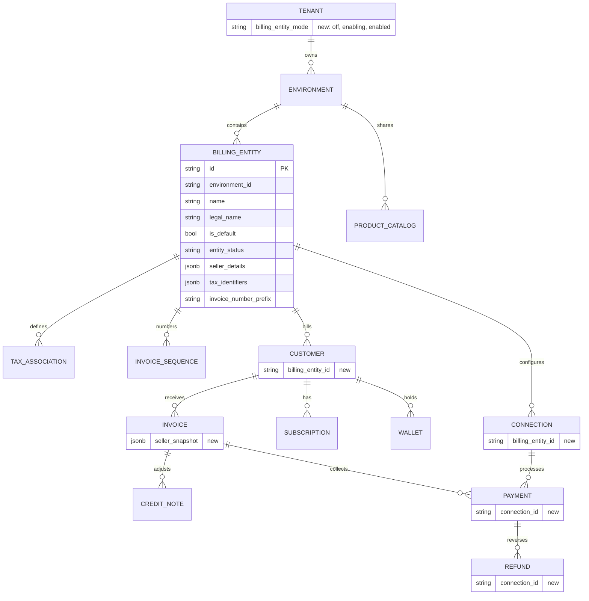
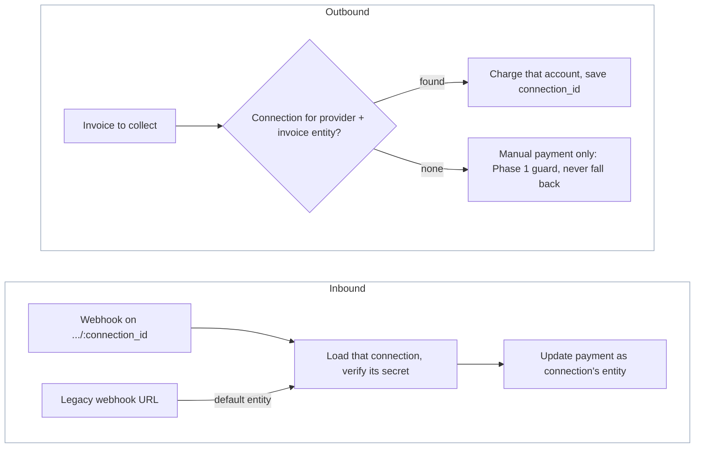
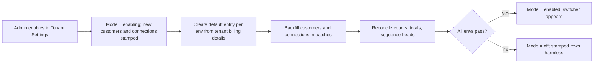

# Billing Entities — ERD

Status: **Proposed**
Date: 2026-10-21 (updated 2026-10-27)
Author: Paras Aghija
Linear: [FLE-1695](https://linear.app/flexprice/issue/FLE-1695/support-two-billing-entities-in-flexprice-with-each-customer-billed-by)
Base commit checked: `develop` @ `18cd7c661`

---

## 1. Problem

Today every environment bills as one seller. Tenants that sell one catalog through several registered
companies cannot model that.

| Today on `develop` | Consequence |
| --- | --- |
| Invoice PDF seller comes from `tenant.billing_details` (`invoiceService.getBillerInfo`) | Every invoice shows the same legal seller |
| One `invoice_sequences` row per `(tenant_id, environment_id, year_month)` | One numbering series for all customers |
| `connectionRepository.GetByProvider` returns the first published connection; 58 call sites rely on it | All payments land in one gateway account |
| Customer create copies tenant-level auto-apply tax associations | One tax setup for all customers |

Example: Acme sells Acme Pro from **Acme Inc.** (US, Stripe US) and **Acme India Pvt. Ltd.** (India,
Razorpay). Both share one catalog. Each customer must be invoiced, taxed and collected by the company
that sells to them.

## 2. Goals, non-goals, phases

| Phase | Goal | Visible to |
| --- | --- | --- |
| 0. Foundation | Schema, tenant switch, entity filter and response field, enablement backfill. No behaviour change | Nobody |
| 1. Invoices per entity (Goal 1) | Invoices carry the issuing entity's seller details, numbering and tax | Internal tenants, design partners |
| 2. Payments per entity (Goal 2) | Each entity has its own gateway and accounting connections; payments, webhooks and refunds use the entity's account | All tenants |

Phase 1 stays internal: a second entity must never collect money through the first entity's gateway.

Non-goals for this release:

- Moving an existing customer to another entity.
- One customer billed by more than one entity (see §13, open question 1).
- Entity-level user permissions.
- An all-entities reporting view.
- Any change to usage events or metering.

## 3. Concepts and scope

A **billing entity** is the legal company that sells to a customer and issues its invoice. It lives
inside an environment, beside the shared catalog. Each environment has its own entities because sandbox
and production use different gateway accounts.

| Scope | What lives here |
| --- | --- |
| Environment (shared) | Products, plans, prices, meters, features, add-ons, coupons and their redemption caps, credit rules, invoice template and branding |
| Billing entity | Seller identity, tax setup, invoice numbering, gateway and accounting connections, customers |
| Customer's records | Subscriptions, invoices, credit notes, wallets, credits, payments, refunds — belong to the customer's entity, derived through the customer |
| Issued record | A finalized invoice freezes its seller details and entity; a payment keeps the exact gateway account it used |

**Decided: entities are scoped at customer level.** The customer decides the entity; everything created
for the customer belongs to it and can never change it. Customer `external_id` stays unique per
`(tenant_id, environment_id)`.

Why not subscription level: `meter_usage` is keyed by
`(tenant_id, environment_id, external_customer_id, meter_id, timestamp)` with no subscription column, and
billing reads usage per subscription line item from those rows. Two concurrent subscriptions under
different entities pricing the same meter would both bill the same usage. Customer level keeps billing
entities an invoicing concern and leaves ingestion and aggregation untouched.

## 4. Invariants

1. **Off means unchanged.** For a tenant with the feature off, every SQL query, cache key, webhook route
   and API response behaves as today (responses only gain a `billing_entity_id` that stays null).
2. **No entity field, no break.** API calls that send no `billing_entity_id` work in both modes. When
   enabled, customer and connection creates use the default entity and lists span all entities.
3. **The customer decides the entity.** Only `customers` and `connections` store `billing_entity_id`,
   and it is immutable. Every other record derives its entity through its customer or invoice.
4. **One record, one entity.** No invoice, grouped or delegated invoice, wallet debit or tax application
   mixes entities.
5. **Catalog is shared.** Plans, prices, meters, features, add-ons and coupons carry no entity.
6. **Money follows the entity.** A payment or refund uses a connection owned by the invoice's entity and
   records the exact `connection_id`. No fallback to another entity's connection.
7. **Issued documents are frozen.** Invoice numbers, amounts and finalized seller details (including the
   entity id) never change.
8. **Irreversible switch.** `off → enabling → enabled`. Only a failed `enabling` returns to `off`.
9. **Usage events stay as they are.** No change to ingestion or ClickHouse schemas.

## 5. Tenant opt-in

Multi-entity billing is a per-tenant switch in Tenant Settings, stored in
`tenants.billing_entity_mode` and changed only by the enable endpoint (never by the generic settings
API). Tenants that never enable it keep today's behaviour permanently.

| | Off (e.g. Zomato) | Enabled (e.g. Acme) |
| --- | --- | --- |
| Dashboard | No switcher | Entity switcher beside environment |
| API without `billing_entity_id` | Works as today | Works; creates use the default entity, lists span all entities |
| API with `billing_entity_id` (filter or body) | 400: no entities exist | Acts on that entity after env check |
| Request bodies | Unchanged | Customer and connection create gain optional `billing_entity_id` |
| Responses | `+ billing_entity_id` (null) | `+ billing_entity_id` |
| Existing webhook URLs | Unchanged | Resolve to default entity's connection |

Enabling with only the default entity changes nothing a customer or API client can observe.
Environments created after enablement get a default entity at creation.

## 6. Flows: before and after enablement

"Before" is also how every tenant that never enables behaves.

| Flow | Before | After enablement |
| --- | --- | --- |
| Create customer | Created in the environment | Created under the body `billing_entity_id`, else the default entity. Entity never changes |
| Customer `external_id` | Unique per environment | Unchanged: unique per environment across all entities |
| Customer tax defaults | Tenant-level auto-apply rates copied | Entity's auto-apply rates copied |
| Create subscription | Plan from catalog | Same; belongs to the customer's entity |
| Delegated invoicing (`invoicing_customer_id`) | Any customer in env | Must belong to the same entity |
| Renewals, plan changes, pauses | Unchanged | Unchanged |
| Usage events, attribution, analytics, alerts | By `external_customer_id` | Unchanged; entity derived through the customer |
| Generate invoice (subscription, one-off, credit purchase) | Same calculation order | Unchanged calculation; invoice belongs to the customer's entity |
| Grouped / consolidated invoice | Any customers | All participants share one entity |
| Invoice number | One sequence per env | Default entity continues the existing sequence; each other entity has its own sequence and a required distinct prefix |
| Seller on invoice and PDF | Tenant billing details | Issuing entity's details, frozen at finalization |
| Tax | Tenant → customer → subscription | Entity → customer → subscription |
| Wallets, credit grants, top-ups | Per customer | Per customer, so per entity; balances never cross entities |
| Coupons | Per env | Per env; redemption caps count across entities |
| Gateway connections (Phase 2) | One per provider per env | Each connection belongs to an entity |
| Auto-charge, checkout, payment links (Phase 2) | Env's connection | Invoice entity's connection |
| Gateway webhooks (Phase 2) | One URL per provider per env | One URL per connection; existing URLs serve the default entity |
| Refunds (Phase 2) | Provider connection | The exact connection the payment used |
| Accounting / CRM sync (Phase 2) | One connection per provider | Per entity connection |
| Lists, exports, basic reports | Whole env | Whole env; optional `billing_entity_id` filter narrows to one entity |
| Get record by ID | Works | Works for any entity; response shows its entity |
| Environment clone | Catalog and settings | Also entity profiles; connections not copied |

In Phase 1, non-default entities have no connections; their invoices can only be marked paid manually.

## 7. ERD and schema changes

All changes are additive and nullable. Off tenants keep `NULL` everywhere and never read the new columns.

### 7.1 New table `billing_entities`

`BaseMixin` + `EnvironmentMixin` + `MetadataMixin`.

| Column | Type | Notes |
| --- | --- | --- |
| `id` | varchar(50) | Prefix `be_` |
| `name` | varchar(255) | Display name in the switcher |
| `legal_name` | varchar(255) | Seller name on invoices |
| `is_default` | bool | Partial unique index `(tenant_id, environment_id) WHERE is_default AND status='published'` |
| `entity_status` | varchar(20) | `active` / `disabled` |
| `seller_details` | jsonb | Same shape as `TenantBillingDetails` |
| `tax_identifiers` | jsonb | Seller tax IDs printed on invoices |
| `invoice_number_prefix` | varchar(20), nullable | Required for non-default entities; unique among the environment's entities and different from the env prefix; NULL = env `invoice_config` prefix |

### 7.2 Tenant mode

`tenants.billing_entity_mode` varchar(20), default `off`.

### 7.3 `billing_entity_id` on customers and connections

Nullable `varchar(50)`, immutable once set. Index `(tenant_id, environment_id, billing_entity_id, …)`
matching each table's main list index, built `CONCURRENTLY`.

| Table | Value comes from |
| --- | --- |
| `customers` | Body `billing_entity_id` on create, else the default entity |
| `connections` | Body `billing_entity_id` on create, else the default entity |

### 7.4 Derived entity

Every other record stores no entity and derives it. The customer's entity is immutable, so the derived
value can never drift.

| Record | Derived through |
| --- | --- |
| Subscriptions, wallets, payment methods, checkout sessions, commitments | `customer_id` → customer |
| Invoices | `customer_id` → customer; frozen into `seller_snapshot` at finalization |
| Credit notes, refunds | `invoice_id` → invoice → customer |
| Payments | `destination_type`: `INVOICE` → invoice → customer; `CUSTOMER` → customer |

Child records inherit through their parent: invoice and subscription line items, wallet transactions,
credit grants and applications, tax applied, payment attempts, coupon applications, hosted invoice
tokens.

Derivation reads customers in any status, so records of deleted or archived customers keep their entity.

An entity column on invoices is added only if invoices can belong to a different entity than their
customer, customer reassignment becomes supported, or measured query performance needs it. If
reassignment is introduced, invoice entity ids are populated before customers may move.

### 7.5 Other key and index changes

| Table | Change | Why |
| --- | --- | --- |
| `invoices` | Add `seller_snapshot` jsonb, set at finalization: entity id, seller details, tax IDs | Issued invoices keep their seller and issuing entity; historical rows stay NULL and render from the current source |
| `invoice_sequences` | Add `billing_entity_id` NOT NULL default `''`; unique key `(tenant_id, environment_id, billing_entity_id, year_month)` | Default entity keeps writing the `''` row so its sequence continues; `ON CONFLICT` works without `NULLS NOT DISTINCT` |
| `invoices` unique `(tenant_id, environment_id, invoice_number)` | Keep | Distinct prefix per entity prevents collisions without rebuilding a hot index |
| `entity_integration_mappings` | Add `connection_id`; add it to the unique key | A shared plan or price can map to two Stripe accounts |
| `payments`, `refunds` | Add `connection_id` | Refunds and webhooks resolve the original account |
| `tax_associations` | New `entity_type = billing_entity` | Entity-level tax defaults; tenant-level rows are treated as the default entity's |

**Invoice numbering (decided).** Each entity gets its own counter and a required distinct prefix. The
counter's entity is read from the invoice's customer at finalization. Without the distinct prefix, two
entities with separate counters would both produce e.g. `INV-202610-00001` and the second would fail the
unique index.

## 8. API design

### 8.1 Entity selection

The entity is passed as request data, never as a header or request context.

| Request | Entity comes from |
| --- | --- |
| List / search | Optional `billing_entity_id` filter; absent = all entities |
| Create customer, create connection | Optional body `billing_entity_id`; absent = default entity |
| Create anything else | The customer (or invoice); no entity field |
| Get / update / delete by ID | The record; no entity field |

| Tenant mode | `billing_entity_id` absent | `billing_entity_id` present |
| --- | --- | --- |
| `off` | Same as today | 400 `billing_entities_not_enabled`: no entities exist |
| `enabling` | Same as today; new customers and connections stamped with the default entity | 400 `billing_entities_not_enabled`: entities not usable until enabled |
| `enabled` | Creates use the default entity; lists span all entities | That entity, after checking it belongs to the env and is active (disabled: reads only) |

Tenant mode comes from a cached tenant lookup.

### 8.2 New endpoints

| Method | Path | Notes |
| --- | --- | --- |
| `POST` | `/v1/tenants/billing-entities/enable` | Tenant admin only. Body: default entity profile. Starts the enablement workflow, returns `enabling` |
| `GET` | `/v1/tenants/billing-entities/status` | Mode and per-environment progress |
| `GET` / `POST` | `/v1/billing-entities` | List / create in the current environment. Requires `enabled` |
| `GET` / `PUT` | `/v1/billing-entities/:id` | Read / edit profile; edits apply to future invoices |
| `POST` | `/v1/billing-entities/:id/disable` | Refused while active subscriptions or draft invoices exist |
| `POST` | `/v1/webhooks/{provider}/:tenant_id/:environment_id/:connection_id` | Connection-scoped webhook routes (Phase 2) |

### 8.3 Changes to existing endpoints

- Responses gain `billing_entity_id` on top-level billing resources, in Get, List and webhook payloads
  alike. Additive, SDK-compatible. Null until the tenant is `enabled`. ID only; names and profiles come
  from `/v1/billing-entities`.

| Resource | `billing_entity_id` in response |
| --- | --- |
| Customers, connections | Stored |
| Invoices, subscriptions, wallets, credit notes, payments, refunds | Derived (§7.4) |
| Catalog (plans, prices, meters, coupons…) | No; belongs to the environment |
| Nested children (invoice lines, subscription lines, payment attempts) | No; the enclosing resource carries it |

- Customer and connection create bodies gain optional `billing_entity_id`. No other request body changes.
- List and search filters gain optional `billing_entity_id`.
- Duplicate provider connections are allowed across entities, not within one.
- Existing `/v1/webhooks/{provider}/:tenant_id/:environment_id` routes resolve to the default entity's
  connection.

## 9. Repository filtering and responses

The `billing_entity_id` filter adds a predicate only when set. It is rejected unless the tenant is
`enabled`, so off tenants run identical SQL.

| Records | Filter predicate |
| --- | --- |
| Customers, connections | `billing_entity_id = ?` |
| Invoices, subscriptions, wallets, credit notes | `customer_id` in the entity's customers |
| Refunds | `invoice_id` in the entity's invoices |
| Payments | By `destination_type`: the entity's invoices or customers |

| Operation | Rule |
| --- | --- |
| Create customer or connection | Stamp the body entity, else the default entity |
| Create of other records | Nothing stored; same-entity checks where two customers meet (delegated, grouped invoices) |
| Get / update / delete by ID | No entity filter; response shows `billing_entity_id` |
| Lookup by `external_customer_id` | Environment-scoped, as today |
| Catalog tables | Never filtered by entity |

Derived `billing_entity_id` in responses is filled by the service with one batch lookup per page (two for
payments), never one lookup per row.

Cache: connection lookups by entity include the entity id in the cache key (Phase 2). Off tenants keep
the same keys.

## 10. Background paths and integrations

Background work has no request entity. Before any step that issues, prices, taxes or collects, it reads
the entity from the record's customer. Temporal payloads need no change; activities re-read the record,
so retries never replay a stale entity.

| Path | Entity source |
| --- | --- |
| Billing / renewal workflows | Subscription's customer |
| Invoice finalize, number, PDF | Invoice's customer; frozen into `seller_snapshot` at finalization |
| Provider sync workflows | Record's entity → its connection (optional `connection_id` in new payloads) |
| Kafka event consumers | Not needed |
| Customer created from a gateway webhook | The connection's entity |
| Onboarding, environment clone | Default entity; clone copies entity profiles, not connections |

| Method | Use |
| --- | --- |
| `GetByProvider(ctx, p)` | Same signature; for enabled tenants resolves to the default entity's connection |
| `GetByProviderForEntity(ctx, p, entityID)` | New; entity comes from a record |
| `Get(ctx, connectionID)` | Refunds, webhooks, retries that already know the account |

Catalog sync writes one `entity_integration_mappings` row per connection.

## 11. Enablement and migration

One Temporal workflow per tenant; tenants that stay off are never migrated.

Backfill order (`WHERE tenant_id = ? AND environment_id = ? AND billing_entity_id IS NULL`, batches of
1,000, idempotent): `connections` → `customers` → `payments`, `refunds` (set `connection_id`) →
`entity_integration_mappings` (set `connection_id`). `invoice_sequences` needs no backfill.

Reconciliation per environment: zero NULL customers and connections; row counts unchanged; invoice
totals, amounts paid and wallet balances unchanged; every invoice sequence head unchanged.

Deploy order: columns and concurrent indexes first, code that reads them second, enablement API last.

### 11.1 Code touchpoints and PR plan

| Area | Where on `develop` | Change |
| --- | --- | --- |
| Filters | List filter types for customers, connections, invoices, subscriptions, wallets, credit notes, payments, refunds | Optional `billing_entity_id` and its predicate (§9) |
| Requests | Customer and connection create DTOs | Optional `billing_entity_id` |
| Responses | Service response builders and webhook payloads | Batch-fill derived `billing_entity_id` |
| Connections | `internal/repository/ent/connection.go` + 58 `GetByProvider` call sites | Entity-aware lookup; explicit entity or connection |
| Numbering | `internal/repository/ent/invoice.go` `GetNextInvoiceNumber` | Entity in sequence key and prefix |
| Seller, tax | `internal/ee/service/invoice.go` `getBillerInfo`, `internal/types/taxassociation.go`, `internal/ee/service/customer.go` | Snapshot; `billing_entity` tax level |
| Webhooks | `internal/api/router.go`, `internal/api/v1/webhook.go` | Connection-scoped routes |
| Mappings | `ent/schema/entityintegrationmapping.go` | `connection_id` in unique key |

| Phase | Contents |
| --- | --- |
| 0 | Schema: `billing_entities`, `tenants.billing_entity_mode`, customer and connection columns, concurrent indexes |
| 0 | Mode checks, entity filter, create body field, derived response field |
| 0 | Enablement workflow, reconciliation, enable/status API |
| 1 | Entity CRUD, same-entity checks |
| 1 | Per-entity numbering, seller snapshot, PDF, tax level |
| 1 | Connection filter guard and fail-safe audit of all `GetByProvider` call sites |
| 2 | Multiple connections per provider, mappings, payment/refund `connection_id` |
| 2 | Connection-scoped webhooks, sync workflows, OAuth flows |
| 1–2 | Dashboard: Tenant Settings switch, entity switcher, entity forms |

## 12. Release acceptance and tests

Phase 0

- [ ] Off tenants pass the full unit, integration and `integration-testing-suite` runs unchanged, including calls without `billing_entity_id`.
- [ ] SQL snapshot test: repository queries without a `billing_entity_id` filter contain no entity predicate.
- [ ] Enabling an internal tenant leaves every invoice number, amount, status, balance and issued PDF unchanged; a forced failure returns to off.

Phase 1

- [ ] One environment issues invoices from two entities with different seller details, numbering and tax.
- [ ] Cross-entity rejections: delegated invoice, grouped invoice, wallet debit, tax link.
- [ ] Editing seller details does not change issued invoices.
- [ ] A non-default entity cannot reach any gateway charge, checkout or sync.

Phase 2

- [ ] Stripe for the US and Razorpay for India in one environment.
- [ ] Two entities with separate Stripe accounts charge, receive webhooks (including out of order) and refund correctly.
- [ ] Existing webhook URLs keep working for the default entity.
- [ ] Old Temporal payloads replay correctly; connection cache isolation across entities.

## 13. Open questions

| # | Question | Proposal |
| --- | --- | --- |
| 1 | Can one buyer be billed under different entities? | If yes, the buyer gets a separate customer under each entity, each with its own config (external ID, billing details, tax, currency, payment methods, wallets) and its own usage stream. One customer across entities needs subscription-level entities and per-subscription usage attribution; out of scope now |
| 2 | Accounting and CRM connectors (QuickBooks, Zoho Books, HubSpot, Tabs) in Phase 2? | Yes; each company's books stay separate |
| 3 | Stripe Tax for non-default entities in Phase 1 | Native tax only until Phase 2 |
| 4 | Disabling an entity with drafts or scheduled work | Block disable while drafts or active subscriptions exist |
| 5 | All-entities reporting view | Defer; design after Phase 2 |

Decided: customer-level entities; tenant-level irreversible switch; mode on `tenants`; entity stored
only on customers and connections, derived everywhere else; entity selected by list filters and
customer/connection create bodies, no header; lists without a filter span all entities; responses carry
`billing_entity_id` on top-level billing resources; get-by-ID not entity-scoped; per-entity invoice
counter with required distinct prefix; credit notes keep their random `CN-` IDs, unchanged; no backfill needed for environments created after enablement.

## 14. References

| Flexprice object | Similar object elsewhere | Source |
| --- | --- | --- |
| Billing entity inside one environment | Chargebee Multi-Business Entity: several businesses as independent entities on one site | [Chargebee docs](https://www.chargebee.com/docs/billing/2.0/multi-business-entity/mbe) |
| Default entity when the API names none | Lago assigns customers to the default billing entity when none is specified via API | [Lago docs](https://docs.getlago.com/guide/billing-entities) |
| Per-entity invoice numbering | Recurly: each entity uses its own invoice sequence or the site's shared one | [Recurly docs](https://docs.recurly.com/docs/multiple-business-entities) |
| Per-entity gateway account | Metronome connects one environment to several Stripe accounts | [Metronome docs](https://docs.metronome.com/integrations/invoice-integrations/stripe) |
