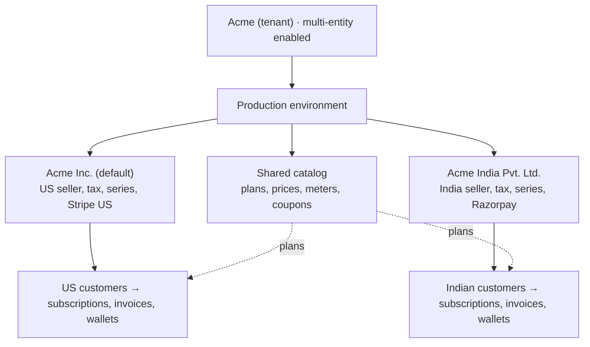
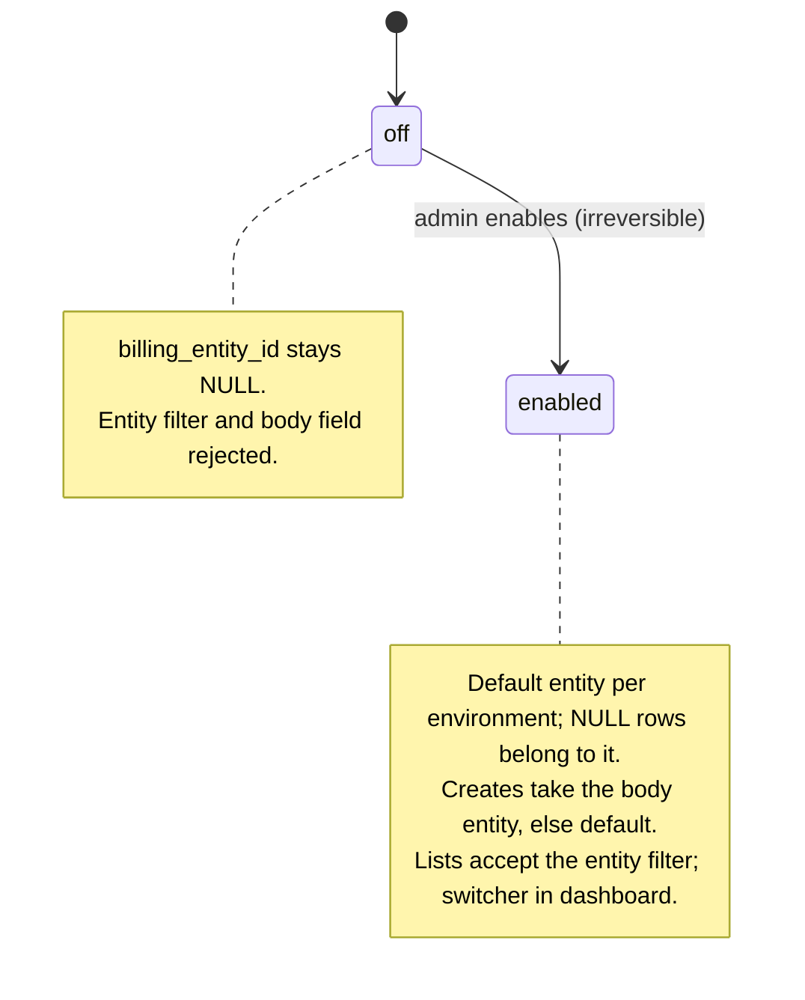
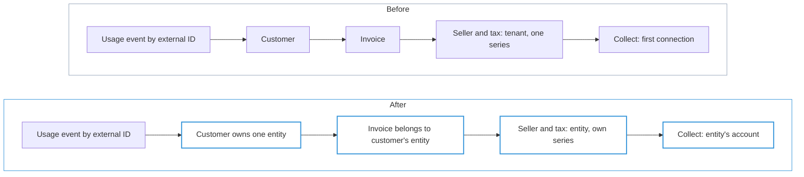
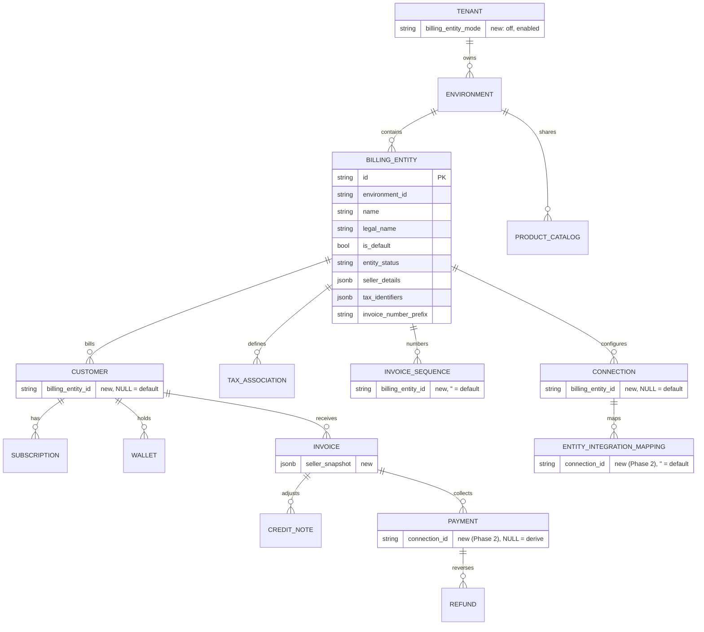
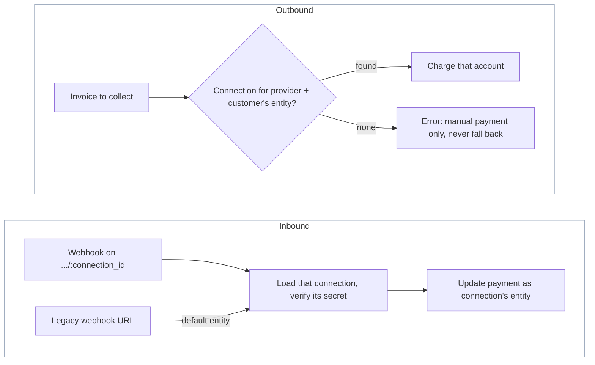
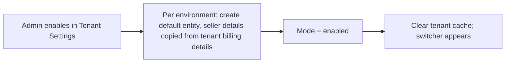

# Billing Entities — ERD

Status: **Proposed**
Date: 2026-10-21 (updated 2026-10-27)
Author: Paras Aghija
Linear: [FLE-1695](https://linear.app/flexprice/issue/FLE-1695/support-two-billing-entities-in-flexprice-with-each-customer-billed-by)
Base commit checked: `develop` @ `18cd7c661`

---

## 1. Problem

Today every environment bills as one seller. Tenants that sell one catalog through several registered
companies cannot model that.

| Today on `develop` | Consequence |
| --- | --- |
| Invoice PDF seller comes from `tenant.billing_details` (`invoiceService.getBillerInfo`) | Every invoice shows the same legal seller |
| One `invoice_sequences` row per `(tenant_id, environment_id, year_month)` | One numbering series for all customers |
| `connectionRepository.GetByProvider` returns the first published connection; 58 call sites rely on it | All payments land in one gateway account |
| Customer create copies tenant-level auto-apply tax associations | One tax setup for all customers |

Example: Acme sells Acme Pro from **Acme Inc.** (US, Stripe US) and **Acme India Pvt. Ltd.** (India,
Razorpay). Both share one catalog. Each customer must be invoiced, taxed and collected by the company
that sells to them.

## 2. Goals, non-goals, phases

| Phase | Goal | Visible to |
| --- | --- | --- |
| 0. Foundation | Schema, tenant switch, entity filter and response field, enable endpoint. No behaviour change | Nobody |
| 1. Invoices per entity (Goal 1) | Invoices carry the issuing entity's seller details, numbering and tax | Internal tenants, design partners |
| 2. Payments per entity (Goal 2) | Each entity has its own gateway and accounting connections; payments, webhooks and refunds use the entity's account | All tenants |

Phase 1 stays internal: a second entity must never collect money through the first entity's gateway.

Non-goals for this release:

- Moving an existing customer or connection to another entity. Everything that exists at enablement
  stays with the default entity.
- One customer billed by more than one entity; the buyer gets a separate customer per entity.
- Changing which entity is the default.
- Entity-level user permissions.
- An all-entities reporting view.
- An entity filter on exports and scheduled tasks.
- Any change to usage events or metering.

## 3. Concepts and scope

A **billing entity** is the legal company that sells to a customer and issues its invoice. It lives
inside an environment, beside the shared catalog. Each environment has its own entities because sandbox
and production use different gateway accounts.

| Scope | What lives here |
| --- | --- |
| Environment (shared) | Products, plans, prices, meters, features, add-ons, coupons and their redemption caps, credit rules, invoice template and branding |
| Billing entity | Seller identity, tax setup, invoice numbering, gateway and accounting connections, customers |
| Customer's records | Subscriptions, invoices, credit notes, wallets, credits, payments, refunds — belong to the customer's entity, derived through the customer |
| Issued record | A finalized invoice freezes its seller details and entity |

The **default entity** is the one created in each environment when the tenant enables the feature. It
owns everything that existed before enablement, receives creates that name no entity, and can never be
changed or disabled.

**Decided: entities are scoped at customer level.** The customer decides the entity; everything created
for the customer belongs to it and can never change it. Customer `external_id` stays unique per
`(tenant_id, environment_id)`.

Why not subscription level: `meter_usage` is keyed by
`(tenant_id, environment_id, external_customer_id, meter_id, timestamp)` with no subscription column, and
billing reads usage per subscription line item from those rows. Two concurrent subscriptions under
different entities pricing the same meter would both bill the same usage. Customer level keeps billing
entities an invoicing concern and leaves ingestion and aggregation untouched.

## 4. Invariants

1. **Off means unchanged behaviour.** For a tenant with the feature off, every API response, webhook
   route and invoice behaves as today (responses only gain a `billing_entity_id` that stays null).
   Internal SQL may change where the schema requires it (§11).
2. **No entity field, no break.** API calls that send no `billing_entity_id` work in both modes. When
   enabled, customer and connection creates use the default entity and lists span all entities.
3. **The customer decides the entity.** Only `customers` and `connections` store `billing_entity_id`,
   and it is immutable. NULL means the default entity. Every other record derives its entity through its
   customer or invoice.
4. **One record, one entity.** No invoice, grouped or delegated invoice, wallet debit or tax application
   mixes entities.
5. **Catalog is shared.** Plans, prices, meters, features, add-ons and coupons carry no entity.
6. **Money follows the entity.** A payment uses the connection that its derived entity owns for that
   provider; a refund uses the connection that took the payment. An enabled tenant's gateway call with
   no entity errors; it never falls back to another entity's connection.
7. **Issued documents are frozen.** Invoice numbers, amounts and finalized seller details (including the
   entity id) never change.
8. **Irreversible switch.** `off → enabled`, never back.
9. **Fixed default.** The default entity is created at enablement and can never be changed or disabled.
10. **Usage events stay as they are.** No change to ingestion or ClickHouse schemas.

## 5. Tenant opt-in

Multi-entity billing is a per-tenant switch in Tenant Settings, stored in
`tenants.billing_entity_mode` and changed only by the enable endpoint (never by the generic settings
API). Tenants that never enable it keep today's behaviour permanently.

| | Off (e.g. Zomato) | Enabled (e.g. Acme) |
| --- | --- | --- |
| Dashboard | No switcher | Entity switcher beside environment |
| API without `billing_entity_id` | Works as today | Works; creates use the default entity, lists span all entities |
| API with `billing_entity_id` (filter or body) | 400: no entities exist | Acts on that entity after env check |
| Request bodies | Unchanged | Customer and connection create gain optional `billing_entity_id` |
| Responses | `+ billing_entity_id` (null) | `+ billing_entity_id` |
| Seller details | Tenant billing details | Maintained per entity under Entities; tenant billing details keep only self-billing |
| Existing webhook URLs | Unchanged | Serve the default entity's connection |

Enabling with only the default entity changes nothing a customer or API client can observe.

## 6. Flows: before and after enablement

"Before" is also how every tenant that never enables behaves.

| Flow | Before | After enablement |
| --- | --- | --- |
| Create customer | Created in the environment | Created under the body `billing_entity_id`, else the default entity. Entity never changes |
| Customer `external_id` | Unique per environment | Unchanged: unique per environment across all entities |
| Customer tax defaults | Tenant-level auto-apply rates copied | Entity's auto-apply rates copied |
| Create subscription | Plan from catalog | Same; belongs to the customer's entity |
| Delegated invoicing (`invoicing_customer_id`) | Any customer in env | Must belong to the same entity |
| Renewals, plan changes, pauses | Unchanged | Unchanged |
| Usage events, attribution, analytics, alerts | By `external_customer_id` | Unchanged; entity derived through the customer |
| Generate invoice (subscription, one-off, credit purchase) | Same calculation order | Unchanged calculation; invoice belongs to the customer's entity |
| Grouped / consolidated invoice | Any customers | All participants share one entity |
| Invoice number | One sequence per env | Default entity continues the existing sequence; each other entity has its own sequence and a distinct prefix |
| Seller on invoice, PDF and hosted page | Tenant billing details | Customer's entity's details; frozen into `seller_snapshot` at finalization |
| Tax | Tenant → customer → subscription | Entity → customer → subscription |
| Wallets, credit grants, top-ups | Per customer | Per customer, so per entity; balances never cross entities |
| Coupons | Per env | Per env; redemption caps count across entities |
| Gateway connections (Phase 2) | One per provider per env | One per provider per entity |
| Auto-charge, checkout, payment links (Phase 2) | Env's connection | The customer's entity's connection |
| Gateway webhooks (Phase 2) | One URL per provider per env | One URL per connection; existing URLs serve the default entity |
| Refunds (Phase 2) | Provider connection | The connection that took the payment |
| Accounting / CRM sync (Phase 2) | One connection per provider | Per entity connection |
| Lists, basic reports | Whole env | Whole env; optional `billing_entity_id` filter narrows to one entity |
| Exports, scheduled tasks | Whole env | Unchanged: whole env, no entity filter |
| Get record by ID | Works | Works for any entity; response shows its entity |
| Environment clone | Catalog and settings | Also entity profiles; connections not copied |

In Phase 1, non-default entities have no connections; their invoices can only be marked paid manually.

## 7. ERD and schema changes

All changes are additive. Existing rows keep their current values and need no backfill.

### 7.1 New table `billing_entities`

`BaseMixin` + `EnvironmentMixin` + `MetadataMixin`.

| Column | Type | Notes |
| --- | --- | --- |
| `id` | varchar(50) | Prefix `be_` |
| `name` | varchar(255) | Display name in the switcher |
| `legal_name` | varchar(255) | Seller name on invoices |
| `is_default` | bool | Set at enablement, never moves. Partial unique index `(tenant_id, environment_id) WHERE is_default AND status='published'` |
| `entity_status` | varchar(20) | `active` / `disabled`; the default entity is always `active` |
| `seller_details` | jsonb | Same shape as `TenantBillingDetails`; the default entity's copy is taken from the tenant's billing details at enablement |
| `tax_identifiers` | jsonb | Seller tax IDs printed on invoices |
| `invoice_number_prefix` | varchar(20), nullable | Required for non-default entities; NULL = env `invoice_config` prefix. Editable; see prefix rule below |

`billing_entities` is not recorded in the activity log. Customer activity snapshots carry
`billing_entity_id`; invoice snapshots carry the entity through `seller_snapshot` once finalized.

**Prefix rule.** An entity cannot set prefix `P` (on create or edit) if `P` is another entity's current
prefix or any invoice in the environment numbered `P<separator>…` belongs to another entity. The env
`invoice_config` prefix counts as the default entity's and its edits are checked the same way. Checking
issued numbers, not only current prefixes, stops a renamed entity's old prefix (or an old env prefix)
from being reused by another entity, whose own counter would restart and repeat issued numbers. The
check is per environment; other environments may use the same prefix.

### 7.2 Tenant mode

`tenants.billing_entity_mode` varchar(20), default `off`.

### 7.3 `billing_entity_id` on customers and connections

Nullable `varchar(50)`, immutable once written. NULL means the default entity, for rows created before
and after enablement alike. Index `(tenant_id, environment_id, billing_entity_id, …)` matching each
table's main list index, built `CONCURRENTLY`.

| Table | Value on create |
| --- | --- |
| `customers` | Body `billing_entity_id`; absent or the default's ID stores NULL |
| `connections` | Body `billing_entity_id`; absent or the default's ID stores NULL |

The connection duplicate check widens from one published connection per provider per environment to one
per provider per entity, still excluding S3 and GCS.

### 7.4 Derived entity

Every other record stores no entity and derives it. The customer's entity is immutable, so the derived
value can never drift.

| Record | Derived through |
| --- | --- |
| Subscriptions, wallets, payment methods, checkout sessions, commitments | `customer_id` → customer |
| Invoices | `customer_id` → customer; frozen into `seller_snapshot` at finalization |
| Credit notes, refunds | `invoice_id` → invoice → customer |
| Payments | `destination_type`: `INVOICE` → invoice → customer; `CUSTOMER` → customer |

Child records inherit through their parent: invoice and subscription line items, wallet transactions,
credit grants and applications, tax applied, payment attempts, coupon applications, hosted invoice
tokens. Every other customer-linked table inherits through the customer the same way, with no schema
change.

Derivation reads customers in any status, so records of deleted or archived customers keep their entity.

A record's connection is derived the same way: its entity's connection for the record's provider
(`payment_gateway` on payments). Payments are the exception: each stores the `connection_id` that took
it, and its refunds use that connection, so a later account swap cannot send a refund to the wrong
account. If that connection has been removed, the refund fails with an error naming the payment and the
removed connection, for the seller to handle outside Flexprice; it never falls back to another
connection. Payments without one (made before Phase 2) derive it.

An entity column on invoices is added only if invoices can belong to a different entity than their
customer, customer reassignment becomes supported, or measured query performance needs it. If
reassignment is introduced, invoice entity ids are populated before customers may move.

### 7.5 Other key and index changes

| Table | Change | Why |
| --- | --- | --- |
| `invoices` | Add `seller_snapshot` jsonb for enabled tenants: entity id, seller details, tax IDs | Issued invoices keep their seller and issuing entity |
| `invoice_sequences` | Add `billing_entity_id` NOT NULL default `''`; unique key `(tenant_id, environment_id, billing_entity_id, year_month)` | Default entity keeps writing the `''` row so its sequence continues; `ON CONFLICT` works without `NULLS NOT DISTINCT` |
| `invoices` unique `(tenant_id, environment_id, invoice_number)` | Keep | Distinct prefix per entity prevents collisions without rebuilding a hot index |
| `entity_integration_mappings` (Phase 2) | Add `connection_id` NOT NULL default `''`; replace `idx_entity_integration_mapping_unique` with one that includes it, before per-connection sync starts; written on every new row of enabled tenants | A shared plan or price maps to one external id per provider account; `''` = default entity's connection; off tenants keep writing `''` |
| `payments` (Phase 2) | Add `connection_id` nullable; written on every new gateway payment | Refunds reach the account that took the payment |
| `tax_associations` | New `entity_type = billing_entity` | Entity-level tax defaults; tenant-level rows are treated as the default entity's |

**Invoice numbering (decided).** Each entity gets its own counter and a distinct prefix. The counter's
entity is read from the invoice's customer at finalization. Without the distinct prefix, two entities
with separate counters would both produce e.g. `INV-202610-00001` and the second would fail the unique
index. If two concurrent prefix edits still produce a duplicate number, finalization fails with an error
naming the number and the prefix; the invoice stays a draft and the counter increment rolls back with
the finalization transaction, so the seller sets another prefix and finalizes again.

**Seller snapshot.** For enabled tenants:

1. Written in the same transaction as finalization, so no finalized invoice exists without one.
2. Written only if empty; a finalization retry never overwrites it.
3. Every PDF and hosted page of a finalized invoice reads the seller from it, including forced rebuilds.
   Drafts read the customer's entity.
4. Invoices finalized before enablement have no snapshot; their stored PDF stays as it is, and a forced
   rebuild uses the default entity's details.

Off tenants keep reading the tenant's billing details, as today.

## 8. API design

### 8.1 Entity selection

The entity is passed as request data, never as a header.

| Request | Entity comes from |
| --- | --- |
| List / search | Optional `billing_entity_id` filter; absent = all entities |
| Create customer, create connection | Optional body `billing_entity_id`; absent = default entity |
| Create anything else | The customer (or invoice); no entity field |
| Get / update / delete by ID | The record; no entity field |

| Tenant mode | `billing_entity_id` absent | `billing_entity_id` present |
| --- | --- | --- |
| `off` | Same as today | 400 `billing_entities_not_enabled`: no entities exist |
| `enabled` | Creates use the default entity; lists span all entities | That entity, after checking it belongs to the env and is active (disabled: reads only) |

Tenant mode comes from a cached tenant lookup. Before returning `billing_entities_not_enabled`, the mode
is re-read from the database, so a stale cache never rejects an enabled tenant's request.

### 8.2 New endpoints

| Method | Path | Notes |
| --- | --- | --- |
| `POST` | `/v1/tenants/billing-entities/enable` | Tenant admin only. Body: default entity profile. Enables in one transaction (§11), returns `enabled` |
| `GET` | `/v1/tenants/billing-entities/status` | Current mode |
| `GET` / `POST` | `/v1/billing-entities` | List / create in the current environment. Requires `enabled` |
| `GET` / `PUT` | `/v1/billing-entities/:id` | Read / edit profile; edits apply to future invoices |
| `POST` | `/v1/billing-entities/:id/disable` | Non-default entities only; refused while active subscriptions or draft invoices exist. A disabled entity takes no new customers or connections; its invoices can still be paid and refunded and its webhooks still arrive |
| `POST` | `/v1/webhooks/{provider}/:tenant_id/:environment_id/:connection_id` | Connection-scoped webhook routes (Phase 2) |

### 8.3 Changes to existing endpoints

- Responses gain `billing_entity_id` on top-level billing resources, in Get, List and webhook payloads
  alike. Additive, SDK-compatible. Null until the tenant is `enabled`; afterwards a stored NULL is
  returned as the default entity's ID. ID only; names and profiles come from `/v1/billing-entities`.

| Resource | `billing_entity_id` in response |
| --- | --- |
| Customers, connections | Stored |
| Invoices, subscriptions, wallets, credit notes, payments, refunds | Derived (§7.4) |
| Catalog (plans, prices, meters, coupons…) | No; belongs to the environment |
| Nested children (invoice lines, subscription lines, payment attempts) | No; the enclosing resource carries it |

- Customer and connection create bodies gain optional `billing_entity_id`. No other request body changes.
- List and search filters gain optional `billing_entity_id`.
- Duplicate provider connections are allowed across entities, not within one.
- Existing `/v1/webhooks/{provider}/:tenant_id/:environment_id` routes serve the default entity's
  connection.

## 9. Repository filtering and responses

The `billing_entity_id` filter adds a predicate only when set, and is rejected unless the tenant is
`enabled`.

| Records | Filter predicate |
| --- | --- |
| Customers, connections | Default entity: `billing_entity_id IS NULL`; other: `billing_entity_id = ?` |
| Invoices, subscriptions, wallets, credit notes | `customer_id` in the entity's customers |
| Refunds | `invoice_id` in the entity's invoices |
| Payments | By `destination_type`: the entity's invoices or customers |

| Operation | Rule |
| --- | --- |
| Create customer or connection | Store the body entity; the default entity is stored as NULL |
| Create of other records | Nothing stored; same-entity checks where two customers meet (delegated, grouped invoices) |
| Get / update / delete by ID | No entity filter; response shows `billing_entity_id` |
| Lookup by `external_customer_id` | Environment-scoped, as today |
| Catalog tables | Never filtered by entity |

One shared filter helper is the only way to filter by entity, so the NULL rule lives in one place.

Derived `billing_entity_id` in responses is filled by the service with one batch lookup per page (two for
payments), never one lookup per row.

Cache: connection lookups by entity include the entity id in the cache key (Phase 2). Off tenants keep
the same keys.

## 10. Background paths and integrations

**Connection resolution.** Before any gateway or integration call, the service reads the entity from
the record and puts it in `ctx` (like the environment ID today). `GetByProvider(ctx, p)` keeps its
signature and reads that entity.

| Cached mode | Entity in `ctx` | `GetByProvider` returns |
| --- | --- | --- |
| Any | Non-default entity | That entity's connection; error if it has none |
| Any | Default entity | The default entity's (NULL-entity) connection |
| Enabled | Missing | Error; never the default entity's connection |
| Off | Missing | First published NULL-entity connection; same as today, since an off tenant has no others |

The entity is never read from the request. Legacy webhook routes set the default entity; connection-scoped
routes set the connection's entity. A connection's provider account never changes once used (credential
rotation is fine; another account means a new connection). Removed connections stay readable by ID for
late webhooks only (`Get` returns published only, so these routes use a read that includes removed
ones); refunds against a removed connection fail as described in §7.4.

| Job | Entity source | Payload change |
| --- | --- | --- |
| Billing, renewal, invoice and subscription workflows | Activity re-reads the record and sets its customer's entity | No |
| Invoice finalize, number, PDF | Invoice's customer; frozen into `seller_snapshot` at finalization | No |
| Customer and invoice provider syncs | Record's customer's entity → its connection | No |
| Catalog syncs (`price_sync`, `price_sync_v2`, `addon_price_sync`, `quickbooks_price_sync`) | Phase 1: the default entity's connection. Phase 2: one run per connection | Phase 2: `connection_id` |
| Exports, scheduled tasks | None; whole environment | No |
| Kafka event consumers, usage alerts | Not needed | No |
| Customer created from a gateway webhook | The connection's entity | No |
| Onboarding, environment clone | Default entity; clone copies entity profiles, not connections | No |

Activities re-read the record, so retries never replay a stale entity.

Catalog sync writes one `entity_integration_mappings` row per connection (Phase 2).

## 11. Enablement and migration

The enable endpoint runs one database transaction; tenants that stay off are never touched.

- **No backfill.** Existing customers and connections stay NULL, which means the default entity.
- **The record's entity decides, not the cached mode.** A pod can see `off` after enablement (in-memory
  cache up to 2 minutes; Redis up to 30 if a read races the invalidation). Since the switch is
  irreversible, a non-NULL entity on the customer means enabled: numbering, tax, seller snapshot,
  gateway lookup and mapping writes use the record's entity whatever the cached mode says. NULL takes
  today's path, which is also the default entity's path. The mode only gates API inputs and outputs.
- **Environments created at the same moment.** Looking up the default entity creates it if missing; the
  partial unique index on `is_default` makes concurrent creates safe. Environments created after
  enablement get their default entity at creation.

**`invoice_sequences` rollout** (Phase 1), so the `ON CONFLICT` target always matches a unique index:

1. Migration: add `billing_entity_id` NOT NULL default `''` and the new unique index
   `(tenant_id, environment_id, billing_entity_id, year_month)` beside the old one.
2. Deploy: the SQL uses `ON CONFLICT (tenant_id, environment_id, billing_entity_id, year_month)` and
   always passes the entity (`''` for off tenants and the default entity).
3. Migration: drop the old unique index. While both exist only `''` rows exist, so they never disagree.

Deploy order for the other columns: columns and concurrent indexes before the code that reads them.

### 11.1 Code touchpoints and PR plan

| Area | Where on `develop` | Change |
| --- | --- | --- |
| Filters | List filter types for customers, connections, invoices, subscriptions, wallets, credit notes, payments, refunds | Optional `billing_entity_id` and its predicate (§9) |
| Requests | Customer and connection create DTOs | Optional `billing_entity_id` |
| Responses | Service response builders and webhook payloads | Batch-fill derived `billing_entity_id` |
| Connections | `internal/repository/ent/connection.go`, `internal/ee/service/connection.go` | `GetByProvider` reads the `ctx` entity; duplicate check per entity |
| Context | `internal/types/context.go` + service entry points (collect, sync, refund, checkout) | Set the record's entity in `ctx` |
| Numbering | `internal/repository/ent/invoice.go` `GetNextInvoiceNumber` | Entity in sequence key and prefix |
| Seller, tax | `internal/ee/service/invoice.go` `getBillerInfo`, `internal/ee/service/hosted_invoice.go`, `internal/types/taxassociation.go`, `internal/ee/service/customer.go` | Snapshot; `billing_entity` tax level |
| Webhooks | `internal/api/router.go`, `internal/api/v1/webhook.go` | Connection-scoped routes |
| Mappings | `ent/schema/entityintegrationmapping.go` | `connection_id` in unique key |
| Payments, refunds | `ent/schema/payment.go`, `internal/ee/service/refund.go` | `connection_id` on payments; refunds use it and fail if it was removed |

| Phase | Contents |
| --- | --- |
| 0 | Schema: `billing_entities`, `tenants.billing_entity_mode`, customer and connection columns, concurrent indexes |
| 0 | Mode checks, entity filter, create body field, derived response field |
| 0 | Enable/status endpoints |
| 1 | Entity CRUD, prefix checks, disable, same-entity checks |
| 1 | Per-entity numbering (`invoice_sequences` rollout), seller snapshot, PDF and hosted page, tax level |
| 1 | `ctx` entity at every service entry point; `GetByProvider` errors without it for enabled tenants |
| 2 | Multiple connections per provider, mappings `connection_id`, per-connection catalog sync |
| 2 | `payments.connection_id`; refunds use the payment's connection |
| 2 | Connection-scoped webhooks, sync workflows, OAuth flows |
| 1–2 | Dashboard: Tenant Settings switch, entity switcher, entity forms |

## 12. Release acceptance and tests

Phase 0

- [ ] Off tenants pass the full unit, integration and `integration-testing-suite` runs unchanged, including calls without `billing_entity_id`.
- [ ] Repository queries without a `billing_entity_id` filter contain no entity predicate.
- [ ] Filtering by the default entity returns the NULL rows.
- [ ] Enabling an internal tenant leaves every invoice number, amount, status, balance and issued PDF unchanged.

Phase 1

- [ ] One environment issues invoices from two entities with different seller details, numbering and tax.
- [ ] Off tenants' invoice numbers continue unchanged across the `invoice_sequences` rollout.
- [ ] Cross-entity rejections: delegated invoice, grouped invoice, wallet debit, tax link.
- [ ] Editing seller details does not change issued invoices.
- [ ] An enabled tenant's gateway call without an entity errors; a non-default entity cannot reach any gateway charge, checkout or sync.

Phase 2

- [ ] Stripe for the US and Razorpay for India in one environment.
- [ ] Two entities with separate Stripe accounts charge, receive webhooks (including out of order) and refund correctly.
- [ ] After an entity replaces its Stripe account, refunds of older payments go to the old account.
- [ ] Existing webhook URLs keep working for the default entity.
- [ ] One plan syncs to two Stripe accounts; connection cache isolation across entities.

## 13. Open questions

| # | Question | Proposal |
| --- | --- | --- |
| 1 | Accounting and CRM connectors (QuickBooks, Zoho Books, HubSpot, Tabs) in Phase 2? | Yes; each company's books stay separate |
| 2 | Stripe Tax for non-default entities in Phase 1 | Native tax only until Phase 2 |
| 3 | All-entities reporting view | Defer; design after Phase 2 |

Decided: customer-level entities; a buyer billed by two entities is two customers, each with its own
external ID, billing details, tax, currency, payment methods, wallets and usage stream; tenant-level irreversible switch with no backfill; mode on `tenants`;
one fixed default entity per environment, stored as NULL; entity stored only on customers and
connections, derived everywhere else; payments store the connection that took them and refunds use it; entity selected by list
filters and customer/connection create bodies, no header; lists without a filter span all entities;
responses carry `billing_entity_id` on top-level billing resources; get-by-ID not entity-scoped; gateway
lookups take the entity from the record via `ctx` and error without it; per-entity invoice counter with a
distinct prefix; credit notes keep their random `CN-` IDs, unchanged; seller snapshot for enabled tenants;
exports unchanged; disable only for non-default entities without active subscriptions or drafts.

## 14. References

| Flexprice object | Similar object elsewhere | Source |
| --- | --- | --- |
| Billing entity inside one environment | Chargebee Multi-Business Entity: several businesses as independent entities on one site | [Chargebee docs](https://www.chargebee.com/docs/billing/2.0/multi-business-entity/mbe) |
| Default entity when the API names none | Lago assigns customers to the default billing entity when none is specified via API | [Lago docs](https://docs.getlago.com/guide/billing-entities) |
| Per-entity invoice numbering | Recurly: each entity uses its own invoice sequence or the site's shared one | [Recurly docs](https://docs.recurly.com/docs/multiple-business-entities) |
| Per-entity gateway account | Metronome connects one environment to several Stripe accounts | [Metronome docs](https://docs.metronome.com/integrations/invoice-integrations/stripe) |
