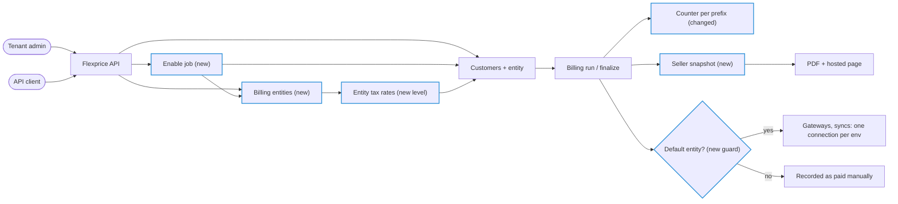
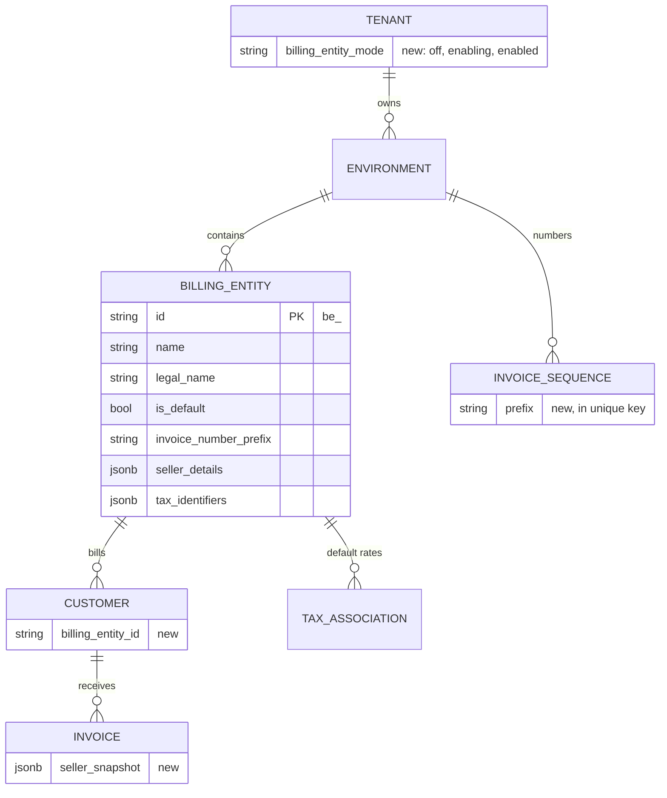
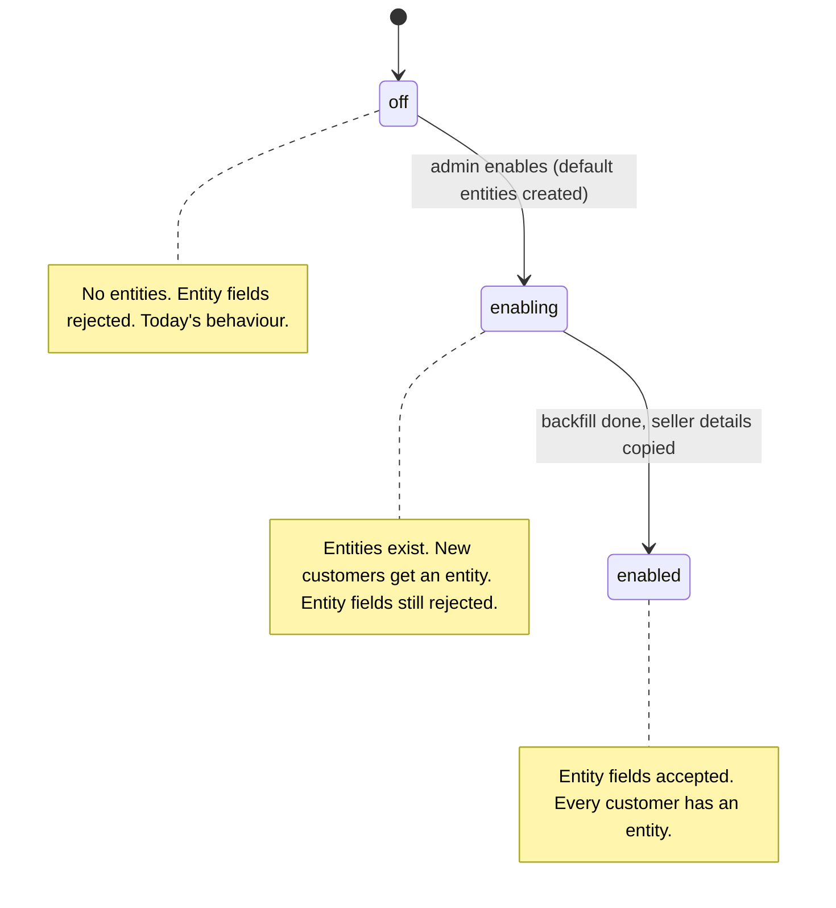
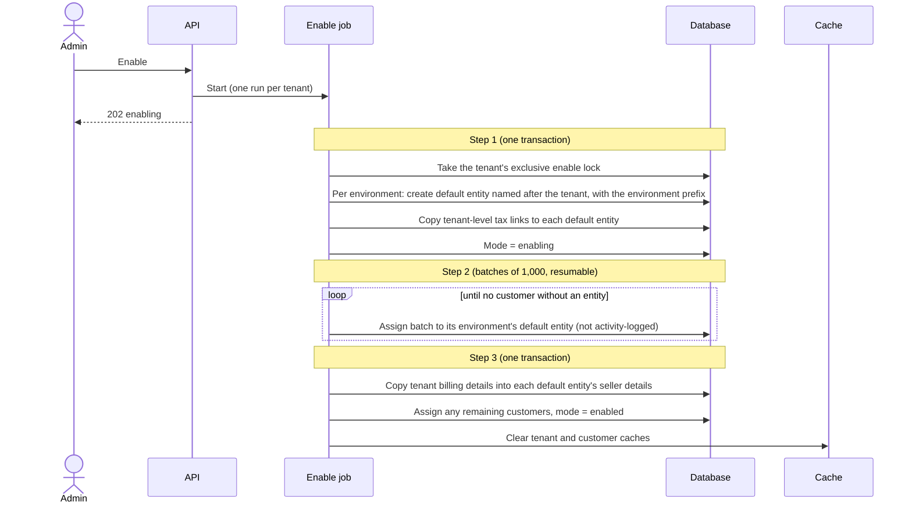
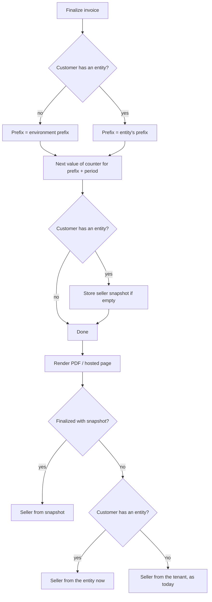
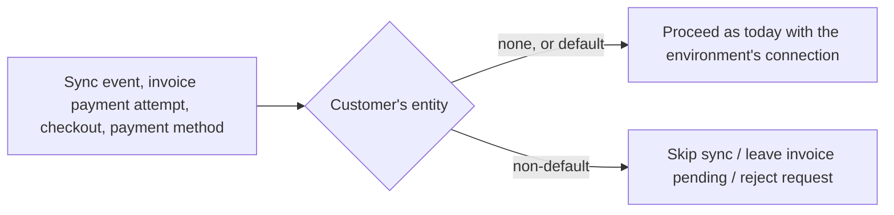

# Billing Entities Phase 1 — Design ERD

Status: In review · Owner: Paras Aghija · Last updated: 2026-10-27
Links: FLE-1695 · overall ERD PR #3165

## 1. Requirement
<!-- erd:locked -->

**Today.** A tenant environment bills as exactly one seller. Every invoice shows the tenant's name and
billing details as the seller, draws its number from one environment-wide sequence under one prefix,
and every new customer gets the tenant-level default tax rates. A tenant that sells through several
legal entities (for example a US company and an EU subsidiary) has no way to say which entity bills
which customer.

**Gap.** Such tenants either run a separate Flexprice tenant per legal entity, duplicating catalog and
setup, or issue invoices that name the wrong seller, carry the wrong tax defaults and share one number
series across entities.

**Outcome.** A tenant can enable billing entities and create several legal entities inside one
environment, all sharing the same catalog. Each customer belongs to exactly one entity, and that
customer's invoices show that entity as the seller, use that entity's number prefix and series, and
start from that entity's default tax rates. Finalized invoices keep the seller they were issued with.
Tenants that never enable the feature keep today's behaviour. Payment gateways and other integrations
keep their one connection per environment and serve only the default entity; giving each entity its own
integrations is the next phase.

## 2. Use cases
<!-- erd:locked -->

**UC1 — Tenant admin enables billing entities.**
1. Admin enables billing entities for the tenant.
2. The tenant shows as enabling while every environment gets a default entity and existing customers
   are assigned to it.
3. The tenant shows as enabled; the default entity carries the tenant's seller details, invoice prefix
   and default tax rates, and nothing an end customer sees has changed.

Variation: the admin enables again while enabling is running → the same enablement continues; enabling
an already enabled tenant changes nothing. Any environment of the tenant uses an external tax engine →
enabling is rejected.

**UC2 — Tenant admin manages an entity.**
1. Admin creates an entity with a name, legal name, seller details, tax IDs and a distinct invoice prefix.
2. Admin links the default tax rates the entity's new customers should get.
3. Admin edits the entity later; drafts and future invoices use the new details, issued invoices do not
   change.

Variation: the prefix is another entity's current prefix → rejected. Turning on an external tax engine
in any environment → rejected.

**UC3 — API client creates a customer under an entity.**
1. Client creates a customer naming an entity, or naming none.
2. The customer belongs to the named entity, or to the default entity, and never changes entity.
3. The customer starts with the entity's default tax rates.

Variation: the tenant is off → naming an entity is rejected and the customer is created as today. The
entity belongs to another environment → rejected.

**UC4 — Billing run issues an invoice for a customer.**
1. An invoice is generated for the customer as today.
2. On finalization it takes the next number in the series of the customer's entity's prefix, and freezes
   the entity's seller details and tax IDs.
3. The PDF and hosted invoice page show that entity as the seller, then and on every later rebuild.

Variation: the customer belongs to a non-default entity → the invoice is not auto-charged, offers no
online payment, and is not synced to any integration; it is recorded as paid manually.

**UC5 — API client reads billing records by entity.**
1. Client lists customers, invoices, subscriptions, wallets, credit notes, payments or refunds,
   optionally filtered by one entity.
2. Every returned record, and every outbound webhook for it, shows the entity it belongs to.

Variation: the tenant is off → the filter is rejected and records show no entity.

**UC6 — Tenant that never enables keeps working as today.**
1. The tenant creates customers, issues invoices and collects payments exactly as today.

Variation: the admin changes the environment invoice prefix mid-period → from the follow-up numbering
release on, the new prefix starts its own series instead of continuing the old prefix's counter.

## 3. Scope
<!-- erd:locked -->

**In**
- Per-tenant, irreversible switch to enable billing entities, with an enabling state (UC1).
- One default entity per environment, created at enablement (UC1).
- Entity create, read and edit; seller details, tax IDs and invoice prefix per entity (UC2).
- Entity-level default tax rates (UC2, UC3).
- Customer assigned to one entity at creation, immutable (UC3).
- Per-prefix invoice numbering for all tenants (UC4, UC6).
- Seller snapshot on finalized invoices; entity seller on PDF and hosted invoice page (UC4).
- Entity filter on lists and entity on responses and outbound webhooks (UC5).
- Integrations, payments and syncs limited to the default entity (UC4).
- Same-entity rule for delegated and grouped invoices (UC4).
- Dashboard screens for the switch, entity pages and entity choice on customer create, in the portal
  repo (UC1, UC2, UC3).

**Out**
- Per-entity integrations: own gateway, accounting and CRM connections, connection-scoped webhook
  routes, per-connection mappings, payments recording their connection, Stripe Tax per entity (next
  phase).
- Moving customers between entities, including splitting existing customers of a launch tenant.
- Changing which entity is the default.
- Disabling entities.
- Cloning an environment of a tenant with billing entities.
- One customer billed by several entities.
- Entity-level user permissions.
- All-entities reporting view.
- Entity filter on exports and scheduled tasks.
- Any change to usage events or metering.

## 4. Functional requirements
<!-- erd:locked -->

| ID | Requirement | UC | Acceptance criteria |
|---|---|---|---|
| FR-1 | Enabling moves the tenant from `off` to `enabling` and, when done, to `enabled`; it never goes back. | UC1 | Enable on an off tenant → status `enabling`, then `enabled`; no call returns the tenant to `off`. |
| FR-2 | Enabling creates one default entity per environment, taking its name, legal name, invoice prefix and default tax rates from the tenant immediately, and its seller details from the tenant's billing details when it completes. All of them can be edited afterwards. | UC1 | After enable, each environment has exactly one default entity whose name, legal name, prefix, tax rates and seller details equal the tenant's values at enable time. |
| FR-3 | Enabling assigns every existing customer to its environment's default entity. | UC1 | After `enabled`, no customer of the tenant has an empty entity. |
| FR-4 | Enabling is idempotent. | UC1 | Calling enable during `enabling` or after `enabled` starts no second run and changes no data. |
| FR-5 | An environment created in an `enabling` or `enabled` tenant gets its default entity; cloning an environment is rejected in such a tenant. | UC1 | Create an environment after enable → it has a default entity; customers created in it belong to it. Clone on an enabling or enabled tenant → 400. |
| FR-6 | Entities can be created, read, listed and edited in an `enabled` tenant only. | UC2 | Entity endpoints on an off or enabling tenant → 400 `billing_entities_not_enabled`. |
| FR-7 | Every entity has a non-empty invoice prefix that differs from every other entity's current prefix in the environment. | UC2 | Create or edit with another entity's current prefix → 409; with a free prefix → accepted. |
| FR-8 | Billing entities and external tax engines exclude each other: enabling is rejected while any environment of the tenant uses an external tax engine, and turning one on is rejected from `enabling` on. Turning it off is always allowed. | UC1, UC2 | Environment on Stripe Tax → enable → 400; enabled tenant → set `tax_config` to an external provider → 400; set it disabled → saved. |
| FR-9 | Entities cannot be disabled or deleted in this phase. | UC2 | No disable or delete endpoint exists for entities. |
| FR-10 | Entity edits apply to drafts and future finalizations only. | UC2 | Edit seller details → finalized invoice PDF unchanged; draft PDF shows new details. |
| FR-11 | From `enabling` on, the environment invoice prefix and tenant-level tax associations cannot be changed. | UC2 | Change `invoice_config` prefix, or create, update or delete a tenant-level tax association, on an enabling or enabled tenant → 400 naming the entity setting; other `invoice_config` fields still save. |
| FR-12 | Customer create accepts an optional `billing_entity_id`; absent means the default entity. | UC3 | Enabled tenant: create with an entity → customer shows it; without → shows the default's ID. |
| FR-13 | A customer's entity never changes. | UC3 | Update a customer with another `billing_entity_id` → rejected. |
| FR-14 | A new customer gets its entity's auto-apply tax rates; an off tenant's customer gets the tenant-level rates as today. | UC3 | Create a customer of an entity linked to rate R → customer has R. |
| FR-15 | `billing_entity_id` in a request body or filter is rejected unless the tenant is `enabled`, and must name an entity of the request's environment. | UC3, UC5 | Off or enabling tenant → 400 `billing_entities_not_enabled`; other environment's entity → 400. |
| FR-16 | An invoice's number comes from the counter of its prefix and period: the customer's entity's prefix, or the environment prefix for a customer without one. | UC4, UC6 | Two entities with prefixes INV and EU finalize in one period → `INV-…` continues the existing series, `EU-…-00001` starts its own; no two invoices share a number. |
| FR-17 | Finalizing the invoice of a customer with an entity stores a seller snapshot once: entity ID, legal name, seller details, tax IDs. | UC4 | Finalize → snapshot present; retry finalize → snapshot unchanged. |
| FR-18 | The PDF and hosted invoice page show the snapshot for finalized invoices, the customer's entity for drafts, and the tenant for customers without an entity. | UC4 | Edit entity after finalize, force PDF rebuild → old seller shown. |
| FR-19 | For customers with an entity, biller tax IDs come from the entity. | UC4 | Entity with a GSTIN → GSTIN on the PDF. |
| FR-20 | Invoices of a non-default entity's customers are never auto-charged, never get checkout, payment links or saved payment methods, and their customers, invoices and subscriptions are never synced to integrations. | UC4 | Non-default customer with `charge_automatically` → invoice stays pending, no gateway call; checkout or payment method request → 400; no sync workflow started. |
| FR-21 | Delegated and grouped invoices only combine customers of one entity. | UC4 | Set `invoicing_customer_id` to a customer of another entity → 400; grouped invoice across entities → 400. |
| FR-22 | Lists and searches of customers, invoices, subscriptions, wallets, credit notes, payments and refunds accept an optional `billing_entity_id`; absent means all entities. | UC5 | Filter by entity → only that entity's records; no filter → all. |
| FR-23 | Customers, invoices, subscriptions, wallets, credit notes, payments and refunds carry `billing_entity_id` in Get, List and outbound webhook payloads. | UC5 | Each response and webhook shows the stored or derived entity; off tenant → null. |
| FR-24 | Get, update and delete by ID are not scoped by entity. | UC5 | Get a record of any entity by ID → returned with its entity. |

## 5. Non-functional requirements
<!-- erd:locked -->

| ID | Category | Requirement (measurable) | How we verify |
|---|---|---|---|
| NFR-1 | Compatibility | A tenant that never enables sees identical responses, invoice numbers, PDFs and integration behaviour, except the added null `billing_entity_id` field and per-prefix counters after a mid-period prefix change. | Full integration suite on an off tenant before and after the change; diff of invoice numbers. |
| NFR-2 | Compatibility | API changes are additive: no field removed or renamed, every new request field optional. | OpenAPI diff shows additions only; SDK builds unchanged. |
| NFR-3 | Correctness | No two invoices in an environment share a number, under concurrent finalization and concurrent prefix edits. | Unique index on invoice number holds; concurrent finalize e2e. |
| NFR-4 | Correctness | Once a tenant is `enabled`, no customer has an empty entity. | e2e: enable with customers created concurrently during enabling; count of empty-entity customers = 0. |
| NFR-5 | Correctness | Enabling changes no existing invoice number, amount, status, balance or issued PDF. | e2e: snapshot invoices before and after enable. |
| NFR-6 | Performance | Customer create adds at most one shared lock and two indexed reads; list responses add one batch entity lookup per page (two for payments), never one per row. | Query count in e2e traces. |
| NFR-7 | Availability | Enabling never blocks billing: finalization, payments and customer creates keep working throughout; creates wait at most for the enable step-1 transaction. | e2e: run billing while enabling a tenant with 100k customers. |
| NFR-8 | Scalability | The enable backfill updates customers in batches of at most 1,000 rows per transaction and can resume after a crash. | Kill the worker mid-backfill; rerun completes with no duplicates or gaps. |

## 6. Constraints
<!-- erd:locked -->

| Constraint | Source | Impact on the design |
|---|---|---|
| Usage is stored per external customer and meter, with no subscription column. | Existing usage schema | Entities are assigned per customer, not per subscription, so usage is never billed by two entities. |
| Customer `external_id` is unique per environment. | Existing schema | A buyer billed by two entities is two customers with different external IDs. |
| Invoice numbers are unique per environment. | Existing unique index | Distinct prefixes per counter keep entities from colliding (FR-16, NFR-3). |
| There is no database-wide statement or transaction timeout. | Database configuration | "Wait for in-flight creates" cannot be proven; enablement uses a lock instead (FR-3, NFR-4). |
| Tenant mode is cached for up to 2 minutes in memory and up to 30 minutes in Redis when a read races invalidation. | Existing tenant cache | Every decision that affects stored data reads the data or the database, never the cached mode. |
| Customers are cached. | Existing customer cache | Enablement clears the tenant's customer cache after the backfill. |
| Every write to a recorded entity goes into the activity log. | Activity log | The enable backfill is a system update that is not recorded per customer. |
| Tenant name and billing details are also the tenant's buyer details in Flexprice's own billing. | Self-billing | They stay editable after enable; only their seller role ends. |
| External tax engines use the shared gateway account's registrations and address. | Stripe Tax | Billing entities run on native tax only in this phase (FR-8). |
| The enable job runs on Temporal, which is off by default in local setups. | Local configuration | e2e runs need Temporal enabled. |
| Assumption: one counter per prefix and period is acceptable to tenants as their invoice series. | Product | Mid-period prefix changes start a new series (UC6). |

## 7. Current state – what we reuse
<!-- erd:locked -->

| Piece | What it gives us | Reuse as-is / extend / replace |
|---|---|---|
| Environment invoice settings (`invoice_config`) | Prefix, format, separator, suffix length, timezone, start sequence | Extend: prefix locked after enable; the rest stays environment-wide |
| Invoice number counter | Atomic per-period counter inside the finalize transaction | Extend: keyed by prefix |
| Tax rates and tax associations | Shared rate catalog; links of rates to tenant, customer, subscription; copy of auto-apply links at customer create | Extend: new `billing_entity` link level |
| Tax engine setting (`tax_config`) | Native or external engine per environment | Extend: checked at enable; external engines rejected once enabling |
| Invoice PDF and hosted invoice page | Biller block with name, address, contact, tax IDs | Extend: biller from snapshot or entity |
| List filters and search | Optional filters such as `customer_id` on billing lists | Extend: `billing_entity_id` filter |
| Response builders and outbound webhook payloads | Get, List and webhook bodies per resource | Extend: `billing_entity_id` field |
| Transaction advisory lock | Transaction-scoped database lock used for wallets | Extend: shared variant for creates |
| Temporal workflows | Long-running, retried jobs with one ID per run | Reuse for the enable job |
| Tenant and customer caches | Cached reads with invalidation | Reuse; cleared at the end of enable |
| Integration event dispatcher, invoice payment attempt, checkout and payment-method creation | The single entry points for syncs and money movement | Extend: guard for non-default entities |
| Delegated invoicing and grouped invoices | Combining several customers on one invoice | Extend: same-entity check |
| Activity log | Records customer writes with snapshots | Reuse: customer snapshots carry `billing_entity_id`; entities themselves are not recorded |
| Self-billing | Tenant's buyer record in Flexprice's own billing | Reuse unchanged |

## 8. Solution overview
<!-- erd:locked -->



Main flow (UC1 → UC4):
1. Admin enables; the enable job creates a default entity per environment and switches the tenant to `enabling`.
2. The job assigns existing customers to their default entity and switches the tenant to `enabled`.
3. Admin creates a second entity with its own prefix, seller details, tax IDs and tax rates.
4. Client creates a customer under the second entity; the customer gets that entity's tax rates.
5. The billing run finalizes the customer's invoice: the number comes from the entity prefix's counter and the seller is frozen into the snapshot.
6. The PDF and hosted page show the entity as seller; the invoice is not charged or synced, and is recorded as paid manually.

## 9. Detailed design
<!-- erd:locked -->

### 9.1 Data model



New table `billing_entities` (base, environment and metadata columns as every environment-scoped table):

| Column | Type | Null | Default | Why |
|---|---|---|---|---|
| `id` | varchar(50) | no | | Prefix `be_` |
| `name` | varchar(255) | no | | Display name |
| `legal_name` | varchar(255) | no | | Seller name on invoices |
| `is_default` | bool | no | false | One per environment: partial unique index on (tenant, environment) where default and published |
| `invoice_number_prefix` | varchar(20) | no | | Distinct current prefix per environment (FR-7) |
| `seller_details` | jsonb | no | `{}` | Email, help email, phone, address; same shape as tenant billing details |
| `tax_identifiers` | jsonb | no | `[]` | List of `{type, value}` printed as biller tax IDs |

Changed tables:

| Table | Column / change | Type | Null | Why |
|---|---|---|---|---|
| `tenants` | `billing_entity_mode` | varchar(20) | no, default `off` | FR-1 |
| `customers` | `billing_entity_id` | varchar(50) | yes | NULL only while the tenant is off or before the backfill reaches the row; immutable once set. Index (tenant, environment, `billing_entity_id`) built concurrently |
| `invoices` | `seller_snapshot` | jsonb | yes | Written at finalization for customers with an entity (FR-17) |
| `invoice_sequences` | `prefix` | varchar(20) | see migration | Counter key becomes (tenant, environment, prefix, period) |
| `tax_associations` | new `entity_type` value `billing_entity` | | | Entity default rates; no schema change |

Migration notes:
- All additions are nullable or defaulted; `customers.billing_entity_id` and its index need no backfill at
  deploy. Off tenants are never backfilled.
- Migrations run before the new code rolls out and must stay additive, because old pods keep running
  against the migrated schema. `invoice_sequences` therefore changes in two releases:
  1. **This change:** add `prefix` nullable, fill existing rows with their environment's effective
     prefix (stored setting, else the default), build the new unique index beside the old one. New code
     keeps upserting on the old key and records the current prefix on the row, so numbering behaves
     exactly as today; old pods keep using the old key on the same rows.
  2. **Follow-up release:** fill remaining empty prefixes, make `prefix` required, drop the old unique
     index and switch the upsert to the new key. Until it is deployed, prefixes other than the
     environment prefix cannot get their own row, so no tenant is enabled before it.

### 9.2 API contracts

**Enable** — `POST /v1/tenants/billing-entities/enable` · tenant admin

Request: none. Response `202 {"mode": "enabling"}`; on an enabled tenant `200 {"mode": "enabled"}`.
Errors: `403` not a tenant admin; `400` an environment uses an external tax engine (FR-8).

**Status** — `GET /v1/tenants/billing-entities/status` → `{"mode": "off" | "enabling" | "enabled"}`

**Entities** — environment-scoped, require `enabled` (else `400 billing_entities_not_enabled`)

| Method | Path | Notes |
|---|---|---|
| `GET` | `/v1/billing-entities` | List |
| `POST` | `/v1/billing-entities` | Create (non-default) |
| `GET` | `/v1/billing-entities/:id` | Read |
| `PUT` | `/v1/billing-entities/:id` | Edit name, legal name, prefix, seller details, tax IDs |

```json
{
  "id": "be_01J...",
  "name": "Acme EU",
  "legal_name": "Acme Europe B.V.",
  "is_default": false,
  "invoice_number_prefix": "EU",
  "seller_details": {
    "email": "billing@acme.eu",
    "help_email": "help@acme.eu",
    "phone": "+31 20 000 0000",
    "address": {"address_line1": "Main 1", "address_city": "Amsterdam", "address_postal_code": "1011",
                "address_country": "NL"}
  },
  "tax_identifiers": [{"type": "eu_vat", "value": "NL000000000B01"}],
  "metadata": {},
  "created_at": "2026-10-27T10:00:00Z",
  "updated_at": "2026-10-27T10:00:00Z"
}
```

Entity default tax rates use the existing tax association endpoints with `entity_type: "billing_entity"`
and `entity_id` set to the entity.

**Changes to existing endpoints**

| Endpoint | Change |
|---|---|
| Create customer | Optional `billing_entity_id` (FR-12, FR-15) |
| Update customer | `billing_entity_id` not accepted (FR-13) |
| List / search customers, invoices, subscriptions, wallets, credit notes, payments, refunds | Optional `billing_entity_id` filter (FR-22) |
| Same resources: Get, List, outbound webhooks | `billing_entity_id` field (FR-23) |
| Update `invoice_config` setting | Prefix change rejected from `enabling` on (FR-11) |
| Create, update or delete tenant-level tax association | Rejected from `enabling` on (FR-11) |
| Update `tax_config` setting | External provider rejected from `enabling` on (FR-8) |
| Checkout, payment links, payment methods | Rejected for customers of non-default entities (FR-20) |

| Error | Status | When |
|---|---|---|
| `billing_entities_not_enabled` | 400 | Entity field, filter or endpoint while off or enabling; the mode is re-read from the database first |
| Entity not found in this environment | 400 | Body or filter names another environment's entity |
| Prefix in use | 409 | FR-7 |
| External tax engine | 400 | Enable with an external engine, or external engine on an enabling or enabled tenant (FR-8) |
| Setting owned by entity | 400 | FR-11 |
| Cross-entity invoice | 400 | FR-21 |
| No integration for entity | 400 | FR-20 |

### 9.3 Flows

**Tenant mode**



**Enable job** (UC1; FR-1 to FR-4, NFR-4)



**Customer create** (UC3; FR-12, FR-14, NFR-4)

```mermaid
sequenceDiagram
  actor Client
  participant API
  participant DB as Database
  Client->>API: Create customer (optional entity)
  API->>DB: Begin, take the tenant's shared enable lock
  API->>DB: Read tenant mode (database, not cache)
  alt off
    API->>DB: Store customer with no entity, copy tenant-level tax rates
  else enabling
    API->>DB: Reject a named entity; find the environment's default entity (create it if missing)
    API->>DB: Store customer with the default's ID, copy its auto-apply tax rates
  else enabled
    API->>DB: Find the named entity, else the environment's default (create it if missing)
    API->>DB: Store customer with that entity's ID, copy its auto-apply tax rates
  end
  API->>DB: Commit
  API-->>Client: Customer with billing_entity_id
```

Shared locks never block each other; a create waits only while step 1 of an enablement holds the
exclusive lock. A create either commits before step 1 (and is assigned in step 2) or sees `enabling`.

**Finalize and render** (UC4; FR-16 to FR-19)



During `enabling`, a customer the backfill has not reached yet belongs to its environment's default
entity: it can only predate enablement, when the default was the only entity. Every rule above treats it
that way, so its invoices number, render and tax exactly as after the backfill.

**Integration guard** (UC4; FR-20)



### 9.4 Jobs and events

| Job or event | Change |
|---|---|
| Enable job | New Temporal workflow, one run per tenant (§9.3) |
| Integration event dispatcher | Skips customers, invoices and subscriptions of non-default entities |
| Invoice payment attempt (auto-charge) | Skips invoices of non-default entities; invoice stays pending |
| Outbound webhooks for customers, invoices, subscriptions, wallets, credit notes, payments, refunds | Payload gains `billing_entity_id` |
| Inbound gateway webhooks | Unchanged; they only concern default-entity records |
| Exports, scheduled tasks, usage processing | Unchanged |
| Environment create and clone | Create gets a default entity in enabling and enabled tenants; clone is rejected in them |

## 10. Cross-cutting concerns
<!-- erd:locked -->

| Concern | How the design handles it | NFR |
|---|---|---|
| Backward compatibility | Off tenants follow today's paths; new request fields optional, response field additive | NFR-1, NFR-2 |
| Concurrency: enable vs creates | Exclusive lock in enable step 1, shared lock in creates; mode read from the database | NFR-4, NFR-7 |
| Concurrency: numbering | Counter increment in the finalize transaction; unique invoice number index; prefix edits never repeat a number because a prefix always shares one counter | NFR-3 |
| Stale caches | Decisions use stored data, not the cached mode; caches cleared at the end of enable | NFR-4 |
| Idempotency | One enable run per tenant; backfill only touches customers without an entity; snapshot written only if empty | NFR-5, NFR-8 |
| Failure: enable job crashes | Temporal retries the step; steps 1 and 3 are single transactions, step 2 resumes | NFR-8 |
| Failure: customer missed by backfill | Step 3 assigns any remaining customer in the same transaction that sets `enabled` | NFR-4 |
| Performance | Concurrent index build; batch entity lookup per page; backfill batches of 1,000 | NFR-6, NFR-8 |
| Multi-tenancy | Entities are tenant- and environment-scoped; body and filter entities are checked against the request's environment | — |
| Observability | Enable job logs each step with counts; skips by the integration guard are logged with record IDs | — |
| Activity log | Customer snapshots carry `billing_entity_id`; the backfill and entity changes are not recorded | — |

## 11. Risks & open questions
<!-- erd:locked -->

| Risk | Likelihood / Impact | Mitigation |
|---|---|---|
| A tenant is enabled before the follow-up numbering release is deployed | Low / High: non-default entities cannot number | Enable only after that release; release checklist item |
| A guard point for non-default entities is missed and money or data reaches the shared accounts | Medium / High | Guard at the few entry points listed in §9.4; e2e covers each |
| Large tenants make the backfill slow | Low / Low: billing keeps working during `enabling` | Batches of 1,000; progress logged |
| Tenants expect the series to continue after a mid-period prefix change | Low / Low | Documented in release notes (UC6) |

| Question | Answer |
|---|---|
| Should the hosted invoice page hide its payment option for non-default entities, or show "pay offline" text? | Hide it: the hosted invoice response sends `pay.enabled: false`, so the page shows no pay option, and the hosted Pay endpoint rejects the request (2026-10-28). |
