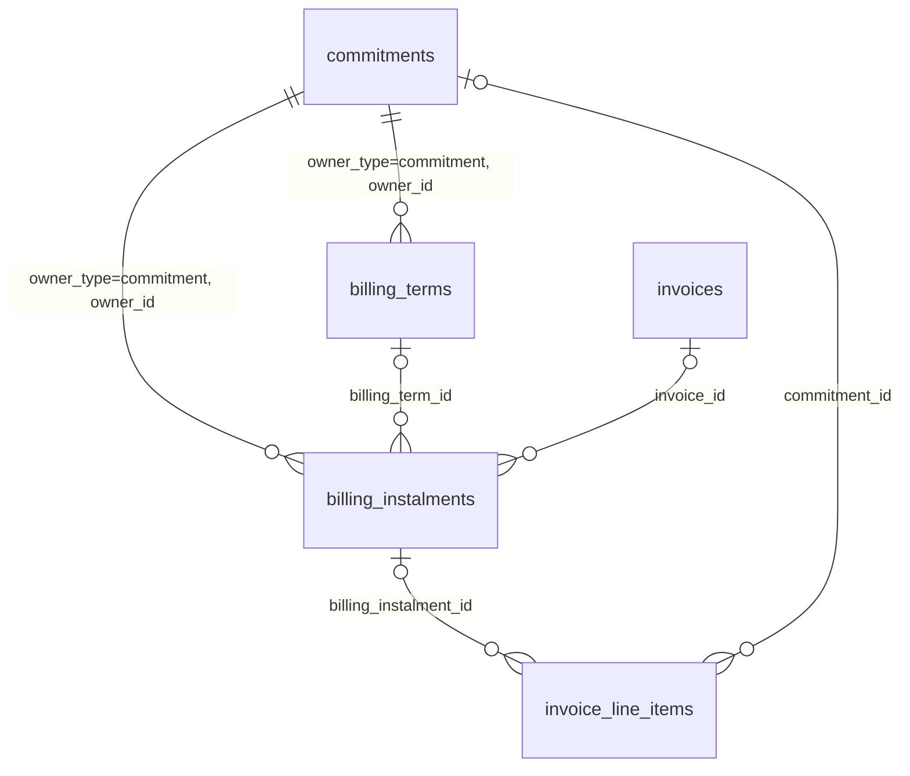

# FLE-1513 — Billing Terms (ERD)

- **Ticket:** [FLE-1513](https://linear.app/flexprice/issue/FLE-1513/erd-commitments-revamp)
- **Date:** 2026-11-02
- **Author:** Ankit Malik
- **Status:** Draft. Replaces §5.2, §5.3, §7 and the billing-terms parts of §8 of the [commitments ERD](./2026-10-07-FLE-1513-commitments-revamp-erd.md). Replaces the open PR stack #3272–#3277, which will be rebuilt from this document.

---

## 0. Summary

- **Billing terms say how a commitment's value is collected:** when, how much, and on which invoice.
- **Terms expand into instalments.** An instalment is one dated amount. The instalments of a commitment always add up to its value.
- **Instalments are billed on the subscription invoice** (default) **or on their own invoice** on the exact date.
- **Terms can be edited.** An edit replaces the whole set of terms and regenerates the instalments not yet billed. Invoiced instalments and their invoices are kept.
- **A milestone is billed when it is triggered.**
- **Every instalment invoice line points back** to its instalment, and from there to its term and commitment.
- **Early termination never refunds automatically.** It cancels what hasn't been billed, bills anything earned but not yet billed, and adds an optional cancellation fee.

## 1. Why this redesign

Commitments shipped with one way to collect money: `per_period`, a true-up on every period invoice. Real contracts also ask for "$300 upfront, the rest monthly", "30% at signing, 50% mid-term, the rest at the end", or "quarterly in advance". The ERD designed billing terms for this, and PRs #3272–#3277 implemented it.

That stack is not mergeable as it stands:

- It adds about 69k lines and reaches well beyond billing terms: subscription lifecycle, trial recovery, payment lifecycle, Stripe, Chargebee and QuickBooks sync, wallets and cost explorer.
- The same ideas go by several names (rules, terms, schedule items, occurrences, claims, budget, principal).
- It does not allow fixing terms that were set up wrong, and its code does not meet the style rules in §12.

This document keeps the ERD's model where it worked and simplifies the rest.

## 2. Goals, non-goals, anti-goals

**Goals**

- Create a commitment with `collection_method = billing_terms`, directly or inline on subscription create, with a preview before anything is saved.
- Edit the terms of an active commitment, with a preview of the edit.
- Deliver instalments on the subscription invoice or on separate invoices.
- Trigger manual instalments.
- Terminate early: cancel unbilled instalments, settle earned-but-unbilled money, bill an optional flat cancellation fee.
- Show where every instalment invoice line came from.
- Cover scenarios A2–A7, A14–A17, B1–B4, B7 and B8 of the [scenarios doc](./2026-10-07-FLE-1513-commitments-scenarios.md), with the changes listed in §15.

**Non-goals**

- Owners other than commitments (scenarios B9–B12). The tables carry `owner_type` / `owner_id` so a second owner can be added later without a schema change, but nothing else is built for it.
- Automatic refunds or credit notes, on termination or on edit. Tenants issue credit notes against invoices through the existing API.
- Percentage terms and percentage cancellation fees. The API accepts the shape; the service rejects it as not supported yet.
- Future-dated termination. `effective_at` stays in the API; a future value is rejected as not supported yet.
- The ERD's `credit_note` and `bill_remaining` termination rules. `on_early_termination` stays unexposed.
- Presets (`upfront`, `partial_upfront`, `spread`). Plain rows cover the same cases.
- Re-plan and bring forward (scenarios B5 and B6). An edit covers both; such flows can be added when a need shows up.
- The "covered by instalment" display on usage lines (ERD D13).
- Analytics, utilisation, cost explorer and revenue recognition (billed / earned / deferred).
- Billing terms on open-ended commitments. They have no finite value to split.
- Changes to integrations. Instalment lines are shaped like the shipped cancellation-fee line, so integrations treat them the same way. Any gap there is shared with that line and is a follow-up.

**Anti-goals** (this has failed even if it works)

- Touching subscription lifecycle, trial, payment, wallet or integration code paths beyond the few touch points in §12.
- A second locking or claiming framework. Claims use one conditional update inside the existing invoice transaction.
- Code that breaks the rules in §12: unreadable structs, comment essays, vague names, thin wrappers.

## 3. Vocabulary

One word per idea, in code, API and docs.

| Term | Meaning |
| --- | --- |
| **Commitment value** | The sum of the commitment's period amounts over its term. Stored as `commitments.total_amount` when billing terms are used. |
| **Commitment period** | A billing period clipped to the commitment's term. A term starting 25 Aug on a monthly subscription has a first period of 25 Aug–1 Sep. |
| **Billing term** | One rule saying how part of the commitment value is billed. Stored in `billing_terms`. |
| **Instalment** | One dated amount produced from the terms. Stored in `billing_instalments`. |
| **Settlement** | An instalment added at termination for money earned but not yet billed. |
| **Remainder** | A term whose amount is the commitment value minus every other term. |
| **Step** | The span of one instalment in a recurring term: `period_count` consecutive commitment periods. |
| **Boundary** | The moment one billing period ends and the next begins. The subscription invoice issued there carries the arrear charges of the period that ended and the advance charges of the one that starts. |
| **Live invoice** | An invoice that is not voided. |

Do not use: rule, schedule item, occurrence, claim (as a noun), budget, principal.

## 4. Decisions

| # | Decision | Why |
| --- | --- | --- |
| BT1 | Instalments are rows in their own table. They are not prices or subscription line items. | Prices can't express exact-date or milestone billing, can't split $1,000 into 333.33 / 333.33 / 333.34 without extra line items, and every feature that walks fixed line items (cancellation proration credits, plan-change migration, line-item coupons, gateway item sync) would start touching commitment money. |
| BT2 | Tables `billing_terms` (`bterm_`) and `billing_instalments` (`binst_`). British spelling, matching the shipped `commitments.instalment_invoicing`. | Finance language for "one dated part of a total"; reads naturally as "terms produce instalments". "Schedule" is already used for Temporal schedules, `scheduled_tasks` and the `scheduled` status. |
| BT3 | Both tables point to their owner through `owner_type` / `owner_id`. An owner is anything that implements `billingterm.Owner`: its identity, the customer and subscription it bills, its currency and delivery, and the period and total it collects. `*commitment.Commitment` is the only implementation today. | Any entity can collect through billing terms by implementing the interface. Expansion asks only for what it needs. |
| BT4 | Billing terms require a binding commitment with an `end_date`. `total_amount` is set at creation to the commitment value. | Instalments split a finite value. The snapshot keeps instalments consistent with the value they were generated from. |
| BT5 | A recurring term's step is `period_count` commitment periods (default 1). There is no `interval` field. | Every step starts and ends on a boundary by construction, so no cadence validation is needed. Quarterly payments on a monthly subscription are `period_count: 3`. A step shorter than a billing period can't be written. |
| BT6 | A term's `value_type` is `fixed` or `remainder`; `percentage` is reserved and rejected as not supported yet. A fixed term's `value` is money; on a recurring term it is per instalment. At most one term is the remainder. | Stored terms are plain money. One `value` column read by `value_type` lets percentage terms arrive later without a schema change. |
| BT7 | While the commitment is active, its instalments that are not cancelled add up to `total_amount` exactly. In a remainder term, the last instalment absorbs rounding. | Everything adds up to the contract value. |
| BT8 | Instalments are billed when `bill_on` is reached. A milestone instalment (`bill_trigger = manual`) is stored with `bill_on = end_date` until triggered; triggering moves `bill_on`. | One due rule for every instalment. "Billed at term end if never triggered" needs no extra code. |
| BT9 | An edit replaces the whole set of terms. Old terms are archived. The scheduled instalments are cancelled and the new terms generate instalments for what the invoiced ones leave of `total_amount`. Invoiced instalments and their invoices are never touched. New terms without dates start at the billing period holding the edit. | Billed history stays as it is. Terms are linked through the remainder, so one term can't change on its own. An edit plans from the current billing period, so a term left undated doesn't spread instalments over periods already past. An undated once term bills at the current period's start, which may be earlier in the period, so it is due at once. |
| BT10 | Edit and trigger change scheduled instalments only and keep BT7. | Invoiced history stays intact. |
| BT11 | An instalment is claimed when the invoice carrying it is **finalized**: one conditional update (`scheduled` → `invoiced`, setting `invoice_id`) in the finalize transaction. Computing a draft never claims; finalizing claims. If a subscription draft carries instalments that are no longer `scheduled`, finalization recomputes it once and finalizes again; a manually edited draft fails and asks for a recompute. A draft that misses an instalment that fell due within it after it was computed is recomputed before finalizing. Charging a draft that carries instalments no longer `scheduled` is refused, both when the payment is created and when a pending payment is processed; a payment a gateway already collected is still recorded. Voiding the invoice reschedules its `invoiced` instalments (back to `scheduled`), so they land on the recalculated replacement or the next invoice. Cancelled instalments stay cancelled. Voiding never forgives commitment money; forgiving it is a credit note. | The current period's draft is recomputed daily and mid-period, so claiming on compute would lock instalments before they are due and make edits and terminations depend on when a background compute ran. "Billed" means on a finalized invoice, nothing else. |
| BT12 | Under `billing_terms`, usage within the commitment is billed at $0 and there is no true-up. Overage is billed as usual. | The commitment's money is collected only through instalments. Skipping only the true-up would collect twice. |
| BT13 | Termination cancels scheduled instalments. If earned is more than billed, a settlement instalment bills the difference. Nothing is refunded. A cancellation fee is billed as it is today. | Earned money is never left unbilled, and refunds stay a deliberate tenant action. |
| BT14 | `cancellation_fee` becomes `{type, value}`, with `type` `fixed` or `percentage`; `type` says how to read `value`, as on a term. Only `fixed` is accepted today. | Leaves room for percentage fees without another API change. |
| BT15 | Termination is immediate. `effective_at` stays in the contract but can't be in the future; a future value is rejected as not supported yet. This applies to every commitment, not only billing terms. | Removes kept-instalment and pull-back logic. Future-dated termination can be added later through the same field, with no contract change. |
| BT16 | Instalments wait while the subscription is trialing or paused. They are billed on the first invoice after the trial or pause ends. | The trial-start invoice zeroes every amount, and paused periods are never invoiced. Billing commitment money in either would bill $0 or charge a customer who isn't being billed. |
| BT17 | Billing terms and instalments publish their own webhook events (§11.1), one per entity change, after commit. The payload is built from the current row when the event is sent, as commitment events are today. | Tenants can mirror payment schedules in their CRM or ERP without diffing commitment payloads. |

## 5. Data model



Both new tables use `BaseMixin` and `EnvironmentMixin`. Every query filters on `tenant_id` and `environment_id`.

### 5.1 `billing_terms` (prefix `bterm`)

| Column | Type | Null | Used by | Meaning |
| --- | --- | --- | --- | --- |
| `id` | varchar(50) | no | all | `bterm_…` |
| `owner_type` | varchar(30) | no | all | `commitment` |
| `owner_id` | varchar(50) | no | all | e.g. `cmt_…` |
| `kind` | varchar(20) | no | all | `once` or `recurring` |
| `value_type` | varchar(20) | no | all | `fixed` or `remainder` |
| `value` | numeric(20,8) | yes | all | Read by `value_type`. Fixed, once: the instalment's amount. Fixed, recurring: the amount per instalment. NULL for remainder. |
| `bill_trigger` | varchar(20) | yes | once | `date` (default) or `manual` (a milestone, BT8) |
| `bill_on` | timestamptz | yes | once | Billing date within `[start_date, end_date]`. Default: the term start (BT9 on an edit). NULL when `manual`. |
| `start_date`, `end_date` | timestamptz | yes | recurring | First step's start and last step's end. Default: the term start (BT9 on an edit) and the term end. |
| `period_count` | int | yes | recurring | Commitment periods per step. Default 1. |
| `invoice_cadence` | varchar(20) | yes | recurring | `ADVANCE` (bill at step start) or `ARREAR` (bill at step end). Reuses `types.InvoiceCadence`. |
| `split` | varchar(20) | yes | recurring remainder | `even` (default) or `proportional` (each instalment matches its step's period amounts) |
| `invoice_label` | varchar(255) | yes | all | Invoice line label, after the commitment's `invoice_label`. Default "Instalment {n} of {of}". `{n}` and `{of}` number all of the commitment's instalments together, once and recurring, in billing order. The line description is the commitment's `invoice_description`. |
| `metadata` | jsonb | yes | all | Free-form |

`status` (from `BaseMixin`) is `published` for the current terms and `archived` after an edit replaces them.

**Index:** `(tenant_id, environment_id, owner_type, owner_id, status)`.

### 5.2 `billing_instalments` (prefix `binst`)

| Column | Type | Null | Meaning |
| --- | --- | --- | --- |
| `id` | varchar(50) | no | `binst_…`, time-sortable. Instalments are ordered by `bill_on`, then `id`. |
| `owner_type`, `owner_id` | varchar | no | The commitment |
| `billing_term_id` | varchar(50) | yes | The term that produced it. NULL for settlements. |
| `customer_id` | varchar(50) | no | Copied from the commitment |
| `subscription_id` | varchar(50) | yes | Copied from the owner, for lookups. NULL for an owner billed without a subscription. |
| `currency` | varchar(10) | no | Copied from the commitment |
| `kind` | varchar(20) | no | `instalment` or `settlement` |
| `bill_trigger` | varchar(20) | no | `date` or `manual` |
| `bill_on` | timestamptz | no | When it becomes billable. For an untriggered milestone: the commitment's `end_date`. |
| `triggered_at` | timestamptz | yes | When a milestone was triggered |
| `amount` | numeric(20,8) | no | Greater than 0, in `currency`, rounded to currency precision |
| `invoice_label` | varchar(255) | no | Rendered label, e.g. "Instalment 3 of 10" |
| `service_period_start`, `service_period_end` | timestamptz | no | What it pays for: the step, the whole term for a once term, or for a settlement the term up to termination. Used for the invoice line period. |
| `delivery` | varchar(30) | no | `subscription_invoice` or `separate_invoice`, copied from `commitments.instalment_invoicing` |
| `instalment_status` | varchar(20) | no | `scheduled`, `invoiced` or `cancelled` |
| `invoice_id` | varchar(50) | yes | The finalized invoice that billed it. Cleared when that invoice is voided. |
| `metadata` | jsonb | yes | Free-form |

**Indexes**

- `(tenant_id, environment_id, owner_type, owner_id)`
- `(tenant_id, environment_id, subscription_id, instalment_status, bill_on)` for the subscription invoice build
- `(tenant_id, environment_id, instalment_status, delivery, bill_on)` for separate-invoice pickup
- `(tenant_id, environment_id, invoice_id)` for void and draft recompute

### 5.3 Changes to existing tables and types

| Item | Change |
| --- | --- |
| `invoice_line_items` | Add `billing_instalment_id`, nullable, with a partial index. Instalment lines also set `commitment_id`. |
| `types.InvoiceBillingReason` | Add `BILLING_TERMS` for invoices that carry only instalments (separate delivery). |
| `commitments` | No new columns. `total_amount` and `instalment_invoicing` become live. |
| `dto.CreateCommitmentRequest` | Stop rejecting `collection_method = billing_terms`; accept `billing_terms` and `instalment_invoicing`. |
| `dto.TerminateCommitmentRequest` | `cancellation_fee` becomes an object (BT14). This is a breaking change to a gated, unreleased API; no compatibility shim. |
| `types.CommitmentLineKind` | Already has `instalment` and `settlement`. |

## 6. Terms in detail

### 6.1 Fields each kind uses

| Field | once | recurring |
| --- | --- | --- |
| `value_type`, `value` | required (no value for remainder) | required (no value for remainder) |
| `bill_trigger` | optional, default `date` | not allowed |
| `bill_on` | optional, default the term start; absent when `manual` | not allowed |
| `start_date`, `end_date` | not allowed | optional, default the term |

On an edit, "the term start" is the start of the billing period holding now, or the commitment start once the term has ended (BT9). Earlier dates can still be given explicitly.
| `period_count` | not allowed | optional, default 1 |
| `invoice_cadence` | not allowed | required |
| `split` | not allowed | remainder only, default `even` |
| `invoice_label` | optional | optional |

### 6.2 Validation

Every failure is `ErrValidation` naming the term's index and the field.

| # | Rule |
| --- | --- |
| V1 | The commitment is binding, has an `end_date`, and uses `collection_method = billing_terms`. |
| V2 | 1 to 20 terms. Fields not used by the kind (§6.1) are absent. |
| V3 | `value_type` is `fixed` or `remainder`; `percentage` is rejected as not supported yet. Fixed needs `value` > 0, rounded to currency precision; remainder has no `value`. |
| V4 | At most one remainder term. |
| V5 | Resolved fixed amounts add up to less than `total_amount` when there is a remainder term, and exactly to it when there isn't. |
| V6 | Once: `bill_on` within the commitment's `[start_date, end_date]`; `manual` has no `bill_on`. |
| V7 | Recurring: the term's `start_date` is the commitment's `start_date` or a period boundary inside it; the term's `end_date` is a boundary inside the commitment or its `end_date`; `start_date` < `end_date`; `period_count` ≥ 1. |
| V8 | After expansion: every amount > 0, the total equals `total_amount`, at most 500 instalments with the invoiced ones. That limit keeps every numbered invoice label within its template's 255 characters. |

### 6.3 Expansion

Inputs: the terms, `total_amount`, the commitment periods with their period amounts, and the currency precision.

1. **Steps.** For each recurring term, cut the commitment periods in the term's `[start_date, end_date)` into groups of `period_count`. The last group may be shorter.
2. **Amounts.**
   - Once, fixed: `value`.
   - Recurring, fixed: `value` × number of steps.
   - Remainder: `total_amount` minus every other term. It must be > 0.
3. **Instalments.**

| Term | `bill_on` | Service period | Amount |
| --- | --- | --- | --- |
| once, `date` | the term's `bill_on` | the commitment's term | the term's amount |
| once, `manual` | `end_date` until triggered | the commitment's term | the term's amount |
| recurring, fixed | step start (`ADVANCE`) or step end (`ARREAR`) | the step | `value` |
| recurring, remainder, `even` | same | the step | term amount ÷ number of steps |
| recurring, remainder, `proportional` | same | the step | term amount × (step's period amounts ÷ the term's period amounts) |

4. **Rounding.** Round every instalment to currency precision. In a remainder term, the last instalment absorbs the difference.

**Examples** (each one is a test case; amounts must match to the cent)

| Scenario | Terms | Instalments |
| --- | --- | --- |
| A3: $1,000 over 10 months | once fixed 300 + recurring remainder ARREAR | $300 on 1 Jan, then 10 × $70 at month ends |
| A6: deposit | once fixed 300 + recurring fixed 100 ARREAR from 1 Apr | $300 on 1 Jan, then $100 at each month end April–December |
| A7: quarterly in advance | recurring fixed 300 ADVANCE, `period_count: 3` | $300 on 1 Jan, 1 Apr, 1 Jul, 1 Oct |
| A14: mid-period start, $1,154.84 | once fixed 300 + recurring remainder ARREAR | even: $71.24 × 11, last $71.20; proportional: $40.59, then $74.02, last $74.05 |
| B8: rounding | recurring remainder ARREAR over 3 months, total $1,000 | $333.33, $333.33, $333.34 |

## 7. Delivery

**Subscription invoice** (default)

- Whenever the subscription invoice for boundary *b* is computed (including the daily draft computes), it includes the subscription's instalments with `delivery = subscription_invoice`, status `scheduled` and `bill_on` ≤ *b*. Each becomes a fixed line: no price, `commitment_id`, `billing_instalment_id`, the commitment's `invoice_label` followed by the instalment's, the commitment's `invoice_description`, the instalment's service period.
- Computing never claims. Finalizing claims (BT11). If a subscription draft carries instalments that are no longer `scheduled` (cancelled by an edit or termination, or billed by another draft since it was computed), finalization recomputes it once and finalizes again, so they drop out on their own. A manually edited draft fails and asks for a recompute.
- A draft computed before an instalment fell due within it (a trigger or an edit afterwards) is recomputed when finalized, so it bills that instalment. A manually edited draft is not recomputed; the instalment lands on the next invoice.
- An advance step lands on the invoice that opens it, an arrear step on the invoice that closes it, and a once instalment dated mid-period on the next boundary's invoice. Instalments dated in the past (after an edit or a late trigger) land on the next invoice.
- The trial-start invoice carries no instalments. Paused periods are never computed. In both cases due instalments land on the first invoice after the trial or pause, because they are still `scheduled` with `bill_on` ≤ *b* (BT16).

**Separate invoice**

- A cron workflow registered in `AllTemporalScheduleConfigs` runs every 15 minutes. It finds instalments with `delivery = separate_invoice`, status `scheduled` and `bill_on` ≤ now, and issues one finalized `ONE_OFF` invoice per instalment with billing reason `BILLING_TERMS`, claiming the instalment in the same transaction. It skips instalments whose subscription is trialing or paused; they are picked up by the first run after the trial or pause ends (BT16).
- It reuses the path the shipped cancellation fee uses to create one-off invoices.

**Void.** Voiding an invoice returns its `invoiced` instalments to `scheduled` and clears `invoice_id`, in the void transaction and under their commitments' locks, so it never lands between an edit's cancellation and its count of invoiced instalments. The existing recalculate action then re-bills them on the replacement invoice. Cancelled instalments stay cancelled.

**Re-billing in full.** To plan the whole `total_amount` again, void the invoices that carry instalments, then edit the terms: the voided instalments are scheduled again, so the edit replaces them. A replacement draft that still carries them recomputes when finalized (BT11). An invoice that should stay valid is corrected with a credit note instead, and the instalments it billed stay invoiced.

**Previews and dry runs** list due instalments without claiming them.

## 8. Changing a plan

Every operation locks the commitment row and runs in one transaction. All of them require an active commitment and publish the events in §11.1 for every term and instalment they change.

| Operation | API | Behaviour | Rules |
| --- | --- | --- | --- |
| Edit | `PUT /v1/commitments/{id}/billing-terms` | Cancels the scheduled instalments, archives the current terms, saves the new ones and expands them against what the invoiced instalments leave of `total_amount` (BT9). Undated terms start at the billing period holding now (§6.1). New instalments are numbered after the invoiced ones. | §6.2, with the remainder in place of `total_amount`; a fully invoiced commitment can't be edited. Cancelling comes first, so an instalment a finalize claims meanwhile counts as invoiced. Returns the new terms with the scheduled and invoiced instalments. Drafts carrying a cancelled instalment recompute when finalized (BT11). |
| Preview edit | `POST /v1/commitments/{id}/billing-terms/preview` | Same as edit without saving. | Same response. |
| Trigger | `POST /v1/commitments/{id}/instalments/{instalment_id}/trigger` `{bill_on?}` | Sets `bill_on` (default now) and `triggered_at` on a manual instalment. | The instalment is manual and scheduled; `bill_on` within the term and not after its current `bill_on`, since a draft may already carry it there. Billing it later is an edit. |

## 9. Termination

**When.** Termination is immediate (BT15). `effective_at` defaults to now. A future value is rejected with "future-dated termination is not supported yet", for every commitment. The shipped lower bounds on a past `effective_at` stay. Subscription cancellation and plan change call `TerminateForSubscription` when the cancellation takes effect, which is never in the future. The branch in `TerminateForSubscription` that pulls a future termination back to an earlier date is removed.

**Subscription cancellation.**

- Cancelled at period end or on a scheduled date: the commitment and its instalments keep billing per the terms until the cancellation takes effect. When it takes effect, every instalment not yet on a finalized invoice is cancelled and billed through the settlement (earned up to the cancellation minus what finalized invoices already billed), on its own invoice; the open period draft drops those lines when it is recomputed.
- Cancelled immediately: the commitment is terminated at once. The settlement is billed even when the cancel uses the default `skip` invoice policy, because it goes on its own invoice, not the skipped period invoice.

**Steps.** `POST /v1/commitments/{id}/terminate` `{effective_at?, cancellation_fee?}`, subscription cancellation and plan change all follow the same steps under `billing_terms`:

1. Lock the commitment.
2. **Earned** = the period amounts up to `effective_at`, with the last period prorated (existing `accruedAmount`).
3. Cancel every scheduled instalment.
4. **Billed** = the sum of `invoiced` instalments.
5. If earned > billed, add a settlement instalment for the difference: `bill_on = effective_at`, service period `[start_date, effective_at)`, always `delivery = separate_invoice`. It is billed on its own `ONE_OFF` invoice together with the cancellation fee, never on a subscription invoice: the default immediate cancel issues no final invoice at all, and the period invoice may still be a draft when commitments terminate.
6. If billed ≥ earned, do nothing more. No refund and no credit note.
7. Bill `cancellation_fee` as today when `type = fixed`, on the same invoice as the settlement. Reject `type = percentage` with "percentage cancellation fees are not supported yet".
8. Set `commitment_status = terminated` and `terminated_at`.

A void after termination still returns the instalment to `scheduled` (BT11), so it is billed again.

| Example ($1,200/year, terminated after month 4, earned $400) | Billed so far | Result |
| --- | --- | --- |
| All upfront | $1,200 | Nothing more |
| $300 upfront + 12 × $75 arrear | $600 | Nothing more |
| Everything at term end | $0 | Settlement of $400, also when the subscription is cancelled immediately with `skip` |

## 10. Commitment billing under billing terms

- Usage within the commitment is billed as `utilized` lines at $0. Their label says the usage is covered by the commitment.
- No true-up line is computed for billing.
- Overage lines are unchanged.
- The engine's allocation is unchanged. Only the line pricing changes.

## 11. API

| Method | Path | Change |
| --- | --- | --- |
| POST | `/v1/commitments`, `/v1/commitments/preview` | Accept `collection_method: billing_terms`, `instalment_invoicing` and `billing_terms`. Preview returns the commitment value, each term's resolved amount and every instalment. |
| POST | `/v1/subscriptions` | Inline `commitments[]` accept the same fields. |
| GET | `/v1/commitments/{id}/billing-terms` | Current terms |
| PUT | `/v1/commitments/{id}/billing-terms` | Edit (§8) |
| POST | `/v1/commitments/{id}/billing-terms/preview` | Preview an edit |
| GET | `/v1/commitments/{id}/instalments` | Instalments, filterable by status |
| POST | `/v1/commitments/{id}/instalments/{instalment_id}/trigger` | Trigger |
| POST | `/v1/commitments/{id}/terminate` | `cancellation_fee` object (BT14); a future `effective_at` is rejected (BT15) |

Create request:

```json
{
  "collection_method": "billing_terms",
  "instalment_invoicing": "subscription_invoice",
  "billing_terms": [
    {
      "kind": "once",
      "value_type": "fixed",
      "value": "300"
    },
    {
      "kind": "recurring",
      "value_type": "remainder",
      "invoice_cadence": "ARREAR"
    }
  ]
}
```

Cancellation fee:

```json
{ "cancellation_fee": { "type": "fixed", "value": "500" } }
{ "cancellation_fee": { "type": "percentage", "value": "10" } }
```

The second form is rejected until percentage fees are built. What the percentage applies to is decided then.

### 11.1 Webhook events

| Event | Fires when | Payload |
| --- | --- | --- |
| `billing_terms.created` | Terms are saved with a new commitment | Owner type and id, the current terms |
| `billing_terms.updated` | An edit replaces the terms | Same |
| `billing_instalment.created` | An instalment is added: expansion on create or edit, settlement | The instalment |
| `billing_instalment.updated` | A trigger changes its date, or a void reschedules it | The instalment |
| `billing_instalment.cancelled` | An edit or termination cancels it | The instalment |
| `billing_instalment.invoiced` | The invoice carrying it is finalized | The instalment, with `invoice_id` |

Events are listed in `cmd/migrate/data.json`, built by payload builders registered in `internal/webhook/payload/factory.go`, and published post-commit like `commitment.*` events.

## 12. Code layout and rules

**Suggested layout** (the builder may adjust within the rules below)

| Path | Holds |
| --- | --- |
| `internal/types/billing_term.go` | Enums: term kind, value type, bill trigger, split, instalment kind, instalment status, delivery, cancellation fee type |
| `internal/domain/billingterm/` | `Term`, `Instalment`, builders, `FromEnt`, `TermRepository`, `InstalmentRepository`, the `Owner` interface, and `Expand`: pure validation and expansion, terms + periods in, instalments out. No database, no commitment types. |
| `internal/domain/commitment/` | `*Commitment` implements `billingterm.Owner` |
| `internal/repository/ent/billing_term.go`, `billing_instalment.go` | Repositories |
| `internal/webhook/payload/`, `internal/webhook/dto/` | Billing terms and instalment payload builders and DTOs |
| `internal/ee/service/commitment_billing_terms.go` | Create, edit, trigger and termination, as commitment service methods |
| `internal/ee/service/billing.go` | One step that turns due instalments into invoice line requests |
| `internal/ee/service/invoice.go` | Claim at finalization (recovering a stale draft once), reschedule on void |
| `internal/temporal/workflows/cron/` | The separate-invoice workflow |

**Touch points outside billing terms, and only these:** commitment create / preview / terminate, the subscription invoice build, invoice compute and void, the cron schedule list, and the commitment line pricing in §10.

**Rules** (a reviewer will block on any of these)

- Follow [Practical Go](https://dave.cheney.net/practical-go/presentations/qcon-china.html) and `AGENTS.md` "Coding style guide": clear names whose length matches their scope, no names after types, packages named for what they provide, guard clauses, happy path unindented, no package-level mutable state.
- Package names don't repeat in identifiers: `billingterm.Term`, not `billingterm.BillingTerm`.
- Struct fields one per line, with blank lines between logical blocks. No dense one-liners.
- Comments only where logic is not obvious, one or two lines, with no references to tickets or this document.
- No thin private helpers that wrap one call plus one line; inline them.
- Use `types` enums, never raw strings. No `any` in DTOs.
- One test file per source file.
- Writes to entities registered with the activity log return their rows (`SaveReturning` / `ExecReturning` for bulk updates such as cancelling instalments). Register `billing_terms` and `billing_instalments` with the activity log.
- `clock.Now()`, never `time.Now()`, in business code.
- Reuse before adding: the cancellation-fee one-off invoice path, `RecalculateInvoice`, `accruedAmount`, `commitmentPeriods`, `AllTemporalScheduleConfigs`.
- Everything stays behind the existing `commitments_v2` setting.

## 13. Build order

A suggested stack of small PRs, each reviewable on its own:

1. Schema, migration, types, domain and repositories.
2. Pure validation and expansion, with table tests for every example in §6.3.
3. Commitment create, preview and edit with billing terms; $0 within-commitment lines and no true-up.
4. Delivery: the subscription invoice step, claiming, void release, draft recompute; the separate-invoice workflow.
5. Trigger.
6. Termination and the cancellation fee shape.

## 14. Tests

- **Expansion** (pure, table-driven): every example in §6.3 to the cent, plus every rule in §6.2.
- **Delivery** (real database): advance and arrear landing, a mid-period once instalment, a past-dated instalment, a daily draft compute that claims nothing, a claim retried after commit, a void then recalculate, a stale draft that finalization recomputes once, two catch-up drafts that share an instalment, a manually edited stale draft that fails.
- **Plan changes:** an edit with and without invoiced instalments, an instalment claimed while an edit runs, a fully invoiced commitment, trigger.
- **Termination:** each row of the §9 table, a void after termination, a percentage fee rejected, a future `effective_at` rejected, a subscription cancelled immediately.
- **Trial and pause:** an upfront instalment on a trialing subscription lands on the trial-end invoice; an instalment due during a pause lands on the first invoice after resume; the separate-invoice job skips both.
- **End to end**, extending `commitment_e2e_test.go`: A2, A3, A4, A6, A7 and B1 with exact invoice totals.
- **Regression:** `per_period` commitments bill exactly as before.

## 15. Scenario coverage

| Scenario | Status |
| --- | --- |
| A2, A4, A5, A6, A14, A16, A17, B1–B4, B7, B8 | Covered as written, using `once` / `recurring` terms in place of presets |
| B5, B6 | Not in this release; an edit of the terms covers both |
| A3 | Covered, without the "covered by" list on usage lines |
| A7 | Covered with `period_count: 3` |
| A15 | Only the default behaviour: settle earned-but-unbilled, never refund. `credit_note` and `bill_remaining` are not built. |
| B9–B12 | Not in this release (other owners) |

## 16. Left to the builder

- Exact DTO and type names, within §12.
- How claiming fits into `ComputeInvoice` and line reconciliation, as long as BT11 holds.
- Index tuning beyond §5.

## 17. Calls made in this document

These were not discussed explicitly. Review them first.

- Old terms are archived (not deleted) on edit, so invoiced instalments still point to the term that produced them.
- Instalments are claimed at finalization, not at compute (BT11). Draft recompute recreates lines, so the line points to the instalment and the instalment records only `invoice_id`.
- Milestones store `bill_on = end_date` until triggered (BT8) instead of a NULL date.
- A settlement always goes on its own one-off invoice with the cancellation fee, whatever the commitment's delivery. The subscription-invoice path can't carry it without changing subscription cancellation code.
- A settlement and cancellation fee are billed at termination even while the subscription is trialing or paused, as the cancellation fee is today. Termination is an explicit action; BT16 covers only scheduled instalments.
- `split` defaults to `even`; `invoice_cadence` is required on recurring terms and reuses the existing `ADVANCE` / `ARREAR` values.
- A term stores one `value` that `value_type` explains, so percentage terms need no new column.
- Presets and the "covered by" display are left out.
- The `cancellation_fee` change ships without a compatibility shim because `commitments_v2` isn't enabled for any customer.
