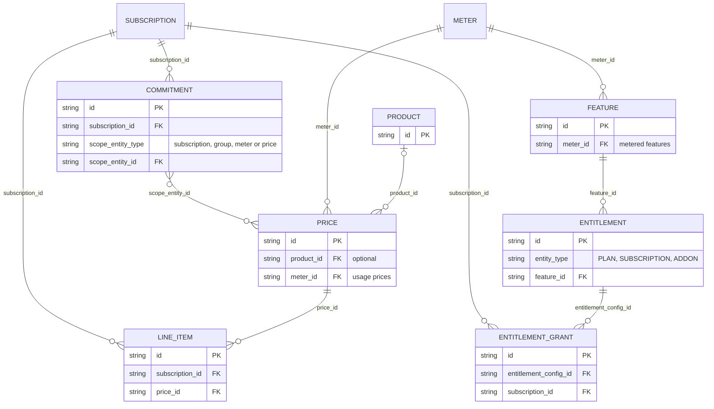
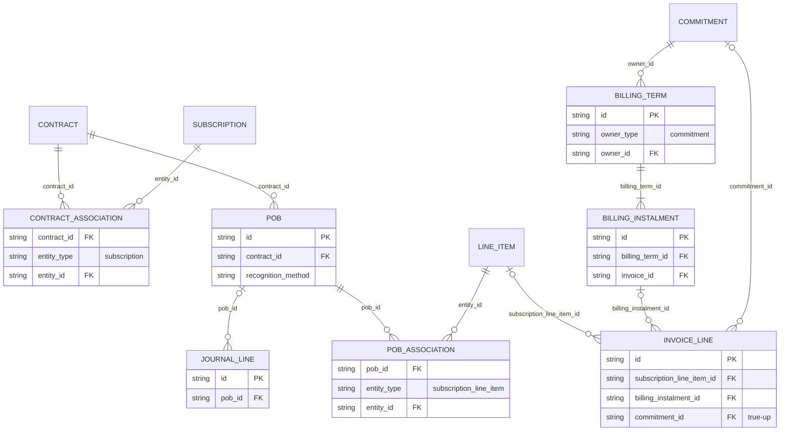
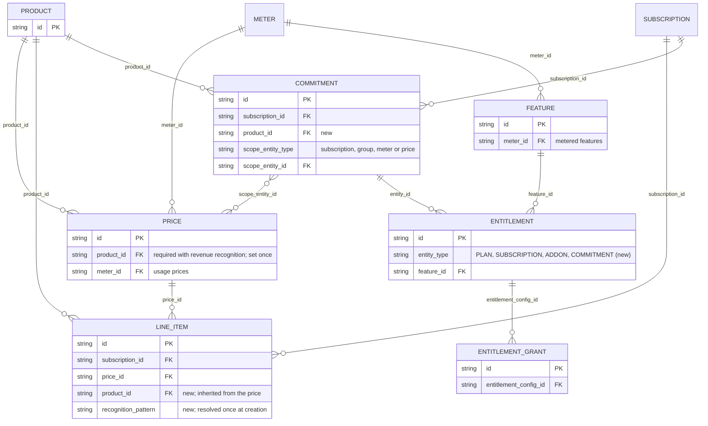
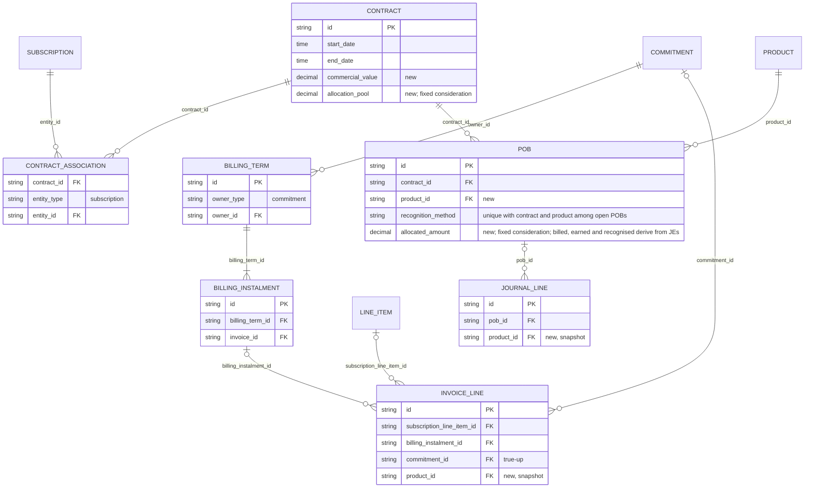

# Product across Flexprice

**Author:** Harshit Gupta

**Dated**: 2nd Nov, 2026

## Purpose

How Product fits with billing, entitlements and revenue recognition: what was **sold**, **charged, provided** and **earned**, and how Product attribution carries through each of these.

## Vocabulary


| Term                    | Meaning                                                                                                                                                                                                                      |
| ----------------------- | ---------------------------------------------------------------------------------------------------------------------------------------------------------------------------------------------------------------------------- |
| Product                 | What is sold, as finance reports it. Carries the ERP item and revenue accounts. Coarse: many prices share one Product (e.g. LLM, Transcriber, Platform fee).                                                                 |
| Feature                 | What a customer may access or use. Entitlements reference it. Points to one meter.                                                                                                                                           |
| Meter                   | Measures usage events. Prices and features reference it.                                                                                                                                                                     |
| Price                   | How a charge is calculated, one per rate. Carries a Product, which line items inherit with no override.                                                                                                                      |
| Plan, Add-on            | A reusable package of prices and entitlements. A plan is the base package; add-ons extend it. Either can span several Products through its prices.                                                                          |
| Subscription            | One customer's arrangement, with a start and end date. Standalone, or linked to a contract. It owns the customer-specific objects below.                                                                                    |
| Line item               | A price applied to one subscription, with customer-specific quantity, dates and overrides. Its recognition pattern is resolved once, when it is created.                                                                     |
| Recognition pattern     | How a line's revenue is earned: straight line, point in time or as consumed. As consumed covers usage billed as it is used and a prepaid amount earned as its grant is drawn.                                               |
| Commitment              | An agreed purchase of usage over a term: a prepaid bank, a reservation or a postpaid minimum. Has one Product of its own; its scope can span prices of several Products. Covers usage charges only.                          |
| Billing Term (BT)       | A known amount and how it is collected, e.g. 30% upfront and 70% quarterly. Owned by a Commitment, whose Product its lines carry. Several BTs can collect one amount. Fixed fees use fixed Prices, not BTs.                  |
| Entitlement             | What a customer may access or consume, for a Feature. Scoped to a plan, add-on, subscription or commitment.                                                                                                                  |
| Entitlement grant       | An allowance with a quantity or value, eligibility and validity. One that does not reset and was paid for is earned as it is drawn.                                                                                          |
| Credit Grant            | Issues credits, paid or free, once or on a schedule, with expiry.                                                                                                                                                            |
| Wallet                  | Holds credits and applies them to invoices as settlement. Buying credits is a prepayment, not a promise. Coverage under an agreed scope is an entitlement grant, not a wallet.                                               |
| Contract                | A customer's agreement for one term, with a start and end date. Records the Plans, Add-ons, Products, Charges and overrides sold; links one or more subscriptions that bill and provision them; owns the POBs. A renewal starts a new contract. |
| POB                     | A promise to the customer under a contract. One per contract, Product and recognition pattern. Stores allocated, billed, earned and recognised amounts separately. Standalone subscriptions have no POBs.                  |
| Allocation              | How a contract's fixed consideration is spread across its POBs: relative SSP, or an approved manual split. Allocations sum to the pool.                                                                                     |
| Invoice, Credit Note    | Billing, and adjustments to billing.                                                                                                                                                                                         |
| Payment, Refund         | Settlement, and its reversal.                                                                                                                                                                                                |
| Journal entry and lines | Immutable financial effects. A line may carry attribution such as POB and Product.                                                                                                                                           |


## Data model

Only the entities this doc changes, with the fields that link them. Each model is split in two: catalog and subscription, then contract, billing and revenue.

### Today

**Catalog and subscription**



**Contract, billing and revenue**



- Product is reached only through Price, and is optional there.
- Commitments have no Product and provide no grant. BTs are owned by commitments only.
- One POB per line item, linked by a POB association row.
- Invoice and journal lines carry no Product.

### Proposed

**Catalog and subscription**



**Contract, billing and revenue**



- Product is set on Price and Commitment. Line items inherit it from the price, BT lines from the commitment, and invoice and journal lines snapshot it. Every Price in a contract has a Product; a customer override keeps the original Price's Product.
- A line item's recognition pattern is resolved once, when it is created: usage is as consumed, one-time is point in time, other fixed prices are straight line, and a fixed price that funds a grant which does not reset is as consumed.
- A POB is one per contract, Product and recognition pattern. An invoice line finds its POB through its line item, its BT instalment or its commitment, so there is no POB association.
- A contract links the customer's subscriptions; their line items and commitments are the record of what was sold, and the contract holds only its header and POB allocations. A linked subscription has an end date, and billing resolves to the contract through the subscription for the service period. A renewal starts a new contract.
- BTs are owned by commitments only. Ordinary fixed fees are fixed Prices whose term value comes from the actual billing schedule.
- A commitment covers usage charges and provides its entitlement and grant. Its grant can be drawn by eligible prices of several Products; each drawdown records the consuming price and Product, and the funding commitment.

## Standalone and contract-based recognition

A subscription is either standalone or linked to a contract. Both post JEs; only contracts have POBs.

| | Standalone subscription | Contract-based subscription |
| --- | --- | --- |
| Source of revenue | Finalised invoice lines only: net amount, service period and the line's recognition pattern | POBs: allocated amount, earned by schedule or fulfillment |
| Before invoicing | Nothing accrues | Earned revenue accrues as unbilled |
| Recurring fixed charge | Ratable over the line's service period | Straight line POB |
| One-time charge | Point in time, at finalisation | Point in time POB |
| Usage and overage | At finalisation, for the billed period | As consumed POB, as used |
| Commitment BT instalment | Ratable over the instalment's service period, following the invoice | As consumed POB, by grant drawdown |
| Minimum true-up | At finalisation of the true-up line | When the window closes, from its allocation |
| Arrears billing | Elapsed periods are recognised in full at finalisation (catch-up) | Already earned; the invoice only offsets unbilled |
| Credit note | Reduces deferred first, then recognised | Reduces the POB's billed; the allocation is unchanged |

The examples below show contract-based recognition. Under a standalone subscription, each one follows the left column: Example 1 recognises 3,000 on Apr 1 when the arrears invoice finalises, and the bank in Examples 2, 3 and 5 earns ratably over each instalment's service period instead of by drawdown.

**Future extension:** recognise standalone prepaid commitment revenue from actual drawdowns, independently of invoicing.

## Allocation

A contract tracks two totals: **commercial value**, what the customer agreed to pay, and the **allocation pool**, the fixed consideration spread across POBs. They match today; future pass-through charges may make them differ.

- In v1 the pool is allocated by relative SSP, or by an approved manual split. Allocations sum to the pool.
- A POB can be allocated 0 and still track fulfillment. A $0 sale price can still receive an SSP allocation: two distinct promises with equal SSPs billed $10 and $0 are allocated $5 and $5, and each earns its $5 by its own pattern.
- A variable-only POB can start with no fixed allocation and earn later. A POB can hold both: bank drawdowns release up to the bank's allocation, and overage adds revenue above it.
- A single price never bundles several Products. Billing credits each line's own POB, allocation sets what each POB earns, and each POB's billed and earned net into its own deferred or unbilled. The contract reports their net. See Example 10.

## Journal entries and amendments

- Billing events (invoice finalisation, void, credit note, payment, refund) each post their own JE. Recognition and offset JEs post asynchronously at accounting period close.
- JE lines carry Product, and POB for contract revenue, so one invoice can fund several Products or POBs.
- Posted JEs are immutable. Corrections are reversals or adjustment entries. A retried workflow posts each event once.
- An amendment is effective-dated and preserves posted history. It can modify or add a subscription, add a POB for a new promise, or change the remaining allocation or schedule of an existing POB. A billing-only change affects only the invoice schedule.

## Rollout by section

### 1. Products

Products ship in the catalog for every tenant. A Product holds template prices, and plan, add-on and subscription prices name the Product they belong to.

| Action | Result |
| --- | --- |
| Create a Product | `lookup_key` is generated from the name when left empty |
| Create a price on the Product | A template price: `entity_type=PRODUCT`, `entity_id` and `product_id` = the Product. It has no scope and is never billed directly. |
| Add a Product to a plan, add-on, or a contract's subscription | Each selected template becomes a price of that entity, linked to the Product by `product_id`. The copy keeps no link to its template and does not follow its edits. The same Product can be added again to bring in more templates. |
| Create a price in a plan or add-on | `product_id` is optional |
| Set the Product on an existing plan or add-on price | Allowed once, while `product_id` is empty. It never changes after that. |
| Delete a Product | Also deletes its template prices that no subscription uses. Blocked while any plan, add-on or subscription price names it. |

**Schema**

| Change | Where |
| --- | --- |
| `PRICE_ENTITY_TYPE_PRODUCT = "PRODUCT"` | `internal/types/price.go`. `entity_type` is already varchar(20), so the enum needs no migration |

The service enforces `product_id = entity_id` for template prices, and lists and pickers of plan or add-on prices exclude them. Price stays optional on `product_id` until it joins a contract (Contracts section). The ERP item and per-Product account overrides ship with ERP posting (revenue recognition phase 2 ERD), not with this release.

## Framework

Each example answers these, in order:

1. Agreement
2. Entities
3. Earning and financial changes
4. Relationships

## Examples


| #   | Example                                                                                 | What it tests                                                                                                  |
| --- | --------------------------------------------------------------------------------------- | -------------------------------------------------------------------------------------------------------------- |
| 1   | Recurring platform subscription                                                         | The baseline: Product inherited from Price, time-based earning                                                 |
| 2   | Platform access plus a purchased usage bank (60k + 60k, four 30k invoices)              | Two Products, a fixed Price and a commitment BT, why instalments don't refill the bank                         |
| 3   | Same 12k purchase, different collection (30% upfront + 70% monthly, vs all at year-end) | Earning is independent of collection                                                                           |
| 4   | Metered usage with a postpaid minimum                                                   | A minimum is variable consideration; usage and true-up earn as billed in v1                                    |
| 5   | Purchased allowance (100 units for 80)                                                  | Operational value ≠ allocated value; breakage on the POB                                                       |
| 6   | Wallet credits (100 credits for 80)                                                     | Consumption vs settlement vs expiry; credits are payment, not a POB                                            |
| 7   | Free credits (50 promotional credits)                                                   | No revenue and no liability; the whole settlement is a discount                                                |
| 8   | Allowance inside paid access (100 runs a day)                                           | An allowance earns by time with access, not by drawdown                                                        |
| 9   | Prepaid usage across several Products                                                   | A commitment per Product; no shared bank                                                                       |
| 10  | Negotiated prices reallocated by SSP (72k + 48k billed, 60k + 60k allocated)            | SSP changes earning, not billing; POB positions net at the contract                                            |


### Example 1 — Recurring platform subscription

**In short:** Contract = Subscription + platform line item (`prod_platform`) + 1 POB (`prod_platform`, straight line)

**1. Agreement**

Acme subscribes to Platform at 3,000 a quarter, billed in arrears, from Jan 1 until cancelled. Access is delivered evenly.

**2. Entities**


| Entity       | Instance                  | Responsibility                     |
| ------------ | ------------------------- | ---------------------------------- |
| Product      | `prod_platform`           | Names what is sold                 |
| Price        | 3,000 / quarter, arrear   | Forms the charge                   |
| Plan         | Platform plan             | Packages the price and entitlement |
| Subscription | Acme's subscription       | The customer arrangement           |
| Line item    | Platform line             | Applies the price to Acme          |
| Entitlement  | Access to the platform feature | Gates access. Not read by revenue. |
| Contract     | Acme contract             | Groups the POB                     |
| POB          | `prod_platform`, straight line | Promise delivered over time   |
| Invoice      | Quarterly invoice         | Bills each ended quarter           |


No BT (the price's cadence collects), no Commitment, no grant or wallet.

**3. Earning and financial changes**

The POB earns the quarter's 3,000 by time: 1,000 a month, before any invoice exists. The invoice only sets AR and billed.


| Event                   | Entry (`prod_platform`)                   | Unbilled | Deferred |
| ----------------------- | ----------------------------------------- | -------- | -------- |
| Jan, Feb, Mar month end | Dr unbilled 1,000 / Cr revenue 1,000 each | 3,000    | 0        |
| Apr 1, invoice          | Dr AR 3,000 / Cr deferred 3,000           | 3,000    | 3,000    |
| April run, offset       | Dr deferred 3,000 / Cr unbilled 3,000     | 0        | 0        |
| Payment                 | Dr cash / Cr AR, no Product               | —        | —        |


**4. Relationships**

```
Contract
└── Subscription
    ├── Platform line item (Price: prod_platform, straight line) ──▶ POB (prod_platform, straight line)
    │     └── invoice lines: prod_platform
    └── Entitlement: access to the platform feature, from the plan ── no POB

Journal lines: prod_platform, from the POB
```

**Rule:** Product is chosen on the Price, inherited by the line item, and snapshotted onto invoice lines and journal lines. The line's Product and recognition pattern pick its POB. Earning follows consideration and time, not the invoice.

### Example 2 — Platform access plus a purchased usage bank

**In short:** Contract = Subscription + platform line item (`prod_platform`) + Commitment (`prod_agent_usage`) + BT (on the commitment) + usage line item (`prod_agent_usage`) + grant (from the commitment) + 2 POBs (`prod_platform`, straight line; `prod_agent_usage`, as consumed)

**1. Agreement**

Globex buys a one-year deal starting Jan 1:

- Platform access: 60,000.
- Agent usage bank: 60,000, all available from Jan 1. Usage beyond the bank is billed at the overage rate. Unused rights lapse at Dec 31 with no refund and no rollover.
- Collection: four quarterly invoices of 30,000, in arrears.

Relative SSP allocates 60,000 to each component.

**2. Entities**


| Entity            | Instance                                                    | Responsibility                                                        |
| ----------------- | ----------------------------------------------------------- | --------------------------------------------------------------------- |
| Product           | `prod_platform`, `prod_agent_usage`                         | Name the two things sold                                              |
| Price, line item  | Platform, 15,000 a quarter in arrears, `prod_platform`      | Bills access each quarter                                             |
| Commitment        | 60,000 usage bank for the year, scoped to the usage price   | Holds the bank's value and Product                                    |
| Billing Term      | 4 × 15,000 in arrears, on the commitment                    | Collects the bank's value. Carries the commitment's Product.          |
| Entitlement       | Access to the platform feature, from the plan               | Gates access. Not read by revenue.                                    |
| Entitlement grant | 60,000 of agent usage, valid Jan 1 – Dec 31, from the commitment | Provides the bank; tracks its drawdown                           |
| Price, line item  | Agent usage, per unit                                       | Values each unit drawn from the bank. Covered usage is 0 on invoices; overage is billed here. |
| Subscription      | Globex subscription                                         | Holds the usage line and the commitment                               |
| Contract          | Globex contract                                             | Groups the POBs                                                       |
| POB A             | `prod_platform`, straight line                              | Promise delivered over time                                           |
| POB B             | `prod_agent_usage`, as consumed                             | Promise delivered as the grant is drawn down, and as overage is used  |
| Invoice           | Quarterly invoice                                           | One per quarter: the platform line, the BT instalment, and any overage |


Access is an ordinary fixed Price, so it needs no BT. Only the bank, a commitment, has a BT.

**3. Earning and financial changes**

- **POB A** earns 5,000 a month, by time.
- **POB B** earns usage drawn from the grant, valued by the usage price. Q1 usage: Jan 2,000, Feb 3,000, Mar 3,000.


| Event              | Entry                                                                                  | Unbilled | Deferred      |
| ------------------ | -------------------------------------------------------------------------------------- | -------- | ------------- |
| Jan month end      | Dr unbilled 7,000 / Cr revenue 5,000 (platform) + 2,000 (usage)                        | 7,000    | 0             |
| Feb, Mar month end | 8,000 each (5,000 + 3,000)                                                             | 23,000   | 0             |
| Apr 1, Q1 invoice  | Dr AR 30,000 / Cr deferred 15,000 (platform line) + 15,000 (BT instalment, usage)      | 23,000   | 30,000        |
| Offset for Q1      | POB A 15,000. POB B: min(15,000 billed, 8,000 earned) = 8,000                          | 0        | 7,000 (usage) |


After the Q1 invoice:

- Revenue: 23,000.
- Net contract liability: 7,000, all on POB B.
- Bank remaining on the grant: 52,000.

**Why the bank is 60,000, not 120,000.** The grant is the usage that was bought. The other 60,000 pays for access.

**Why instalments don't refill the bank.** The whole grant was given on Jan 1. Each 15,000 instalment collects money for rights already provided.

**Accelerated use.**

- Q2 usage is 40,000, so 48,000 has been earned against 30,000 billed. POB B carries 18,000 unbilled; earning is not capped by billing.
- Q3 usage is 20,000. It exhausts the grant: 12,000 is covered and 8,000 is overage.
- Overage earns on POB B as it is used, because it has the same Product and pattern as the bank. It is billed in arrears on the usage line, at its Price.

**Unused bank.** Suppose only 40,000 is used by Dec 31.

- POB B holds 20,000 deferred.
- The rights lapse with no refund or rollover, so nothing more is owed. The 20,000 is recognized as breakage on Dec 31: Dr deferred 20,000 / Cr revenue 20,000.
- Had the contract allowed rollover, the 20,000 would stay deferred and move to the renewal. Had it been refundable, it would become a refund liability.

**4. Relationships**

```
Contract
└── Subscription
    ├── Platform line item (Price: prod_platform, 15,000 a quarter, straight line) ──▶ POB A (prod_platform, straight line)
    ├── Commitment: bank, 60,000 (prod_agent_usage)
    │     ├── BT: 4 × 15,000 (prod_agent_usage) ──▶ instalment lines ──▶ POB B
    │     ├── Entitlement (entity_type=COMMITMENT)
    │     │     └──entitlement_config_id──▶ Grant: 60,000, Jan 1 – Dec 31 ── drawdown ──▶ POB B
    │     └── scope ──▶ agent usage price
    ├── Usage line item (Price: prod_agent_usage, as consumed) ──▶ POB B (prod_agent_usage, as consumed)
    │     └── overage invoice lines: prod_agent_usage
    └── Entitlement: access to the platform feature, from the plan ── no POB
```

**Rule:** Access is a fixed Price; its lines earn by time. A prepaid usage bank is a Commitment with one Product, collected by its BT and provided by its grant. Its instalments, drawdown and overage all earn into the POB of that Product, as consumed. Rights follow the agreement; collection only changes billed.

### Example 3 — Same 12k purchase, different collection

**In short:** Contract = Subscription + Commitment (`prod_agent_usage`) + 1 BT (X or Y, on the commitment) + usage line item + grant + 1 POB (`prod_agent_usage`, as consumed)

**1. Agreement**

A customer buys a 12,000 agent usage bank for the year, starting Jan 1. It's all available from Jan 1 and lapses at Dec 31. There are two ways to pay:

- **Option X:** 30% upfront (3,600 on Jan 1), then 70% in 12 monthly instalments of 700, each at month end.
- **Option Y:** the full 12,000, invoiced on Dec 31.

Usage is the same under both: Jan 400, Feb 1,000, Mar 1,200.

**2. Entities**


| Entity             | Instance                                                           | Responsibility                                                    |
| ------------------ | ------------------------------------------------------------------ | ----------------------------------------------------------------- |
| Product            | `prod_agent_usage`                                                 | Names what is sold                                                |
| Commitment         | 12,000 usage bank for the year, scoped to the usage price          | Holds the value and Product                                       |
| Billing Term       | X: 3,600 on Jan 1, then 12 × 700 at month end. Y: 12,000 on Dec 31 | Collects the value and carries the commitment's Product. The only entity that differs between options. |
| Entitlement, grant | 12,000 of agent usage, Jan 1 – Dec 31, from the commitment         | Provides the bank from Jan 1 under both options                   |
| Price              | Agent usage, per unit                                              | Values each unit drawn                                            |
| Line item          | Agent usage line                                                   | Prices usage; covered usage is 0 on invoices                      |
| Contract, POB      | One contract, one POB: `prod_agent_usage`, as consumed             | Earns as the grant is drawn                                       |
| Invoice            | X: 13 invoices. Y: one                                             | Bills the BT rows                                                 |


Not needed: a Price for the BT, a second POB or a wallet.

**3. Earning and financial changes**

The POB earns what's drawn from the grant: 400, 1,000 and 1,200. That's the same under X and Y. The BT only sets billed, and the offset nets billed against earned, so X builds deferred and Y builds unbilled.


| Month end                        | Revenue (cumulative) | X: billed (cumulative) | X: deferred | Y: unbilled |
| -------------------------------- | -------------------- | ---------------------- | ----------- | ----------- |
| Jan                              | 400                  | 4,300                  | 3,900       | 400         |
| Feb                              | 1,400                | 5,000                  | 3,600       | 1,400       |
| Mar                              | 2,600                | 5,700                  | 3,100       | 2,600       |
| Dec 31, after invoice and offset | 12,000               | 12,000                 | 0           | 0           |


X never carries unbilled here, and Y never carries deferred. If usage ran ahead of X's billing, X would carry unbilled too. The Dec 31 row assumes the bank is fully used, or that the remainder is breakage on lapse (Example 2).

**Annual access, delivered evenly.** A 12,000 access Price earns 1,000 a month however it is billed. Billed annually upfront, it shows 9,000 deferred at Mar 31; billed annually in arrears, 3,000 unbilled. A fixed Price follows its own cadence, so collecting access as 30% upfront and 70% monthly needs custom billing schedules (future extension).

**4. Relationships**

```
Contract
└── Subscription
    ├── Commitment: bank, 12,000 (prod_agent_usage)
    │     ├── BT: X (3,600 + 12 × 700) or Y (12,000 on Dec 31), prod_agent_usage
    │     │     └──▶ instalment lines ──▶ POB (prod_agent_usage, as consumed)
    │     ├── Entitlement ──▶ Grant: 12,000, from Jan 1 under both ── drawdown ──▶ same POB
    │     └── scope ──▶ agent usage price
    └── Usage line item (Price: prod_agent_usage, as consumed) ──▶ same POB, for any overage

Only the BT differs between X and Y.
```

**Rule:** Collection changes billed, never earned. Swapping a commitment's BT changes only unbilled and deferred.

### Example 4 — Metered usage with a postpaid minimum

**In short:** Contract = Subscription + usage line item (`prod_api_calls`) + minimum Commitment (`prod_api_calls`, scoped to the usage price) + 1 POB (`prod_api_calls`, as consumed, allocated 0)

**1. Agreement**

A customer pays for API calls at 0.01 a call, billed monthly in arrears. They commit to a minimum of 3,000 a quarter. If usage falls short, a true-up for the difference is billed with the quarter's last invoice. There is no access limit.

Q1 usage: Jan 800, Feb 900, Mar 700. The total is 2,400, so the shortfall is 600.

**2. Entities**


| Entity       | Instance                                                 | Responsibility                                       |
| ------------ | -------------------------------------------------------- | ---------------------------------------------------- |
| Product      | `prod_api_calls`                                         | Names what is sold                                   |
| Meter        | API calls                                                | Counts usage events                                  |
| Price        | 0.01 per call, monthly in arrears                        | Values usage                                         |
| Subscription | The customer's subscription                              | Holds the line item and the commitment               |
| Line item    | API calls line                                           | Bills usage each month                               |
| Commitment   | 3,000 minimum per quarter, scoped to the API calls price | Holds the minimum and Product; sets the true-up      |
| Contract     | The customer's contract                                  | Owns the POB                                         |
| POB          | `prod_api_calls`, as consumed, allocated 0               | Earns usage and the true-up; both are variable       |
| Invoice      | Monthly; the quarter's last one adds a true-up line      | Bills usage and the shortfall                        |


Not needed: an entitlement or grant, a BT (the minimum is a floor, not a schedule), a POB of the commitment's own, or a wallet.

The minimum is variable consideration: nothing about it is in the allocation pool, so the POB's allocation is 0. The true-up line carries the commitment's Product, which here is the usage Product, so it joins the usage POB.

**3. Earning and financial changes**

In v1, usage and true-ups earn as billed: each finalised invoice line earns ratably over its service period. Billed equals earned, so the POB carries no unbilled or deferred. A month's revenue lands in that month as long as its invoice finalises before the month closes; otherwise it lands in the first open period.


| Event                         | Entry (`prod_api_calls`)                                      | Revenue lands in |
| ----------------------------- | ------------------------------------------------------------- | ---------------- |
| Feb 1, January usage invoiced | Dr AR 800 / Cr deferred 800; Dr deferred 800 / Cr revenue 800 | January          |
| Mar 1, February usage         | Same, for 900                                                 | February         |
| Apr 1, March usage + true-up  | Dr AR 1,300 / Cr deferred 1,300; Dr deferred / Cr revenue: 700 usage (March) + 600 true-up (ratably over Jan–Mar: 200 a month) | March, with January and February's 200 each in the first open period if they have closed |


Q1 revenue is 3,000. Had usage been 3,500, there would be no true-up, and 3,500 would be earned as usage.

**Later, as consumed:** usage earns as it happens, from metering, before it is invoiced, and the true-up earns when the window closes on Mar 31.

**4. Relationships**

```
Contract
└── Subscription
    ├── Commitment: 3,000 minimum a quarter (prod_api_calls)
    │     ├── scope ──▶ API calls price
    │     └── true-up invoice line: prod_api_calls ──commitment_id──▶ POB (prod_api_calls, as consumed, allocated 0)
    └── API calls line item (Price: prod_api_calls, Meter: API calls) ──▶ same POB
          └── usage invoice lines: prod_api_calls

No BT, no entitlement.
```

**Rule:** A minimum is a floor on what the usage pays, not a separate promise, and it is variable consideration outside the allocation. Its true-up joins the POB of the commitment's Product. In v1 both usage and true-up earn as billed, over their invoice lines' service periods.

### Example 5 — Purchased allowance

**In short:** Contract = Subscription + Commitment (`prod_agent_usage`) + BT (on the commitment) + usage line item + grant + 1 POB (`prod_agent_usage`, as consumed)

**1. Agreement**

Agent usage lists at 1.00 a unit. A customer buys a usage bank of 100 units for 80, paid upfront on Jan 1. It's valid Jan 1 – Dec 31, with no refund and no rollover. Usage beyond the bank bills at list.

The customer uses 25 units in January. The other 75 lapse on Dec 31.

**2. Entities**


| Entity             | Instance                                             | Responsibility                                                       |
| ------------------ | ---------------------------------------------------- | -------------------------------------------------------------------- |
| Product            | `prod_agent_usage`                                   | Names what is sold                                                   |
| Commitment         | 80 bank of 100 units, scoped to the usage price      | Holds the value and Product                                          |
| Billing Term       | 80 upfront on Jan 1                                  | Collects the value; carries the commitment's Product                 |
| Entitlement, grant | 100 units, Jan 1 – Dec 31, from the commitment       | Provides the bank; tracks drawdown                                   |
| Price, line item   | Agent usage, 1.00 a unit, on the usage line          | Values units; covered usage is 0 on invoices, and overage bills here |
| Subscription       | The customer's subscription                          | Holds the usage line and the commitment                              |
| Contract, POB      | One contract, one POB: `prod_agent_usage`, as consumed | Earns as the grant is drawn, and any overage                       |


Not needed: a wallet or credit grant.

**3. Earning and financial changes**

The grant counts 100 units: that's the operational value. The commitment is worth 80, so each unit drawn earns 80 ÷ 100 = 0.80. The 25 units used earn 20. Overage, billed on the usage line at 1.00, earns at 1.00 in the same POB.


| Event                  | Entry (`prod_agent_usage`)                         | Unbilled | Deferred |
| ---------------------- | -------------------------------------------------- | -------- | -------- |
| Jan 1, BT invoice      | Dr AR 80 / Cr deferred 80                          | 0        | 80       |
| Jan 31, 25 units drawn | Dr unbilled 20 / Cr revenue 20; offset 20          | 0        | 60       |
| Dec 31, 75 units lapse | Breakage: Dr deferred 60 / Cr revenue 60           | 0        | 0        |


**4. Relationships**

```
Contract
└── Subscription
    ├── Commitment: 100 units for 80 (prod_agent_usage)
    │     ├── BT: 80 upfront (prod_agent_usage) ──▶ instalment line ──▶ POB (prod_agent_usage, as consumed)
    │     ├── Entitlement ──▶ Grant: 100 units ── drawdown, 0.80 a unit ──▶ same POB
    │     └── scope ──▶ agent usage price
    └── Usage line item (Price: prod_agent_usage, 1.00, as consumed) ──▶ same POB, for any overage
```

**Rule:** A unit drawn from a purchased allowance earns the commitment's value per unit, not its list value.

### Example 6 — Wallet credits

**In short:** Contract = Subscription + usage line item (`prod_agent_usage`) + 1 POB (`prod_agent_usage`, as consumed). Wallet ← paid credit grant, no Product

**1. Agreement**

Agent usage lists at 1.00 a unit, billed monthly in arrears. A customer tops up their wallet with 100 credits for 80, paid on Jan 1. The credits expire on Dec 31 with no refund. Each credit settles 1.00 of invoice.

The customer uses 25 units in January. The other 75 credits expire on Dec 31.

**2. Entities**


| Entity           | Instance                                               | Responsibility                  |
| ---------------- | ------------------------------------------------------ | ------------------------------- |
| Product          | `prod_agent_usage`                                     | Names what is sold              |
| Price, line item | Agent usage, 1.00 a unit, on the usage line            | Bills usage at list             |
| Credit grant     | 100 paid credits for 80, expiring Dec 31               | Issues credits into the wallet  |
| Wallet           | The customer's wallet                                  | Holds credits; settles invoices |
| Contract, POB    | One contract, one POB: `prod_agent_usage`, as consumed | Earns usage as it happens       |
| Invoice          | Monthly usage invoice                                  | Bills usage; settled by credits |


Not needed: a commitment, BT or entitlement.

**3. Earning and financial changes**

Consumption, settlement and expiry are three separate events. Usage earns 25 at list. When credits settle the invoice, 20 comes off the wallet liability and the other 5 becomes a discount. Net revenue is 20.


| Event                        | Entry                                                                   | Unbilled | Deferred | Wallet |
| ---------------------------- | ----------------------------------------------------------------------- | -------- | -------- | ------ |
| Jan 1, top-up                | Dr cash 80 / Cr credits liability 80, no Product                        | 0        | 0        | 80     |
| Jan 31, usage                | Dr unbilled 25 / Cr revenue 25                                          | 25       | 0        | 80     |
| Feb 1, invoice and offset    | Dr AR 25 / Cr deferred 25; offset 25                                    | 0        | 0        | 80     |
| Feb 1, settled by 25 credits | Dr credits liability 20 + Dr discount 5 (`prod_agent_usage`) / Cr AR 25 | 0        | 0        | 60     |
| Dec 31, 75 credits expire    | Breakage: Dr credits liability 60 / Cr credits breakage 60, no Product  | 0        | 0        | 0      |


The discount lands on Feb 1, when the credits are applied. If the credits had settled an invoice line for another Product, the discount would carry that Product.

**Proposed:** wallet entries carry no Product. Top-up, settlement and breakage post to tenant GL accounts: `credits_liability` and a credits breakage income account. A top-up invoice line needs no Product and joins no POB.

**4. Relationships**

```
Contract
└── Subscription
    └── Usage line item (Price: prod_agent_usage, as consumed) ──▶ POB (prod_agent_usage, as consumed)
          └── invoice lines: prod_agent_usage

Customer
└── Wallet ◀── Credit grant: 100 paid credits for 80 (no Product)
      └── settles invoice ──▶ credits liability 20 + discount 5 (prod_agent_usage)
```

**Rule:** Buying credits is a prepayment, not a POB. Consumption earns on the usage line; settlement only moves the liability to AR; expired credits are breakage on the wallet.

### Example 7 — Free credits

**In short:** Contract = Subscription + usage line item (`prod_agent_usage`) + 1 POB (`prod_agent_usage`, as consumed). Wallet ← free credit grant, no Product

**1. Agreement**

Agent usage lists at 1.00 a unit, billed monthly in arrears. On Jan 1 the customer is given 50 free promotional credits, expiring Mar 31. Each credit settles 1.00 of invoice.

The customer uses 30 units in January, and the credits settle that invoice. The other 20 credits expire on Mar 31.

**2. Entities**


| Entity           | Instance                                               | Responsibility                  |
| ---------------- | ------------------------------------------------------ | ------------------------------- |
| Product          | `prod_agent_usage`                                     | Names what is sold              |
| Price, line item | Agent usage, 1.00 a unit, on the usage line            | Bills usage at list             |
| Credit grant     | 50 free credits, expiring Mar 31                       | Issues credits into the wallet  |
| Wallet           | The customer's wallet                                  | Holds credits; settles invoices |
| Contract, POB    | One contract, one POB: `prod_agent_usage`, as consumed | Earns usage as it happens       |
| Invoice          | Monthly usage invoice                                  | Bills usage; settled by credits |


Not needed: a commitment, BT or entitlement.

**3. Earning and financial changes**

Free credits cost the customer nothing, so they create no liability. Usage earns 30 at list. When the free credits settle the invoice, they relieve no liability, so the whole 30 is a discount. Net revenue is 0, and expiry posts nothing.


| Event                        | Entry                                          | Unbilled | Deferred | Free credits |
| ---------------------------- | ---------------------------------------------- | -------- | -------- | ------------ |
| Jan 1, 50 credits granted    | None                                           | 0        | 0        | 50           |
| Jan 31, usage                | Dr unbilled 30 / Cr revenue 30                 | 30       | 0        | 50           |
| Feb 1, invoice and offset    | Dr AR 30 / Cr deferred 30; offset 30           | 0        | 0        | 50           |
| Feb 1, settled by 30 credits | Dr discount 30 (`prod_agent_usage`) / Cr AR 30 | 0        | 0        | 20           |
| Mar 31, 20 credits expire    | None                                           | 0        | 0        | 0            |


This is the Example 6 settlement with a cost of 0: credits relieve liability at what was paid for them, and the rest of what they settle is a discount.

**Agreed:** free credits are a discount. Under ASC 606, consideration given to a customer reduces the transaction price, so it is contra-revenue.

**Agreed:** credits a plan includes are accounted the same way.

**4. Relationships**

```
Contract
└── Subscription
    └── Usage line item (Price: prod_agent_usage, as consumed) ──▶ POB (prod_agent_usage, as consumed)
          └── invoice lines: prod_agent_usage

Customer
└── Wallet ◀── Credit grant: 50 free credits (no Product)
      └── settles invoice ──▶ discount 30 (prod_agent_usage)
```

**Rule:** Free credits create no revenue and no liability. When they settle an invoice, the whole amount settled is a discount on the settled lines' Products. Expiry posts nothing.

### Example 8 — Allowance inside paid access

**In short:** Contract = Subscription + platform line (`prod_platform`) + overage line (`prod_agent_runs`) + entitlement (100 runs a day, from the plan) + 2 POBs (`prod_platform`, straight line; `prod_agent_runs`, as consumed)

**1. Agreement**

A customer subscribes to Platform at 1,000 a month, billed monthly in advance. It includes 100 agent runs a day. The allowance resets daily, and unused runs don't carry over. Runs beyond 100 in a day are billed at 0.50 each, monthly in arrears.

In January the customer stays under the allowance every day except Jan 15, when they make 130 runs. That's 30 runs of overage, or 15.

**2. Entities**


| Entity           | Instance                                   | Responsibility                                     |
| ---------------- | ------------------------------------------ | -------------------------------------------------- |
| Product          | `prod_platform`, `prod_agent_runs`         | Name access and agent runs                         |
| Meter            | Agent runs                                 | Counts runs                                        |
| Price, line item | Platform, 1,000 a month in advance         | Bills access                                       |
| Entitlement      | 100 agent runs a day, on the agent runs feature, from the plan | Gates runs and resets daily. Not read by revenue. |
| Price, line item | Agent runs overage, 0.50 a run, in arrears | Bills runs beyond the daily allowance              |
| Contract         | The customer's contract                    | Groups the POBs                                    |
| POB              | `prod_platform`, straight line             | Earns by time                                      |
| POB              | `prod_agent_runs`, as consumed             | Earns overage as it happens                        |
| Invoice          | Monthly                                    | Bills next month's access and last month's overage |


Not needed: a commitment, BT, grant or wallet.

**3. Earning and financial changes**

The allowance is part of the access promise. The access POB earns 1,000 a month by time, however many runs are used. Unused runs earn nothing more and leave no breakage, because nothing was allocated to them. Only the overage earns as it is used.


| Event                                               | Entry                                                                                 | Unbilled | Deferred |
| --------------------------------------------------- | ------------------------------------------------------------------------------------- | -------- | -------- |
| Jan 1, invoice for January access                   | Dr AR 1,000 / Cr deferred 1,000 (`prod_platform`)                                     | 0        | 1,000    |
| Jan 31, access earned                               | Dr unbilled 1,000 / Cr revenue 1,000; offset 1,000 (`prod_platform`)                  | 0        | 0        |
| Jan 31, overage earned                              | Dr unbilled 15 / Cr revenue 15 (`prod_agent_runs`)                                    | 15       | 0        |
| Feb 1, invoice: February access and January overage | Dr AR 1,015 / Cr deferred 1,000 (`prod_platform`) + 15 (`prod_agent_runs`); offset 15 | 0        | 1,000    |


**4. Relationships**

```
Contract
└── Subscription
    ├── Platform line item (Price: prod_platform, straight line) ──▶ POB (prod_platform, straight line)
    ├── Overage line item (Price: prod_agent_runs, as consumed) ──▶ POB (prod_agent_runs, as consumed)
    └── Entitlement: 100 runs a day (agent runs feature), from the plan ── no POB

The overage price and the agent runs feature share the agent runs meter.
```

**Rule:** An allowance that resets and doesn't carry over is part of the access promise. It earns by time with access, not by drawdown. Only usage beyond it earns as it is used.

### Example 9 — Prepaid usage across several Products

**In short:** Contract = Subscription + 3 Commitments (`prod_voice`, `prod_text`, `prod_model`), each with a BT + 3 usage lines + 3 POBs (one per Product)

**1. Agreement**

A customer buys 30,000 of AI usage for the year, invoiced upfront on Jan 1: 15,000 of voice, 9,000 of text and 6,000 of model usage. Each part covers only its own usage, at that usage's price. Usage beyond a part is billed at its price as overage. Unused rights lapse at Dec 31.

**2. Entities**


| Entity             | Instance                                                              | Responsibility                                 |
| ------------------ | --------------------------------------------------------------------- | ---------------------------------------------- |
| Product            | `prod_voice`, `prod_text`, `prod_model`                               | Name the three kinds of usage                  |
| Commitments        | 15,000 voice, 9,000 text, 6,000 model; each scoped to its own price   | Hold each part's value and Product             |
| Billing Terms      | One per commitment, upfront on Jan 1                                  | Collect each value; one invoice, three lines   |
| Prices, line items | Voice, text and model usage lines                                     | Value units drawn, and bill overage            |
| Contract           | Pool 30,000                                                           | Owns the POBs and the allocation               |
| POBs               | One per Product, allocated 15,000, 9,000 and 6,000                    | Earn each commitment's allocation              |


Not needed: a shared bank. A commitment belongs to one Product and covers only its prices, so one pool spent across several Products is either split into a commitment per Product, as here, or sold as one Product (say `prod_ai_usage`) whose prices are voice, text and model.

**3. Earning and financial changes**

In v1 each prepaid commitment earns its allocation straight line over its term: voice 1,250, text 750 and model 500 a month. Overage earns as billed, on the same Product's POB, above its allocation.


| Event              | Entry                                                                                                | Deferred |
| ------------------ | ---------------------------------------------------------------------------------------------------- | -------- |
| Jan 1, BT invoice  | Dr AR 30,000 / Cr deferred 15,000 (`prod_voice`) + 9,000 (`prod_text`) + 6,000 (`prod_model`)         | 30,000   |
| Each month end     | Dr deferred 2,500 / Cr revenue 1,250 (`prod_voice`) + 750 (`prod_text`) + 500 (`prod_model`)          | −2,500   |
| Dec 1, voice overage of 400 invoiced | Dr AR 400 / Cr deferred 400; Dr deferred 400 / Cr revenue 400 (`prod_voice`)       | —        |


With SSPs given, the 30,000 pool can be reallocated across the three POBs; the BT invoice still bills 15,000, 9,000 and 6,000.

**Later, as consumed:** each POB earns its commitment's drawdown, and the unused remainder is breakage at Dec 31.

**4. Relationships**

```
Contract (pool 30,000)
└── Subscription
    ├── Commitment: voice 15,000 (prod_voice) ── BT: upfront ──▶ POB (prod_voice), straight line
    │     └── scope ──▶ voice price
    ├── Commitment: text 9,000 (prod_text)    ── BT: upfront ──▶ POB (prod_text), straight line
    │     └── scope ──▶ text price
    ├── Commitment: model 6,000 (prod_model)  ── BT: upfront ──▶ POB (prod_model), straight line
    │     └── scope ──▶ model price
    ├── Voice line item (Price: prod_voice) ──▶ POB (prod_voice), overage as billed
    ├── Text line item  (Price: prod_text)  ──▶ POB (prod_text), overage as billed
    └── Model line item (Price: prod_model) ──▶ POB (prod_model), overage as billed
```

**Rule:** A commitment has one Product and covers only that Product's prices. Usage prepaid across several Products is a commitment per Product, or one Product that groups the usage prices. Each commitment earns into its Product's POB; overage adds to that POB above its allocation.

### Example 10 — Negotiated prices reallocated by SSP

**In short:** Contract = Subscription + platform line item (`prod_platform`) + Commitment (`prod_agent_usage`) with a BT + usage line item + 2 POBs, billed 72,000 / 48,000, allocated 60,000 / 60,000 by SSP

**1. Agreement**

A customer signs a 120,000 agreement for the year: platform access at 18,000 a quarter and a 48,000 agent usage bank collected as 12,000 a quarter, both in arrears. The negotiated prices favour the bank, but the two have equal standalone selling prices, so each is allocated 60,000.

**2. Entities**


| Entity           | Instance                                                         | Responsibility                                     |
| ---------------- | ---------------------------------------------------------------- | -------------------------------------------------- |
| Product          | `prod_platform`, `prod_agent_usage`                              | Name the two things sold                           |
| Price, line item | Platform, 18,000 a quarter in arrears (`prod_platform`)          | Bills access                                       |
| Commitment       | 48,000 usage bank for the year (`prod_agent_usage`)              | Holds the bank's value and Product                 |
| Billing Term     | 4 × 12,000 in arrears, on the commitment                         | Collects the bank                                  |
| Price, line item | Agent usage, per unit (`prod_agent_usage`)                       | Values units drawn, and bills overage              |
| Contract         | Pool 120,000; SSPs equal                                         | Owns the POBs and the allocation                   |
| POB A, POB B     | `prod_platform` and `prod_agent_usage`, straight line, 60,000 each | Earn their allocation                            |


Not needed: a bundled price. Each charge is a Price or commitment with one Product; only the allocation moves revenue between them.

**3. Earning and financial changes**

Without SSPs each POB would be allocated what it bills: 72,000 and 48,000. With equal SSPs the 120,000 pool is reallocated to 60,000 each, so each POB earns 5,000 a month. Billing still credits each line's own POB; the monthly offset nets each POB's billed against its earned.


| Event                | Entry                                                                         | POB A (`prod_platform`) | POB B (`prod_agent_usage`) |
| -------------------- | ----------------------------------------------------------------------------- | ----------------------- | -------------------------- |
| Jan–Mar month ends   | Dr unbilled / Cr revenue 5,000 a month on each POB                            | unbilled 15,000         | unbilled 15,000            |
| Apr 1, Q1 invoice    | Dr AR 30,000 / Cr deferred 18,000 (POB A) + 12,000 (POB B)                     | deferred 18,000         | deferred 12,000            |
| Offset for Q1        | Each POB nets billed against earned                                           | deferred 3,000          | unbilled 3,000             |


After Q1, revenue is 30,000, the same as billed. POB A is 3,000 ahead in billing and POB B 3,000 behind; they net to 0 at the contract level, which is where the contract asset or liability is reported.

The same mechanism covers a 10 / 0 sale of two promises with equal SSPs: each POB is allocated 5 and earns it by its own method, and the 0-billed POB carries unbilled until the contract ends.

**4. Relationships**

```
Contract (pool 120,000; SSP: POB A 60,000, POB B 60,000)
└── Subscription
    ├── Platform line item (Price: prod_platform, 18,000 a quarter) ──▶ POB A (prod_platform), straight line
    ├── Commitment: bank 48,000 (prod_agent_usage)
    │     ├── BT: 4 × 12,000 ──▶ POB B (prod_agent_usage), straight line
    │     └── scope ──▶ usage line item
    ├── Usage line item (Price: prod_agent_usage) ──▶ POB B, overage as billed
    └── Entitlement: access to the platform feature, from the plan ── no POB
```

**Rule:** Every charge has one Product, and billing credits that Product's POB. SSPs change only what each POB earns. Each POB's billed and earned net into its own deferred or unbilled, and the contract reports their net.

## Relationship summary

### Where a known amount lives


| Offering                                  | Known amount                                  | Collected by                         | POB tracks                                                          |
| ----------------------------------------- | --------------------------------------------- | ------------------------------------ | ------------------------------------------------------------------- |
| Access, recurring or prepaid              | The line item's price × quantity, each period | The fixed Price's cadence            | The line item, by time                                              |
| Usage bank or other prepaid coverage      | Commitment `value`                            | The commitment's BT                  | The commitment and its grant's drawdown                             |
| Postpaid usage, with or without a minimum | None upfront                                  | Billed per period                    | The commitment if one scopes the line item; otherwise the line item |
| Negotiated prices across several Products | Each Price or commitment, as billed           | Its own cadence or BT                | Each Product's POB; SSP reallocation changes only earning           |


The middle layer is the line item for fixed and usage charges and the Commitment for prepaid usage. A BT's rows state their own amounts, so a BT needs no Price. Negotiated instalments for a fixed charge or a whole contract wait for custom billing schedules (future extension).

### Entitlements


| Offering                  | Entitlement                           | Provided by                      | Linked to the POB?                               |
| ------------------------- | ------------------------------------- | -------------------------------- | ------------------------------------------------ |
| Access                    | Static access, or none                | Plan, subscription or commitment | No. Time is the measure.                         |
| Allowance inside access   | Entitlement with a reset              | Plan, subscription or commitment | No. Part of the access promise.                  |
| Usage bank                | Grant, valid for the term             | The Commitment that sold it      | Yes. Grant drawdown is the measure.              |
| Postpaid usage            | None, unless there is an access limit | Subscription                     | No. Meter usage on the line item is the measure. |
| Free or purchased credits | None; credit grant and wallet         | Customer wallet                  | No. Credits are a payment method.                |


## Open questions

- **Price without a Product.** What a price with no Product posts to outside a contract: likely the global account defaults.

## References

- [Stripe: credit grant object](https://docs.stripe.com/api/billing/credit-grant/object)
- [Stripe: billing credits](https://docs.stripe.com/billing/subscriptions/usage-based/billing-credits)
- [Stripe: entitlements](https://docs.stripe.com/billing/entitlements.md?dashboard-or-api=api)
- [Stripe: Revenue Recognition methodology](https://docs.stripe.com/revenue-recognition/methodology)
- [Stripe: chart of accounts](https://docs.stripe.com/revenue-recognition/chart-of-accounts)
- [Chargebee: recognizing discounts](https://www.chargebee.com/docs/revrec/revenue-recognition/recognizing-discounts)
- [Chargebee: RevRec Premium journal entries](https://www.chargebee.com/docs/revrec/revrec-premium/revrec-premium-understanding-journal-entries)
- [Chargebee: entitlements API](https://apidocs.chargebee.com/docs/api/entitlements)
- [Chargebee: credit units](https://apidocs.chargebee.com/docs/api/credit_units)
- [Chargebee: RevRec product catalog](https://www.chargebee.com/docs/revrec/revenue-recognition/configuring-product-catalog)
- [Chargebee: journal account mapping](https://www.chargebee.com/docs/revrec/general-ledger-accounting-close/journal-account-mapping)
- [Tabs: revenue recognition](https://docs.tabs.com/revenue-recognition)
- [Tabs: performance obligation](https://help.tabs.com/articles/3513205169-performance-obligation)
- [Tabs: billing terms](https://help.tabs.com/articles/5082917631-billing-terms-in-tabs)
- [Tabs: usage-based API billing](https://www.tabs.com/blog/usage-based-api-billing)
- [Sequence: credits overview](https://docs.sequencehq.com/credits/overview)
- [Sequence: credit grants revenue](https://docs.sequencehq.com/revenue-recognition/credit-grants)
- [Sequence: revenue recognition settings](https://docs.sequencehq.com/revenue-recognition/settings.md)
- [Orb: revenue recognition](https://docs.withorb.com/revenue-reporting/revenue-recognition)
- [Orb: scoped credits](https://docs.withorb.com/product-catalog/scoped-credits)
- [Orb: NetSuite credit drawdown](https://docs.withorb.com/integrations-and-exports/netsuite-credit-drawdown)
- [Metronome: revenue recognition](https://docs.metronome.com/guides/reporting-insights/financial-reporting/revenue-recognition)
- [Metronome: revenue recognition examples](https://docs.metronome.com/guides/reporting-insights/financial-reporting/revenue-recognition-examples)
- [Metronome: apply credits and commits](https://docs.metronome.com/pricing-packaging/apply-credits-commits/)
- [Zuora: prepaid with drawdown](https://docs.zuora.com/en/zuora-billing/bill-your-customer/usage-billing/prepaid-with-drawdown/prepaid-with-drawdown-overview)
- [Zuora Revenue: performance obligations processing](https://docs.zuora.com/zuora-revenue/getting-started/policy-management/performance-obligations-processing)
- [Solvimon: credit revenue and breakage](https://docs.solvimon.com/platform-guides/wallets-credits/credit-revenue-breakage)
- [Lago: entitlements](https://getlago.com/docs/guide/entitlements.md)
- [Lago: wallets and prepaid credits](https://getlago.com/docs/guide/revenue-recognition/how-it-works/wallets-and-prepaid-credits.md)
- [Maxio: entitlements](https://docs.maxio.com/billing/catalog/entitlements/understand-entitlements)

