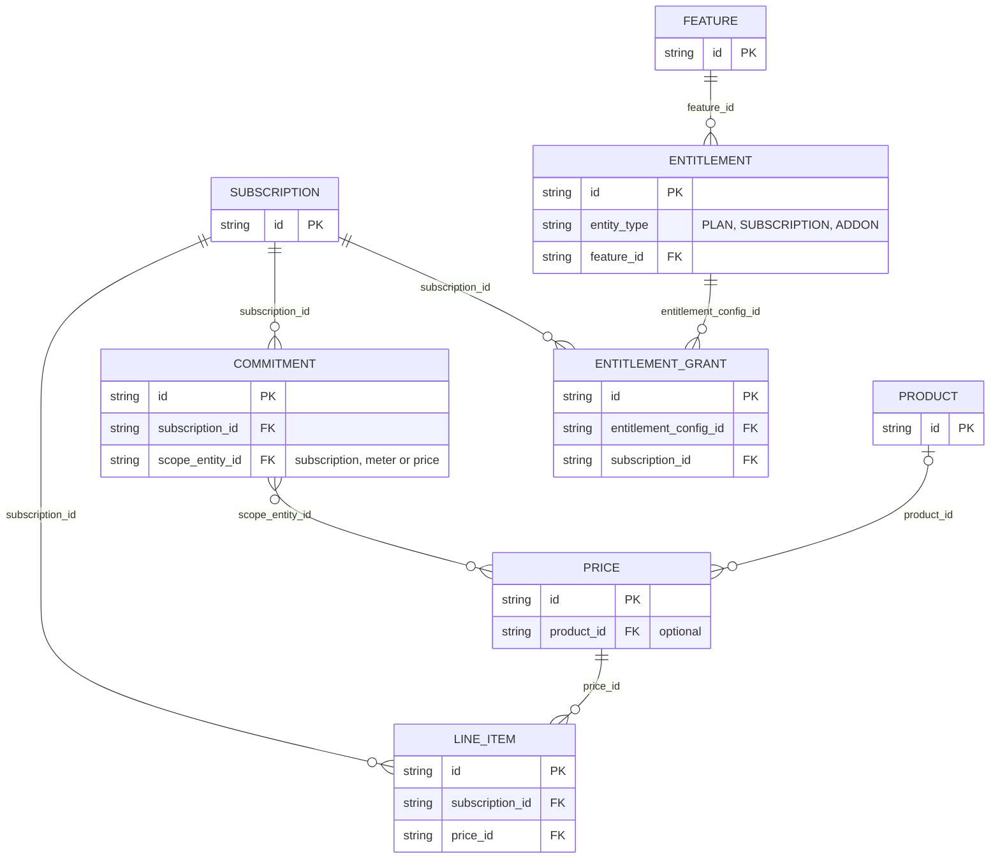
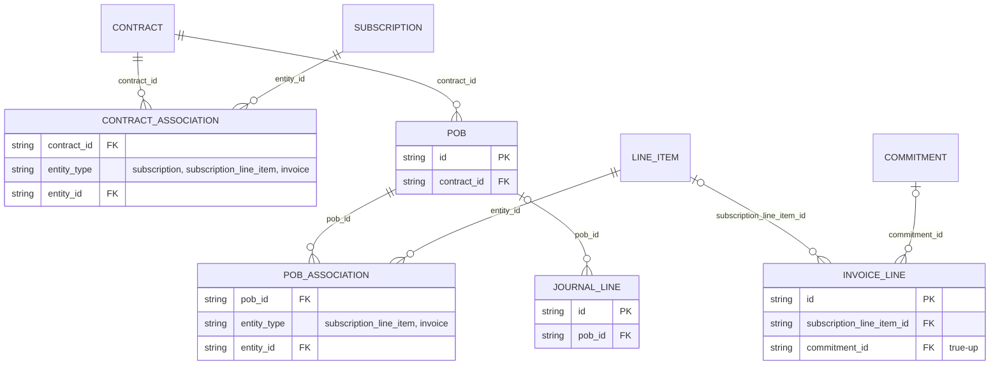
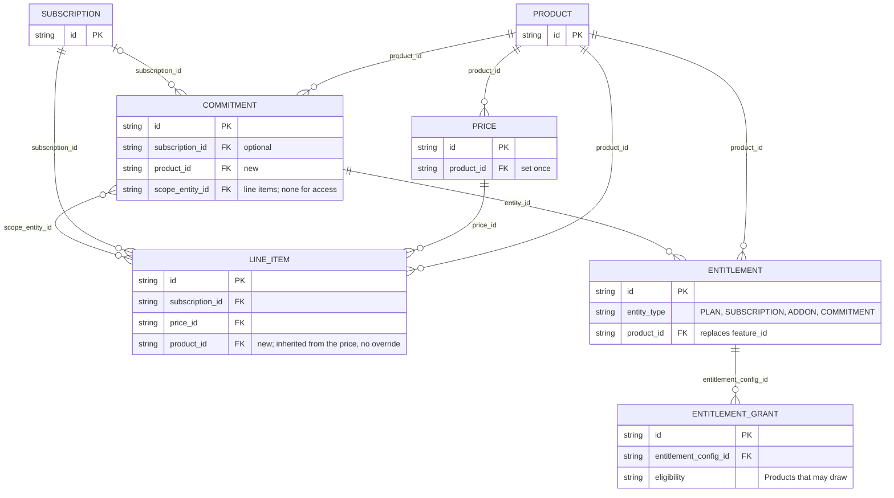
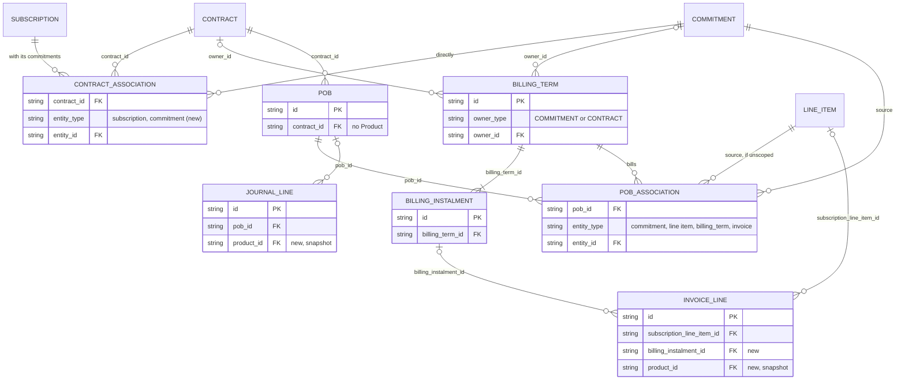

# Product across Flexprice

**Author:** Harshit Gupta

**Dated**: 2nd Nov, 2026

## Purpose

How Product fits with billing, entitlements and revenue recognition: what was **sold**, **charged, provided** and **earned**, and how Product attribution carries through each of these.

## Vocabulary


| Term                    | Meaning                                                                                                                                                                                                                                                                                                   |
| ----------------------- | --------------------------------------------------------------------------------------------------------------------------------------------------------------------------------------------------------------------------------------------------------------------------------------------------------- |
| Product                 | A catalog identity for something we sell, carrying ERP and accounting defaults. **Agreed:** Product replaces Feature.                                                                                                                                                                                     |
| Meter                   | Measures usage events. Prices and commitments reference it.                                                                                                                                                                                                                                               |
| Price                   | How a charge is calculated. It carries a Product, which line items inherit with no override.                                                                                                                                                                                                              |
| Plan                    | A reusable package of prices and entitlements.                                                                                                                                                                                                                                                            |
| Subscription            | One customer's arrangement. It owns the customer-specific objects below.                                                                                                                                                                                                                                  |
| Line item               | A price applied to one subscription, with customer-specific quantity, dates and overrides.                                                                                                                                                                                                                |
| Billing Term (BT)       | A known amount and how it is collected, e.g. 30% upfront and 70% quarterly. Owned by a Commitment or a Contract. Its rows state the amounts. It has no Product of its own: its invoice lines take the commitment's, or split by allocation when the contract owns it. Several BTs can collect one amount. |
| Commitment              | An agreed purchase over a term: prepaid access, a usage bank, a reservation or a minimum. Holds the value and Product; may own BTs; may provide an entitlement or grant.                                                                                                                                  |
| Entitlement             | What a customer may access or consume, for a Product. Scoped to a plan, subscription or commitment.                                                                                                                                                                                                       |
| Entitlement grant       | An allowance with a quantity or value, eligibility and validity.                                                                                                                                                                                                                                          |
| Credit Grant            | Issues credits, paid or free, once or on a schedule, with expiry.                                                                                                                                                                                                                                         |
| Wallet                  | Holds credits and applies them to invoices as settlement. Coverage under an agreed scope is an entitlement grant, not a wallet.                                                                                                                                                                           |
| Contract                | A customer's agreement. Through associations it holds subscriptions, with their commitments, and commitments directly. It owns contract-level BTs. Its consideration is allocated to POBs.                                                                                                                |
| POB                     | A promise to the customer. Fulfilling it earns the consideration allocated to it. It has no Product; its source (a line item or commitment) has one.                                                                                                                                                      |
| Invoice, Credit Note    | Billing, and adjustments to billing.                                                                                                                                                                                                                                                                      |
| Payment, Refund         | Settlement, and its reversal.                                                                                                                                                                                                                                                                             |
| Journal entry and lines | Immutable financial effects. A line may carry attribution such as POB and Product.                                                                                                                                                                                                                        |


## Data model

Only the entities this doc changes, with the fields that link them. Each model is split in two: catalog and subscription, then contract, billing and revenue.

### Today

**Catalog and subscription**




**Contract, billing and revenue**




- Product is reached only through Price.
- Commitments have no Product, own no BT and provide no grant. There are no BTs.
- Invoice and journal lines carry no Product.


### Proposed

**Catalog and subscription**




**Contract, billing and revenue**




- Product is set on Price and Commitment only. Line items inherit it; invoice and journal lines snapshot it.
- A contract holds subscriptions, with their commitments, or commitments directly.
- A BT has one owner: a commitment or a contract.
- A commitment provides its entitlement and grant.
- A POB has exactly one source association, a commitment or an unscoped line item, and no Product. A BT association says which POBs it bills.


## Framework

Each example answers these, in order:

1. Agreement
2. Entities
3. Earning and financial changes
4. Relationships


## Examples


| #   | Example                                                                                 | What it tests                                                                                                  |
| --- | --------------------------------------------------------------------------------------- | -------------------------------------------------------------------------------------------------------------- |
| 1   | Recurring platform subscription                                                         | The baseline: Product inherited from Price, time-based earning                                                 |
| 2   | Platform access plus a purchased usage bank (60k + 60k, four 30k invoices)              | Two Products, BTs per component, why instalments don't refill the bank                                         |
| 3   | Same 12k purchase, different collection (30% upfront + 70% monthly, vs all at year-end) | Earning is independent of collection                                                                           |
| 4   | Metered usage with a postpaid minimum                                                   | Meter, Price, Commitment, usage above the minimum and true-up with no entitlement; how the shortfall is earned |
| 5   | Purchased allowance (100 units for 80)                                                  | Operational value ≠ allocated value; breakage on the POB                                                       |
| 6   | Wallet credits (100 credits for 80)                                                     | Consumption vs settlement vs expiry; credits are payment, not a POB                                            |
| 7   | Free credits (50 promotional credits)                                                   | No revenue and no liability; the whole settlement is a discount                                                |
| 8   | Allowance inside paid access (100 runs a day)                                           | An allowance earns by time with access, not by drawdown                                                        |
| 9   | One bank covering several Products                                                      | One commitment and POB for a bank several Products draw from; revenue by drawing Product                       |
| 10  | One agreement collected by a contract-level BT (100k, four 25k instalments)             | A BT owned by the contract; billing split across POBs by allocation                                            |


### Example 1 — Recurring platform subscription

**In short:** Contract = Subscription + platform line item (`prod_platform`) + 1 POB (from the line item)

**1. Agreement**

Acme subscribes to Platform at 3,000 a quarter, billed in arrears, from Jan 1 until cancelled. Access is delivered evenly.

**2. Entities**


| Entity       | Instance                  | Responsibility                     |
| ------------ | ------------------------- | ---------------------------------- |
| Product      | `prod_platform`           | Names what is sold                 |
| Price        | 3,000 / quarter, arrear   | Forms the charge                   |
| Plan         | Platform plan             | Packages the price and entitlement |
| Subscription | Acme's subscription       | The customer arrangement           |
| Line item    | Platform line             | Applies the price to Acme          |
| Entitlement  | Access to `prod_platform` | Gates access. Not read by revenue. |
| Contract     | Acme contract             | Groups the POB                     |
| POB          | Platform access           | Promise delivered over time        |
| Invoice      | Quarterly invoice         | Bills each ended quarter           |


No BT (the price's cadence collects), no Commitment, no grant or wallet.

**3. Earning and financial changes**

The POB earns the quarter's 3,000 by time: 1,000 a month, before any invoice exists. The invoice only sets AR and billed.


| Event                   | Entry (`prod_platform`)                   | Unbilled | Deferred |
| ----------------------- | ----------------------------------------- | -------- | -------- |
| Jan, Feb, Mar month end | Dr unbilled 1,000 / Cr revenue 1,000 each | 3,000    | 0        |
| Apr 1, invoice          | Dr AR 3,000 / Cr deferred 3,000           | 3,000    | 3,000    |
| April run, offset       | Dr deferred 3,000 / Cr unbilled 3,000     | 0        | 0        |
| Payment                 | Dr cash / Cr AR, no Product               | —        | —        |


**4. Relationships**

```
Contract
└── Subscription
    ├── Platform line item (Price: prod_platform) ──source──▶ POB, by time
    │     └── invoice lines: prod_platform
    └── Entitlement: access to prod_platform, from the plan ── no POB

Journal lines: prod_platform, from the POB's source
```

**Rule:** Product is chosen on the Price, inherited by the line item, and snapshotted onto invoice lines and journal lines. Earning follows consideration and time, not the invoice.

### Example 2 — Platform access plus a purchased usage bank

**In short:** Contract = Subscription + Commitment A (`prod_platform`) + Commitment B (`prod_agent_usage`) + 2 BTs (one per commitment) + usage line item + grant (from B) + 2 POBs (one per commitment)

**1. Agreement**

Globex buys a one-year deal starting Jan 1:

- Platform access: 60,000.
- Agent usage bank: 60,000, all available from Jan 1. Usage beyond the bank is billed at the overage rate. Unused rights lapse at Dec 31 with no refund and no rollover.
- Collection: four quarterly invoices of 30,000, in arrears.

Each component is allocated its own 60,000.

**2. Entities**


| Entity            | Instance                                                       | Responsibility                                                        |
| ----------------- | -------------------------------------------------------------- | --------------------------------------------------------------------- |
| Product           | `prod_platform`, `prod_agent_usage`                            | Name the two things sold                                              |
| Commitment A      | 60,000 platform access for the year; no usage scope            | Holds access's value and Product                                      |
| Commitment B      | 60,000 usage bank, scoped to the usage line                    | Holds the bank's value and Product                                    |
| Billing Term      | 4 × 15,000 arrear on each commitment                           | Collects each commitment's value                                      |
| Entitlement       | Access to `prod_platform`, from Commitment A                   | Gates access. Not read by revenue.                                    |
| Entitlement grant | 60,000 of agent usage, valid Jan 1 – Dec 31, from Commitment B | Provides the bank; tracks its drawdown                                |
| Price             | Agent usage, per unit                                          | Values each unit drawn from the bank, and overage                     |
| Subscription      | Globex subscription                                   | Holds the usage line and the commitments                              |
| Line item         | Agent usage line                                               | Prices usage. Covered usage is 0 on invoices; overage is billed here. |
| Contract          | Globex contract                                       | Groups the POBs                                                       |
| POB A             | Platform access                                                | Promise delivered over time                                           |
| POB B             | Agent usage bank                                               | Promise delivered as the grant is drawn down                          |
| Invoice           | Quarterly invoice                                              | One per quarter: two BT lines, plus any overage                       |


Platform access has no Price and no line item: its BT rows state the amounts.

**3. Earning and financial changes**

- **POB A** earns 5,000 a month, by time.
- **POB B** earns usage drawn from the grant, valued by the usage price. Q1 usage: Jan 2,000, Feb 3,000, Mar 3,000.


| Event              | Entry                                                           | Unbilled | Deferred      |
| ------------------ | --------------------------------------------------------------- | -------- | ------------- |
| Jan month end      | Dr unbilled 7,000 / Cr revenue 5,000 (platform) + 2,000 (usage) | 7,000    | 0             |
| Feb, Mar month end | 8,000 each (5,000 + 3,000)                                      | 23,000   | 0             |
| Apr 1, Q1 invoice  | Dr AR 30,000 / Cr deferred 15,000 (platform) + 15,000 (usage)   | 23,000   | 30,000        |
| Offset for Q1      | POB A 15,000. POB B: min(15,000 billed, 8,000 earned) = 8,000   | 0        | 7,000 (usage) |


After the Q1 invoice:

- Revenue: 23,000.
- Net contract liability: 7,000, all on POB B.
- Bank remaining on the grant: 52,000.

**Why the bank is 60,000, not 120,000.** The grant is the usage that was bought. The other 60,000 pays for access.

**Why instalments don't refill the bank.** The whole grant was given on Jan 1. Each 15,000 instalment collects money for rights already provided.

**Accelerated use.**

- Q2 usage is 40,000, so 48,000 has been earned against 30,000 billed. POB B carries 18,000 unbilled; earning is not capped by billing.
- Q3 usage is 20,000. It exhausts the grant: 12,000 is covered and 8,000 is overage.
- Overage earns on POB B as it is used. It is billed in arrears on the usage line, at its Price.

**Unused bank.** Suppose only 40,000 is used by Dec 31.

- POB B holds 20,000 deferred.
- The rights lapse with no refund or rollover, so nothing more is owed. POB B is satisfied, and the 20,000 is recognized as breakage on Dec 31: Dr deferred 20,000 / Cr revenue 20,000.
- Had the contract allowed rollover, the 20,000 would stay deferred and move to the renewal. Had it been refundable, it would become a refund liability.

**4. Relationships**

```
Contract
└── Subscription
    ├── Commitment A: access, 60,000 (prod_platform) ──source──▶ POB A, by time
    │     ├── BT: 4 × 15,000 ──▶ invoice lines: prod_platform
    │     └── Entitlement: access (prod_platform) ── no POB
    ├── Commitment B: bank, 60,000 (prod_agent_usage) ──source──▶ POB B, by drawdown
    │     ├── BT: 4 × 15,000 ──▶ invoice lines: prod_agent_usage
    │     ├── Entitlement (entity_type=COMMITMENT)
    │     │     └──entitlement_config_id──▶ Grant: 60,000, Jan 1 – Dec 31
    │     └── scope ──▶ usage line item
    └── Usage line item (Price: prod_agent_usage) ── no POB of its own
          └── overage invoice lines: prod_agent_usage
```

**Rule:** A prepaid component is one Commitment, one Product and one POB. Its BTs collect and its grant or entitlement provides. Rights follow the agreement; collection only changes billed.

### Example 3 — Same 12k purchase, different collection

**In short:** Contract = Subscription + Commitment (`prod_agent_usage`) + 1 BT (X or Y) + usage line item + grant + 1 POB (from the commitment)

**1. Agreement**

A customer buys a 12,000 agent usage bank for the year, starting Jan 1. It's all available from Jan 1 and lapses at Dec 31. There are two ways to pay:

- **Option X:** 30% upfront (3,600 on Jan 1), then 70% in 12 monthly instalments of 700, each at month end.
- **Option Y:** the full 12,000, invoiced on Dec 31.

Usage is the same under both: Jan 400, Feb 1,000, Mar 1,200.

**2. Entities**


| Entity             | Instance                                                           | Responsibility                                                    |
| ------------------ | ------------------------------------------------------------------ | ----------------------------------------------------------------- |
| Product            | `prod_agent_usage`                                                 | Names what is sold                                                |
| Commitment         | 12,000 usage bank for the year, scoped to the usage line           | Holds the value and Product                                       |
| Billing Term       | X: 3,600 on Jan 1, then 12 × 700 at month end. Y: 12,000 on Dec 31 | Collects the value. The only entity that differs between options. |
| Entitlement, grant | 12,000 of agent usage, Jan 1 – Dec 31, from the commitment         | Provides the bank from Jan 1 under both options                   |
| Price              | Agent usage, per unit                                              | Values each unit drawn                                            |
| Line item          | Agent usage line                                                   | Prices usage; covered usage is 0 on invoices                      |
| Contract, POB      | One contract, one POB: the usage bank                              | Earns as the grant is drawn                                       |
| Invoice            | X: 13 invoices. Y: one                                             | Bills the BT rows                                                 |


Not needed: a Price for the BT, a second POB or a wallet.

**3. Earning and financial changes**

The POB earns what's drawn from the grant: 400, 1,000 and 1,200. That's the same under X and Y. The BT only sets billed, and the offset nets billed against earned, so X builds deferred and Y builds unbilled.


| Month end                        | Revenue (cumulative) | X: billed (cumulative) | X: deferred | Y: unbilled |
| -------------------------------- | -------------------- | ---------------------- | ----------- | ----------- |
| Jan                              | 400                  | 4,300                  | 3,900       | 400         |
| Feb                              | 1,400                | 5,000                  | 3,600       | 1,400       |
| Mar                              | 2,600                | 5,700                  | 3,100       | 2,600       |
| Dec 31, after invoice and offset | 12,000               | 12,000                 | 0           | 0           |


X never carries unbilled here, and Y never carries deferred. If usage ran ahead of X's billing, X would carry unbilled too. The Dec 31 row assumes the bank is fully used, or that the remainder is breakage on lapse (rule 10).

**Annual access, delivered evenly.** Under both options, a 12,000 access commitment earns 1,000 a month. By Mar 31, X shows 2,700 deferred and Y shows 3,000 unbilled.

**4. Relationships**

```
Contract
└── Subscription
    ├── Commitment: bank, 12,000 (prod_agent_usage) ──source──▶ POB, by drawdown
    │     ├── BT: X (3,600 + 12 × 700) or Y (12,000 on Dec 31)
    │     │     └──▶ invoice lines: prod_agent_usage
    │     ├── Entitlement ──▶ Grant: 12,000, from Jan 1 under both
    │     └── scope ──▶ usage line item
    └── Usage line item (Price: prod_agent_usage) ── no POB of its own

Only the BT differs between X and Y.
```

**Rule:** Collection changes billed, never earned. Swapping a commitment's BT changes only unbilled and deferred.

### Example 4 — Metered usage with a postpaid minimum

**In short:** Contract = Subscription + usage line item (`prod_api_calls`) + minimum Commitment (scoped to the line) + 1 POB (from the commitment)

**1. Agreement**

A customer pays for API calls at 0.01 a call, billed monthly in arrears. They commit to a minimum of 3,000 a quarter. If usage falls short, a true-up for the difference is billed with the quarter's last invoice. There is no access limit.

Q1 usage: Jan 800, Feb 900, Mar 700. The total is 2,400, so the shortfall is 600.

**2. Entities**


| Entity       | Instance                                                | Responsibility                                                      |
| ------------ | ------------------------------------------------------- | ------------------------------------------------------------------- |
| Product      | `prod_api_calls`                                        | Names what is sold                                                  |
| Meter        | API calls                                               | Counts usage events                                                 |
| Price        | 0.01 per call, monthly in arrears                       | Values usage                                                        |
| Subscription | The customer's subscription                             | Holds the line item and the commitment                              |
| Line item    | API calls line                                          | Bills usage each month                                              |
| Commitment   | 3,000 minimum per quarter, scoped to the API calls line | Holds the minimum and Product; sets the true-up                     |
| Contract     | The customer's contract                                 | Groups the POB                                                      |
| POB          | API usage, from the commitment                          | Earns usage as it happens, and any shortfall when the window closes |
| Invoice      | Monthly; the quarter's last one adds a true-up line     | Bills usage and the shortfall                                       |


Not needed: an entitlement or grant (nothing gates or draws down), a BT (the minimum is a floor, not a schedule) or a wallet.

**3. Earning and financial changes**

Usage earns as it happens. The shortfall earns on Mar 31, when the window closes and the minimum is due. It comes from the window's allocation, not from the true-up invoice. If the true-up were invoiced later, Q1 revenue would still be 3,000.


| Event                     | Entry (`prod_api_calls`)                                               | Unbilled | Deferred |
| ------------------------- | ---------------------------------------------------------------------- | -------- | -------- |
| Jan 31, usage             | Dr unbilled 800 / Cr revenue 800                                       | 800      | 0        |
| Feb 1, invoice and offset | Dr AR 800 / Cr deferred 800; offset 800                                | 0        | 0        |
| Feb 28 and Mar 1          | Same, for 900                                                          | 0        | 0        |
| Mar 31, usage             | Dr unbilled 700 / Cr revenue 700                                       | 700      | 0        |
| Mar 31, window closes     | Shortfall: Dr unbilled 600 / Cr revenue 600                            | 1,300    | 0        |
| Apr 1, invoice and offset | Dr AR 1,300 (usage 700, true-up 600) / Cr deferred 1,300; offset 1,300 | 0        | 0        |


Q1 revenue is 3,000. Had usage been 3,500, there would be no true-up, and 3,500 would be earned as usage.

**4. Relationships**

```
Contract
└── Subscription
    ├── Commitment: 3,000 minimum a quarter (prod_api_calls) ──source──▶ POB
    │     ├── scope ──▶ API calls line item
    │     └── true-up invoice line: prod_api_calls
    └── API calls line item (Price: prod_api_calls, Meter: API calls) ── no POB of its own
          └── usage invoice lines: prod_api_calls

No BT, no entitlement.
```

**Rule:** A minimum's shortfall earns when its window closes, from the window's allocation. The true-up invoice only bills it.

### Example 5 — Purchased allowance

**In short:** Contract = Subscription + Commitment (`prod_agent_usage`) + BT + usage line item + grant + 1 POB (from the commitment)

**1. Agreement**

Agent usage lists at 1.00 a unit. A customer buys a usage bank of 100 units for 80, paid upfront on Jan 1. It's valid Jan 1 – Dec 31, with no refund and no rollover. Usage beyond the bank bills at list.

The customer uses 25 units in January. The other 75 lapse on Dec 31.

**2. Entities**


| Entity             | Instance                                             | Responsibility                                                       |
| ------------------ | ---------------------------------------------------- | -------------------------------------------------------------------- |
| Product            | `prod_agent_usage`                                   | Names what is sold                                                   |
| Commitment         | 80 bank of 100 units, scoped to the usage line       | Holds the value and Product                                          |
| Billing Term       | 80 upfront on Jan 1                                  | Collects the value                                                   |
| Entitlement, grant | 100 units, Jan 1 – Dec 31, from the commitment       | Provides the bank; tracks drawdown                                   |
| Price, line item   | Agent usage, 1.00 a unit, on the usage line          | Values units; covered usage is 0 on invoices, and overage bills here |
| Subscription       | The customer's subscription                          | Holds the usage line and the commitment                              |
| Contract, POB      | One contract, one POB: the bank, from the commitment | Earns as the grant is drawn                                          |


Not needed: a wallet or credit grant.

**3. Earning and financial changes**

The grant counts 100 units: that's the operational value. The POB is allocated 80, so each unit drawn earns 0.80. The 25 units used earn 20.


| Event                  | Entry (`prod_agent_usage`)                         | Unbilled | Deferred |
| ---------------------- | -------------------------------------------------- | -------- | -------- |
| Jan 1, BT invoice      | Dr AR 80 / Cr deferred 80                          | 0        | 80       |
| Jan 31, 25 units drawn | Dr unbilled 20 / Cr revenue 20; offset 20          | 0        | 60       |
| Dec 31, 75 units lapse | Breakage: Dr deferred 60 / Cr revenue 60 (rule 10) | 0        | 0        |


**4. Relationships**

```
Contract
└── Subscription
    ├── Commitment: 100 units for 80 (prod_agent_usage) ──source──▶ POB, 0.80 a unit
    │     ├── BT: 80 upfront ──▶ invoice line: prod_agent_usage
    │     ├── Entitlement ──▶ Grant: 100 units
    │     └── scope ──▶ usage line item
    └── Usage line item (Price: prod_agent_usage, 1.00) ── no POB of its own
```

**Rule:** A unit drawn from a purchased allowance earns its allocated value, not its list value.

### Example 6 — Wallet credits

**In short:** Contract = Subscription + usage line item (`prod_agent_usage`) + 1 POB (from the line item). Wallet ← paid credit grant, no Product

**1. Agreement**

Agent usage lists at 1.00 a unit, billed monthly in arrears. A customer tops up their wallet with 100 credits for 80, paid on Jan 1. The credits expire on Dec 31 with no refund. Each credit settles 1.00 of invoice.

The customer uses 25 units in January. The other 75 credits expire on Dec 31.

**2. Entities**


| Entity           | Instance                                               | Responsibility                  |
| ---------------- | ------------------------------------------------------ | ------------------------------- |
| Product          | `prod_agent_usage`                                     | Names what is sold              |
| Price, line item | Agent usage, 1.00 a unit, on the usage line            | Bills usage at list             |
| Credit grant     | 100 paid credits for 80, expiring Dec 31               | Issues credits into the wallet  |
| Wallet           | The customer's wallet                                  | Holds credits; settles invoices |
| Contract, POB    | One contract, one POB: agent usage, from the line item | Earns usage as it happens       |
| Invoice          | Monthly usage invoice                                  | Bills usage; settled by credits |


Not needed: a commitment, BT or entitlement.

**3. Earning and financial changes**

Consumption, settlement and expiry are three separate events. Usage earns 25 at list. When credits settle the invoice, 20 comes off the wallet liability and the other 5 becomes a discount. Net revenue is 20.


| Event                        | Entry                                                                   | Unbilled | Deferred | Wallet |
| ---------------------------- | ----------------------------------------------------------------------- | -------- | -------- | ------ |
| Jan 1, top-up                | Dr cash 80 / Cr credits liability 80, no Product                        | 0        | 0        | 80     |
| Jan 31, usage                | Dr unbilled 25 / Cr revenue 25                                          | 25       | 0        | 80     |
| Feb 1, invoice and offset    | Dr AR 25 / Cr deferred 25; offset 25                                    | 0        | 0        | 80     |
| Feb 1, settled by 25 credits | Dr credits liability 20 + Dr discount 5 (`prod_agent_usage`) / Cr AR 25 | 0        | 0        | 60     |
| Dec 31, 75 credits expire    | Breakage: Dr credits liability 60 / Cr credits breakage 60, no Product  | 0        | 0        | 0      |


The discount lands on Feb 1, when the credits are applied. If the credits had settled an invoice line for another Product, the discount would carry that Product.

**Proposed:** wallet entries carry no Product. Top-up, settlement and breakage post to tenant GL accounts: `credits_liability` and a credits breakage income account. A top-up invoice line is exempt from the missing-Product audit (rule 6).

**4. Relationships**

```
Contract
└── Subscription
    └── Usage line item (Price: prod_agent_usage) ──source──▶ POB
          └── invoice lines: prod_agent_usage

Customer
└── Wallet ◀── Credit grant: 100 paid credits for 80 (no Product)
      └── settles invoice ──▶ credits liability 20 + discount 5 (prod_agent_usage)
```

**Rule:** Buying credits is a prepayment, not a POB. Consumption earns on the usage line; settlement only moves the liability to AR; expired credits are breakage on the wallet.

### Example 7 — Free credits

**In short:** Contract = Subscription + usage line item (`prod_agent_usage`) + 1 POB (from the line item). Wallet ← free credit grant, no Product

**1. Agreement**

Agent usage lists at 1.00 a unit, billed monthly in arrears. On Jan 1 the customer is given 50 free promotional credits, expiring Mar 31. Each credit settles 1.00 of invoice.

The customer uses 30 units in January, and the credits settle that invoice. The other 20 credits expire on Mar 31.

**2. Entities**


| Entity           | Instance                                               | Responsibility                  |
| ---------------- | ------------------------------------------------------ | ------------------------------- |
| Product          | `prod_agent_usage`                                     | Names what is sold              |
| Price, line item | Agent usage, 1.00 a unit, on the usage line            | Bills usage at list             |
| Credit grant     | 50 free credits, expiring Mar 31                       | Issues credits into the wallet  |
| Wallet           | The customer's wallet                                  | Holds credits; settles invoices |
| Contract, POB    | One contract, one POB: agent usage, from the line item | Earns usage as it happens       |
| Invoice          | Monthly usage invoice                                  | Bills usage; settled by credits |


Not needed: a commitment, BT or entitlement.

**3. Earning and financial changes**

Free credits cost the customer nothing, so they create no liability. Usage earns 30 at list. When the free credits settle the invoice, they relieve no liability, so the whole 30 is a discount. Net revenue is 0, and expiry posts nothing.


| Event                        | Entry                                          | Unbilled | Deferred | Free credits |
| ---------------------------- | ---------------------------------------------- | -------- | -------- | ------------ |
| Jan 1, 50 credits granted    | None                                           | 0        | 0        | 50           |
| Jan 31, usage                | Dr unbilled 30 / Cr revenue 30                 | 30       | 0        | 50           |
| Feb 1, invoice and offset    | Dr AR 30 / Cr deferred 30; offset 30           | 0        | 0        | 50           |
| Feb 1, settled by 30 credits | Dr discount 30 (`prod_agent_usage`) / Cr AR 30 | 0        | 0        | 20           |
| Mar 31, 20 credits expire    | None                                           | 0        | 0        | 0            |


This is the Example 6 settlement with a cost of 0: credits relieve liability at what was paid for them, and the rest of what they settle is a discount.

**Agreed:** free credits are a discount. Under ASC 606, consideration given to a customer reduces the transaction price, so it is contra-revenue.

**Agreed:** credits a plan includes are accounted the same way.

**4. Relationships**

```
Contract
└── Subscription
    └── Usage line item (Price: prod_agent_usage) ──source──▶ POB
          └── invoice lines: prod_agent_usage

Customer
└── Wallet ◀── Credit grant: 50 free credits (no Product)
      └── settles invoice ──▶ discount 30 (prod_agent_usage)
```

**Rule:** Free credits create no revenue and no liability. When they settle an invoice, the whole amount settled is a discount on the settled lines' Products. Expiry posts nothing.

### Example 8 — Allowance inside paid access

**In short:** Contract = Subscription + platform line (`prod_platform`) + overage line (`prod_agent_runs`) + entitlement (100 runs a day, from the plan) + 2 POBs (one per line)

**1. Agreement**

A customer subscribes to Platform at 1,000 a month, billed monthly in advance. It includes 100 agent runs a day. The allowance resets daily, and unused runs don't carry over. Runs beyond 100 in a day are billed at 0.50 each, monthly in arrears.

In January the customer stays under the allowance every day except Jan 15, when they make 130 runs. That's 30 runs of overage, or 15.

**2. Entities**


| Entity           | Instance                                   | Responsibility                                     |
| ---------------- | ------------------------------------------ | -------------------------------------------------- |
| Product          | `prod_platform`, `prod_agent_runs`         | Name access and agent runs                         |
| Meter            | Agent runs                                 | Counts runs                                        |
| Price, line item | Platform, 1,000 a month in advance         | Bills access                                       |
| Entitlement      | 100 agent runs a day, from the plan        | Gates runs and resets daily. Not read by revenue.  |
| Price, line item | Agent runs overage, 0.50 a run, in arrears | Bills runs beyond the daily allowance              |
| Contract         | The customer's contract                    | Groups the POBs                                    |
| POB              | Platform access, from the platform line    | Earns by time                                      |
| POB              | Agent runs overage, from the overage line  | Earns overage as it happens                        |
| Invoice          | Monthly                                    | Bills next month's access and last month's overage |


Not needed: a commitment, BT, grant or wallet.

**3. Earning and financial changes**

The allowance is part of the access promise. The access POB earns 1,000 a month by time, however many runs are used. Unused runs earn nothing more and leave no breakage, because nothing was allocated to them. Only the overage earns as it is used.


| Event                                               | Entry                                                                                 | Unbilled | Deferred |
| --------------------------------------------------- | ------------------------------------------------------------------------------------- | -------- | -------- |
| Jan 1, invoice for January access                   | Dr AR 1,000 / Cr deferred 1,000 (`prod_platform`)                                     | 0        | 1,000    |
| Jan 31, access earned                               | Dr unbilled 1,000 / Cr revenue 1,000; offset 1,000 (`prod_platform`)                  | 0        | 0        |
| Jan 31, overage earned                              | Dr unbilled 15 / Cr revenue 15 (`prod_agent_runs`)                                    | 15       | 0        |
| Feb 1, invoice: February access and January overage | Dr AR 1,015 / Cr deferred 1,000 (`prod_platform`) + 15 (`prod_agent_runs`); offset 15 | 0        | 1,000    |


**4. Relationships**

```
Contract
└── Subscription
    ├── Platform line item (Price: prod_platform) ──source──▶ POB, by time
    ├── Overage line item (Price: prod_agent_runs) ──source──▶ POB, as used
    └── Entitlement: 100 runs a day (prod_agent_runs), from the plan ── no POB

The overage line and the entitlement share the agent runs meter.
```

**Rule:** An allowance that resets and doesn't carry over is part of the access promise. It earns by time with access, not by drawdown. Only usage beyond it earns as it is used.

### Example 9 — One bank covering several Products

**In short:** Contract = Subscription + Commitment (`prod_ai_bank`) + BT + 3 usage lines (voice, text, model) + grant + 1 POB (from the commitment)

**1. Agreement**

A customer buys a 30,000 AI usage bank for the year, invoiced upfront on Jan 1. Voice, text and model usage can all draw from it, each at its own price. Usage beyond the bank is billed at those prices. Unused rights lapse at Dec 31.

January usage: voice 1,200, text 500, model 300.

**2. Entities**


| Entity             | Instance                                                             | Responsibility                                               |
| ------------------ | -------------------------------------------------------------------- | ------------------------------------------------------------ |
| Product            | `prod_voice`, `prod_text`, `prod_model`                              | Name the three kinds of usage                                |
| Product            | `prod_ai_bank`                                                       | Names the bank itself, which is what was sold                |
| Commitment         | 30,000 bank for the year, scoped to the three usage lines            | Holds the value and `prod_ai_bank`                           |
| Billing Term       | 30,000 upfront on Jan 1                                              | Collects the value                                           |
| Entitlement, grant | One grant of 30,000, Jan 1 – Dec 31; eligible: voice, text and model | Provides the bank; tracks drawdown and which Product drew it |
| Prices, line items | Voice, text and model usage lines                                    | Value each unit drawn, and bill overage                      |
| Contract, POB      | One contract, one POB: the bank, from the commitment                 | Earns as the grant is drawn                                  |
| Invoice            | The BT invoice, then overage invoices                                | Bills the BT row and any overage                             |


Not needed: one POB per Product. The usage mix isn't known upfront, so there is no fixed amount to give each.

**3. Earning and financial changes**

The POB earns what's drawn, valued at each line's price: 2,000 in January. Deferred and unbilled lines carry `prod_ai_bank`. Revenue lines carry the Product that drew it, taken from the grant's drawdown records.


| Event               | Entry                                                                                                                       | Unbilled | Deferred |
| ------------------- | --------------------------------------------------------------------------------------------------------------------------- | -------- | -------- |
| Jan 1, BT invoice   | Dr AR 30,000 / Cr deferred 30,000 (`prod_ai_bank`)                                                                          | 0        | 30,000   |
| Jan 31, 2,000 drawn | Dr unbilled 2,000 (`prod_ai_bank`) / Cr revenue 1,200 (`prod_voice`) + 500 (`prod_text`) + 300 (`prod_model`); offset 2,000 | 0        | 28,000   |


**Overage.** Say the bank runs out in November, and 400 of voice usage comes after it. That 400 earns on the bank's POB as revenue under `prod_voice`, and is invoiced on Dec 1 on the voice line, also under `prod_voice`. Its unbilled and deferred lines carry `prod_ai_bank`, so they net within the POB.

**4. Relationships**

```
Contract
└── Subscription
    ├── Commitment: bank, 30,000 (prod_ai_bank) ──source──▶ POB, by drawdown
    │     ├── BT: 30,000 upfront ──▶ invoice line: prod_ai_bank
    │     ├── Entitlement ──▶ Grant: 30,000; eligible: voice, text, model
    │     └── scope ──▶ voice, text and model line items
    ├── Voice line item (Price: prod_voice)  ┐
    ├── Text line item  (Price: prod_text)   ├── no POB of their own; overage invoiced here
    └── Model line item (Price: prod_model)  ┘

Revenue lines: the drawing line's Product.
Deferred, unbilled and breakage lines: prod_ai_bank.
A commitment scoped to one price carries that price's Product; scoped to several, its own.
```

**Rule:** A bank shared by several Products is one commitment and one POB. Its deferred, unbilled and breakage lines carry the bank's Product; its revenue lines carry the Product that drew it.

### Example 10 — One agreement collected by a contract-level BT

**In short:** Contract = Subscription + Commitment A (`prod_platform`) + Commitment B (`prod_agent_usage`) + 1 BT (owned by the contract) + usage line item + grant (from B) + 2 POBs (one per commitment)

**1. Agreement**

A customer signs one 100,000 agreement for the year: platform access and an agent usage bank. It's collected as four quarterly instalments of 25,000, in arrears. The instalments are for the whole agreement, not for either part.

The standalone selling prices allocate 48,000 to access and 52,000 to the bank. Q1 usage: Jan 4,000, Feb 5,000, Mar 6,000.

**2. Entities**


| Entity             | Instance                                                            | Responsibility                                         |
| ------------------ | ------------------------------------------------------------------- | ------------------------------------------------------ |
| Product            | `prod_platform`, `prod_agent_usage`                                 | Name the two things sold                               |
| Commitment A       | Platform access for the year, no usage scope; allocated 48,000      | Holds access's value and Product                       |
| Commitment B       | Usage bank for the year, scoped to the usage line; allocated 52,000 | Holds the bank's value and Product; provides the grant |
| Billing Term       | 4 × 25,000 in arrears, owned by the contract                        | Collects the agreement. Has no Product of its own.     |
| Entitlement, grant | Access to `prod_platform`; a 52,000 grant of agent usage            | Gate access; provide the bank                          |
| Price, line item   | Agent usage, per unit                                               | Values units drawn, and overage                        |
| Subscription       | The customer's subscription                                         | Holds the usage line and the commitments               |
| Contract           | The customer's contract                                             | Owns the BT; groups the POBs                           |
| POB A, POB B       | Access, from Commitment A; the bank, from Commitment B              | Earn by time; earn by drawdown                         |
| Invoice            | Quarterly                                                           | One line per instalment                                |


Not needed: BTs on the commitments.

**3. Earning and financial changes**

POB A earns 4,000 a month by time. POB B earns usage as it's drawn. Each 25,000 instalment is split between the POBs by allocation, 48% and 52%: 12,000 to access and 13,000 to the bank.


| Event                | Entry                                                                                                    | Unbilled      | Deferred |
| -------------------- | -------------------------------------------------------------------------------------------------------- | ------------- | -------- |
| Jan–Mar month ends   | Dr unbilled / Cr revenue: 4,000 a month (`prod_platform`); 4,000, 5,000 and 6,000 (`prod_agent_usage`)   | 27,000        | 0        |
| Apr 1, Q1 instalment | Dr AR 25,000 / Cr deferred 12,000 (`prod_platform`) + 13,000 (`prod_agent_usage`), from one invoice line | 27,000        | 25,000   |
| Offset for Q1        | POB A 12,000. POB B: min(13,000 billed, 15,000 earned) = 13,000                                          | 2,000 (usage) | 0        |


After Q1, revenue is 27,000, and POB B carries 2,000 unbilled because its usage ran ahead of its share of billing.

**Agreed:** one invoice line per instalment. The BT has no Product; the line's Product is split by allocation across the commitments' Products.

**4. Relationships**

```
Contract
├── BT: 4 × 25,000, no Product ──bills by allocation──▶ POB A 48% + POB B 52%
└── Subscription
    ├── Commitment A: access, 48,000 (prod_platform) ──source──▶ POB A, by time
    │     └── Entitlement: access (prod_platform) ── no POB
    ├── Commitment B: bank, 52,000 (prod_agent_usage) ──source──▶ POB B, by drawdown
    │     ├── Entitlement ──▶ Grant: 52,000
    │     └── scope ──▶ usage line item
    └── Usage line item (Price: prod_agent_usage) ── no POB of its own

Instalment invoice line: 12,000 prod_platform + 13,000 prod_agent_usage.
Commitment A could also be held by the contract directly, outside the subscription.
```

**Rule:** A contract's BT collects for the whole agreement. Its billing is split across the contract's POBs by allocation, so each POB's billed and earned still net out under its commitment's Product.

## Relationship summary

### Where a known amount lives


| Offering                                   | Known amount                                  | BT owner                           | POB tracks                                                          |
| ------------------------------------------ | --------------------------------------------- | ---------------------------------- | ------------------------------------------------------------------- |
| Prepaid access (e.g. 60k for a year)       | Commitment `value`, no usage scope            | Commitment or Contract             | The commitment, by time                                             |
| Usage bank or other prepaid coverage       | Commitment `value`                            | Commitment or Contract             | The commitment and its grant's drawdown                             |
| Recurring fixed charge on a plan price     | The line item's price × quantity, each period | None; the price's cadence collects | The line item                                                       |
| Postpaid usage, with or without a minimum  | None upfront                                  | None; billed per period            | The commitment if one scopes the line item; otherwise the line item |
| One agreement covering several commitments | Each commitment's `value`                     | Contract                           | Each commitment's POB, billed by allocation                         |


The middle layer is the Commitment for known prepaid amounts and the line item for amounts priced each period. A BT's rows state their own amounts, so a BT needs no Price. A Price is needed only to value units, such as usage and overage.

### Entitlements


| Offering                  | Entitlement                           | Provided by                      | Linked to the POB?                               |
| ------------------------- | ------------------------------------- | -------------------------------- | ------------------------------------------------ |
| Access                    | Static access, or none                | Plan, subscription or commitment | No. Time is the measure.                         |
| Allowance inside access   | Entitlement with a reset              | Plan, subscription or commitment | No. Part of the access promise.                  |
| Usage bank                | Grant, valid for the term             | The Commitment that sold it      | Yes. Grant drawdown is the measure.              |
| Postpaid usage            | None, unless there is an access limit | Subscription                     | No. Meter usage on the line item is the measure. |
| Free or purchased credits | None; credit grant and wallet         | Customer wallet                  | No. Credits are a payment method.                |


## References

- [Stripe: credit grant object](https://docs.stripe.com/api/billing/credit-grant/object)
- [Stripe: billing credits](https://docs.stripe.com/billing/subscriptions/usage-based/billing-credits)
- [Stripe: entitlements](https://docs.stripe.com/billing/entitlements.md?dashboard-or-api=api)
- [Stripe: Revenue Recognition methodology](https://docs.stripe.com/revenue-recognition/methodology)
- [Stripe: chart of accounts](https://docs.stripe.com/revenue-recognition/chart-of-accounts)
- [Chargebee: recognizing discounts](https://www.chargebee.com/docs/revrec/revenue-recognition/recognizing-discounts)
- [Chargebee: RevRec Premium journal entries](https://www.chargebee.com/docs/revrec/revrec-premium/revrec-premium-understanding-journal-entries)
- [Chargebee: entitlements API](https://apidocs.chargebee.com/docs/api/entitlements)
- [Chargebee: credit units](https://apidocs.chargebee.com/docs/api/credit_units)
- [Chargebee: RevRec product catalog](https://www.chargebee.com/docs/revrec/revenue-recognition/configuring-product-catalog)
- [Chargebee: journal account mapping](https://www.chargebee.com/docs/revrec/general-ledger-accounting-close/journal-account-mapping)
- [Tabs: revenue recognition](https://docs.tabs.com/revenue-recognition)
- [Tabs: performance obligation](https://help.tabs.com/articles/3513205169-performance-obligation)
- [Tabs: billing terms](https://help.tabs.com/articles/5082917631-billing-terms-in-tabs)
- [Tabs: usage-based API billing](https://www.tabs.com/blog/usage-based-api-billing)
- [Sequence: credits overview](https://docs.sequencehq.com/credits/overview)
- [Sequence: credit grants revenue](https://docs.sequencehq.com/revenue-recognition/credit-grants)
- [Sequence: revenue recognition settings](https://docs.sequencehq.com/revenue-recognition/settings.md)
- [Orb: revenue recognition](https://docs.withorb.com/revenue-reporting/revenue-recognition)
- [Orb: scoped credits](https://docs.withorb.com/product-catalog/scoped-credits)
- [Orb: NetSuite credit drawdown](https://docs.withorb.com/integrations-and-exports/netsuite-credit-drawdown)
- [Metronome: revenue recognition](https://docs.metronome.com/guides/reporting-insights/financial-reporting/revenue-recognition)
- [Metronome: revenue recognition examples](https://docs.metronome.com/guides/reporting-insights/financial-reporting/revenue-recognition-examples)
- [Metronome: apply credits and commits](https://docs.metronome.com/pricing-packaging/apply-credits-commits/)
- [Zuora: prepaid with drawdown](https://docs.zuora.com/en/zuora-billing/bill-your-customer/usage-billing/prepaid-with-drawdown/prepaid-with-drawdown-overview)
- [Zuora Revenue: performance obligations processing](https://docs.zuora.com/zuora-revenue/getting-started/policy-management/performance-obligations-processing)
- [Solvimon: credit revenue and breakage](https://docs.solvimon.com/platform-guides/wallets-credits/credit-revenue-breakage)
- [Lago: entitlements](https://getlago.com/docs/guide/entitlements.md)
- [Lago: wallets and prepaid credits](https://getlago.com/docs/guide/revenue-recognition/how-it-works/wallets-and-prepaid-credits.md)
- [Maxio: entitlements](https://docs.maxio.com/billing/catalog/entitlements/understand-entitlements)

