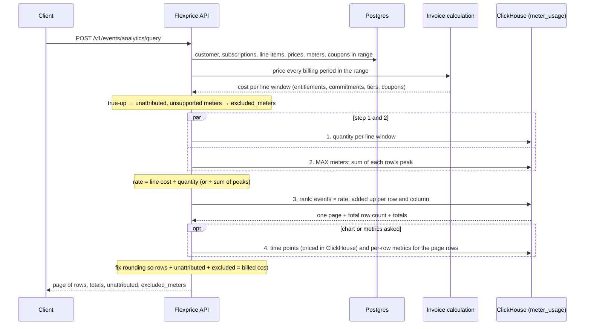

# Analytics Query — Sorted & Paginated Usage Cost (PRD)

Status: **For review** · Linear: FLE-1804 · Updated 2026-11-03

## 1. Problem

Customers want to show **usage cost broken down by an event property** (user, app, service…) for a
time range, **sorted and one page at a time**, with totals that cover everything.

Our analytics API (`POST /v1/events/analytics`) returns every line item × property value, unsorted,
with no page or total count, and gets slower as customers' data and pricing setups grow.

## 2. Use cases

| Use case | What the screen shows | Group by |
|---|---|---|
| **Per-user credits** | Credits per user table (month columns, search, pages); top services | `user`, `service`, `sub_service` |
| **App spend** | Spend by app / team / owner / model; build vs run columns; top 10 + "Other" cost-over-time chart; owner and app counts per row | `app`, `team`, `model`… |
| **Per-model spend** | One end-customer's spend by model, with hundreds of meters (one per model) | `model` / meter |
| **Per-minute bucketed pricing** | The same breakdowns for meters priced per minute, which take **4–17 s** today | `token_uuid`, `source` |

Also: query **long time ranges** with paginated results.

All of them reduce to the same request:

```
one customer + time range + filters (include / exclude)
  → group by 1–3 keys (optionally one key spread into columns, e.g. build/run or months)
  → cost and usage per row
  → sorted, one page at a time, + total row count
  → totals over the full filtered set
```

## 3. Why today's API can't do it

1. ClickHouse returns **every** line item × property value (× time bucket).
2. The app prices each line on its total (tiers apply), then splits that cost across values by usage share.
3. Everything is returned unsorted; the client sorts and pages.

So: no sort, page, total count or exclude filter; every page re-computes and re-ships everything; app
memory grows with values × meters × buckets; and query count grows with configuration (one query per
subscription, per line item, and for bucketed meters **one per property value**).

Today's results also depend on how you group. For a line with a commitment, grouping by a property drops the
true-up entirely, while not grouping shows the whole month's commitment even for a one-week range.

**A per-minute bucketed customer, one real request:** 17 s, **311 ClickHouse queries**, 267 of them one per `token_uuid`.

## 4. Step 0 — fix today's bucketed queries (no contract change)

Bucketed meters run one query for the totals plus **one query per property value**. Step 0 makes it one
query per meter, with the same response. On per-minute bucketed data: **273 → 3 queries, ClickHouse time 56 s → 7 s**.

**Step 0b:** today's response carries every value's per-minute points (2.45M rows in that example) only to draw
the chart. Rolling them up to the requested window inside ClickHouse cuts that to ~3k rows.

## 5. Approach

**Price each line like the invoice, then let ClickHouse rank.** Pricing stays in our app (the invoice
calculation); ClickHouse only multiplies and adds up per row.



**Example** — 2 meters, 4 users, "top 2 users by cost":

- Copywriter: 2,000 units, tiered → $3,000 → **$1.50/unit**. Designer: 600 units at $3 → **$3/unit**.
- Arjun = 600 × 1.5 + 300 × 3 = **$1,800**; Priya = 800 × 1.5 + 100 × 3 = **$1,500** → page of 2, "4 rows total".
- Same split as today (Priya used 40% of the copywriter units → 40% of $3,000); only *where* the math runs changes.

**Shape:** a **new endpoint**, `POST /v1/events/analytics/query`. The existing `/events/analytics` stays
unchanged in shape and values; it can move onto this engine later behind a flag.

### Pricing rules

| Situation | Rule |
|---|---|
| Normal monthly plan | One rate per line per billing period. |
| Plan change mid-period / daily line items | One rate per **line window**; each event uses its window's rate. |
| Tiered price | Priced once on the line total, then averaged; never per row (that would restart tiers). |
| Bucketed (per-minute) meters | Line priced per minute as billing does (tiers reset each minute), then split by usage share. |
| Entitlements (free quota) | Applied as on the invoice; rows show their share as `free_usage`. |
| Commitments | Utilized and overage stay on rows. True-up (unused commitment) goes to `unattributed`, unless a row key is the line itself (`meter_id`, `feature_id`, `sub_line_item_id`). |
| Coupons | Percentage coupons, as today; rows show `subtotal`, `discount`, `cost`. Coupon IDs are not returned. |
| MAX meters | A row costs rate × its own peak, where rate = line cost ÷ sum of every row's peak (unfiltered). |
| Range covers part of a period | Usage uses the full period's rate, so slices add up to the invoice. A line's true-up carries the range's share of that line's usage; MAX lines, lines with no usage and charges with no line carry the range's share of time. |
| Open (current) period | Amounts are billing's current values, so they change as usage arrives (like the invoice preview). |
| Same meter on two subscriptions | Both prices apply, as billing does. |
| Filters | A row's cost is the same filtered or unfiltered (rates always come from the full line). |

### API

`POST /v1/events/analytics/query`

**Request**

| Field | Meaning |
|---|---|
| `external_customer_id` | Required. One customer. |
| `start_time`, `end_time` | Range; defaults to the last 7 days, like today. Windows use the customer's timezone. |
| `feature_ids` / `meter_ids` | Which meters. |
| `group_by` | 1–3 row keys: `properties.*`, `source`, `meter_id`, `feature_id`, `sub_line_item_id`. Taken literally — meter is a key only if listed. |
| `columns` | Optional single key spread into columns: `properties.*`, `source`, `meter_id`, `month`; ≤ 50 values. |
| `filters` | `[{key, op: in \| not_in, values}]` on any key, ANDed. |
| `search` | Case-insensitive contains on the row key values. |
| `sort` | `total` (default) \| `column` \| `name` \| `usage` (single meter only) \| `event_count`; ties broken by row values. |
| `limit` (≤ 100), `offset` | Paging. Each request reads the latest data, so rows can shift slightly between pages while events arrive. |
| `window_size` | Cost-over-time points (e.g. per day) for the page rows, plus totals per window across all rows for the chart's "Other"; ≤ 400 windows. |
| `expand` | `price`, `plan`, `addon`, `subscription`; `meter` and `feature` when a row key is the meter, feature or line. |
| `metrics` | Extensible per-row extras; v1: `distinct:<key>` → `{count, values}` (values when ≤ 5). |
| `deduplicate` | Off by default, like today. |

**Sample response** — `group_by: ["properties.app"]`, `columns: "properties.type"`, `window_size: "WEEK"`,
`metrics: ["distinct:source"]`, `limit: 2` (points trimmed):

```json
{
  "currency": "usd",
  "total_count": 3,
  "column_values": ["build", "run"],
  "totals": {
    "cost": "50.41", "subtotal": "50.41", "discount": "0",
    "rows_cost": "50.41", "unattributed_cost": "0", "excluded_cost": "0",
    "breakdown": { "usage": "50.41", "commitment_utilized": "0", "overage": "0", "true_up": "0" },
    "columns": { "build": { "cost": "27.45" }, "run": { "cost": "22.96" } },
    "points": [
      { "window_start": "2026-10-04T00:00:00Z", "cost": "13.67",
        "columns": { "build": { "cost": "7.40" }, "run": { "cost": "6.27" } } }
    ]
  },
  "items": [
    {
      "group": { "app": "payout" },
      "cost": "28.08", "subtotal": "28.08", "discount": "0",
      "breakdown": { "usage": "28.08", "commitment_utilized": "0", "overage": "0", "true_up": "0" },
      "event_count": 360,
      "columns": { "build": { "cost": "15.39" }, "run": { "cost": "12.69" } },
      "metrics": { "distinct:source": { "count": 2, "values": ["api", "batch"] } },
      "points": [
        { "window_start": "2026-10-04T00:00:00Z", "cost": "7.44",
          "columns": { "build": { "cost": "4.02" }, "run": { "cost": "3.42" } } }
      ],
      "price_ids": ["price_tokens", "price_storage"],
      "subscription_ids": ["subs_123"],
      "plan_ids": ["plan_growth"]
    },
    {
      "group": { "app": "support" },
      "cost": "11.17", "subtotal": "11.17", "discount": "0",
      "breakdown": { "usage": "11.17", "commitment_utilized": "0", "overage": "0", "true_up": "0" },
      "event_count": 120,
      "columns": { "build": { "cost": "5.94" }, "run": { "cost": "5.23" } },
      "metrics": { "distinct:source": { "count": 2, "values": ["api", "batch"] } }
    }
  ],
  "unattributed": { "cost": "0", "breakdown": { "usage": "0", "commitment_utilized": "0", "overage": "0", "true_up": "0" } },
  "excluded_meters": []
}
```

With a commitment and rows grouped by a property, the unused part appears as:

```json
"unattributed": {
  "cost": "18.59",
  "breakdown": { "usage": "0", "commitment_utilized": "0", "overage": "0", "true_up": "18.59" },
  "charges": [
    { "subscription_id": "subs_123", "plan_id": "plan_growth", "meter_id": "meter_tokens",
      "sub_line_item_id": "li_tokens", "price_id": "price_tokens",
      "cost": "18.59", "breakdown": { "true_up": "18.59" }, "reason": "unused_commitment" }
  ]
}
```

**Rules**

- `totals.cost = rows_cost + unattributed_cost + excluded_cost = subtotal − discount`; every breakdown, column set and point series adds up to its row.
- With filters or search, `unattributed` is left out and `excluded_meters` carry no cost (their share of a slice is unknown).
- MAX meters: row usages don't add up to the total (peaks aren't additive); costs do.
- Events missing a row or column key go to a `""` value, shown as "(none)".
- A row spanning a price change lists both `price_ids`; group by `sub_line_item_id` to split it like today.
- Sort changes are a new request unless `total_count ≤ limit` (then the client has every row).
- `unattributed.charges[].reason`: `unused_commitment`, `no_usage` (cost on a line with no usage in range), `unlinked_charge`.

## 6. Scope

| | What | Customers |
|---|---|---|
| **v1** | SUM, COUNT, SUM_WITH_MULTIPLIER and **MAX** meters, incl. **bucketed SUM** (flat or tiered); entitlements, commitments, true-up, percentage coupons, daily line items; 1–3 row keys + one column key; include/exclude filters; search; sort; pages + total count + totals; cost-over-time points; distinct metrics; `expand`; one customer per request | All four use cases (per-minute bucketed: SUM meters) |
| **v1, if parity holds** | Package pricing on bucketed meters; billing-group pricing — both are line cost × usage share | Per-minute bucketed |
| **v1.1** | Bucketed MAX; COUNT_UNIQUE / AVG / LATEST; cumulative meters; parent/child customers and `include_children`; CSV export; coupon IDs per row | Per-minute bucketed, parent/child tenants |
| **Not planned** | Tenant-wide breakdown across all customers (separate design); commitment time-bucket detail; multi-currency (deferred) | — |

Until v1.1, meters that can't be split are listed in `excluded_meters` with their cost, and parent/child
customers get a clear 400.

## 7. How much it handles

The limit is **events scanned per request** (customer × time range) and how wide each event's JSON is.
Distinct values (7 vs 1M) and number of meters matter far less.

| Events in the requested range | Table only | Table + cost-over-time chart (+ counts) | Verdict |
|---|---|---|---|
| ~1M | < 0.5 s | < 1 s | Comfortable |
| ~10M | ~2–3.5 s | ~5–7 s | Works; chart is the slow part |
| ~10M, 300–3,000 meters | ~1.6–4.8 s | ~4–8 s | Works; meter count barely matters |
| ~30M, 250 meters | ~2 s (by model) – ~9 s (100k users) | ~5–15 s | Works for few rows; slow for many |
| ~100M | ~22–25 s | ~40–60 s | Too slow → v2 rollup |
| 10M, 50 JSON keys per event | ~7 s | ~13 s | Keep events lean |

**Throughput.** One request already uses all cores of the node, so concurrent requests queue. Rough ceiling
on one 8-vCPU ClickHouse node with nothing else running (= 8 ÷ CPU-seconds per request, full request with
chart; estimated, **not load-tested**): **~12 req/min at 10M events, ~4–5 at 30M, ~1.5 at 100M**.
Production ClickHouse also serves ingest and billing, so at ~10M events per range this suits a handful of
concurrent viewers per customer.

## 8. Benchmark — 2026-11-03

**Setup:** ClickHouse 26.3, one node (8 vCPU, 32 GB) on GKE, real `meter_usage` schema, synthetic data,
30-day range, warm cache, **one request at a time**. Times are the proposed approach's ClickHouse queries
per request (§5 steps 1–4); the app-side pricing step is not included.

**Data:** 30 days of events per synthetic customer, timestamps spread evenly, usage skewed (a few heavy
users, many light ones), ~8 JSON properties (~160 bytes) per event unless noted. Example event (per-user credits):

```
meter_id = mA_cost   qty_total = 4.37   source = src_2   timestamp = 2026-10-14 08:21:09
properties = {"user":"u412","service":"svc3","sub_service":"sub87","model":"model5","provider":"prov1",
              "session_id":"…","input_tokens":"1830","output_tokens":"412"}
```

| Shape | Events | Meters | Distinct values of the row key |
|---|---|---|---|
| Per-user credits | 1M / 10M / 100M | 2 (one SUM, one MAX) | 1k / 50k / 1M users |
| Many meters | 10M | 300 / 500 / 3,000 SUM | 10 services / 100k users |
| App spend | 10M / 100M | 5 SUM | 5k apps × 50 teams × 3k owners |
| Per-model spend | 30M | 250 SUM | 100k users, 250 models |
| Per-minute bucketed | 6M | 6 (3 per-minute bucketed) | 90 (`token_uuid × source`) |
| Wide events | 10M | 2 | 50k users, **50 JSON keys** per event |

**Results** — seconds per request; page of 25 rows; "Detail" = the cost-over-time chart: daily points for the page
rows and daily totals across all rows (app spend also counts distinct owners and teams per row).

| Scenario | Rows ranked | Quantity | MAX peaks | Rank | Detail | **Total** |
|---|---|---|---|---|---|---|
| Per-user credits 1M, by user | 1k | 0.08 | 0.13 | 0.26 | 0.30 | **0.8** |
| Per-user credits 10M, by service × month columns | 7 | 0.29 | — | 1.66 | 1.58 | **3.5** |
| Per-user credits 10M, by user | 50k | 0.30 | 0.78 | 2.10 | 2.64 | **5.8** |
| Per-user credits 10M, by user | 615k | 0.29 | 0.88 | 4.35 | 4.29 | **9.8** |
| App spend 10M, app + build/run + owner/team counts | 5k | 0.28 | — | 2.42 | 4.21 | **6.9** |
| App spend 10M, app × team | 250k | 0.29 | — | 3.00 | 2.24 | **5.5** |
| Per-model spend 30M, by model | 250 | 0.84 | — | 1.06 | 3.12 | **5.0** |
| Per-model spend 30M, by user | 100k | 0.86 | — | 8.52 | 5.60 | **15.0** |
| Per-model spend 30M, 7,500 daily line windows | 100k | 1.04 | — | 11.90 | 6.58 | **19.5** |
| Many meters 10M, 300 meters, by service | 10 | 0.38 | — | 1.61 | 1.80 | **3.8** |
| Many meters 10M, 500 meters, by service | 10 | 0.42 | — | 1.69 | 1.99 | **4.1** |
| Many meters 10M, 3,000 meters, by service | 10 | 0.59 | — | 1.77 | 1.98 | **4.3** |
| Many meters 10M, 300 meters, by user | 100k | 0.36 | — | 3.61 | 2.14 | **6.1** |
| Many meters 10M, 500 meters, by user | 100k | 0.41 | — | 3.86 | 2.88 | **7.2** |
| Many meters 10M, 3,000 meters, by user | 100k | 0.51 | — | 4.75 | 2.39 | **7.7** |
| Per-minute bucketed 6M, token × source | 90 | 0.21 | — | 0.96 | 1.16 | **2.3** |
| Wide events 10M, by user | 50k | 0.29 | — | 6.52 | 6.15 | **13.0** |
| Per-user credits 100M, by user | 50k | 2.64 | 7.28 | 14.82 | 17.26 | **42.0** |
| App spend 100M, app + build/run + owner count | 5k | 2.54 | — | 19.26 | 38.74 | **60.5** |

**Findings**

1. Every query reads the customer's events once; time tracks **events × JSON size**. Each extra pass re-parses
   the JSON, so the number of passes per request is the main lever.
2. The ranked table alone is ~2–3.5 s at 10M; the cost-over-time chart roughly doubles a request. 1M events is under
   a second in every case.
3. Distinct values matter little for time (7 → 615k values: 3.5 s → 9.8 s with chart) and memory stays under
   ~2 GB; the app receives one page, not every value (today's API ships up to millions of rows).
4. Number of meters and line windows doesn't limit the approach: 300 → 3,000 meters at 10M events stays at ~4 s
   (few rows) / ~6–8 s (100k rows); 7,500 daily windows run in ~20 s on 30M events. The chart is priced inside
   ClickHouse, so it returns one row per point, not one per meter.
5. Wide JSON doubles the cost; 100M events per request is beyond a dashboard and needs the v2 rollup.

## 9. What's next — v2: hourly rollup

**When:** a customer's requests regularly scan ~30M+ events, or many people view the dashboard.

**What:** a scheduled job writes an hourly table per customer:
`(customer, meter, hour, property key, property value) → usage, event count`.
Queries read the rollup for closed hours and raw events only for the current hour. It stores
**usage, never cost**, so pricing changes need no rebuild.

- Generic, no schema change per customer: the property **key is a row value**, so each customer's own
  properties work. Each tenant lists which keys to roll up.
- A job, not a materialized view, so it can de-duplicate and re-compute the last few days for late events.
- Gain depends on how many rows collapse: big for keys like `service` or `team`, small for keys with
  a value per event (`request_id`). Benchmark on real key cardinalities before building.

Dropped: storing breakdown keys as typed columns — every customer has different properties.
Later, separate design: tenant-wide breakdowns across all customers.

## 10. Decisions

- Pricing stays in the app at line level, using the invoice calculation for every billing period in the range;
  per-row math, sort and paging run in ClickHouse.
- New endpoint `POST /v1/events/analytics/query`; the existing endpoint keeps its shape and values.
- A page row is one combination of 1–3 row keys; one optional column key; totals cover the full filtered set.
- Partial ranges use the full period's rate, so slices add up to the invoice.
- True-up goes to `unattributed` unless a row key is the line; for partial ranges it carries the range's share
  of the line's usage (time for lines with no usage and charges with no line).
- A row's cost is the same filtered or unfiltered.
- No de-duplication by default (like today); optional `deduplicate`.
- Entitlements applied as on the invoice; percentage coupons as today.
- Paging is `limit` + `offset`; each page reads the latest data (small drift between pages accepted).
- v1 ranks additive meters and MAX; other meters are reported in `excluded_meters` until v1.1.
- Parent/child customers come in v1.1 (clear 400 until then).
- Multi-currency deferred; v1 assumes one currency per customer, like today.
- No result cache in v1.
- Step 0 ships first, on its own.
- No typed key columns; the scale path is the hourly rollup (v2).

## 11. Known limitations & tech debt

Updated as testing and review continue.

- **TD-1. Partial ranges use the period's average rate.** Tiers and free units are really used in time order, so
  a past slice can change once the period fills in (e.g. Oct 1–15 tokens: $28.78 mid-month, $24.76 after month
  end). Totals still match the invoice. Fix (v1.1): price a partial range in time order, cost to range end minus
  cost to range start.
