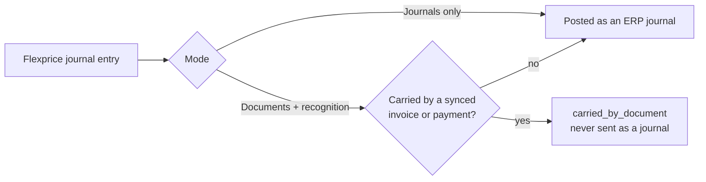
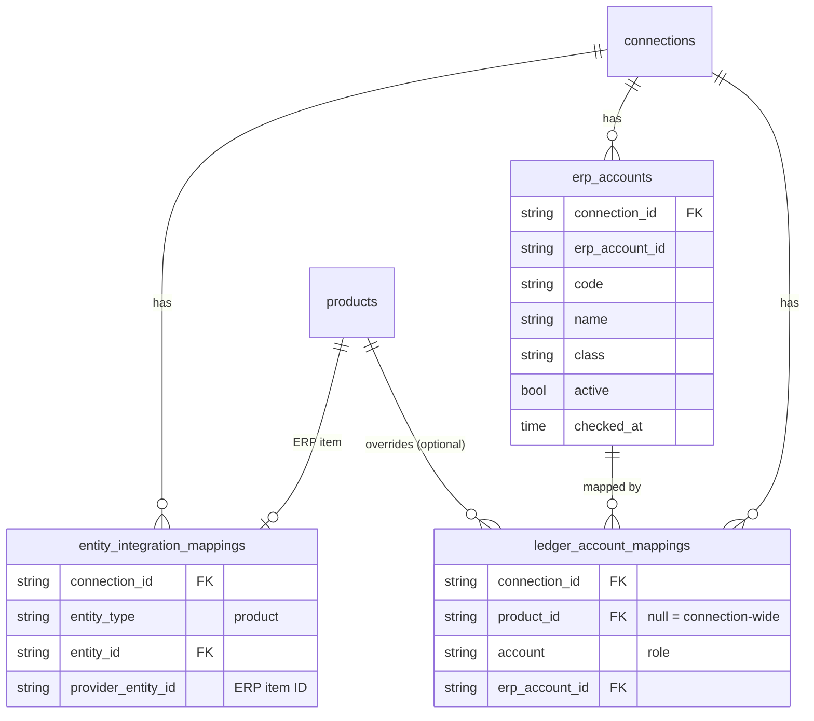
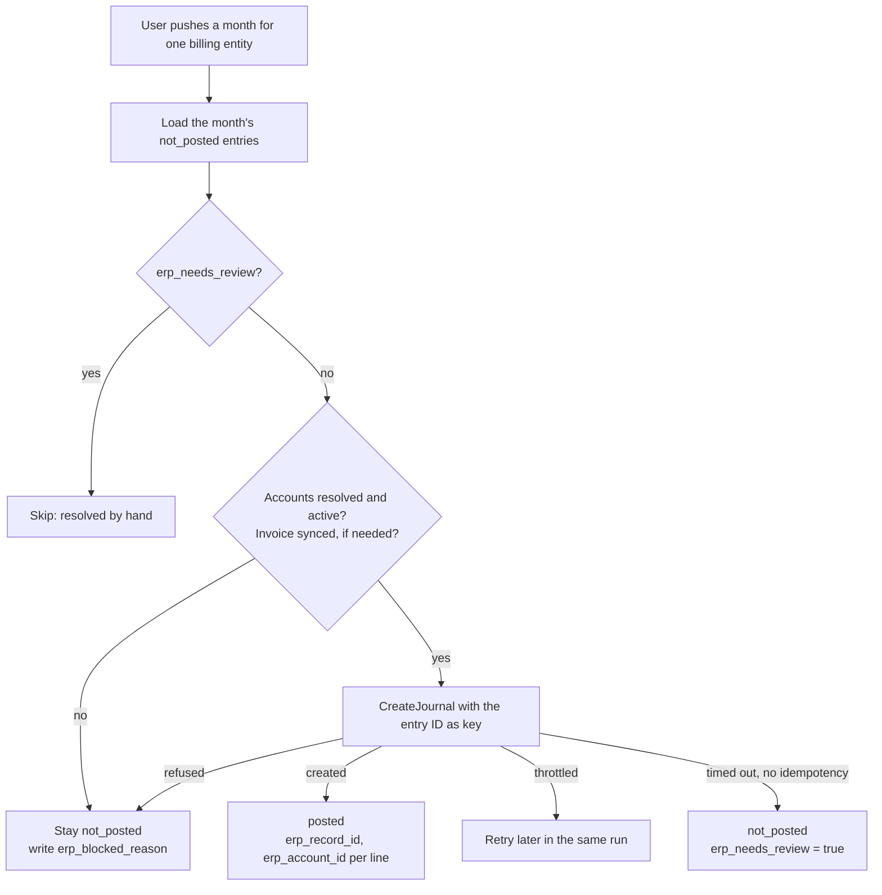
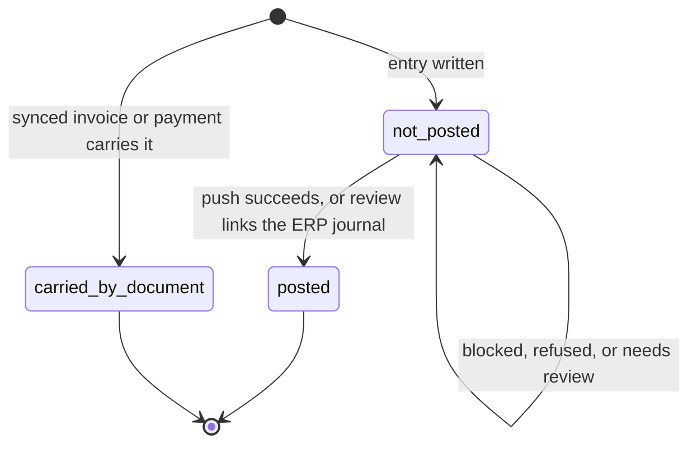
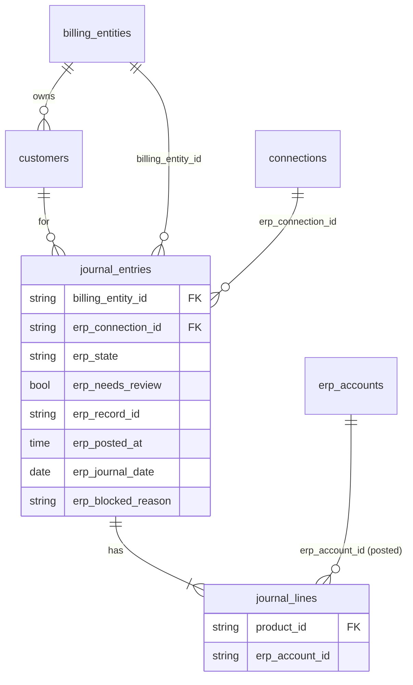

# Revenue Recognition — Phase 2 (ERP posting)

**Author:** Harshit Gupta

**Dated**: 3rd Nov, 2026

Figures marked *assumed* are illustrative. Code facts are as of commit `f1d4b5826`; billing entities as of `develop` `75ff9588f`.

## 1. Problem

Flexprice's journal knows what was earned; the customer's books live in their ERP. Phase 2 posts Flexprice journal entries to Zoho Books through an ERP provider (Rutter or Apideck), against accounts the customer mapped, without the ERP counting anything twice.

### Example: Agent Workforce (assumed)

$60,000 annual access + $60,000 annual usage bank (available upfront), billed as four quarterly $30,000 invoices (15,000 + 15,000). Two POBs, $60,000 each. Q1 usage drawn: $8,000. Access earns monthly-even.


| End of Q1 | Access | Usage bank | Total  |
| --------- | ------ | ---------- | ------ |
| Billed    | 15,000 | 15,000     | 30,000 |
| Earned    | 15,000 | 8,000      | 23,000 |
| Deferred  | 0      | 7,000      | 7,000  |


Bank remaining: 52,000. Where the 7,000 ends up depends on the unused-bank policy (expiry, refund or rollover), which is still open.

### Why mappings are needed

Journal lines post to eight fixed roles: `cash`, `accounts_receivable`, `unbilled_receivable`, `deferred_revenue`, `customer_credit`, `tax_payable`, `revenue`, `contra_revenue`. Zoho needs an account ID from one organization's chart of accounts.

A line resolves its account in this order:

1. The Product-specific mapping for its role.
2. Otherwise, the connection-wide mapping for its role.
3. Otherwise, the role is unresolved and the **whole entry** is blocked. It still exists in Flexprice.

Product is what lets Agent Workforce's two `revenue` credits land in "Platform revenue" and "Usage revenue". Journal lines carry no `product_id` today, only `pob_id`, so Product has to be stored on the line.

### Why invoice export is not enough

Flexprice already syncs invoices to Zoho Books and QuickBooks. A synced invoice books revenue on its invoice date. For Agent Workforce, the Q1 invoice books 30,000 of revenue against 23,000 earned, or 0 if it is dated Apr 1.

If the invoice sync and journal posting both run, the same money lands twice:


| Q1 in Zoho | Invoice sync | Journals | Zoho shows | Correct |
| ---------- | ------------ | -------- | ---------- | ------- |
| Receivable | 30,000       | 30,000   | 60,000     | 30,000  |
| Revenue    | 30,000       | 23,000   | 53,000     | 23,000  |


### Rule: one carrier per effect

Each financial effect reaches the ERP once, either through a synced document or through a journal. **Anything not synced as a document goes out as a journal**; this is the default. Two modes follow from that:


| Mode                    | Documents synced                      | Journals posted                                                                        |
| ----------------------- | ------------------------------------- | -------------------------------------------------------------------------------------- |
| Journals only           | None                                  | Every entry                                                                            |
| Documents + recognition | Invoices; payments on synced invoices | Recognition, offset, and everything not synced (credit notes, refunds, other payments) |




In Documents + recognition, each Zoho invoice line books to the account of its own role, as Flexprice's invoice entry does: `deferred_revenue` for lines with a POB, `customer_credit` for wallet top-ups, `revenue` otherwise. Agent Workforce's lines all have POBs, so Zoho gets: invoice Dr AR 30,000 / Cr Deferred 30,000; then one recognition journal per POB per month, e.g. January access Dr Deferred 5,000 / Cr Platform revenue 5,000. Zoho ends Q1 with AR 30,000, revenue 23,000 and deferred 7,000, which matches Flexprice.

## 2. ERP Provider


### Interface


| Method                       | Purpose                                                                   |
| ---------------------------- | ------------------------------------------------------------------------- |
| `ListAccounts`               | The chart of accounts: ERP ID, code, name, class, status                  |
| `GetAccount(erp_account_id)` | One account by ERP ID, including an inactive one; not found if deleted    |
| `ListItems`                  | ERP items, used for the Product mapping                                   |
| `CreateJournal(entry, key)`  | Posts one entry. `key` is the Flexprice journal entry ID                  |
| `GetJournalResult(key)`      | Returns the outcome of an earlier create, after a timeout or an async job |
| `Capabilities`               | What this provider supports for this ERP (below)                          |


Capabilities shape posting, so they are reported rather than assumed. Each value below was tested against a Zoho Books sandbox.


| Capability                        | Rutter on Zoho                                            | Apideck on Zoho                               |
| --------------------------------- | --------------------------------------------------------- | --------------------------------------------- |
| Idempotent create                 | Yes, `Idempotency-Key` (async)                            | No; Apideck rejects the key for Zoho journals |
| Customer required on every line   | Yes                                                       | No                                            |
| Update or delete a posted journal | No                                                        | Yes                                           |
| Account on each invoice line      | Yes                                                       | Yes                                           |
| Read freshness                    | Rutter's synced copy; records deleted in Zoho stay listed | Live                                          |


### Rules that follow

- **Posted journals are never edited in the ERP.** A correction is a new reversing entry, matching Flexprice's immutable journal.
- **Retries never duplicate.** Where the provider takes an idempotency key, the Flexprice entry ID is the key; nothing Flexprice-specific is written into the ERP journal.
- **An unknown outcome is never retried automatically** where the provider has no idempotency (Apideck on Zoho). The entry waits for review: the reviewer either links the ERP journal it created, or confirms it is absent and Flexprice resends it. Flexprice lists likely matches (same date, amount, accounts, customer) to speed this up, but never decides alone.
- **Every line carries the customer** when the provider requires it: the Zoho contact of the entry's customer.
- **Errors fall into three outcomes:**
  - Rejected (unbalanced, unknown account): blocked until a mapping changes.
  - Connection needs attention (disconnected, not ready): paused for the whole connection.
  - Throttled or ERP unavailable: retried later.
- **Flexprice shows its own journal, invoice entries included.** Each entry shows how it reached the ERP: through the synced invoice or as a posted journal, with the ERP record. The ERP's own invoice postings are not read back as journals; when needed they are checked per invoice from the invoice's line accounts.


## 3. Product to ERP mapping

A Product carries two things per ERP connection: the **ERP item** its document lines use, and **accounts for its own roles**. Both are set in Flexprice; neither is read from the ERP item.

### Rules

- **Product → one ERP item per connection.** The item is used only when Flexprice syncs a document. It replaces today's one item per Price.
- **The user picks the item** from the ERP's items or asks Flexprice to create one. If an invoice syncs before an item is picked, Flexprice creates one named after the Product. Flexprice never adopts an item by name; a duplicate name is an error.
- **A Product can override four roles:** `revenue`, `deferred_revenue`, `unbilled_receivable` and `contra_revenue`. `cash`, `accounts_receivable`, `customer_credit` and `tax_payable` are connection-wide only. The user picks or confirms every account from the chart of accounts; Flexprice never saves one on its own.
- **Accounts never come from the ERP item.** The item's sales account pre-fills the Product's `revenue` override as a suggestion; it is saved only when the user confirms it.
- **Accounts resolve when an entry is posted.** A mapping change applies to entries not yet posted; posted ERP journals are never re-mapped.
- **No Product dimension on ERP journals.** The split by Product is carried by accounts. Zoho reporting tags are not used.


### Schema


| Table                         | Change                                                                                                                                |
| ----------------------------- | ------------------------------------------------------------------------------------------------------------------------------------- |
| `ledger_account_mappings`     | New. One row per connection, role and optional Product (below)                                                                        |
| `entity_integration_mappings` | New `entity_type = product`. `provider_entity_id` is the ERP item ID; scoped by `connection_id` (added by billing entities, PR #3319) |
| `journal_lines`               | New `product_id`, a snapshot taken when the line is written                                                                           |


| `ledger_account_mappings` | Notes                                                                      |
| ------------------------- | -------------------------------------------------------------------------- |
| `connection_id`           | The ERP connection; account IDs belong to one ERP organization             |
| `product_id`              | Null for the connection-wide row; set for a Product override               |
| `account`                 | The role (`LedgerAccountKey`); a Product row only for the four roles above |
| `erp_account_id`          | The ERP's own account ID (Zoho `account_id`), not a provider ID            |


Unique per `(tenant, environment, connection, product, account)` among published rows, with at most one connection-wide row per role. 

### Resolution

A journal line's account is its Product's row for its role, else the connection-wide row, else unresolved (Section 1). The line's Product is `journal_lines.product_id`.

### What Flexprice reads

`ListItems` returns `{erp_item_id, name, status, sales_account_id}`, all ERP IDs.


| Field              | Apideck `GET accounting/invoice-items` | Rutter `GET accounting/items?expand=platform_data` |
| ------------------ | -------------------------------------- | -------------------------------------------------- |
| `erp_item_id`      | `id`                                   | `platform_id`                                      |
| `name`             | `name`                                 | `name`                                             |
| `status`           | `active`                               | `status`                                           |
| `sales_account_id` | `asset_account.id`                     | `platform_data.account_id`                         |


Apideck returns Zoho's sales account under `asset_account`. Rutter's unified item has no account, so it comes from `platform_data`. Rutter writes take Rutter account IDs; the adapter translates through `ListAccounts`, where each account's `platform_id` is the ERP ID.

### What Flexprice sends


| Call                                                           | Field                     | Value                                                          |
| -------------------------------------------------------------- | ------------------------- | -------------------------------------------------------------- |
| `CreateJournal`                                                | each line's account       | The resolved account                                           |
| Zoho `POST /invoices` (existing sync)                          | `line_items[].item_id`    | The Product's ERP item                                         |
| Zoho `POST /invoices` (existing sync)                          | `line_items[].account_id` | The resolved account of the line's role (Section 1). New field |
| Zoho `POST /items` (on request, or first sync without an item) | `name`, `product_type`    | The Product's name, `service`. A duplicate name is an error    |


A line's `account_id` overrides its item's sales account, so each synced line credits its role's account whatever the item says. Credit notes post as journals (Section 1).

### Example: Agent Workforce


| Row                | Role                  | ERP account      |
| ------------------ | --------------------- | ---------------- |
| Connection-wide    | `deferred_revenue`    | Deferred Revenue |
| Connection-wide    | `unbilled_receivable` | Unbilled Revenue |
| `prod_platform`    | `revenue`             | Platform revenue |
| `prod_agent_usage` | `revenue`             | Usage revenue    |


Q1 in Zoho:

- Invoice, synced: Platform access 15,000 and Agent usage 15,000, each with `account_id` = Deferred Revenue. Dr AR 30,000 / Cr Deferred Revenue 30,000.
- Recognition, one journal per POB per month. Both POBs are billed ahead, so each month debits Deferred Revenue directly and no offset is needed:
  - Access: Dr Deferred Revenue / Cr Platform revenue 5,000 in each of January, February and March (15,000).
  - Usage: Dr Deferred Revenue / Cr Usage revenue as drawn each month (8,000 for the quarter).


## 4. Chart of accounts sync

Flexprice reads the chart of accounts live when the user maps an account. It keeps a copy of **only the mapped accounts**, so every journal line shows its ERP account without calling the ERP.

### Roles and classes

A role is fixed in code. The account mapped to it must be of the role's class, taken from the provider's broad classification.


| Role                                                 | Class     |
| ---------------------------------------------------- | --------- |
| `cash`, `accounts_receivable`, `unbilled_receivable` | asset     |
| `deferred_revenue`, `customer_credit`, `tax_payable` | liability |
| `revenue`, `contra_revenue`                          | income    |


The class rules out the wrong kind of account, not the wrong account. Deferred Revenue and GST Payable are both liabilities; choosing between them stays with the user.

### What Flexprice reads

`ListAccounts` and `GetAccount` return `{erp_account_id, code, name, class, active}`.


| Field            | Apideck `accounting/ledger-accounts` | Rutter `accounting/accounts` |
| ---------------- | ------------------------------------ | ---------------------------- |
| `erp_account_id` | `id`                                 | `platform_id`                |
| `code`           | `code`                               | `nominal_code`               |
| `name`           | `name`                               | `name`                       |
| `class`          | `classification`                     | `category`                   |
| `active`         | `active`                             | `status`                     |


- An inactive account is missing from the list. `GetAccount` tells the cases apart: `active = false` is inactive, not found is deleted.
- Rutter serves its synced copy, so a new ERP account shows up after Rutter's next sync. Rutter has no read by ERP ID; `GetAccount` filters its list on `platform_id`.


### Rules

- **The picker is per role** and lists only active accounts of the role's class. An account whose class the provider reports as `unknown` can't be mapped.
- **Saving a mapping reads the account.** A wrong class or an inactive account is rejected.
- **Mapped accounts are checked** when the mapping screen opens and before each post. Each check refreshes `erp_accounts`.
- **A mapped account that is inactive, deleted or of the wrong class blocks only the entries that use it.** They are unresolved (Section 1); other entries keep posting. ERP rejections between the check and the post (Zoho `11015` inactive, `11016` unknown account) give the same outcome.
- **Every journal line, posted or not, shows its ERP account code and name** from `erp_accounts`. A rename in the ERP appears after the next check.


### Schema


| Table                     | Change                                                                         |
| ------------------------- | ------------------------------------------------------------------------------ |
| `erp_accounts`            | New. One row per mapped ERP account per connection; never the full chart       |
| `ledger_account_mappings` | `erp_account_id` refers to `erp_accounts` by `(connection_id, erp_account_id)` |


| `erp_accounts`   | Notes                                          |
| ---------------- | ---------------------------------------------- |
| `connection_id`  | The ERP connection                             |
| `erp_account_id` | The ERP's own account ID                       |
| `code`, `name`   | As in the ERP, e.g. `4010`, `Platform revenue` |
| `class`          | `asset`, `liability` or `income`               |
| `active`         | False once the account is inactive or deleted  |
| `checked_at`     | When it was last read from the ERP             |


Unique per `(tenant, environment, connection, erp_account_id)`. A row is added when an account is first mapped and is never deleted.



### Example: Agent Workforce (codes assumed)

1. The user overrides `revenue` for `prod_platform`. The picker shows income accounts only: `4000 Sales`, `4010 Platform revenue`, `4900 Discounts`.
2. They pick `4010`. `GetAccount` returns income, active; the mapping is saved and `erp_accounts` gets `4010 Platform revenue`.
3. January's access recognition entry shows:


| Side | Role               | ERP account           | Amount |
| ---- | ------------------ | --------------------- | ------ |
| Dr   | `deferred_revenue` | 2410 Deferred Revenue | 5,000  |
| Cr   | `revenue`          | 4010 Platform revenue | 5,000  |


1. Later, `4010` is made inactive in Zoho. The next check marks it inactive. Entries crediting `4010` are blocked; the rest keep posting.


## 5. Posting


### Granularity

**One Flexprice entry → one ERP journal.** Entries are never summed or merged before posting. The entry ID is the idempotency key, a correction is one reversing journal, and a blocked entry holds back only itself.

Agent Workforce, end of January. Access is billed ahead, so recognition writes one entry; a line billed in arrears writes two (amounts assumed):


| Flexprice entry                            | ERP journal                                           |
| ------------------------------------------ | ----------------------------------------------------- |
| `revenue_earned`, access POB               | Dr Deferred Revenue 5,000 / Cr Platform revenue 5,000 |
| `revenue_earned`, arrears POB              | Dr Unbilled Revenue 250 / Cr Usage revenue 250        |
| `revenue_offset`, arrears POB, once billed | Dr Deferred Revenue 250 / Cr Unbilled Revenue 250     |


Recognition writes up to two entries per POB per month, so month end brings many creates at once. Posting stays within the ERP's limits (Zoho: 100 calls per minute per organization); a throttled create is retried later (Section 2).

### Trigger

**The user pushes a month.** Nothing posts on its own. The user reviews a month's entries in Flexprice and clicks Push; Flexprice sends that month's unposted entries through the ERP provider, one `CreateJournal` each.

- **Journals arrive published.** Review happens in Flexprice before the push, not as an ERP draft; neither provider creates a Zoho draft.
- **Pushing again sends only what is new**, such as reversals or late entries. A posted entry is never sent twice.
- **Each entry shows its state** (below); a not-posted entry that can't go yet also shows why.



Agent Workforce: on Feb 3 the user opens January, sees three entries and pushes. All three post. If a later entry is dated January, January shows one unposted entry and the next push sends only that one.

### Ordering

In Documents + recognition, **an entry that depends on an invoice waits until that invoice has synced.** Only that entry waits; the rest of the month posts.


| Entry                                              | Waits for                                            |
| -------------------------------------------------- | ---------------------------------------------------- |
| Recognition or offset that debits Deferred Revenue | Every invoice for the same POB dated on or before it |
| Refund or credit note journal                      | Its invoice                                          |
| Recognition that debits Unbilled Revenue           | Nothing                                              |


A waiting entry shows as blocked with the invoice, e.g. "waiting for INV-123 to sync". Pushing never syncs invoices; that stays with the existing invoice sync. Once the invoice syncs, the next push sends the entry.

Agent Workforce: the Q1 invoice fails to sync. January's access entry (Dr Deferred Revenue / Cr Platform revenue) shows "waiting for INV-001 to sync"; an arrears entry in the same month posts.

### Posting record

**One posting connection per billing entity**, or per environment when billing entities are off. An entry posts to its billing entity's connection, so the entry itself holds its posting state.

- **An entry's billing entity is its customer's**, recognition and offset entries included. A customer never changes entity, so it is set once when the entry is written.
- **A connection stays on the ERP organization it first connected to.** Re-authorizing it to a different organization is rejected. Moving books means connecting a new one, mapping it from scratch and making it the entity's posting connection. Posted entries keep `erp_connection_id` pointing at the books they went to; not-posted entries go to the new one.
- **A posted line keeps its ERP account.** `erp_account_id` is set once at push; code and name come from `erp_accounts`. A later remap, rename or delete never changes which account a posted line shows.
- **Three states:**


| `erp_state`           | Meaning                                                                  | Tabs equivalent |
| --------------------- | ------------------------------------------------------------------------ | --------------- |
| `not_posted`          | Not in the ERP yet. Includes a push the ERP refused; nothing was created | Draft           |
| `posted`              | Flexprice created the ERP journal                                        | Posted          |
| `carried_by_document` | A synced invoice or payment carries it; never sent as a journal          | Info Only       |




- **Why a** `not_posted` **entry can't go yet is a reason, not a state:** missing mapping, inactive account, invoice not synced, ERP period closed, ERP refusal. Each check or push rewrites it in `erp_blocked_reason`, since fixing a mapping changes it without touching the entry.
- **`erp_needs_review` marks an unknown outcome**: a create timed out where the provider has no idempotency, so the journal may already exist in the ERP (Section 2). Only these entries are flagged; an ERP refusal is a blocked reason. A month push skips flagged entries; each is resolved by hand, by linking the ERP journal or resending it.


| Table             | New column           | Notes                                                                                                      |
| ----------------- | -------------------- | ---------------------------------------------------------------------------------------------------------- |
| `journal_entries` | `billing_entity_id`  | The customer's entity, set when written; null when billing entities are off                                |
| `journal_entries` | `erp_connection_id`  | The connection it posted through; set at push                                                              |
| `journal_entries` | `erp_state`          | `not_posted`, `posted`, `carried_by_document`                                                              |
| `journal_entries` | `erp_needs_review`   | True after an unknown outcome; cleared when the entry is linked or resent                                  |
| `journal_entries` | `erp_record_id`      | The ERP journal ID, or the ERP invoice or payment ID when a synced document carried it                     |
| `journal_entries` | `erp_posted_at`      | When the ERP confirmed it                                                                                  |
| `journal_entries` | `erp_journal_date`   | The date on the ERP journal; differs from `business_date` only after a closed-period override              |
| `journal_entries` | `erp_blocked_reason` | Why a `not_posted` entry can't go yet, e.g. "waiting for INV-123 to sync"; rewritten at each check or push |
| `journal_lines`   | `erp_account_id`     | Set once at push                                                                                           |


`erp_accounts` rows are kept after an account is unmapped, so posted lines still show its code and name.



Agent Workforce: January's access entry posts to `4010 Platform revenue`. In March the user remaps `revenue` for `prod_platform` to `4015`. January's line still shows `4010 Platform revenue`; April's entries post to `4015`.

### Closed periods

**An entry dated in a period the ERP has locked is blocked**, shown as "ERP period closed". The ERP's rejection is how Flexprice learns of the lock; neither provider reads lock dates. The user then either:

- reopens the period in the ERP and pushes again, or
- chooses **post on first open date** for that entry. The ERP journal takes that date; the Flexprice entry keeps its own `business_date`, and `erp_journal_date` records the difference.

Nothing is moved to another date without the user choosing it.

Agent Workforce: October is locked in Zoho on Nov 5. On Nov 12 a credit note adds an entry dated Oct 20. The push is rejected ("Transactions before 31/10/2026 have been locked"), so the entry shows "ERP period closed". The user picks post on first open date; the ERP journal is dated Oct 31, and the entry shows Flexprice Oct 20, ERP Oct 31.

### Customer on lines

**A line carries the entry's customer where the ERP requires it.** `Capabilities` reports which lines need one:


| Value              | Lines with the customer | Example         |
| ------------------ | ----------------------- | --------------- |
| `every_line`       | All                     | Rutter on Zoho  |
| `receivable_lines` | `accounts_receivable`   | Rutter on QBO   |
| `none`             | None                    | Apideck on Zoho |


The ERP customer comes from the existing customer sync, the same one invoice sync uses. If the customer isn't in the ERP yet, the push creates it first.

Agent Workforce through Rutter on Zoho: every line of the January access entry carries the Zoho contact for Agent Workforce.

### Tax and applied credit on synced invoices

In Documents + recognition, **the synced invoice carries the whole invoice entry, tax and applied credit included.** Flexprice posts nothing extra for them. Where Zoho books them differently, the entry shows the difference.


| Effect         | Flexprice books      | Zoho books                                                           |
| -------------- | -------------------- | -------------------------------------------------------------------- |
| Tax            | Cr `tax_payable`     | Its own tax on the invoice (e.g. Cr Output CGST 9, Cr Output SGST 9) |
| Applied credit | Dr `customer_credit` | Invoice adjustment: Dr Other Charges                                 |


Example: a 100 invoice with 18% GST and 10 of prepaid credit applied. Both sides book AR 108 and Deferred Revenue 100. Flexprice debits 10 to customer credit; Zoho debits 10 to Other Charges. The entry shows "applied credit 10 booked to Other Charges in Zoho".

### Payments on synced invoices

**A payment on a synced invoice is never posted as a journal.** Zoho already has it by one of two routes: Flexprice marks the Zoho invoice paid, or the payment was entered in Zoho and came back to Flexprice. The Flexprice entry still exists and shows "carried by Zoho payment".


| Mode                    | A payment reaches the ERP as |
| ----------------------- | ---------------------------- |
| Documents + recognition | Zoho's own customer payment  |
| Journals only           | A journal                    |


Refunds always post as journals.

Posting both would count the payment twice. For a 118 invoice paid once, Zoho would show AR −118 and 118 of unused customer credit.

## 6. Not in Phase 2


| Item                       | Why it waits                                                                                                                                   |
| -------------------------- | ---------------------------------------------------------------------------------------------------------------------------------------------- |
| Unused usage-bank policy   | Expiry, refund or rollover of a leftover bank is a recognition rule, not a posting one                                                         |
| Currency and FX            | Phase 2 posts in the entry's currency only; exchange rates and revaluation are not handled                                                     |
| Dimensions                 | Classes, locations, departments, tracking categories and Zoho reporting tags; Product is split by account (Section 3)                          |
| ERPs other than Zoho Books | Each ERP has its own journal limits; for example, Xero journals can't use system or bank accounts, so its billing effects would need documents |


## 7. API

All routes are under `/v1` and scoped to the tenant and environment.

### Connection setup

The connection's existing `sync_config` decides posting:


| `sync_config`                  | Meaning                                                                 |
| ------------------------------ | ----------------------------------------------------------------------- |
| `journal_entry.outbound: true` | This is the billing entity's posting connection; at most one per entity |
| `invoice.outbound: true`       | Documents + recognition; otherwise Journals only (Section 1)            |


### Mappings (Sections 3–4)


| Route                                                         | Does                                                                                                       |
| ------------------------------------------------------------- | ---------------------------------------------------------------------------------------------------------- |
| `GET /connections/:id/erp/accounts?role=revenue`              | Live chart of accounts: active accounts of the role's class                                                |
| `GET /connections/:id/erp/items`                              | ERP items for the Product picker                                                                           |
| `GET /connections/:id/ledger_account_mappings`                | Every mapping with its ERP code, name and status. Checks the mapped accounts first (Section 4)             |
| `PUT /connections/:id/ledger_account_mappings`                | `{account, product_id?, erp_account_id}`. Reads the account; a wrong class or inactive account is rejected |
| `DELETE /connections/:id/ledger_account_mappings/:mapping_id` | Removes a mapping; the `erp_accounts` row stays                                                            |
| `PUT /connections/:id/products/:product_id/erp_item`          | `{erp_item_id}` to pick an item, or `{create: true}` to create one named after the Product                 |


### Posting and review (Section 5)


| Route                                        | Does                                                                                                                                             |
| -------------------------------------------- | ------------------------------------------------------------------------------------------------------------------------------------------------ |
| `POST /journal_entries/search`               | Adds filters `accounting_period_id`, `billing_entity_id`, `erp_state`. Returns each entry's ERP fields and its lines' ERP accounts               |
| `POST /journal_entries/erp/push`             | `{accounting_period_id, billing_entity_id}`. Starts a Temporal workflow that posts the month's `not_posted` entries; returns `202 {workflow_id}` |
| `POST /journal_entries/:id/erp/review`       | For entries with `erp_needs_review`: `{action: "link", erp_record_id}` or `{action: "resend"}`                                                                    |
| `POST /journal_entries/:id/erp/journal_date` | For "ERP period closed": `{erp_journal_date}`; the next push posts on that date                                                                  |


### Screen: Revenue › ERP posting

```
[Jan 2026 ▾]  [Entity: US ▾]                                   [Push month]
Not posted 3 · Posted 41 · Carried 12 · Needs review 1

Entry                 Event              State        Detail
INV-001               invoice_finalized  carried      Zoho INV-001232
pob_access · Jan      revenue_earned     not posted   waiting for INV-001 to sync
CN-017                credit_note        not posted   ERP period closed   [Set date]
PAY-090               payment_succeeded  carried      Zoho payment 4069…
pob_usage · Jan       revenue_earned     not posted   needs review: timed out   [Link] [Resend]
```

