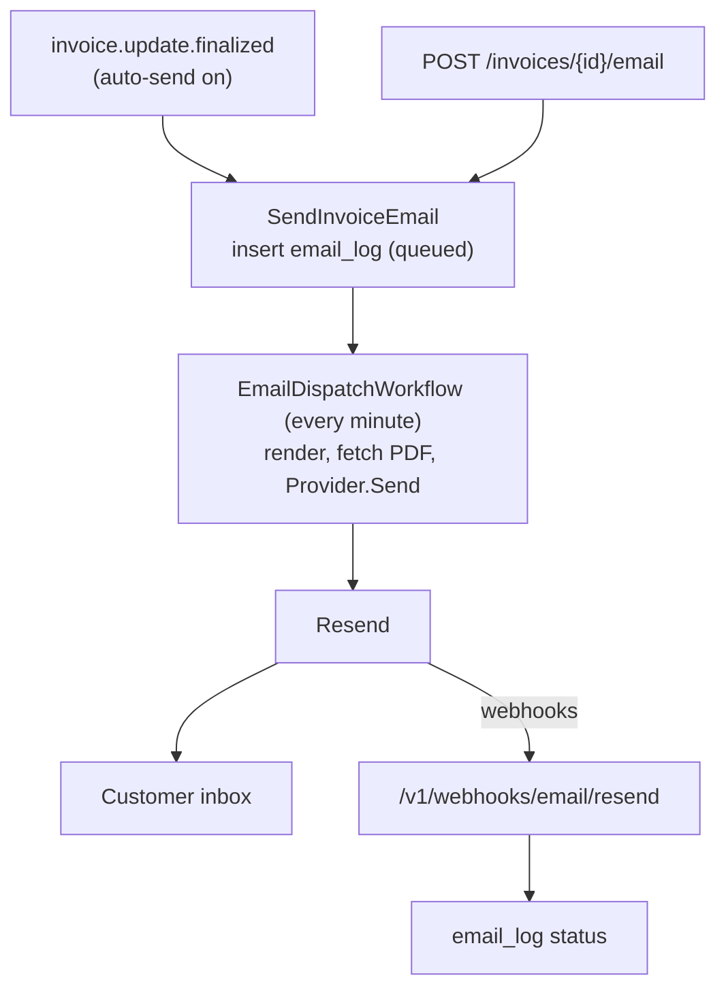
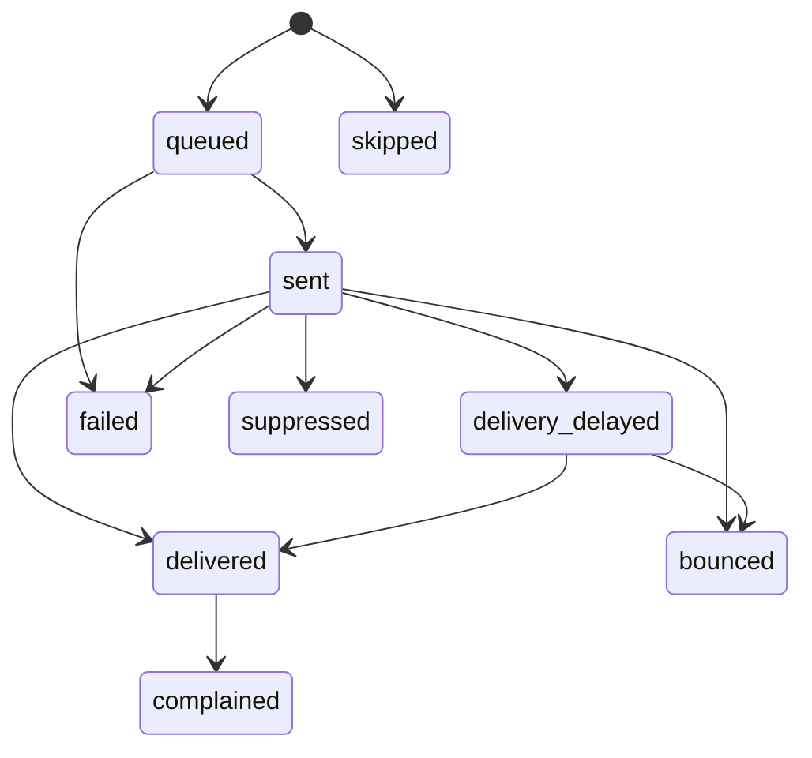

# Invoice Email — Phase 1 ERD

2026-11-06

## Problem

Flexprice does not email invoices. Tenants without their own email setup rely on the `invoice.communication.triggered` webhook, so their customers often never see the invoice. Stripe, Chargebee and Lago send these natively.

Phase 1 delivers:
- An email to the customer when an invoice is finalized (off by default, enabled per environment).
- A **Send email** action on any finalized invoice, even with auto-send off.
- A per-email record with delivery status.

The send path must stay generic: custom domains (Phase 2), receipts, payment failure and dunning reuse it later.

## Scope

| Area | Decision |
|---|---|
| Provider | Resend, behind a `Provider` interface |
| Account | Existing Resend account (us-east-1), shared by all regions, India included |
| Domain | New `mail.flexprice.io`; root `flexprice.io` stays with Supabase Auth |
| From | `"<Tenant name>" <invoices+<tenant_id>@mail.flexprice.io>`; `<tenant_id>` is the lowercased `tenant.id` (unique, immutable, no migration, same in sandbox and production) |
| Reply-To | Tenant `billing_details.help_email`, else `billing_details.email`; one is required |
| To / CC | `customer.email`; manual send can override |
| Trigger | `invoice.update.finalized` when auto-send is on; manual send always |
| Setting | Per environment, default off |
| Content | One template in code, hosted invoice link, PDF attached |
| Tracking | Resend webhooks update one status per email |
| Suppression | Owned by Resend; recorded as `suppressed` |

**Not in Phase 1:** custom domains, blocking sandbox sends, billing-entity sender settings, other email types, editable templates, open/click tracking, bring-your-own provider, cleanup of the unused `internal/email` service.

## Current state

| What | Where | Use |
|---|---|---|
| `invoice.update.finalized` event | `internal/types/webhook.go`, `internal/ee/service/revenue_hooks.go` | Auto trigger |
| Integration-events dispatch for finalized invoices | `internal/integration/events/dispatch.go` | Auto trigger joins its list |
| `GetInvoicePDFUrl` | `internal/ee/service/invoice.go` | PDF source order |
| Resend client, `renderTemplate()`, `EmailConfig` (unused today) | `internal/email/`, `internal/config/` | Reused for the adapter and config |

## Architecture

Auto and manual sends share one service, one dispatcher and one adapter. No new runtime component: API, consumer and Temporal worker only.



- Auto-send writes a `skipped` row instead of sending when the customer has no email or the invoice total is 0. Manual send still works for zero-amount invoices.
- Every region's webhook receives every event (one account); each region drops events whose `tags.region` is not its own.
- `email_log` changes reach the activity log through the existing Ent hook.

## Data model

New table `email_log` (`BaseMixin` + `EnvironmentMixin`):

| Column | Type | Notes |
|---|---|---|
| `id` | varchar(50) | `email_` prefix; Resend `Idempotency-Key` |
| `entity_type`, `entity_id` | varchar(50) | `invoice` + invoice id |
| `customer_id` | varchar(50) | Customer timeline, search |
| `template_key` | varchar(100) | `invoice_finalized` |
| `trigger` | varchar(20) | `auto` / `manual` |
| `from_address`, `reply_to` | varchar(320) | As sent |
| `to_addresses`, `cc_addresses` | jsonb | Arrays |
| `subject` | text | As sent |
| `provider` | varchar(20) | `resend` |
| `provider_message_id` | varchar(100), null | Set when the API accepts |
| `delivery_status` | varchar(30) | See Delivery tracking |
| `status_reason` | text, null | Provider detail |
| `sent_at`, `delivered_at` | timestamptz, null | |
| `metadata` | jsonb | Message-ID, PDF notes |

`delivery_status` is separate from `BaseMixin.status`, which stays `published` / `archived`. `created_by` / `created_at` record who requested the send and when, from the request context: the user who clicked Send, or for auto sends the actor that finalized the invoice.

Indexes:
- Unique `(provider, provider_message_id)` where not null: webhook lookup.
- `(tenant_id, environment_id, entity_type, entity_id, created_at DESC)`: invoice Emails panel.
- Partial unique `(tenant_id, environment_id, entity_id, template_key)` where `trigger = 'auto'`: one auto email per invoice.
- `(tenant_id, environment_id, delivery_status, created_at)`: search.

Setting `email_notification_config` (existing `settings` table; no row = off):

```json
{ "attach_invoice_pdf": true, "auto_send": { "enabled": false, "entities": ["invoice"] } }
```

Validation: when `enabled` is true, `entities` must be non-empty (only `invoice` in Phase 1) and the tenant must have `billing_details.help_email` or `billing_details.email`.

New entity types later = new `entities` value + `template_key`; billing entities later add a nullable `billing_entity_id`.

## Delivery tracking



| Resend event | Status |
|---|---|
| API 200 / `email.sent` | `sent` |
| `email.delivery_delayed` | `delivery_delayed` |
| `email.delivered` | `delivered` |
| `email.bounced` | `bounced` |
| `email.complained` | `complained` |
| `email.failed` | `failed` |
| `email.suppressed` | `suppressed` |

Handler rules:
- Verify the Svix signature; reject events older than 5 minutes.
- Drop (200) when `tags.region` ≠ `email.region_tag`, before any lookup or log. Drop unknown `provider_message_id` too.
- Forward only: `queued < sent < delivery_delayed < delivered < complained`; `bounced`, `failed`, `suppressed` are final. Replays change nothing, so no dedupe column.
- Never log webhook bodies (customer emails; staging sees prod events).
- No event 72 h after `sent`: UI shows "No delivery confirmation". No polling.

**Activity log:** register `email_log` in `internal/activity/entities.go`; each status update sets `activity.WithAction`. Actions: `created`, `skipped`, `sent`, `delivered`, `bounced`, `complained`, `failed`, `suppressed` (not `delivery_delayed`). `skipped` rows carry `status_reason`; with auto-send off nothing is written. The actor on `created` is `created_by`; status updates from webhooks and the dispatcher use `system`. `customer_id` links every entry to the customer's timeline. The snapshot drops `to_addresses`, `cc_addresses`, `status_reason` and `metadata` (`activity:"drop"`), as it does for customer contact data.

## APIs and UI

| Endpoint | Purpose | Permission |
|---|---|---|
| `GET/PUT /settings/email_notification_config` | Read / change auto-send | Existing settings rules |
| `POST /invoices/{id}/email` | Manual send; optional `to`, `cc` | `invoice:write` |
| `GET /invoices/{id}/emails` | Emails for an invoice | `invoice:read` |
| `POST /email-messages/search` | Filter by status, trigger, date, customer | `invoice:read` |
| `POST /v1/webhooks/email/{provider}` | Delivery events, Svix-signed | Public |

Manual send refuses: non-finalized invoices, no recipient, no tenant Reply-To, more than 50 To addresses.

UI: Settings → Email (toggle, entity picker, From/Reply-To preview); invoice **Send email** dialog and **Emails** panel. The existing Trigger communication action stays.

## Email template

A one-column copy of the hosted invoice page, with its labels and states.

| Part | Content |
|---|---|
| Subject | `Invoice <number> from <tenant name>` |
| Summary | Number, status badge (Due / Overdue / Paid), amount, due or paid date, Billed to, Invoice date |
| Button | `View invoice`, linking to the hosted invoice (paying happens there); none without a hosted link (the PDF is attached) |
| Charges | Groups with their lines (Go port of `toGroups()`), up to 10 lines then "+ N more", then subtotal, discounts, prepaid credits, tax, total, amount due |
| Footer | Tenant contact (`help_email` / `email`), Powered by Flexprice |

- `html/template`, 600 px tables, inline styles, fixed hex colours from portal tokens, plus a text part.
- **Hosted link:** issued at finalization. If `hosted_invoice.base_url` is empty or no active token exists, the email has no button. Invoices synced to Stripe use Stripe's hosted URL, as the page does.
- **Paid at finalization** (auto-charged): Paid badge, `Paid <date> with <method>`, same subject.
- **PDF:** same source order as `GetInvoicePDFUrl` (invoice `invoice_pdf_url`, then billing provider, then Flexprice's stored PDF), factored into one helper. Attach Flexprice's stored PDF, rendering and uploading it first if missing (never re-render a stored one: it freezes tax numbers). An invoice's own `invoice_pdf_url` is shown as a link; billing-provider PDFs (expiring links) and stored PDFs over Resend's 40 MB cap are not attached, noted in `metadata`.
- PDF bytes are fetched and sent inside the dispatch activity, never passed through Temporal payloads.
- `attach_invoice_pdf: false` sends no PDF. An email whose PDF is not ready waits up to 10 minutes, then goes without it (`metadata.pdf = unavailable`); it never blocks the email.

## One-time setup

1. Add `mail.flexprice.io` in Resend (us-east-1); add its DKIM, return-path MX, SPF and DMARC (`p=none`) records in Cloudflare via Terraform; verify.
2. Turn off open and click tracking.
3. One `sending_access` API key restricted to `mail.flexprice.io`, shared by all deployments.
4. One webhook per deployment → `/v1/webhooks/email/resend`, own signing secret each.
5. Config per deployment:

```yaml
email:
  enabled: true
  provider: resend          # local for local runs
  resend:
    api_key: ${FLEXPRICE_EMAIL_RESEND_API_KEY}
    webhook_secret: ${FLEXPRICE_EMAIL_RESEND_WEBHOOK_SECRET}
  sender_domain: mail.flexprice.io
  sender_local_part: invoices
  region_tag: us            # us | ca | in | staging
```

6. Staging smoke test: SPF, DKIM and DMARC all `PASS`.

## Implementation

```go
type Provider interface {
    Send(ctx context.Context, msg OutboundEmail) (SendResult, error)
    ParseEvents(ctx context.Context, body []byte, hdr http.Header) ([]DeliveryEvent, error)
    Name() types.EmailProvider // "resend" | "local"
}
```

- Resend adapter sends with `Idempotency-Key = email_log.id`, tags (tenant, environment, email id, region) and our own `Message-ID: <email_log.id@mail.flexprice.io>`.
- Service `internal/ee/service/email_notification.go`: `SendInvoiceEmail` loads invoice, customer, tenant and setting and inserts `queued`; nothing else happens in the request.
- `EmailDispatchWorkflow` (Temporal schedule, every minute, one run at a time) lists environments with queued emails, takes one email from each in turn (manual sends first, then oldest) and sends at most `email.send_rate_per_second`. A composer per `template_key` builds each email's content.
- An email that cannot be sent now stays `queued` and nothing is written: a 429 ends the run, three provider errors in a row end it, a PDF not ready waits. 4xx marks `failed`, and so does an email still queued after 24 hours.
- Auto trigger in the integration-events dispatch list; the one-auto-email index stops redelivery from double-sending.
- Everything ships behind `email.enabled` plus a set `email.provider`; with no provider, customer emails stay off.

## Testing

| Layer | Needs | Covers |
|---|---|---|
| Unit, fake `Provider` | Nothing | Setting validation, From/Reply-To, skip rules, status rank |
| Webhook handler | Signed fixtures in `testdata/` | Signature, region drop, forward-only, unknown id |
| Docker, `provider: local` | Nothing | Finalize / Send → dispatcher → `email_log` → activity log |
| Real Resend | API key + tunnel | Real send, PDF, delivery events via `delivered@`, `bounced@`, `complained@`, `suppressed@resend.dev` |

Real-Resend runs send only to the `@resend.dev` test addresses, never from the root `flexprice.io`, and the temporary tunnel webhook is deleted afterwards.
