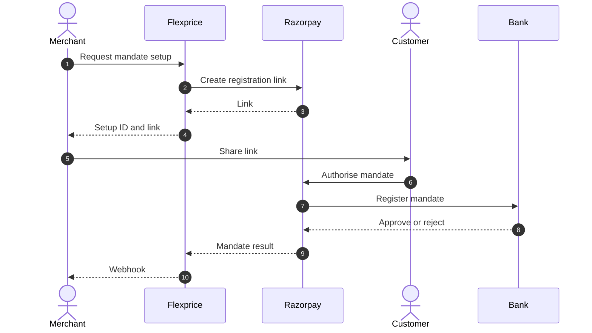
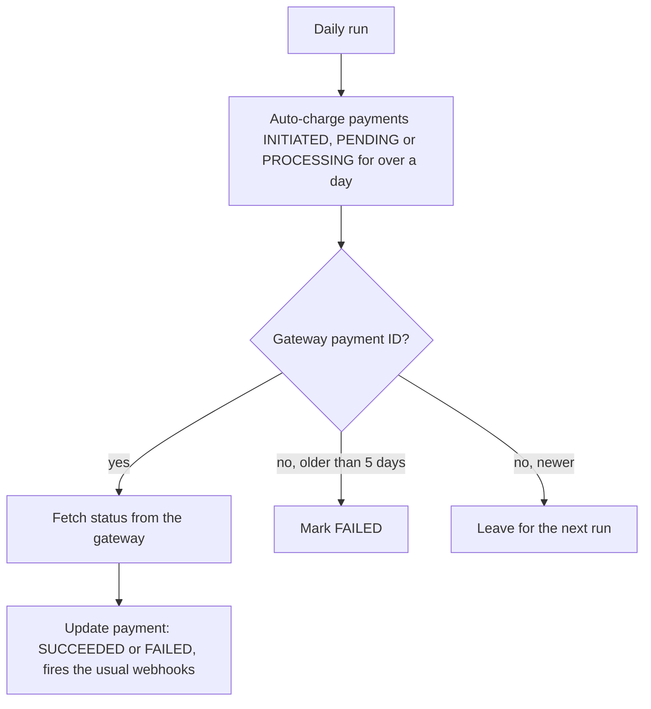

# Razorpay eNACH Mandates (ERD)

- **Date:** 2026-11-06
- **Author:** Harshit Gupta
- **Status:** Draft

---

## 1. Problem statement

- Merchants on Razorpay want their customers to pay recurring invoices straight from a bank account.
- Flexprice auto-charges only card and UPI mandates on Razorpay. RBI caps those at ₹15,000 per debit without extra authentication, below many B2B invoices.
- eNACH is NPCI's bank-account mandate. The customer approves it once on Razorpay's page, up to ₹1 crore, and the merchant debits invoices against it.
- Flexprice needs to let a merchant set up an eNACH mandate for a customer and charge `charge_automatically` invoices against it, without storing bank details or mandate records.
- eNACH debits settle in about 2 working days and can fail, so an invoice must not be voided, marked overdue or charged twice while a debit is in flight.


## 2. Setting up a mandate




## 3. What we store and what is passthrough


| Data                                                                       | Where it lives                                                                                      |
| -------------------------------------------------------------------------- | --------------------------------------------------------------------------------------------------- |
| Mandate (status, bank, IFSC, last 4 digits, auth type, max amount, expiry) | Razorpay. Read live on every request, never stored                                                  |
| Setup link (status, URL, expiry)                                           | Razorpay. The merchant keeps the setup ID                                                           |
| Mandate webhooks                                                           | Forwarded to the merchant, nothing stored                                                           |
| Flexprice customer to Razorpay customer                                    | Stored (existing integration mapping)                                                               |
| Each debit                                                                 | Stored as a Flexprice payment (existing): method eNACH, Razorpay payment ID, status, failure reason |
| Full account number, account holder name                                   | Never returned or logged                                                                            |


## 4. Our APIs


| API                                                                    | Change                                                                                                                    | Purpose                                                                              |
| ---------------------------------------------------------------------- | ------------------------------------------------------------------------------------------------------------------------- | ------------------------------------------------------------------------------------ |
| `POST /v1/payments/customers/:id/setup/intent`                         | Existing. Accepts `provider: razorpay` and optional `max_amount` (Razorpay default ₹99,999 when omitted)                  | Create the eNACH setup link. Returns `setup_intent_id`, `checkout_url`, `expires_at` |
| `GET /v1/payments/customers/:id/setup/intent/:setup_intent_id`         | New                                                                                                                       | Setup link status: issued, paid, cancelled, expired                                  |
| `POST /v1/payments/customers/:id/setup/intent/:setup_intent_id/cancel` | New                                                                                                                       | Cancel an unused setup link                                                          |
| `GET /v1/customers/:id/payment-methods`                                | Existing. Lists `ENACH` mandates with status, bank, IFSC, last 4 digits, auth type, max amount, expiry, `can_auto_charge` | Show the customer's mandates                                                         |
| `POST /v1/payments`                                                    | Existing. Accepts `payment_method_type: ENACH`                                                                            | Charge an invoice against the mandate                                                |
| `POST /v1/checkout/sessions`                                           | Existing. `charge_automatically` with payment method `ENACH` debits an existing mandate only, never sends a setup link    | Checkout against a mandate                                                           |
| Customer portal `POST /payment-methods`                                | Existing. For Razorpay, returns an eNACH setup link                                                                       | Customer adds a mandate themselves                                                   |
| `POST /v1/invoices/:id/void`                                           | Existing. Refused while a mandate payment is pending or processing                                                        | Protect in-flight debits                                                             |


## 5. Our webhooks


| Flexprice event                            | Fired on (Razorpay) | Change                                   |
| ------------------------------------------ | ------------------- | ---------------------------------------- |
| `mandate.confirmed`                        | `token.confirmed`   | New. Forwarded, nothing stored           |
| `mandate.rejected`                         | `token.rejected`    | New. Forwarded with the bank's reason    |
| `mandate.cancelled`                        | `token.cancelled`   | New. Forwarded                           |
| `payment.pending`                          | Debit submitted     | Existing                                 |
| `payment.success`                          | `payment.captured`  | Existing                                 |
| `payment.failed`, `invoice.payment.failed` | `payment.failed`    | Existing. Adds the bank's failure reason |


Payload, same for all three events (`status`: `confirmed`, `rejected` or `cancelled`):

```json
{
  "event_type": "mandate.confirmed",
  "mandate": {
    "id": "token_TwxczYRRFYNzcC",
    "customer_id": "cust_01M6KP4Q981MAT2PW9PPG29AFN",
    "provider": "razorpay",
    "type": "ENACH",
    "status": "confirmed",
    "failure_reason": null,
    "max_amount": "1000",
    "currency": "INR",
    "expires_at": "2066-11-06T16:44:35Z",
    "bank_account": {
      "bank": "HDFC",
      "ifsc": "HDFC0004118",
      "last4": "4361",
      "account_type": "savings",
      "auth_type": "aadhaar"
    }
  }
}
```

Rejected example: `"status": "rejected", "failure_reason": "Rejected by bank"`.

## 6. Daily status sync cron

A daily Temporal schedule settles payments whose webhook was missed.




- Covers card, UPI and eNACH on every gateway, using the existing gateway status lookup.
- A payment captured after it was marked FAILED is refunded.

