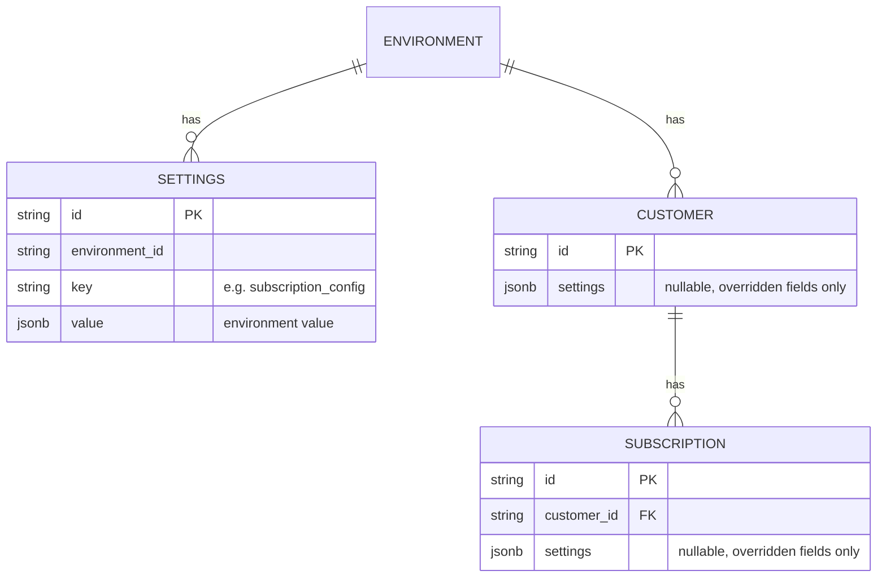

# Scoped Settings — Design ERD

Status: **Implemented**
Date: 2026-11-06
Author: Harshit Gupta

---

## 1. The Problem

Settings such as the grace period (`subscription_config.grace_period_days`) apply to the whole
environment. They cannot be changed for one customer or one subscription.

## 2. How Others Do It

C = customer, S = subscription. Each lower level overrides the one above it.


| Product   | Overridable                                                                                            |
| --------- | ------------------------------------------------------------------------------------------------------ |
| Chargebee | Net terms (C+S), auto-collection (C+S), consolidated invoicing (C)                                     |
| Lago      | Net payment term (C), invoice grace period (C), zero-amount invoice handling (C)                       |
| Orb       | Net terms (S), auto-collection (S), auto-issuance (C)                                                  |
| Recurly   | Net terms (C), invoice template (C), dunning campaign (C or plan)                                      |
| Stripe    | Days until due (S), collection method (S), invoice footer / custom fields / prefix (C), tax exempt (C) |


## 3. The Solution

Customers and subscriptions get a nullable `settings` column that holds their overrides.

- The column is keyed by setting key and stores only the overridden fields, e.g.
`{"subscription_config": {"grace_period_days": 10}}`.
- The effective value is built field by field, with the most specific level winning:
default → environment → customer → subscription.
- Only `grace_period_days` and `auto_cancellation_enabled` can be overridden today.
- An empty override is stored as NULL, never `{}`.
- The customer override comes from the subscription's `customer_id`, not `invoicing_customer_id`.
- A plan change copies the overrides to the new subscription. Inherited child subscriptions do not
  get a copy; they never invoice, so the crons never read their settings.
- Partial indexes on `(tenant_id, environment_id) WHERE settings IS NOT NULL AND status = 'published'`
  keep the auto-cancellation lookup cheap.
- The environment `settings` table is unchanged.


## 4. ERD



## 5. API Contract

`settings`, the same object on customers and subscriptions, in the shape it is stored. Every field is
optional; an unset field inherits from the level above.

```json
"settings": {
  "subscription_config": {
    "grace_period_days": 10,
    "auto_cancellation_enabled": true
  }
}
```

Added to:

- `POST /customers`, `PUT /customers`, `PUT /customers/{id}`
- `POST /subscriptions`, `PUT /subscriptions/{id}`
- The customer and subscription responses (stored overrides only).

The customer portal ignores `settings`, so a customer cannot change their own terms.

On `PUT`, an omitted `settings` keeps the stored overrides, an object replaces them, and `{}` clears them.

## 6. Cron Handling

Grace is applied when the cron runs, not stored on the invoice. Extending it covers invoices that
are already outstanding; shortening it can cancel a subscription on the next run. An override may set
a grace of 0: the subscription skips the incomplete state and, when auto-cancellation is enabled, is
eligible for cancellation right after the due date (the environment setting still requires at least 1).

**Auto-cancellation**

1. One query picks environments where auto-cancellation is on in the environment setting or in any
  customer or subscription override (the overrides are read from the partial indexes).
2. In each environment, list unpaid finalized subscription invoices that are past their due date.
3. Load those invoices' subscriptions and customers, which carry their `settings`.
4. For each subscription, resolve the effective config. Cancel when it is enabled and
  `now > due_date + grace_period_days`.

**Overdue marking**

The single `UPDATE … RETURNING` stays. Its grace window is resolved per row:
`COALESCE(subscription grace, customer grace, environment grace)`.