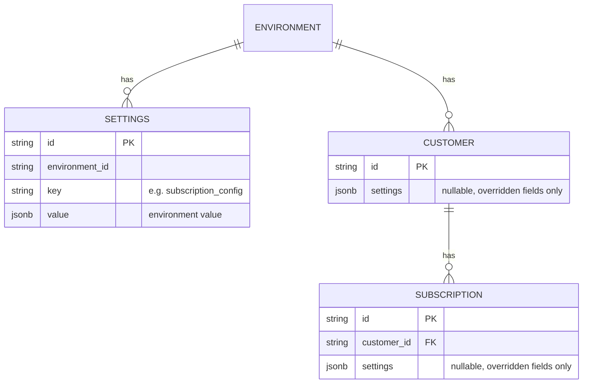

# Scoped Settings — Design ERD

Status: **Proposed**
Date: 2026-11-06
Author: Harshit Gupta

---

## 1. The Problem

Settings such as the grace period (`subscription_config.grace_period_days`) apply to the whole
environment. They cannot be changed for one customer or one subscription.

## 2. How Others Do It

C = customer, S = subscription. Each lower level overrides the one above it.


| Product   | Overridable                                                                                            |
| --------- | ------------------------------------------------------------------------------------------------------ |
| Chargebee | Net terms (C+S), auto-collection (C+S), consolidated invoicing (C)                                     |
| Lago      | Net payment term (C), invoice grace period (C), zero-amount invoice handling (C)                       |
| Orb       | Net terms (S), auto-collection (S), auto-issuance (C)                                                  |
| Recurly   | Net terms (C), invoice template (C), dunning campaign (C or plan)                                      |
| Stripe    | Days until due (S), collection method (S), invoice footer / custom fields / prefix (C), tax exempt (C) |


## 3. The Solution

Customers and subscriptions get a nullable `settings` column that holds their overrides.

- The column is keyed by setting key and stores only the overridden fields, e.g.
`{"subscription_config": {"grace_period_days": 10}}`.
- The effective value is built field by field, with the most specific level winning:
default → environment → customer → subscription.
- Only allow-listed fields can be overridden.
- The environment `settings` table is unchanged.


## 4. ERD



## 5. API Contract

`BillingSettings`, the same object on customers and subscriptions. Every field is optional; an unset
field inherits from the level above.

```json
"billing_settings": {
  "grace_period_days": 10,
  "auto_cancellation_enabled": true
}
```

Added to:

- `POST /customers`, `PUT /customers`
- `POST /subscriptions`, `PUT /subscriptions/{id}`
- The customer and subscription responses (stored overrides only).

The object is stored under `subscription_config` in the entity's `settings` column.

## 6. Cron Handling

**Auto-cancellation**

1. Pick environments where auto-cancellation is on at environment level, or where any customer or
  subscription has a `subscription_config` override.
2. In each environment, list unpaid finalized subscription invoices.
3. Load those invoices' subscriptions and customers, which carry their `settings`.
4. For each invoice, resolve the subscription's effective config. Cancel when it is enabled and
  `now > due_date + grace_period_days`.

**Overdue marking**

The environment grace period is removed from the SQL. Candidate subscriptions are fetched, and each
is marked incomplete only while `now <= due_date + its effective grace_period_days`.