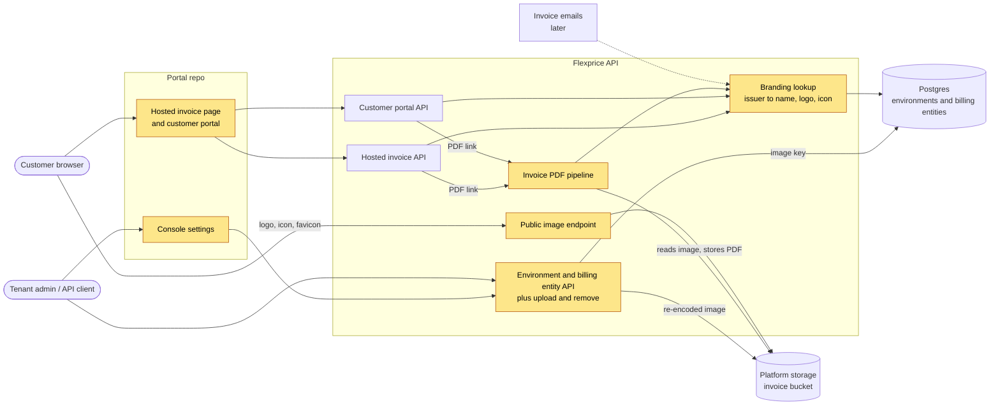
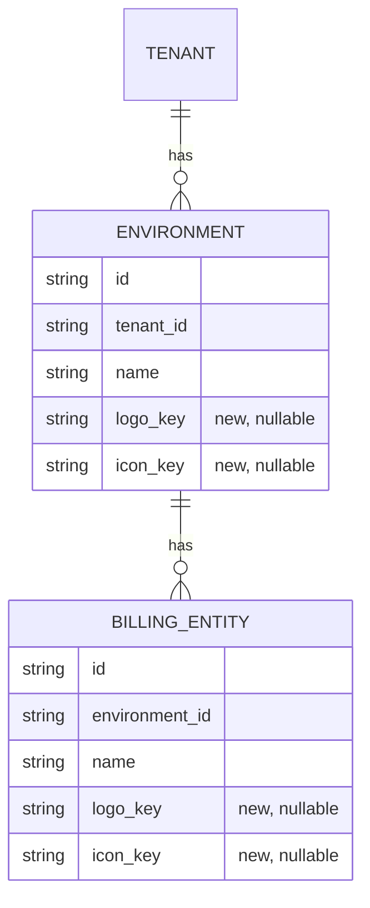
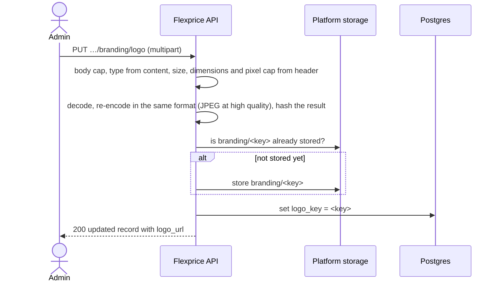
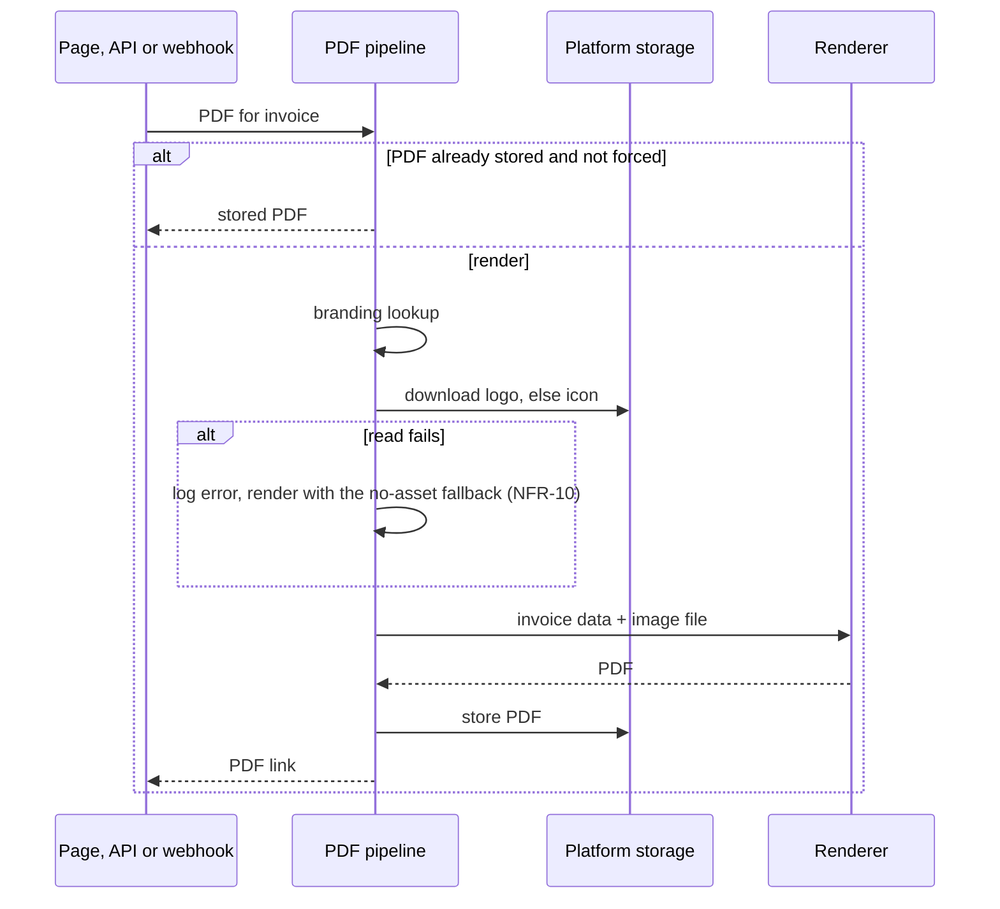

# Tenant branding: logo and icon — Design ERD

Status: In review · Owner: Paras Aghija · Last updated: 2026-11-12
Links: FLE-2316 · Billing entities P1 ERD · Billing entities P2 ERD

## 1. Requirement
<!-- erd:locked -->

**Today.** No tenant, environment or billing entity can store a logo or an icon. The issuer (the tenant, or the billing entity that bills the customer) appears as text at most. The invoice PDF prints a large "Invoice" title and the issuer's name in the From block. The hosted invoice page shows the issuer's name above the invoice. The customer portal header says only "Billing", and the portal names the issuer nowhere; at most it carries a brand colour. The browser tab on the hosted invoice page and the portal always shows the Flexprice favicon.

**Gap.** A customer who receives an invoice or opens the portal sees no logo they recognise, and the portal never says who is billing them. A tenant cannot put its logo on these surfaces, cannot keep a test logo in a sandbox used for a proof of concept apart from production, and cannot show a different logo per billing entity. Stripe and Chargebee both offer a logo plus a square icon.

**Outcome.** A tenant sets a logo and an icon for each environment and can give each billing entity its own. The invoice PDF, the hosted invoice page and the customer portal show the issuer's brand, and their browser tabs show the issuer's icon. With nothing uploaded, the surfaces show the issuer's name, the PDF keeps today's layout, and tabs keep the Flexprice favicon. Invoice emails can reuse the same logo and icon when they ship, with no new upload or storage work.

## 2. Use cases
<!-- erd:locked -->

**UC1 — Tenant admin sets an environment's logo and icon.**
1. Opens the console's settings for the environment (for example, a sandbox used for a proof of concept, or production).
2. Uploads a logo, an icon, or both.
3. That environment's hosted invoice pages and customer portal show them on the next load (UC3, UC4); its PDFs rendered from then on show them too (UC5). Other environments are unaffected.

Variation: the file is rejected (not PNG or JPEG, too large, too small, or an icon that is not square); the message names the problem and the current asset stays.
Variation: the admin removes the logo or the icon; surfaces fall back as if it was never uploaded.
Variation: an API client uploads, removes or reads the assets through the API instead of the console.

**UC2 — Tenant admin gives a billing entity its own logo and icon.**
1. With billing entities enabled, opens a billing entity in the console.
2. Uploads a logo, an icon, or both.
3. That entity's invoices, and the portal of customers it bills, use the entity's assets.

Variation: the entity has only one of the two; its surfaces use only that asset (for example, its icon next to its name) and never mix in the environment's.
Variation: the entity has neither; its surfaces use its environment's assets.
Variation: the rejection and removal paths of UC1 apply per entity.
Variation: billing entities are off; the console offers no per-entity upload and every surface uses the environment's assets.

**UC3 — Customer opens a hosted invoice link.**
1. Clicks the invoice link they received.
2. Sees the issuer's logo above the invoice and the issuer's icon in the browser tab.

Variation: the issuer has no logo; the page shows the icon next to the issuer's name, or the name alone if there is no icon.
Variation: the issuer has no icon; the tab shows the Flexprice favicon.

**UC4 — Customer opens the customer portal.**
1. Opens the portal link the tenant shared.
2. Sees the issuer's logo, then "Billing", in the header, and the issuer's icon in the browser tab. The issuer is the customer's billing entity when billing entities are on, else the tenant.

Variation: same fallbacks as UC3.

**UC5 — Customer reads the invoice PDF.**
1. Opens the PDF from the hosted invoice page, the portal, or a link the tenant sent.
2. Sees the issuer's logo at the top of the first page.

Variation: the issuer has no logo; the PDF shows the icon next to the issuer's name, or today's layout if there is no icon.
Variation: the PDF was rendered before the logo or icon changed; it keeps the look it was rendered with, since a rendered PDF is stored and served again until it is regenerated.
Variation: the invoice's PDF comes from a connected billing provider or an external PDF link; it carries that source's look, not this branding.

## 3. Scope
<!-- erd:locked -->

**In**
- Logo and icon on each environment (UC1).
- Logo and icon on each billing entity, when billing entities are enabled (UC2).
- Upload, remove and read of these assets in the console settings and the API (UC1, UC2).
- Asset links that customer-facing pages can load without signing in (UC3, UC4).
- Hosted invoice page: header and browser tab (UC3).
- Customer portal: header and browser tab (UC4).
- Invoice PDF header (UC5).
- The same issuer assets available to invoice emails later, with no new upload or storage work (§1 outcome).

**Out**
- The console's own invoice preview.
- Themes, light and dark modes, and brand colours beyond what exists today.
- Invoice emails themselves (only the pluggability above is in).
- Re-rendering PDFs already stored when branding changes.
- PDFs supplied by a connected billing provider or an external link.
- SVG uploads.
- A CDN in front of the assets.
- The legacy dashboard (flexprice-front); frontend work is in the portal repo only.

## 4. Functional requirements
<!-- erd:locked -->

**Managing assets**

| ID | Requirement | UC | Acceptance criteria |
|---|---|---|---|
| FR-1 | A tenant admin or API client can upload an environment's logo and icon as a file upload (multipart form), one asset per request. Each environment has its own pair. | UC1 | Uploading a valid PNG logo to a sandbox returns success; reading that environment returns a logo URL that serves a PNG of the same pixel size, and the production environment returns none. |
| FR-2 | Only PNG and JPEG are accepted, judged from the file's content, not its name or declared type. | UC1, UC2 | A GIF renamed to `.png` is rejected with a message naming the allowed formats. |
| FR-3 | Files over 512 KB are rejected. | UC1, UC2 | A 513 KB PNG is rejected with a message stating the limit. |
| FR-4 | An icon must be square and at least 128 × 128 px. A logo must be at least 128 px on each side. | UC1, UC2 | A 200 × 100 icon, a 100 × 100 icon and a 600 × 100 logo are each rejected with a message naming the rule broken; a 600 × 128 logo is accepted. |
| FR-5 | A rejected upload leaves the current asset unchanged. | UC1, UC2 | After a rejected upload, reading the environment returns the same URL as before. |
| FR-6 | A tenant admin or API client can remove the logo or the icon. | UC1 | After removal, reading the environment returns no URL for that asset and surfaces show its fallback (FR-12–FR-16). |
| FR-7 | Reading an environment returns absolute logo and icon URLs, or none for an asset not uploaded. | UC1 | Read after upload and after removal returns the expected URLs. |
| FR-8 | FR-1–FR-7 also apply to a billing entity's logo and icon. Entity uploads and removals are rejected unless billing entities are enabled for the environment, as other billing entity reads and writes are. | UC2 | With billing entities enabled, an entity upload succeeds and reads back; in an environment where they are not enabled, it is rejected with the existing "not enabled" message. |
| FR-9 | The console's environment settings and billing entity page let an admin upload, replace and remove each asset and show the current one. | UC1, UC2 | In the console, uploading, replacing and removing each asset is reflected after reload. |

**Choosing the issuer's assets**

| ID | Requirement | UC | Acceptance criteria |
|---|---|---|---|
| FR-10 | An invoice's issuer is the same one whose name its PDF and hosted page show: for a finalized invoice, the billing entity recorded when it was finalized; for a draft, the invoice's billing entity; with neither, the tenant. The customer portal's issuer is the customer's billing entity (its own, or the default) when billing entities are enabled, else the tenant. | UC3–UC5 | A customer of entity A sees A's assets on its invoices and portal. A finalized invoice with no recorded entity shows its environment's assets. |
| FR-11 | An issuer entity with at least one asset uses only its own assets; one with none uses its environment's. When the issuer is the tenant, the assets are those of the environment the invoice or customer belongs to. Assets are read at render time, not copied onto the invoice. | UC2 | Entity with only an icon in an environment with a logo: wide slots show the entity's icon and name. Entity with neither: the environment's logo shows. After the entity's logo changes, the hosted page of an earlier finalized invoice shows the new logo. |

**Customer-facing surfaces**

| ID | Requirement | UC | Acceptance criteria |
|---|---|---|---|
| FR-12 | The hosted invoice page header shows the issuer's logo; with no logo, the icon next to the issuer's name; with neither, the name alone. | UC3 | Each of the three cases renders as stated. |
| FR-13 | The hosted invoice page and customer portal browser tabs show the issuer's icon; with no icon, the Flexprice favicon. A logo is never used as the tab icon. | UC3, UC4 | Issuer with only a logo: tab shows the Flexprice favicon. |
| FR-14 | The customer portal header shows the issuer's brand by the FR-12 rule, followed by "Billing". | UC4 | With nothing uploaded, the header shows the issuer's name and "Billing". |
| FR-15 | A newly rendered invoice PDF shows the issuer's logo at the top of the first page; with no logo, the icon next to the issuer's name; with neither, today's layout. | UC5 | Rendering in each of the three cases produces the stated header. |
| FR-16 | A stored PDF is not re-rendered when branding changes; regenerating it through the existing force-regenerate option picks up the current branding. | UC5 | After a logo change, the stored PDF is unchanged; a forced regeneration shows the new logo. |
| FR-17 | The hosted invoice and customer portal responses carry the issuer's name and absolute logo and icon URLs that load without signing in, including as images on a page served from another origin. | UC3, UC4 | The URLs from both responses render as images on a page from another origin, in a browser with no session. |
| FR-18 | The customer portal shows the issuer's name wherever it now says "your account team" or leaves the issuer blank (invoice sheet, contact line, no-payment notice, plans card). Square marks beside the name show the issuer's icon, or nothing when there is no icon; no letter tile is drawn. | UC4 | With an icon: the invoice sheet shows the icon and "From <issuer>". With no icon: name only, no letter tile. The no-payment notice names the issuer. |

## 5. Non-functional requirements
<!-- erd:locked -->

| ID | Category | Requirement (measurable) | How we verify |
|---|---|---|---|
| NFR-1 | Security | Uploads are decoded and re-encoded before storage, so the stored image carries no metadata or bytes beyond the pixels. | e2e: upload a JPEG with EXIF location data; the served image has no EXIF. |
| NFR-2 | Security | An image whose header declares more than 4 million pixels (for example 2048 × 2048) is rejected before it is fully decoded. | Unit: a small file declaring 20000 × 20000 px is rejected without allocating the full bitmap. |
| NFR-3 | Security | An upload request body over 1 MiB is cut off while it is read, before the form is parsed. | e2e: a 2 MiB request body returns 400. |
| NFR-4 | Security | Image responses carry the stored type as `Content-Type` and `X-Content-Type-Options: nosniff`. | e2e: response headers checked. |
| NFR-5 | Security | Upload and remove require the same permission as updating the environment or the billing entity. | e2e: a role without that write permission gets 403. |
| NFR-6 | Multi-tenancy | Upload and remove change only an environment of the caller's tenant, or a billing entity in the caller's tenant and environment. | e2e: an upload to another tenant's environment, or to a billing entity in another tenant or environment, returns 404 and changes nothing. |
| NFR-7 | Security | The public image endpoint rejects any key not in the stored-key format without calling storage. | e2e: a malformed key returns 404. Unit: no storage call is made. |
| NFR-8 | Performance | Images are served with `Cache-Control: public, max-age=31536000, immutable` and an `ETag`; a matching `If-None-Match` returns 304. No server-side image cache in v1. | e2e: headers and 304 checked. |
| NFR-9 | Availability | A stored image is never deleted; a URL handed out keeps serving after the asset is replaced or removed. | e2e: replace a logo; the old URL still returns 200 with the old image. |
| NFR-10 | Availability | If an image cannot be read while rendering a PDF, the PDF still renders with the FR-15 fallback for a missing asset, and the failure is logged. That PDF is stored like any other; a forced regeneration (FR-16) restores the branding. | Unit: a failing image read produces a PDF with the fallback header and an error log. |
| NFR-11 | Compatibility | Upload, storage and serving work unchanged on S3 (AWS), GCS (GCP) and S3-compatible on-prem storage. | e2e on local Docker with S3-compatible storage; smoke test on staging (GCP). |
| NFR-12 | Accessibility | Logo and icon images on the hosted invoice page and portal carry the issuer's name as alt text. | e2e: DOM check. |

## 6. Constraints
<!-- erd:locked -->

| Constraint | Source | Impact on the design |
|---|---|---|
| The API has no file upload today, neither multipart nor base64. Multipart is an agreed deviation. | Existing API conventions | FR-1 and FR-8 add the first multipart endpoints; NFR-3 needs its own per-route body cap, since there is no global one. |
| A tenant has several environments, and a billing entity belongs to one environment. | Existing data model | Branding is set per environment, so a sandbox's assets never reach production; entity assets apply only in the entity's environment (FR-1, FR-8, NFR-6). |
| Billing entities only move forward from off to on, and no entity exists while they are off. | Billing entities | FR-8's rejection while off matches every other billing-entity call. |
| Presigned storage links expire within 7 days. | S3 and GCS | They cannot back links in pages or future emails; FR-17 and NFR-9 need a stable public address. |
| The PDF renderer takes image files or bytes, not URLs. | Typst | The PDF path reads the image from storage before rendering (FR-15, NFR-10). |
| Hosted invoice and portal pages are served from a different origin than the regional API. | Existing deployment | Image URLs must be absolute (FR-17). Only SAML has a deployment API address in config today, so a general one is needed. |
| Platform storage is off by default (S3 and GCS both disabled); PDF links then fail with a system error worded for PDFs. | Existing storage setup | Upload and the image endpoint need their own message for this case. Local e2e needs S3-compatible storage switched on (NFR-11). |
| No rate limiting exists on any API route; only the event consumers are throttled. | Existing API | NFR-7's format check is the only guard on the public image endpoint; with no server cache (NFR-8), each well-formed unknown key costs one storage read. |
| The existing public route group requires a hosted invoice token on every request and marks responses `no-store`. | Existing hosted invoice API | The image endpoint must sit outside that group to serve without a token and with NFR-8's caching. |
| Environments and billing entities are not recorded in the activity log. | Activity log | Asset uploads and removals leave no activity entry in v1. |
| A rendered PDF is stored and re-rendered only on a forced regeneration. | Existing invoice PDFs | FR-16 and NFR-10 follow from this. |
| The console calls most of the API through the SDK, which publishes only on a manual release; environment calls, the hosted invoice page and the portal use plain requests, since the SDK has no routes for them. | Portal repo, release process | The billing entity upload screen (FR-9) waits for an SDK release; the environment screen and the hosted page and portal changes (FR-12–FR-14) do not. |
| Customer invoice emails are still in development, outside this work. | In-flight work | Only the reuse described in Scope is built now. |

## 7. Current state – what we reuse
<!-- erd:locked -->

| Piece | What it gives us | Reuse as-is / extend / replace |
|---|---|---|
| Platform storage | Upload, download and existence checks on Flexprice-owned buckets, chosen per deployment; callers pick a bucket by purpose (invoice, export, import). Existence checks report not-found the same way on S3 and GCS; download reports every failure, not-found included, as a server error. No delete operation exists | Extend: a branding purpose that resolves to the invoice bucket under its own key prefix, so no new bucket or infra; image content types added to uploads; download reports not-found distinctly; the storage-off check extended to it |
| Security headers | `nosniff` on every API response | Reuse as-is |
| Request body limit | Cuts a request body off while it is read | Reuse as-is, set to 1 MiB on the upload routes |
| Environment API and its write permission | Environment read, update and clone; writes guarded by environment write permission; responses have their own shape, separate from the stored record | Extend: logo and icon URLs on read; upload and remove endpoints under the same permission |
| Billing entity API and its gating | Entity read and update, rejected while billing entities are off | Extend: same as the environment |
| Invoice issuer resolution | The billing entity that issued an invoice (frozen on finalized invoices, stored on drafts), else the tenant | Reuse as-is for FR-10 |
| Customer's billing entity | The entity that bills a customer, else the default entity, when billing entities are on | Reuse as-is for FR-10 |
| Hosted invoice API | Token-scoped invoice view whose tenant block already carries the issuer's name and billing details | Extend: logo and icon URLs in the tenant block |
| Customer portal session and responses | Session-scoped customer reads; the config response is the environment's stored portal setting as is (version, theme colours, sections, analytics) | Extend: issuer name, logo and icon URLs on a customer-scoped portal response, since the issuer is per customer and the config is a stored setting |
| Invoice PDF pipeline | Renders on first request, stores the PDF, re-renders on a forced regeneration | Extend: read the issuer's image and pass it to the renderer |
| Invoice PDF template | An unused image slot at the top left, beside the "Invoice" title | Extend: fill it with the logo; add the icon-and-name variant |
| Console settings | Environment settings panels and billing entity pages | Extend: upload, replace and remove controls (FR-9) |
| Hosted invoice page and portal surfaces | Page header and title. The portal shell accepts an issuer name, today passed empty; given one, it shows a letter tile and the name in the header, and the name replaces "your account team" in the invoice sheet (letter tile, From, contact line), the no-payment-method notice and the plans card | Extend: issuer name passed in (FR-18); the letter tile becomes the issuer's icon, or is dropped when there is no icon (FR-14, FR-18); logo in the header; favicon set from the icon |
| Static Flexprice favicon | The tab icon on every page | Reuse as-is as the fallback (FR-13) |
| Image decoding and hashing | No image library in the backend's dependencies; the language's standard library decodes and encodes PNG and JPEG and computes SHA-256 | Reuse the standard library; no new dependency |
| Public cached binary endpoint | None exists: the only binary response is the authenticated PDF download, and the only cache header is the hosted invoice `no-store` | New |
| Deployment API address | Exists only inside the SAML settings | Not reused; a general setting is added |

## 8. Solution overview
<!-- erd:locked -->



Highlighted pieces are new or extended; the dashed line is future reuse.

**Main flow (UC1 then UC3–UC5)**
1. An admin uploads a logo or icon from the console or the API.
2. The API checks the request size, the file type from its content, and the image dimensions, then re-encodes the image.
3. The re-encoded image is stored under its tenant and environment, named by its content hash; the environment or billing entity records that key. Nothing already stored is removed.
4. A customer opens the hosted invoice page or the portal, which calls its existing API.
5. That API works out the issuer (FR-10) and runs the branding lookup (FR-11), which returns the issuer's name and logo and icon URLs built on the deployment's public API address.
6. The page draws the header and sets the tab icon; the browser loads the images from the public image endpoint, which reads them from storage and returns them with long-lived cache headers.
7. On the first request for a PDF (from these pages, the API or an invoice webhook), the PDF pipeline runs the same lookup, reads the image from storage, renders the PDF and stores it.

## 9. Detailed design
<!-- erd:locked -->

### 9.1 Data model



| Table | Column | Type | Null | Default | Why |
|---|---|---|---|---|---|
| environments | logo_key | character varying | yes | null | Image key of the environment's logo; null means not uploaded. |
| environments | icon_key | character varying | yes | null | Image key of the environment's icon; null means not uploaded. |
| billing_entities | logo_key | character varying | yes | null | Image key of the entity's logo; null means the entity has none. |
| billing_entities | icon_key | character varying | yes | null | Image key of the entity's icon; null means the entity has none. |

- **Image key:** `<tenant id>/<environment id>/<sha256 of the stored bytes, hex>.<png|jpg>`, for both environment and billing entity assets. The extension sets the served `Content-Type`. Scoping by tenant and environment keeps each owner's images apart, so a later clean-up of a tenant or an environment touches no one else. The stored image can be larger than the upload after re-encoding; the 512 KB limit applies to the upload.
- **Storage object:** the key under a `branding/` prefix in the invoice bucket, through a new branding storage purpose (section 7).
- **Migration:** optional string fields on both ent schemas, and the four nullable columns added in one versioned SQL migration; no backfill. Null is "not uploaded", which is a real state, not a default.
- **Environment clone:** does not copy the logo or icon; a cloned environment starts with none, as clone today copies only features and plans.
- **Config:** `branding.base_url`, the deployment's public API origin (scheme and host, for example `https://us.api.flexprice.io`), named like the existing `hosted_invoice.base_url`, `checkout.base_url` and `auth.saml.base_url`. Image URLs are `<base_url>/v1/branding/images/<image key>`. When it is empty, URL fields are omitted and surfaces show their fallbacks, as an empty `hosted_invoice.base_url` already yields no hosted links.

### 9.2 API contracts

**Upload an asset**
- `PUT /v1/environments/{id}/branding/{asset}` and `PUT /v1/billing-entities/{id}/branding/{asset}`, where `{asset}` is `logo` or `icon`.
- Auth: API key or session with environment write (environment route) or billing entity write (entity route) permission.
- Request: `multipart/form-data` with one part `file`.
- Response `200`: the updated environment or billing entity, as its existing update endpoint returns it, including the new URL fields.
- Any error leaves the current key unchanged (FR-5). Errors:

| Status | When |
|---|---|
| 400 | No `file` part; body over 1 MiB (NFR-3); not PNG or JPEG by content (FR-2); over 512 KB (FR-3); under 128 px on a side, or an icon that is not square (FR-4); over 4 million pixels (NFR-2). The message names the rule. |
| 400 | Entity route while billing entities are not enabled, with the same error other billing-entity calls return (FR-8). |
| 403 | Missing write permission (NFR-5). |
| 404 | Environment not in the caller's tenant, or billing entity not in the caller's tenant and environment (NFR-6). |
| 500 | Platform storage switched off or without a bucket, with a message saying branding storage is not configured (the existing storage errors are worded for PDFs). |

**Remove an asset**
- `DELETE /v1/environments/{id}/branding/{asset}` and `DELETE /v1/billing-entities/{id}/branding/{asset}`.
- Clears the key only; the stored image stays (NFR-9). Removing an asset that is not set succeeds.
- Response `200`: the updated environment or billing entity. Errors as for upload, minus the file errors.

**Read**
- Every environment and billing entity response gains two fields, omitted when not set. The stored keys themselves are not returned.

```json
{
  "id": "be_01…",
  "name": "Acme India",
  "logo_url": "https://us.api.flexprice.io/v1/branding/images/tenant_01…/env_01…/9f2c…e1.png",
  "icon_url": "https://us.api.flexprice.io/v1/branding/images/tenant_01…/env_01…/41ab…7d.png"
}
```

**Serve an image**
- `GET /v1/branding/images/{tenant_id}/{environment_id}/{file}`, in the existing unauthenticated `/v1` route group, outside the hosted invoice token group (section 6). The global CORS and security headers it inherits do not block cross-origin `` loads.
- `200`: image bytes, `Content-Type` from the key's extension, `Cache-Control: public, max-age=31536000, immutable`, `ETag` set to the quoted hash (NFR-4, NFR-8).
- `304`: `If-None-Match` matches.
- `404`: the path does not match `<tenant id>/<environment id>/<64 hex>.<png|jpg>`, or storage reports no such object (download extended to say so, section 7). The format check runs before storage (NFR-7).
- `500`: any other storage failure, sent without the caching headers. Each id segment is 1–50 letters, digits, `_` or `-`: ids are usually prefixed ULIDs (`tenant_…`, `env_…`), but the self-hosted default tenant is a bare all-zero UUID, so a strict prefix check would break it.

**Issuer branding on customer-facing responses**
- The hosted invoice response's `tenant` block gains `logo_url` and `icon_url` for the invoice's issuer (FR-17). Its `name` stays the frozen issuer name.
- New `GET /v1/customer/portal/branding` (portal session), a small computed read like the portal's `/integrations`, returns the customer's issuer; URL fields are omitted when not set:

```json
{
  "name": "Acme India",
  "logo_url": "https://us.api.flexprice.io/v1/branding/images/tenant_01…/env_01…/9f2c…e1.png"
}
```

### 9.3 Flows

**Upload**



**Branding lookup** (one function used by the hosted invoice API, the portal API, the PDF pipeline and, later, emails)
1. Find the issuer (FR-10). For an invoice, the billing entity ID from its frozen snapshot, or a draft's own entity; the name comes from the invoice as today. For the portal, the customer's billing entity, else the tenant.
2. If the issuer is a billing entity with a logo or an icon, use the entity's two keys; otherwise use the two keys of the invoice's or customer's environment (FR-11).
3. Return the name, and an absolute URL for each key that is set.

**PDF render**



The template fills its existing top-left image slot with the logo. With only an icon, it shows the icon next to the issuer's name in the same slot. With neither, today's layout is unchanged (FR-15).

### 9.5 Frontend (portal repo)

| Surface | Change | States |
|---|---|---|
| Console, environment settings | A Branding panel for the current environment with Logo and Icon rows: current image, Upload or Replace (PNG/JPEG picker), Remove. It calls the environment routes with a plain request, like the console's existing environment calls, not a settings key. | Empty, uploading, set, error (backend message shown as is). |
| Console, billing entity page | The same block for the entity. Already hidden while billing entities are off. | As above. |
| Hosted invoice page | Header: logo; else icon next to the name; else the name (FR-12). Tab: set the page icon to `icon_url` once it has loaded; otherwise keep the static Flexprice favicon (FR-13). | Loading state unchanged. An image that fails to load is treated as not uploaded: the header and tab switch to the no-asset layout. |
| Customer portal | Load `/customer/portal/branding`. Header: logo; else icon next to the name; else the name; then a muted "Billing" (FR-14). Pass the name to the portal shell so the invoice sheet, contact line, no-payment notice and plans card name the issuer; the square mark shows the icon or nothing (FR-18). Tab as on the hosted page. | If the branding call fails, today's header and wording stay. An image that fails to load is treated as not uploaded, as on the hosted page. |

Alt text on every logo and icon is the issuer's name (NFR-12). Only the billing entity screen needs the SDK release (section 6).

## 10. Cross-cutting concerns
<!-- erd:locked -->

| Concern | How the design handles it | NFR |
|---|---|---|
| Upload safety | Body cap while reading, type from content, size, dimensions and pixel cap from the header before decoding, then a full re-encode; only PNG and JPEG are ever stored. | NFR-1, NFR-2, NFR-3 |
| Serving safety | Exact `Content-Type` from the stored extension plus `nosniff`; the path is validated before storage is touched. | NFR-4, NFR-7 |
| Access control | Upload and remove reuse environment and billing entity write permission; lookups are scoped to the caller's tenant and environment. | NFR-5, NFR-6 |
| Privacy | Logos are public by nature. Metadata such as EXIF location is stripped on upload. Public URLs contain the tenant and environment IDs, which are not credentials. | NFR-1 |
| Observability | Rejected uploads return a message naming the rule and are not logged as errors. Storage failures on upload, on the image endpoint and during PDF rendering are logged with the tenant, environment and entity IDs. | NFR-10 |
| Failure: storage off or unreachable | Upload returns 500 with a branding-specific message and keeps the current key. The image endpoint returns 500 without caching headers, so nothing bad is cached; the hosted page and portal treat the failed image as not uploaded and show the no-asset layout, with the Flexprice favicon in the tab. PDF rendering falls back to the no-asset header. | NFR-10, NFR-12 |
| Failure: public address not configured | URL fields are omitted, and every surface shows its no-asset fallback. | — |
| Failure: portal branding call fails | The portal keeps today's header and wording. | — |
| Idempotency and concurrency | The same image always produces the same key, so a repeated upload stores nothing new. Two concurrent uploads to one asset end with the last write's key; both images stay stored. | NFR-9 |
| Performance and caching | Browsers may cache each image for a year, and a new upload gets a new URL, so nothing needs invalidating. No server cache in v1. A PDF render adds one storage read. | NFR-8 |
| Backward compatibility | New columns are nullable with no backfill, and new response fields are omitted when unset, so existing clients see no change. Stored PDFs are untouched. | — |
| Portability | Storage goes through the existing provider abstraction, unchanged on S3, GCS and S3-compatible storage. | NFR-11 |

## 11. Risks & open questions
<!-- erd:locked -->

**Risks**

| Risk | Likelihood / Impact | Mitigation |
|---|---|---|
| Requests for random well-formed image paths each cost one storage read, and no rate limiting exists. | Low / Medium | Path check before storage; a storage "not found" is cheap. Add per-IP limits or a CDN if abuse appears. |
| The invoice bucket's lifecycle rules, if any, could expire the branding prefix and break links. | Low / High | Infra checks lifecycle rules on the invoice bucket in every region before release. |
| Public image URLs reveal tenant and environment IDs to anyone who sees a page or, later, an email. | Medium / Low | The IDs grant nothing without an API key or session token; URLs carry no other data. |
| A rebranded billing entity shows its new logo next to its old frozen name on earlier finalized invoices. | Medium / Low | Accepted: the logo is read live by decision. |
| A PDF rendered during a storage read failure is stored without branding and stays that way. | Low / Medium | The failure is logged; a forced regeneration restores the branding. |
| A phone-photo JPEG with an orientation tag shows rotated once metadata is stripped. | Low / Low | Logos are rarely photos; the console preview shows the stored result so the tenant can re-upload. |
| Stored images are never deleted, so storage only grows. | Low / Low | At most 512 KB per upload; tenant- and environment-scoped paths would allow a later clean-up of removed tenants. |
| The billing entity upload screen waits for a manual SDK release. | Medium / Low | Ship the environment screen, hosted page and portal first; they don't use the SDK. |

**Open questions**

| Question | Owner | Blocks |
|---|---|---|
| Add a server-side image cache or a CDN after launch? | Paras | Nothing in v1 |
| Per-IP rate limiting for public endpoints? | Backend team | Nothing in v1 |
| `branding.base_url` value for each region (US, CA, India, staging) and for self-hosted deployments. | Infra | Release |
| Which asset the invoice email header uses (logo, or icon + name). | Invoice email work | Email integration |
