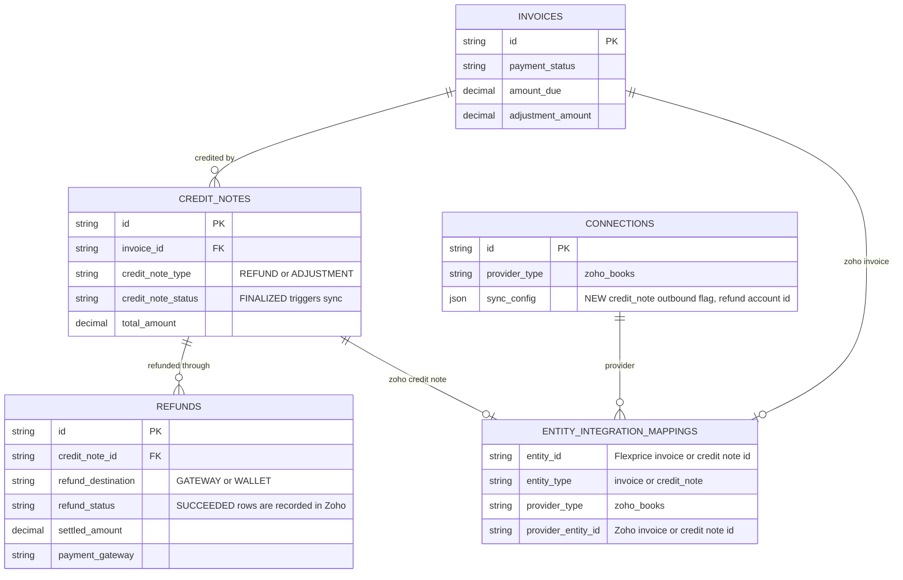
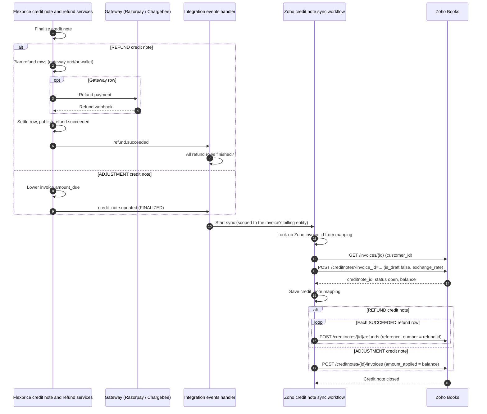
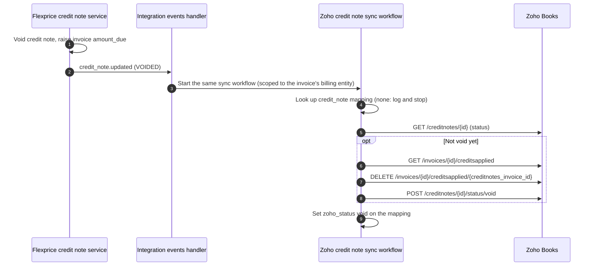

# Zoho Books Credit Note Sync Design

Status: **Proposed**
Date: 2026-11-17
Author: tsage
Ticket: [FLE-1630](https://linear.app/flexprice/issue/FLE-1630/zoho-integration-trace-refund-status-for-credit-notes)

---

## 1. Summary

Flexprice will push every finalized credit note to Zoho Books as an **Open** credit note on the Zoho invoice it
belongs to, and then settle it in Zoho the same way it was settled in Flexprice:

- **Refund credit note** (invoice already paid): once every Flexprice refund for the credit note has finished,
  record one Zoho refund per succeeded refund. This covers refunds back to the gateway and refunds to the
  prepaid wallet.
- **Adjustment credit note** (invoice not paid yet): apply the Zoho credit note to the Zoho invoice, which
  reduces the invoice balance by the same amount Flexprice reduced its amount due.

In both cases the Zoho credit note ends in **Closed** on its own
([Change Status of Credit Note](https://www.zoho.com/us/books/kb/credits/change-status-closed-cn.html)). When
an adjustment credit note is voided in Flexprice after it was synced, its applied credit is removed from the
Zoho invoice and the Zoho credit note is voided. The sync is one-way, Flexprice to Zoho.

## 2. Problem statement

Credit notes are not synced to Zoho Books today. An invoice synced to Zoho keeps showing its original amount
and status after a credit note is issued on it in Flexprice, so:

- For a paid invoice, Zoho never learns that money was returned to the customer. The merchant's books show
  revenue and a bank balance that no longer match.
- For an unpaid invoice, Flexprice lowers the amount due, but the Zoho invoice still shows the full amount.
- The merchant has no way to see in Zoho whether a credit note was refunded.

## 3. ERD and sequence

### 3.1 ERD

No new tables or columns. The Zoho credit note id is stored in the existing mapping table under the existing
`credit_note` entity type. Only the fields the sync reads are shown.

### 3.2 Sequence

### 3.3 Void sequence

## 4. How it works today

### 4.1 Credit notes and refunds in Flexprice

- A credit note is created as `DRAFT` and finalized either in the same call (`process_credit_note`, default
  true) or later with the finalize endpoint.
- The type is chosen from the invoice payment status. A succeeded or partially refunded invoice gets a
  `REFUND` credit note. A pending, processing or failed invoice gets an `ADJUSTMENT` credit note.
- On finalize, a `REFUND` credit note plans refund rows across the invoice's succeeded payments and
  dispatches them. `refund_target` decides where the money goes. `BACK_TO_SOURCE` returns it to the gateway
  (Razorpay or Chargebee) when the payment is gateway refundable. `PREPAID_WALLET`, the default, credits the
  customer's wallet. A failed gateway refund falls back to a new wallet refund row.
- A gateway refund is async. It settles when the gateway webhook arrives. A wallet refund settles at
  dispatch. Both go through `RefundService.Settle`, which publishes `refund.succeeded`.
- On finalize, an `ADJUSTMENT` credit note creates no refund rows. It raises the invoice's
  `adjustment_amount` and lowers `amount_due` and `amount_remaining`. Finalize publishes
  `credit_note.updated` for both types.
- A draft credit note can be voided. A finalized credit note can be voided only when it is an `ADJUSTMENT`
  credit note. A finalized `REFUND` credit note is rejected ("cannot void completed refund"). Voiding a
  finalized credit note recalculates the invoice amounts and publishes `credit_note.updated`.

### 4.2 Zoho Books sync

- Invoices sync to Zoho on `invoice.update.finalized` when invoice outbound sync is enabled. The Zoho invoice
  id is saved in `entity_integration_mappings` (`entity_type = invoice`).
- When an invoice is paid in Flexprice, mark-paid records a Zoho customer payment for the Zoho invoice's
  current balance.
- There is no credit note sync, and no credit note methods on the Zoho client.

## 5. Proposed solution

### 5.1 Zoho APIs

| Step | API | Body |
|---|---|---|
| Create | [`POST /creditnotes`](https://www.zoho.com/books/api/v3/credit-notes/#create-a-credit-note) with query `invoice_id` | `customer_id`, `date`, `is_draft: false`, `exchange_rate`, `reference_number` (Flexprice credit note id), `line_items[]` with `item_id`, `invoice_id`, `quantity`, `rate` |
| Refund (refund credit note) | [`POST /creditnotes/{id}/refunds`](https://www.zoho.com/books/api/v3/credit-notes/#refund-credit-note) | `date`, `refund_mode`, `amount`, `exchange_rate`, `from_account_id`, `reference_number` (Flexprice refund id) |
| Apply (adjustment credit note) | [`POST /creditnotes/{id}/invoices`](https://www.zoho.com/books/api/v3/credit-notes/#credit-to-an-invoice) | `invoices: [{ invoice_id, amount_applied }]` |
| Read status (void) | [`GET /creditnotes/{id}`](https://www.zoho.com/books/api/v3/credit-notes/#get-a-credit-note) | none |
| List applied credits (void) | [`GET /invoices/{id}/creditsapplied`](https://www.zoho.com/books/api/v3/invoices/#list-credits-applied) | none |
| Remove applied credit (void) | [`DELETE /invoices/{id}/creditsapplied/{creditnotes_invoice_id}`](https://www.zoho.com/books/api/v3/invoices/#delete-applied-credit) | none |
| Void | [`POST /creditnotes/{id}/status/void`](https://www.zoho.com/books/api/v3/credit-notes/#void-a-credit-note) | none |

`is_draft: false` creates the credit note as Open. `refund_mode` is a free-text field in Zoho. We send the
gateway name for a gateway refund (for example `razorpay`) and `prepaid_wallet` for a wallet refund.

Zoho requires `exchange_rate` when the credit note's currency differs from the organization's base currency.
The rate is resolved once per sync the same way invoice sync resolves it: 1 for the base currency, otherwise
the rate set in Zoho Settings → Currencies. The credit note and its refunds use the same rate.

### 5.2 Linking to the invoice

The Zoho invoice id comes from the invoice's mapping (`entity_type = invoice`, `entity_id` = Flexprice
invoice id, provider Zoho Books). Each credit note line takes its `item_id` from the price of the invoice
line it credits: credit note line → invoice line → `price_id` → the price's mapping (`entity_type = price`).
Invoice sync already created that item, so a missing mapping for a priced line is an error. An invoice line
without a price (for example on a one-off invoice) was synced without an item, so its credit note line is
sent without `item_id` too, with only its name, quantity and rate. The `customer_id` is read from
the Zoho invoice (`GetInvoice`). `invoice_item_id` is optional in Zoho and is not sent.

If the invoice has no Zoho mapping, it was never synced, and the credit note is skipped.

Invoice sync leaves the Zoho invoice in draft, and Zoho rejects a credit note on a draft invoice (code 12055).
Sending the invoice is the tenant's call, so the sync never marks it as sent. When the Zoho invoice is still
a draft, the sync fails before calling Zoho with an error asking for the invoice to be marked as sent in Zoho
Books.

### 5.3 When each credit note syncs

| Credit note type | Trigger | Zoho calls |
|---|---|---|
| `REFUND` | `refund.succeeded`, and no refund row for the credit note is still `PENDING` or `PROCESSING` | Create, then one refund per `SUCCEEDED` row |
| `ADJUSTMENT` | `credit_note.updated` with status `FINALIZED` | Create, then apply to the invoice |
| Any type, voided | `credit_note.updated` with status `VOIDED` | Remove the applied credit, then void |

Both run in the same sync workflow and activity, which branches on the credit note status. A credit note
voided as a draft was never synced, so it has no mapping and the void stops there.

Waiting for every refund row matters because one credit note can split across several payments, plus a
wallet remainder, and a failed gateway row is replaced by a new wallet row. The credit note is created in Zoho
only once the final refund outcome is known, so Zoho never shows a refund that later fails.

### 5.4 Amounts

- Refund `amount` is the refund row's `settled_amount`.
- Apply `amount_applied` is the Zoho credit note's `balance` returned by the create call, so Zoho's own tax
  and rounding are used.

### 5.5 Retries

- If a credit note mapping (`entity_type = credit_note`) already exists, the credit note was synced and the
  sync is skipped.
- A Zoho rejection is not retried. A network failure is retried by Temporal. If the failure comes after the
  mapping was saved, the retry sees the mapping and skips, so a refund or apply that did not go through must
  be recorded in Zoho by hand.
- A sync for a credit note that is still running makes a later event for the same credit note retry, since
  create and void share one workflow id. A void that arrives while the create is running waits for it.
- A credit note whose sync failed before it reached Zoho (a rejection, or a price not yet synced) can be pushed
  again from its page: `POST /integrations/sync` with `entity_type` `credit_note` starts the same workflow. The
  push is refused, with the reason, for a draft, when credit note or invoice sync is off, when a finalized credit
  note is already mapped, or while a refund credit note still has refunds in progress. A voided credit note can
  be pushed to rerun its void.

### 5.6 Void

Only a finalized `ADJUSTMENT` credit note can be voided, and it was applied to its invoice when it synced. So
voiding in Zoho removes that applied credit and voids the credit note. A refund never has to be deleted.

1. Read the credit note mapping. If there is none (a draft void, sync turned on after the credit note was
   created, the invoice was never synced, or Zoho rejected the create), log and stop.
2. Read the Zoho credit note. If it is already void, skip to step 5. This is what a retry after a successful
   void sees.
3. List the credits applied to the Zoho invoice and delete the one whose `creditnote_id` is ours. The delete
   takes `creditnotes_invoice_id`, the id of the application, which only this list returns.
4. Void the Zoho credit note.
5. Set `zoho_status` to `void` in the mapping's `metadata`, only after Zoho accepted the void.

Flexprice raises the invoice's `amount_due` back when the credit note is voided, and removing the applied
credit raises the Zoho invoice balance by the same amount, so the two stay in step.

### 5.7 Configuration and scope

- A new `credit_note` entry in the connection `sync_config` (`Outbound` only) turns the feature on. It
  requires invoice outbound sync, since a credit note needs a synced invoice. `sync_config` is JSON, so no
  migration is needed.
- `from_account_id` is the existing `deposit_to_account_id` setting, the Zoho ledger account invoice
  payments are recorded into by mark-paid. The refund comes out of the same ledger the payment went into.
  It must be a Bank or Cash account. When it is empty, `from_account_id` is omitted and Zoho rejects the
  refund (code 11016, "Involved account types are not applicable"). It is used for both gateway and wallet
  refunds.
- Credit note sync requires `submit_for_approval` to be off, so the credit note is created Open and can be
  refunded or applied right away. Approvals must also be off in the Zoho org for credit notes.
- The sync scopes the context with `BillingEntityService.ScopeToInvoice` before it reads the connection, so
  it uses the connection of the invoice's billing entity.

## 6. How the books stay balanced

Zoho keeps what a customer owes, and what is owed to them, in **Accounts Receivable** for that customer. A
credit note credits Receivable, which makes the customer's balance negative, meaning the merchant owes the
customer that amount. A refund or an applied credit brings it back to zero.

### 6.1 Refund credit note, invoice ₹100 paid

| Step | Debit | Credit | Customer balance | Zoho status |
|---|---|---|---|---|
| Invoice synced | Receivable 100 | Sales 100 | +100 | Invoice open |
| Invoice paid (mark-paid) | Bank 100 | Receivable 100 | 0 | Invoice paid |
| Credit note created | Sales 100 (and tax, if any) | Receivable 100 | −100 | Credit note Open, balance 100 |
| Refund recorded | Receivable 100 | Bank 100 | 0 | Credit note Closed, balance 0 |

- **Gateway refund.** The money goes back to the customer's payment method. The Zoho refund is recorded once
  the gateway confirms it.
- **Wallet refund.** The money is credited to the customer's prepaid wallet in Flexprice, which future
  invoices draw from. The wallet exists only in Flexprice, so nothing about the wallet is sent to Zoho. The
  Zoho refund is recorded as soon as the wallet is credited, stating that the amount was returned to the
  customer.
- In both cases the customer gets the amount back once, and Zoho shows it returned once, so there is no
  double credit.

### 6.2 Adjustment credit note, invoice ₹200 unpaid, credit note ₹100

| Step | Debit | Credit | Zoho invoice balance | Zoho status |
|---|---|---|---|---|
| Invoice synced | Receivable 200 | Sales 200 | 200 | Invoice open |
| Credit note created | Sales 100 (and tax, if any) | Receivable 100 | 200 | Credit note Open, balance 100 |
| Credit applied to invoice | none, the credit moves from the credit note to the invoice | | 100 | Credit note Closed |
| Invoice paid in Flexprice (mark-paid) | Bank 100 | Receivable 100 | 0 | Invoice paid |

Flexprice and Zoho agree at every step. Flexprice shows `amount_due = 100`, and Zoho shows an invoice balance
of 100, so mark-paid records exactly the 100 that was paid.

## 7. Testing scenarios

All scenarios start with a ₹200 invoice synced to Zoho and a ₹100 credit note on it.

1. **Invoice not paid.** The credit note is an `ADJUSTMENT` credit note, and finalizing it lowers the
   invoice's amount due to ₹100 in Flexprice. Zoho gets an Open credit note on the invoice, which is then
   applied to the invoice. The Zoho invoice is untouched apart from the applied credit, its balance is ₹100,
   and the credit note is Closed. When the invoice is paid in Flexprice, mark-paid records ₹100 and the Zoho
   invoice is Paid.
2. **Invoice paid, refund to the prepaid wallet.** The credit note is a `REFUND` credit note with
   `PREPAID_WALLET`. Finalizing it credits ₹100 to the customer's Flexprice wallet. Right after, Zoho gets an
   Open credit note on the invoice and a ₹100 refund with the Flexprice refund id as `reference_number`. The
   credit note is Closed and the customer's Zoho balance is zero.
3. **Invoice paid, refund back to the gateway.** The credit note is a `REFUND` credit note with
   `BACK_TO_SOURCE` on a Razorpay-paid invoice. Nothing reaches Zoho until the Razorpay refund webhook
   confirms the refund. Then Zoho gets an Open credit note on the invoice and a ₹100 refund with the Flexprice
   refund id as `reference_number`. The credit note is Closed and the customer's Zoho balance is zero.
4. **Adjustment credit note voided.** Scenario 1 runs, then the credit note is voided in Flexprice and the
   invoice's amount due goes back to ₹200. The applied credit is removed from the Zoho invoice, whose balance
   goes back to ₹200, and the Zoho credit note is Void. The credit note mapping shows `zoho_status: void`.

## 8. References

- Zoho Books API, Credit Notes: [create](https://www.zoho.com/books/api/v3/credit-notes/#create-a-credit-note),
  [credit to an invoice](https://www.zoho.com/books/api/v3/credit-notes/#credit-to-an-invoice),
  [refund credit note](https://www.zoho.com/books/api/v3/credit-notes/#refund-credit-note),
  [void a credit note](https://www.zoho.com/books/api/v3/credit-notes/#void-a-credit-note)
- Zoho Books API, Invoices: [delete applied credit](https://www.zoho.com/books/api/v3/invoices/#delete-applied-credit)
- Zoho Books help: [Apply Credits to Invoices](https://www.zoho.com/in/books/help/credit-note/apply-credits.html),
  [Refund Credits](https://www.zoho.com/in/books/help/credit-note/refund-credits.html),
  [Change Status of Credit Note](https://www.zoho.com/us/books/kb/credits/change-status-closed-cn.html)
