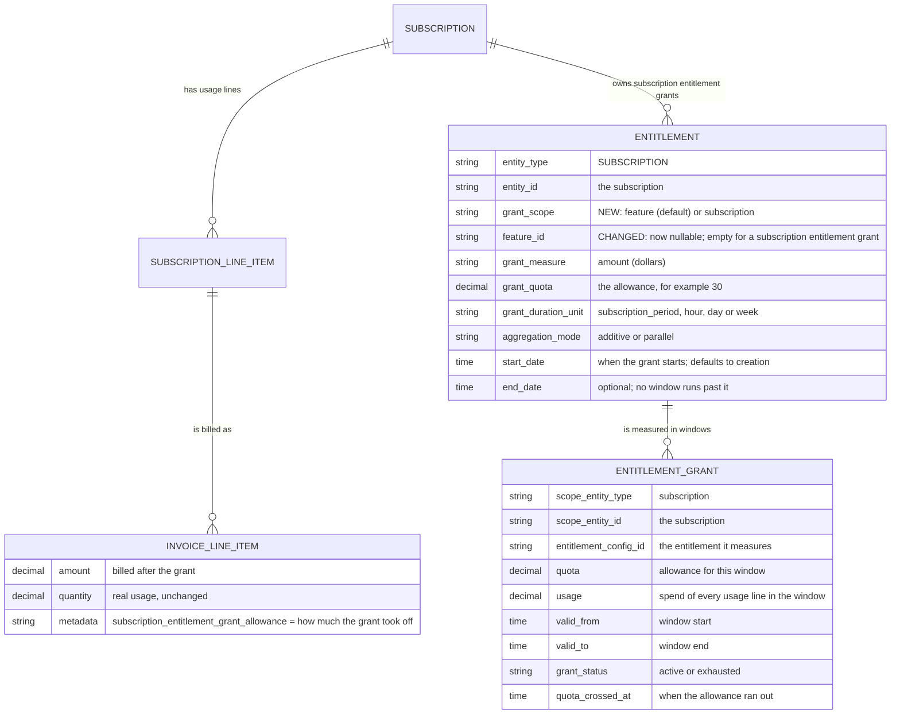
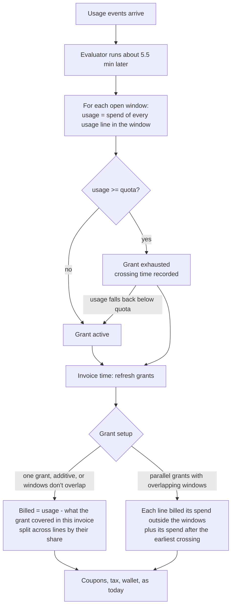

# Subscription entitlement grants

Status: Backend implemented in #3230 (windows and evaluation) and #3236 (billing, create, guards, API). Decisions agreed 2026-10-25, updated 2026-10-27 after review.
Issue: [FLE-1449](https://linear.app/flexprice/issue/FLE-1449/subscription-scoped-entitlement-grants)

## 1. What we are building

A **subscription entitlement grant** is a dollar allowance shared by every usage line on one subscription.

Example: "$30 of free usage per month across all features." If the customer spends $50 on usage, $30 is free and $20 is charged.

Today every grant belongs to one feature. A subscription entitlement grant has no feature: it is an entitlement with `entity_type = SUBSCRIPTION`, `grant_scope = subscription` and no `feature_id`. Its windows are stored with `scope_entity_type = subscription`.

## 2. Data model

Only the highlighted fields are new or changed; everything else already exists.

How to read it: a subscription entitlement grant is one `ENTITLEMENT` row on the subscription. The evaluator opens `ENTITLEMENT_GRANT` windows for it and keeps each window's `usage` up to date. At invoice time each usage `INVOICE_LINE_ITEM` is lowered by its share of what the grant covered.

## 3. How it works

Worked example: a $30 monthly grant. Feature X spends $70 and feature Y spends $50, so $120 in total.

- Billed = $120 - $30 = $90.
- Split by share: X is charged $70 - $17.50 = **$52.50**, Y is charged $50 - $12.50 = **$37.50**.
- The reduction is applied on each line, the same way feature grants work today. There is no separate credit line.

## 4. Rules

**Setup**

- Dollars only (`measure = amount`), in the subscription's currency.
- Created only on a subscription, never on a plan or addon.
- A subscription can have several subscription entitlement grants:
  - **Additive**: quotas add up into one allowance ($100 + $50 = $150). They must have the same window length.
  - **Parallel**: each grant is its own limit on the same spend, for example $10/day and $200/month.
  - Additive and parallel cannot be mixed on one subscription.
- A quota is required. Unlimited subscription entitlement grants are refused.
- **Dates**: a grant starts when it is created unless `start_date` is sent; `end_date` is optional and no window runs past it. A grant created with `POST /subscriptions` starts with the subscription.

**Windows**

- Monthly (`subscription_period`), or hour, day, or week. An hour, day, or week window must be shorter than the billing period; otherwise use `subscription_period`.
- Hour, day, and week windows can start at a fixed boundary (`unit_start`) or at first usage (`first_usage`). First usage means the first event on any of the subscription's meters, whatever its price, matching feature grants today.
- An inherited subscription is measured on its parent's usage lines, as its billing is.

**One grant per charge**

- A subscription has **either** feature usage allowances **or** subscription entitlement grants, never both.
- A feature usage allowance is any metered feature entitlement that makes usage free: a feature grant (limited or unlimited) or a legacy `usage_limit`. On/off features ("SSO enabled") and fixed values ("5 seats") are allowed alongside subscription entitlement grants.

**Billing**

- The grant only takes off what it covered **inside the invoice period**: billed = usage - (allowance used by the end of the invoice - allowance used by its start).
  - Spend before a grant starts or after its `end_date` stays billed. Example: $30 grant created Oct 20; $50 spent Oct 1-19 and $40 Oct 20-31 → $60 billed.
  - Auto-invoice threshold invoices stay correct. Example: $50 grant, $15 threshold: invoice 1 at $65 spent bills $15; invoice 2 at $80 bills the next $15.
- The amount is split across usage lines by their share, in whole cents (largest remainder): no line goes below zero or above its own amount, and the parts add up exactly.
- Crossing times are when the evaluator noticed, not the exact event. Spend between the real crossing and the evaluation is free, as it is for feature grants today.
- If a subscription reaches billing in a setup the grant cannot cover (see section 5), the grant is skipped for that period, every line is billed in full, and an error is logged.

**Changes during a period**

- **Quota edit**: only `grant_quota` can change; delete and recreate the grant to change anything else. Usage is measured up to the edit, the current window closes, and a new one opens with what was left plus the change. Example: $30 → $50 with $20 used leaves $30. Concurrent edits are serialised, so the change is never applied twice.
- **Delete**: a parallel grant's window ends. An additive pool continues for the other grants, less the deleted quota. The last grant's window ends. Allowance already granted is never taken back.
- **Plan change (v1, `/change/execute`)**: v1 creates a new subscription. The grant ends with the old one and is not copied over; re-create it on the new subscription if wanted.
- **Plan change (v2, `/change/v2/execute`)**: the plan is swapped on the same subscription, so the grant stays and its current window continues. Spend on old and new plan lines in the window draws from the same quota. The target plan is checked like any other change (section 5). A billing period reset (`billing_period_behaviour = anchor_at_effect`) is refused while the subscription has a subscription entitlement grant; a change at period end is allowed, since the anchor does not move.
- **Addon attach or detach**: the subscription entitlement grant stays. Only the usage lines feeding it change.
- **Line added, removed, or repriced**: applies from its effective date. Usage before the change keeps the old line and price. Closed windows are never recalculated. A backdated change does alter the open window.

**Usage going down** (from FLE-1510)

- If usage falls back below quota, the grant becomes active again, the crossing time is cleared, and a recovery alert state is recorded. A later exhaustion records a new crossing.
- Grant usage and overage never go below zero.
- Closed windows stay final. A late event dated inside a closed window is not counted, as today.

**Entitlement alerts**

- Creating a **subscription entitlement grant** is refused when entitlement alerts are off, in either the deployment config (`usage_alerts.entitlement_alerts_enabled`) or the environment setting (`entitlement_alert_config`): "Contact Flexprice support to enable this feature."
- Feature grants are not affected. Alerts are off by default and every new metered entitlement becomes a grant, so refusing them would block ordinary plan setup; their usage is still refreshed before every invoice.
- If the refresh at invoice time fails, the invoice is not created, so it never bills from stale grant usage. It is retried on the next billing run.

## 5. What gets refused

| Request | Why |
|---|---|
| Subscription entitlement grant on a plan or addon | Only subscriptions can own one |
| Subscription entitlement grant measured in quantity | Calls and GB cannot be added together |
| Subscription entitlement grant without a quota (unlimited) | Not supported in this release |
| Hour, day, or week window as long as the billing period or longer | Use `subscription_period` |
| Mixing additive and parallel subscription entitlement grants, or additive grants with different windows | One mode and one window per subscription |
| Subscription entitlement grant on a subscription with a feature usage allowance | One grant per charge |
| Anything that adds a feature usage allowance to a subscription with a subscription entitlement grant: direct or bulk create, update, addon attach, plan or addon entitlement | One grant per charge |
| Subscription entitlement grant on a subscription with a minimum spend or an active commitment | The minimum is computed before grants, so it would be wrong |
| A commitment on a subscription with a subscription entitlement grant; `POST /subscriptions` with both | Same, the other way round |
| Subscription entitlement grant while any usage line is incompatible | Coverage would silently not apply |
| Anything that adds an incompatible usage line to a subscription with a subscription entitlement grant: line add or update (including lines dated in a later period), addon attach, a plan or addon usage price that reaches it | Same |
| v2 plan change whose target plan brings an incompatible usage line or a feature usage allowance | Same |
| v2 plan change with an immediate billing period reset (`anchor_at_effect`) | It would cut the grant's window short; see section 9 |
| Subscription entitlement grant in bulk create | Create each one with `POST /entitlements` |
| Changing anything but `grant_quota` on a subscription entitlement grant | Delete and recreate instead |
| Subscription entitlement grant when entitlement alerts are off | Usage would not be evaluated |

Incompatible usage lines: a meter that is not SUM, COUNT, or SUM with multiplier; a bucketed meter; a SUM meter that never resets (`reset_usage = NEVER`); a tiered price; a line commitment; true-up; a usage line billed at a different cadence than the subscription (for example a monthly price on a quarterly subscription).

A plan price on another billing period or currency never reaches the subscription, so it is not refused.

## 6. API

- **Create** on an existing subscription: `POST /entitlements` with `entity_type = SUBSCRIPTION`, `entity_id = <subscription id>`, the grant fields, and no `feature_id`. Optional `start_date` and `end_date`.
- **Create with a subscription**: `subscription_entitlement_grants` on `POST /subscriptions`, separate from `override_entitlements` (those override plan features). Each item takes `grant_quota`, `grant_duration_unit`, optional `grant_duration_value`, `grant_allocation_behavior`, `aggregation_mode`, `start_date` and `end_date`. The subscription and its grants are saved together; if any grant is refused, the whole request fails and nothing is created.
- **Edit and delete**: `PUT` (only `grant_quota`) and `DELETE /entitlements/:id`. `PUT /subscriptions/:id` does not change grants.
- **Read**: `GET /subscriptions/:id/entitlements` returns a `subscription_entitlement_grants` section, separate from `features`: the grants and their windows (quota, usage, remaining, window, status, last calculated). `GET /entitlements?grant_scopes=subscription` lists them. Subscription entitlement grants never appear as an empty feature in feature-based responses.
- **Webhooks**: `entitlement.created`, `updated` and `deleted` are sent for subscription entitlement grants, after the surrounding transaction commits. Grant-exhausted alerts identify the grant by grant, entitlement and subscription ID.

## 7. Not in this release

- Feature grant and subscription entitlement grant on the same subscription (stacking)
- Unlimited subscription entitlement grants
- Subscription entitlement grants on plans or addons (templates), or on a chosen group of features
- Quantity-based subscription entitlement grants, rollover
- Tiered, bucketed, never-resetting SUM, commitment, or true-up lines
- Usage lines billed at a different cadence than the subscription
- Subscriptions with a minimum spend or a commitment
- Carrying a grant over a v1 plan change (it creates a new subscription)
- Billing period reset on a v2 plan change

The UI is part of Phase 1. It is built after the backend is done, in a separate frontend change.

## 8. Known limitations

- A first-usage hour, day, or week window can open on an event from a usage line that already ended earlier in the cycle; that event is then not counted in the window's spend.
- Feature grants (separate from this work): usage outside a feature grant's window is not billed (FLE-1830), and grant overage on a meter with several cadence windows is billed once per window (FLE-1819).

## 9. Phase 2 and tech debt

- **Stacking.** Allow a feature grant and a subscription entitlement grant on the same feature: the feature grant first, then the subscription entitlement grant covers the feature's spend after its crossing. Known issues to solve first:
  - Calculate the subscription entitlement grant's share from events each time and overwrite it. Do not add up changes, which double-count on retries.
  - The crossing time is when it was noticed, not when it happened.
  - Feature windows reset, so only count spend between the feature crossing and the end of that feature window.
- **Exact crossing time.** Find the real crossing from event times instead of the evaluation time. This removes the free spend between the crossing and the evaluation.
- **Never-resetting SUM meters.** Define what a dollar grant means for a running balance (FLE-1510 Phase 2).
- **Alerts turned off later.** Refuse turning entitlement alerts off while subscription entitlement grants exist.
- **Late events for closed windows.** Recount or adjust when an event arrives for a window that is already closed.
- **More pricing.** Support tiered prices, bucketed meters, commitments, and true-up.
- **Query load.** Hourly parallel grants check up to about 720 overage intervals per meter at invoice time. Optimize if customers use them.
- **Minimum spend with subscription entitlement grants.** Count the minimum after the grant ($100 minimum, $120 usage, $30 grant: bill $90, top up to $100). Build on commitments v2 (FLE-1513): it prices commitments from per-line costs we pass in, so post-grant costs can be fed to it. Also decide how grants interact with the overage factor.
- **Wider product scope.** Unlimited subscription entitlement grants, plan or addon templates, feature groups, carrying grants over a v1 plan change.
- **Billing period reset on plan change (open decision).** Proposed rule for `anchor_at_effect`:
  - Only `subscription_period` windows are re-cut. Hour, day and week windows do not follow the anchor and continue.
  - Measure usage up to the change, then close the current window at the change. Do not prorate it: it already covered real usage, and the outgoing-period invoice bills against it.
  - Open a new window from the change to the new period end, with the full quota. It follows the grant's dates as at any period start: cut at `end_date` if that is inside the new period, none if the grant ended before the change, and none until `start_date` if that is later.
  - Additive: one pool window closes and one reopens. Parallel: each grant's window does.
  - Trade-off: the customer gets more than one period's quota across the reset (Oct 1–15 plus a full Oct 15–Nov 15), as the reset gives a full new period. If that is too generous, prorate the new window, never the old one.
  - Reuse `reissueSubscriptionEntitlementGrantWindows`, as for a quota edit. Feature grants should follow the same rule; check what they do on a reset today first.

## 10. Acceptance criteria

| Scenario | Result |
|---|---|
| Subscription entitlement grant in dollars, additive or parallel | Accepted; returned without a feature |
| Any request in section 5 | Refused with a clear error |
| Subscription created with a grant that is refused | Whole request fails; no subscription is created |
| $30 grant, $50 spend on one line | $20 charged once |
| $30 grant, X $70 and Y $50 | X $52.50, Y $37.50 |
| $30 grant created mid-period, $50 spent before it and $40 after | $60 charged |
| $50 monthly grant, $15 auto-invoice threshold, $100 spent | Invoices of $16, $16, $18 (the test's spend steps); total $50 |
| Two parallel grants exhausted at once | Same spend never charged twice |
| Additive grants $100 + $50 | One $150 allowance; usage counted once |
| Quota edit mid-period | Usage measured up to the edit carries over; no fresh allowance |
| Delete, plan change, addon change | Behaves as in section 4 |
| Line repriced mid-period | Old price before the change, new price after |
| Usage falls below quota | Grant active again; later exhaustion records a new crossing |
| Duplicate events or retried evaluation | Usage and charges unchanged |
| Preview, invoice, and usage reads at the same time | Same numbers |
| Several subscriptions, tenants, or environments | No shared usage between them |
| Subscription without a subscription entitlement grant | Billing unchanged |
