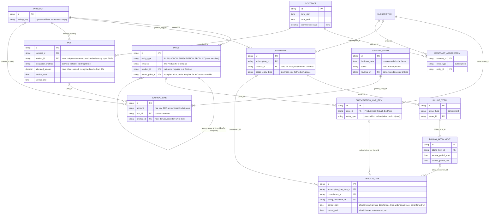

## Products

- Can map to one ERP item per integration. Use Product-level accounting defaults where configured and fall back to global account defaults.
- Can contain multiple SKUs (Prices).
- Ship in the product catalog for every tenant. `lookup_key` is generated from the name when left empty.
- Prices created on a Product are **template prices** (`entity_type=PRODUCT`). They have no scope and are never billed directly.
- Adding a Product to a Plan or Add-on creates prices there from the selected templates, linked to the Product by `product_id`. Copies keep no link to their template and do not follow its edits.
- Adding a Product to a Contract puts its template prices on the Contract's Subscription directly. A negotiated change becomes a Subscription override of the template (`parent_price_id` = template), so other Contracts still see only the template. The Product page lists templates and, separately, their overrides with the Contract each belongs to.
- Deleting a Product also deletes its template prices that no subscription uses. It is blocked while any Plan, Add-on or Subscription price names the Product.
- **Schema:** `PRICE_ENTITY_TYPE_PRODUCT` only; no new columns. Plan and add-on price lists exclude template prices.
- The ERP item and Product account overrides ship with ERP posting (revenue recognition phase 2), not with the catalog release.

## Prices

- Can be fixed fees, either one-time or recurring.
- Can be metered, with charges calculated from recorded usage and the configured pricing model.
- Every Price included in a Contract must belong to a Product. Customer-specific overrides inherit the original Price’s Product.
- Outside Contracts, `product_id` stays optional. The price form gets a Product field.
- A Price's Product is set once and never changes. An existing Plan or Add-on price can be given a Product while it has none.
- A single Price never bundles several Products. One charge funding several Products is handled by Contract allocation.
- **Schema:** none. `prices.product_id` exists; subscription overrides and price versions already copy it.
- **Open:** what a Price with no Product posts to outside a Contract (likely the global account defaults).

## Plans and Add-ons

- Bundle selected Prices and Entitlements. They can span multiple Products through the Prices they include.
- A Plan provides the base package. Add-ons extend it with additional Prices or Entitlements.
- Adding a Product shows its template prices to select from, with select-all. The same Product can be added again to bring in more of its templates.
- Plans and Add-ons don't track template changes; existing copies stay as they are.
- A Product brings prices only, not Entitlements, for now.
- **Schema:** none.
- Resolve the final set of charges before creating Subscription Line Items. A negotiated fee per Product can replace its default fixed charges, while a Product can bring in thousands of selected usage SKUs in one action.

## Standalone Subscriptions

- Are built from a base Plan, with optional Add-ons. They can be open-ended or have an end date.
- Can cover multiple Products through Subscription Line Items and Commitments. Each line item inherits its Product from its Price, and billable invoice lines carry Product attribution.
- Have no explicit POBs. In v1, recognise revenue from **finalised invoice lines only**, using the net amount, service period, and applicable recognition rule. Recurring access can earn ratably. One-time charges and metered usage follow their own rules.
- A Commitment's Billing Term instalment is recognised ratably over its service period, following the invoice.
- Arrears billing recognises the elapsed periods in full at finalisation (catch-up).
- A credit note reduces deferred revenue first, then recognised.
- Every invoice line has a service period: a window for recurring fixed and usage lines, a single day (the invoice date) for one-time and manual lines. Each line is recognised ratably over it.
- Invoice-level discounts are spread across lines pro rata to their net amounts, so each Product's revenue is net of its share.
- A line item reads its Product through its Price; invoice lines derive it too (Commitment lines and instalments → Commitment, other lines → Price). No `product_id` snapshot on invoice lines.
- No contract or POBs are created for a standalone Subscription, and nothing accrues as unbilled before invoicing.
- Enabled by the existing tenant × environment revenue recognition switch.
- Revenue posts to the default accounts from the day revenue recognition is on, with or without Products.
- A customer-triggered reprocess re-derives draft and preview JEs' Product and accounts after Products, Price Products or account mappings change. Posted JEs are corrected by a reversal plus a new entry dated today.
- **Schema:** `journal_lines.product_id` (planned in revenue recognition phase 2), set by posting and by reprocessing while the entry is a draft.
- Create JEs for billing events and separate JEs for revenue recognition. The standalone model does not accrue revenue before invoicing.
- **Future extension:** Recognise prepaid Commitment revenue from actual drawdowns independently of invoicing.

## Commitments and Billing Terms

- A Commitment belongs to one Product. Inside a Contract, its scope must contain only that Product's prices, checked when the Contract creates or amends it. On a standalone Subscription, the scope is unchanged and may include other Products' prices.
- `commitments.product_id` is optional, set once, and required inside a Contract.
- The Commitment's committed and overage prices carry its Product.
- A drawdown records the **consuming price** and the **funding Commitment**: today's utilized invoice lines carry both (`price_id` through the line item, `commitment_id`). Linking Commitments to entitlement grants is deferred.
- Invoice lines derive their Product: lines with a `commitment_id` (utilized, true-up) and instalments take the Commitment's Product; other lines, overage included, take their price's Product.
- **Schema:** `commitments.product_id`. No change to Billing Terms or instalments.
- Keep Billing Terms on Commitments for v1. Use fixed Prices for ordinary fixed fees and derive the term value from the actual billing schedule, including cadence, dates, and proration.
- **Future extension:** Support custom billing schedules for fixed subscription charges or whole Contracts when the normal Price cadence can’t express the negotiated instalments.

## Promises (POBs)

- Track fulfillment of distinct promises under a Contract. For v1, use **one POB per Product × recognition method** within the Contract, with a stable `pob_id`. Service dates determine the recognition schedule.
- Store the **fixed allocated amount** separately from billed, earned, and recognised amounts. **Billed** comes from finalised invoices and adjustments. **Earned** comes from schedules or fulfillment. **Recognised** comes from posted JEs.
- Keep a zero-allocated POB when a distinct promise needs fulfillment tracking. A $0 sale price can still receive an SSP allocation. A variable-only POB can start without a fixed allocation and earn revenue later.
- A POB can receive fixed and variable consideration for the same promise. Bank drawdowns release up to the bank’s fixed allocation. Overage follows its own approved rule and can add revenue above that fixed amount.
- Store service dates for time-based recognition and a fulfillment source for consumption-based or point-in-time recognition. Revenue JE lines carry the POB and Product IDs.
- Each POB has one Product (`performance_obligations.product_id`), unique per (Contract, Product, recognition method) among open POBs. Bundles are several POBs joined by allocation, never one POB over several Products. `performance_obligation_associations` is dropped.
- Only `allocated_amount` is stored. Billed, earned and recognised are derived from JEs: recognised = posted revenue; earned = recognised + draft and preview revenue.
- The allocation caps fixed consideration only. Overage and usage are variable, outside the allocation, so recognised can exceed allocated. Fixed vs variable is derived from the source line (instalment, true-up, fixed price = fixed; overage, usage = variable).
- The recognition method is derived by default and editable in the UI. v1 ships straight line only.
- **Edits:** Product never; recognition method until a JE on the POB is posted; service dates only after the last posted JE, following the Subscription; allocated amount (and reallocation between POBs) until a JE on the POB is posted, never on a variable-only POB. Draft and preview JEs are recalculated; posted ones are corrected by a reversal plus a new entry dated today. The next offset re-nets each POB's billed against its new earned, so no JE moves deferred revenue between POBs.
- A credit note doesn't change the POB. Its contra revenue is spread across POBs by the original allocation, in the month it is issued.
- **Schema:** `performance_obligations.product_id`, `allocated_amount`; drop `performance_obligation_associations`.
- **Future extension:** Support multiple effective-dated revenue schedules under one POB. Each schedule can have its own amount, service window, and recognition rule. Amendments preserve previously posted history and apply the approved treatment from the effective date. A separately accounted promise can have its own POB even when Product and recognition method match.

## Contracts

- Have a start and end date. They can include Plans, Add-ons, Products, and individual Charges. Record the selected Prices, Entitlements, and negotiated overrides for the term.
- Configure one or more linked Subscriptions for billing and provisioning. Default to one Subscription. Use multiple when deployments, billing, or provisioning need independent lifecycles.
- A linked Subscription has an end date. At renewal it links to the new Contract.
- The linked Subscriptions' line items and Commitments are the record of what was sold. The Contract holds its header (dates, commercial value) and the POB allocations; the allocation pool is their sum, not stored.
- Own the POBs that track the Contract’s fulfillment and revenue.
- Track **commercial contract value** separately from the **amount subject to allocation**. Approved POB allocations must sum to the pool being allocated. Future pass-through charges may cause the two totals to differ, depending on their accounting treatment.
- In v1, apply automatic relative SSP allocation to the **fixed consideration pool**, or accept an approved manual allocation. For two distinct promises with equal SSPs, **$10/$0 billed** can become **$5/$5 allocated**. Each POB earns its own $5 according to its recognition rule.
- Billing events resolve to the Contract through the Subscription for the relevant service period. Direct charges route to POBs through Product and source lineage. Every invoice line credits exactly one POB; a single Price never bundles Products, so no line is split.
- Amendments can modify or add a Subscription, add a POB for a new promise, or change the remaining allocation or schedule of an existing POB. Billing-only changes affect the invoice schedule. Record amendments with effective dates and preserve the posted history.
- A credit note does not change the allocation in v1.
- **Building a Contract** can combine: Products (their template prices), Plans and Add-ons, direct charges (Subscription-scoped prices that must name a Product), and a Product created inline with its charges.
- Every Plan or Add-on price added to a Contract must have a Product; one without blocks the add.
- A Product created inline in a Contract is a normal catalog Product; its charges are reusable template prices.
- Template edits apply to new Contracts only; signed Contracts keep the prices they were built with.
- Contract Subscription line items can source from a Product (new `SubscriptionLineItemEntityType` `product`), separate from the price's `PRICE_ENTITY_TYPE_PRODUCT` owner.
- **Allocation pool:** each POB's fixed consideration over the Contract term (fixed prices across their billing periods with proration, one-time charges, prepaid Commitment values). Without SSPs, each POB is allocated its own fixed value. With SSPs, the pool is reallocated across POBs by relative SSP. An approved manual allocation can replace either.
- SSPs, when given, are inputs to the allocation and not stored; `allocated_amount` keeps the result.
- **Earning** comes from each POB's schedule from the Contract start, not from invoices. Invoices only set billed; the offset nets billed against earned per POB into deferred or unbilled.
  - Straight line (v1): allocated × elapsed days ÷ service days, prorated by day.
  - Point in time (later): the full allocation on the fulfillment date (the one-time line's service date).
  - Straight line also covers one-time charges (a one-day service period) and prepaid Commitments (allocated over the Commitment term) in v1.
  - Usage, overage and postpaid minimum true-ups (v1): earned as billed, ratably over each finalised invoice line's service period, so billed equals earned on these POBs.
  - Point in time (later): the full allocation on the fulfillment date.
  - As consumed, usage (later): usage value as it occurs, from metering, before it is invoiced.
  - As consumed, prepaid Commitment (later): drawdown value scaled by allocated ÷ Commitment value, capped at the allocation; the remainder is breakage at expiry; overage above it earns uncapped.
- **Amendments:** a new Product or recognition method adds a POB; otherwise the existing POB's allocation is updated (and, with SSPs, every POB is reallocated). The future revenue schedule follows from the effective date. Prospective (default): the remaining unrecognised amount spreads over the remaining service period. Retrospective: every draft and preview JE is recalculated as if the new allocation had applied from the start; posted JEs are corrected by a reversal plus a new entry dated today.
- A postpaid Commitment minimum is variable consideration, earned as consumed (usage and true-up alike). It is not in the allocation pool.

## Journal Entries (JEs)

- Posted for both standalone and contract-based subscriptions. Each JE balances debits and credits, updates ledger account balances, and can be exported to the ERP.
- JE lines can carry a **Product ID** and, for contract-based revenue, a **POB ID**. Attribution is at the line level so one invoice can fund several Products or POBs.
- Billing events such as invoice finalisation, voids, credit notes, payments, and refunds trigger their own JEs.
- Revenue recognition and offset JEs are created as soon as they are known, dated to the period end, so the coming entries are visible.
- **States:** **preview** (business date in the future; rewritten or deleted, e.g. an offset no longer needed), **draft** (date passed, not pushed; every JE type can be reprocessed), **posted** (pushed to the ERP; immutable). Preview is derived from `business_date > today`, so the stored statuses are draft and posted.
- A JE is pushed only once its business date has passed. Previews never reach the ERP.
- Updating a posted JE is shown as an update in the UI and recorded as a reversal plus a new entry dated today, keeping the ERP in agreement and the audit trail intact.
- No accounting period close for now. When it ships, a finalised state sits between draft and posted.
- Retrying a workflow must preserve a single posting for each event.
## ERD

Only the entities these decisions touch, with the fields that link them. `new` marks a schema change; everything else exists today.

- Dropped: `performance_obligation_associations`.
- Invoice lines carry no Product; it derives from the line item's Price, or from the Commitment for commitment lines and instalments.
